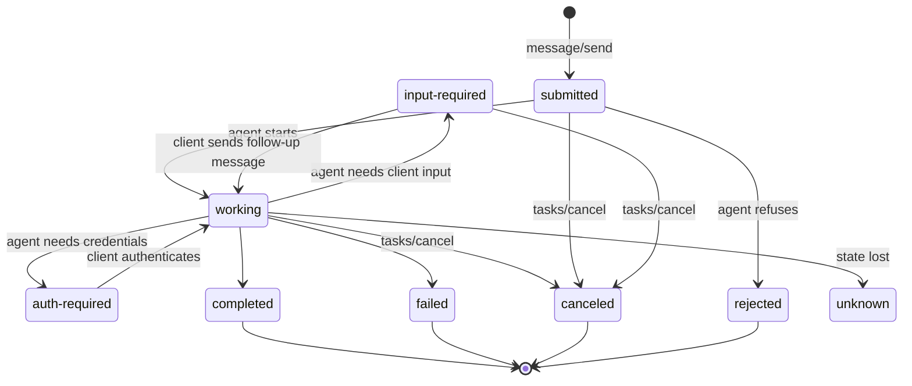
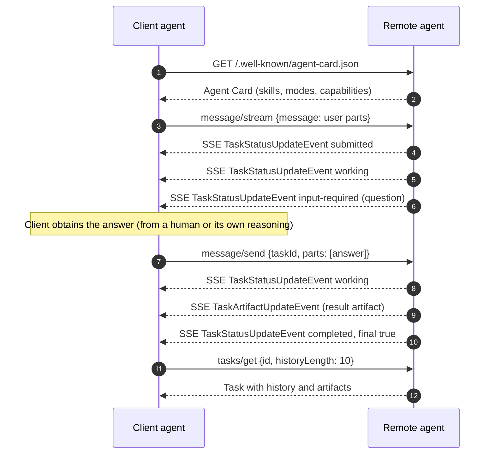

# The Agent2Agent (A2A) protocol

This is an explainer of the A2A protocol and of how Inkuna uses its data model. Inkuna follows the A2A 0.3 object model **in process**: the bus in `internal/a2a` brokers between agents that are headless CLIs. Inkuna does **not** currently serve A2A over HTTP; the last section lists what a network endpoint would add.

## What problem A2A solves

Agents built by different teams, on different frameworks, need a common way to delegate work to one another without sharing internal state, prompts, or tools. A2A (originally published by Google, now a Linux Foundation project) defines:

- how an agent **advertises** what it can do (the Agent Card),
- how a client **sends work** and receives results (Tasks and Messages),
- how long-running work is **observed** (streaming and push notifications), and
- how an agent can **pause** to ask for more input.

### A2A versus MCP

| | Model Context Protocol (MCP) | Agent2Agent (A2A) |
| --- | --- | --- |
| Relationship | A model calls **tools** exposed by a server | A client agent delegates to a **peer** agent |
| Unit of work | A synchronous tool call with a typed result | A Task with a lifecycle that may take minutes or days |
| Who reasons | The caller; the tool is deterministic | Both sides; the remote agent plans and acts on its own |
| Interruption | Not modelled | `input-required` state pauses the task until the client replies |
| Discovery | Server lists tools and resources | Agent Card lists skills, modes, and capabilities |

The two are complementary: an A2A agent often uses MCP tools internally. In Inkuna, workers start only the MCP servers their step is granted ([architecture.md](architecture.md#mcp-servers-a-step-is-granted)), and those their runtime's `runtimes.<name>.userMcp` names from the user's own setup, whether or not `userConfig` is on ([configuration.md](configuration.md#your-own-mcp-servers)). Workers communicate with other agents only through the A2A bus and the filesystem of their worktree.

## Core objects

### Agent Card

A JSON document describing one agent. In network A2A it is served at `/.well-known/agent-card.json`.

| Field | Meaning |
| --- | --- |
| `name`, `description`, `version` | Identity |
| `url` | Where to send JSON-RPC requests |
| `protocolVersion` | A2A version the agent speaks (`0.3.0` in Inkuna) |
| `provider` | Organization behind the agent |
| `capabilities` | `streaming`, `pushNotifications`, `stateTransitionHistory` |
| `defaultInputModes`, `defaultOutputModes` | Media types accepted and produced |
| `skills[]` | `id`, `name`, `description`, `tags`, `examples`, optional per-skill modes |

### Task

The unit of delegated work. A task has an `id`, a `contextId` that groups related tasks into one conversation, a `status` (state plus optional message and timestamp), a `history` of messages, and `artifacts` produced so far.

### Message

One turn between client and agent. `role` is `user` (the client side) or `agent`. A message carries `parts`, and may name the `taskId` it continues and the `contextId` it belongs to. `referenceTaskIds` lets a message point at related tasks.

### Part

The content union inside messages and artifacts:

- `text` part: `{"kind": "text", "text": "..."}`
- `file` part: `{"kind": "file", "file": {"name", "mimeType", "uri" | "bytes"}}` where `bytes` is base64
- `data` part: `{"kind": "data", "data": {...}}` for structured JSON

### Artifact

A durable output of a task (a report, a diff, a generated file). It has an `artifactId`, optional `name` and `description`, and `parts`.

### TaskStatus and the state machine



`completed`, `failed`, `canceled`, and `rejected` are terminal. `input-required` and `auth-required` are interrupted states: the task is alive but waiting on the client.

## Discovery

A client fetches `https://agent.example/.well-known/agent-card.json`, reads the card, and decides whether the agent's skills and modes fit. Cards may also be exchanged out of band or through a registry.

## JSON-RPC methods

A2A uses JSON-RPC 2.0 over HTTPS.

| Method | Purpose |
| --- | --- |
| `message/send` | Send a message; returns the resulting Task (or a direct Message for trivial replies). Starts a new task when no `taskId` is given, continues one otherwise. |
| `message/stream` | Same as `message/send` but the response is a stream of events over Server-Sent Events. |
| `tasks/get` | Fetch a task by id, optionally trimming `history` with `historyLength`. |
| `tasks/cancel` | Request cancellation; the task moves to `canceled` if the agent can honour it. |
| `tasks/resubscribe` | Reopen the event stream for a task after a disconnect. |
| `tasks/pushNotificationConfig/set` | Register a webhook the agent calls when the task changes. |
| `tasks/pushNotificationConfig/get` | Read the registered webhook config. |

### Streaming

With `message/stream` or `tasks/resubscribe`, the server emits SSE events:

- `TaskStatusUpdateEvent`: `{taskId, contextId, status, final}` where `final` is true on the last event.
- `TaskArtifactUpdateEvent`: `{taskId, contextId, artifact, append, lastChunk}` allowing large artifacts to arrive in chunks.

### contextId versus taskId

`taskId` identifies one unit of work with its own lifecycle. `contextId` groups tasks that belong to the same conversation or goal. A multi-turn exchange usually continues one task by sending follow-up messages with the same `taskId`; a follow-up piece of work in the same conversation starts a new task with the same `contextId`.

### Push notifications

For tasks that take hours, the client registers a webhook. The agent posts a notification (typically the task id and state) when something changes, and the client then calls `tasks/get`. Webhooks should be authenticated (bearer token or signed payloads).

### Authentication

A2A relies on standard HTTP mechanisms declared in the card (`securitySchemes`, such as OAuth 2, API keys, or mTLS). Task-level `auth-required` lets an agent ask the client to authenticate to a downstream system mid-task.

## Example: message/send and the resulting Task

Request:

```json
{
  "jsonrpc": "2.0",
  "id": 1,
  "method": "message/send",
  "params": {
    "message": {
      "messageId": "msg-1",
      "role": "user",
      "contextId": "task-1788742705384219000",
      "parts": [
        {"kind": "text", "text": "Fix cancellation in the run view"},
        {"kind": "data", "data": {"objective": "...", "acceptanceCriteria": ["..."]}}
      ]
    },
    "configuration": {"blocking": false}
  }
}
```

Response after the agent paused for input:

```json
{
  "jsonrpc": "2.0",
  "id": 1,
  "result": {
    "id": "task-3f9c2e1a7b4d5e60",
    "contextId": "task-1788742705384219000",
    "status": {
      "state": "input-required",
      "message": {
        "messageId": "msg-2",
        "role": "agent",
        "parts": [
          {"kind": "text", "text": "Which database?"},
          {"kind": "data", "data": {"options": ["sqlite", "postgres"]}}
        ]
      },
      "timestamp": "2026-09-06T21:00:00Z"
    },
    "history": [],
    "artifacts": []
  }
}
```

The client answers by sending another `message/send` with `"taskId": "task-3f9c2e1a7b4d5e60"`.

## A client and agent exchange



## How Inkuna implements A2A

Inkuna's workers are headless CLIs that cannot speak JSON-RPC, so the harness is the broker. The mapping to code:

| A2A concept | Inkuna implementation |
| --- | --- |
| Agent Card | `agent.Definition.Card()` renders each Markdown agent (`.inkuna/agents/*.md`, global directories, built-ins) into `a2a.AgentCard`. Skills come from the agent's Inkuna skill IDs and task kinds. `agent.HumanCard()` represents the user. |
| Registry / discovery | `a2a.Bus.RegisterAgent`, `Agents`, `Agent`. Cards use `inkuna://agents/<name>` URLs. |
| `message/send` | `a2a.Bus.SendMessage(ctx, agentName, MessageSendParams)`. No `taskId` starts a task; a `taskId` continues an interrupted task. |
| Task execution | Each card has a `Handler`. Worker cards share `Service.serveAgentTask`, which looks up the `workerAssignment` whose id the task's metadata names (`assignment`) and runs the runtime adapter, or relays to a remote agent (`serveRemoteTask`). The human card uses `Service.serveHumanTask`. |
| `tasks/get` | `a2a.Bus.GetTask(id, historyLength)` |
| `tasks/cancel` | `a2a.Bus.CancelTask` |
| `message/stream`, `tasks/resubscribe` | `a2a.Bus.Subscribe(taskID)` returns a channel of `a2a.Event` (`status-update`, `artifact-update`). `Wait` and `WaitTerminal` block on state changes. |
| Task states | `a2a.TaskState` with `Terminal()` and `Interrupted()` helpers. |
| `input-required` | The worker's handoff carries `humanInput`, a feedback item's `question`, a permission it was denied, or an MCP sign-in it needs. The handler first calls `UpdateStatus(..., StateInputRequired, question)`, so the answer always finds a task that accepts follow-ups, and then records the inbox item and notifies (`raiseInput`). `AnswerInput` sends a follow-up message on the same task. |
| Check pauses and stage questions | Two more kinds of task go to the human card and are answered by a follow-up message: a check pause, marked `checkPause` in its metadata and answered only with one of its options ([feedback-loop.md](feedback-loop.md#a-failure-only-a-person-can-fix-160)), and a `human-input` stage's question, marked `stage`, which Messages shows with the documents of the steps the stage follows. |
| Notes on a finished task | A tracker change an agent asked for that fails after its run was approved is told to the step's own task as an agent message from Inkuna (`storage.AddA2AMessage`), so its thread in Messages says so; the task stays as it ended ([mcp-and-trackers.md](mcp-and-trackers.md#at-the-review-gate)). |
| Review gates | A run paused at a review gate sends the human card a task marked `review` in its metadata ([feedback-loop.md](feedback-loop.md)). The handler records the inbox item before it reports `input-required`. The task never gets a follow-up message: `ApproveReview` or `RequestChanges` adds the decision as an `answer` artifact and completes it, and cancelling the run cancels it. Such a task outlives the process, so after a restart `a2a.Bus.Restore` puts the stored task back on the bus first; it takes any task that has not ended, since one that was waiting can have been stored a moment before it said so. |
| Peer requests | A handoff with `status: waiting-peers` makes the handler send a new task to the peer card in the same `contextId` with `referenceTaskIds` pointing at the worker's task. |
| `contextId` | The Inkuna task id, so every A2A task for one piece of work shares a context. `RunMessages(runID)` lists them, each round's target's task with the round's feedback for it and the target's replies. |
| Artifacts | `a2a.Bus.AddArtifact`. Handoffs become an artifact with a text summary, a data part, and `file` parts whose `uri` is `inkuna://artifact/<sha256 digest>` in the content-addressed store: the stored handoff, each declared output, and the step's plan document. Each file part's `metadata` gives its artifact `kind`, `size`, and `round`. The parts list Inkuna's own references only: a worker's handoff cannot name artifacts. Messages shows the summary as text and each file part as a link with that kind, name, size, and round; the link opens the artifact in a drawer beside the view, Markdown rendered and other text as it is, with a copy button ([agents.md](agents.md#plan-documents)). |
| Persistence | `storage.Store` implements `a2a.Persister`; every snapshot is written to the `a2a_tasks` table and each history message is recorded once in `a2a_messages` in the same transaction (`SaveA2ATask`, `A2ATasks`, `A2AThreads`, `A2AMessages`). The Messages view reads threads from these tables, so conversations survive run completion and restarts. Snapshots are taken under the bus lock but saved outside it, so the bus numbers each task's mutations and saves them in that order: a late, older snapshot is dropped rather than allowed to overwrite newer state or artifacts. |
| Push notifications | Not implemented as webhooks. Desktop notifications (`internal/notify`) and Wails events (`inkuna:runs`, `inkuna:inbox`, `inkuna:messages`, `inkuna:usage`) play the same role locally. `inkuna:messages` comes from a bus observer (`a2a.WithObserver`, which may be given several; the audit sinks of an embedding binary have another, [extensions.md](extensions.md#audit-sink)), fires only after the snapshot is durable (a failed save is reported to the error handler and not announced), and observers are told one snapshot at a time while the bus still holds its persistence lock, so each sees a task's snapshots in the order they were taken and never an older one after a newer, and carries the task id, context id, agent, and state so the view refreshes only the affected thread. |

Inkuna is also an A2A **client** for remote advisors. `internal/a2a/remote` speaks JSON-RPC over HTTPS to an external agent (`message/send`, `message/stream`, `tasks/get`, `tasks/resubscribe`, `tasks/cancel`) behind the same bus: the remote agent has a local card, and its handler relays one message per stage. Nothing listens on the network. See [remote-a2a.md](remote-a2a.md).

Two Inkuna extensions to the data model: `Task.Agent` records which card the task was sent to, and `Message.Timestamp` is always set.

### What a network endpoint would need

The in-process types are already wire-shaped, so exposing A2A over HTTP later means adding, not rewriting:

1. An HTTP server on localhost with a JSON-RPC 2.0 dispatcher mapping the methods above onto `a2a.Bus`.
2. Serving `/.well-known/agent-card.json` from the registry (one card per agent, or a single Inkuna card whose skills enumerate agents).
3. SSE encoding of `a2a.Event` for `message/stream` and `tasks/resubscribe`.
4. `tasks/pushNotificationConfig/*` storage and an outbound HTTP client for webhooks.
5. Authentication (at minimum a locally generated bearer token) and rate limiting, since external agents would gain the ability to enqueue work. Approval gates would still apply: an external task could plan but not execute without the user's approval.
6. Translating `inkuna://artifact/<digest>` URIs into fetchable HTTP URLs, or inlining bytes for small artifacts.
