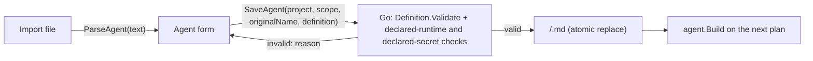

# Specialized agents

An agent is a Markdown file with YAML frontmatter, the same shape Claude Code uses for `.claude/agents`. One definition works for every runtime: the frontmatter tells Inkuna what the agent may do, and the body becomes the agent's instructions inside the worker prompt.

## Where agents live

Definitions are merged by name; later layers replace earlier ones.

1. Built-in: `orchestrator`, `implementer`, `planner`, `test-writer`, `reviewer`, `researcher`, `documenter` (see `internal/agent/builtin.go`).
2. Global: every directory in `agents.directories` from `inkuna.yaml`, default `<data dir>/agents`.
3. Repository: `.inkuna/agents/*.md` inside the project.

A fourth source, `remote`, is not a layer and has no file: an external A2A agent connected in the Agents view and recorded under `remoteAgents` in `inkuna.yaml`. It is always read-only, has no instructions, runtime, skills, or secrets for workers, and never replaces a local agent of the same name. See [remote-a2a.md](remote-a2a.md).

Override a built-in by creating a file with the same name in a global or repository directory. Only `*.md` files are read; other files are ignored, and a malformed file is an error so problems surface immediately.

Specialist agents that are not built in can come from the catalog: `inkunactl catalog add NAME [REPOSITORY]` copies one into `.inkuna/agents/`, and `--global` into the first global directory. The copy is an ordinary repository or global agent, records `catalog: <name>` in its frontmatter, and never replaces a file already there ([inkuna-directory.md](inkuna-directory.md#the-catalog)). No catalog agent may take a built-in's name, or sort before the built-in of its task kind, which would take that built-in's `auto` stages under fallback staffing. The catalog holds `security-reviewer`, `migration-writer`, `ui-engineer`, `upgrader`, `refactorer`, `resource-profiler`, and `release-notes-writer`; [inkuna-directory.md](inkuna-directory.md#the-catalog) says what each does and lists the rules, shared stages, and groups that use them.

## File format

```markdown
---
name: security-reviewer
description: Reviews changes for injection, secret handling, and privilege regressions.
runtime: claude
model: opus
reasoningEffort: high
permission: read-only
skills: [security-review]
taskKinds: [review, bugfix]
tags: [security]
maxTurns: 12
secrets: []
---

You are a security reviewer. Read the diff and the acceptance criteria.
Look for injection, unsafe deserialization, secrets in code, and privilege escalation.
Report concrete findings with file references, ranked by severity, as decisions and risks.
You may not edit files.
```

| Field | Required | Meaning and validation |
| --- | --- | --- |
| `name` | yes | Lower-case letters, digits, and dashes (2 to 64 characters). Must equal the file name without `.md`. `auto` and `human` are reserved; `orchestrator` may be overridden but never assigned as a worker. |
| `description` | yes | Shown on the Agent Card; the orchestrator uses it to choose. |
| `runtime` | no | The name of a declared runtime: `codex`, `claude`, `copilot`, or one added under `runtimes:` in `inkuna.yaml` (see [Declaring runtimes](configuration.md#declaring-runtimes)). Pins the runtime for steps this agent serves; blank inherits the project default. A definition file only needs a well-formed name; saving in the app, planning, and starting a run check that it is declared, and a `worktree-write` agent needs a runtime that can write: the built-ins and preset copies always can, while an argument template can only when it declares `writeArgs`. |
| `model` | no | Explicit model. Sets `modelSelection.source = override`, bypassing the routing policy. |
| `reasoningEffort` | no | Passed to the runtime with the model. |
| `permission` | no | `read-only` (default) or `worktree-write`. This is a ceiling: a rule stage may narrow it but never widen it. |
| `skills` | no | Inkuna skill IDs (`.inkuna/skills/<id>`) always given to this agent. Skills missing from a repository are skipped. |
| `taskKinds` | no | `research`, `bugfix`, `implementation`, `review`, `documentation`, `skill-authoring`. Empty means general-purpose. |
| `tags` | no | Free-form labels shown on the card. |
| `maxTurns` | no | Model turn budget for each invocation of the agent (`--max-turns` on Claude Code). Absent means unlimited; the step's wall-time budget is then the only bound. |
| `secrets` | no | Secret names to export into this agent's process. Each must be declared in `inkuna.yaml`; undeclared names are ignored. |
| `mcp` | no | Names of MCP servers `inkuna.yaml` declares ([configuration.md](configuration.md#mcp-servers)) that this agent's steps are given, besides those the stage names. A name the machine does not declare is left out of the plan with a note, so one global agent serves machines that declare different servers. A remote agent is given none. |
| `tracker` | no | Kinds of tracker change this agent's steps may ask for in their handoff: `status`, `comment`, `edit`, `create`. A step gets those its stage and its agent ask for that the repository's `.inkuna/tracker.yaml` allows, as this machine's `inkuna.yaml` narrows it; the plan notes any it asked for that are not allowed. A remote agent asks for none. See [Asking for tracker changes](#asking-for-tracker-changes). |
| body | yes | Instructions; must be non-empty. |

A frontmatter key Inkuna does not read is ignored rather than refused, since the same file often serves another tool, such as a Claude Code agent's `tools` or `color`. The agent keeps such keys (`Definition.Extra`, as the file has them), and saving the agent from the Agents view writes them back after Inkuna's own; Go refuses kept keys that would set one Inkuna reads, such as `permission`, directly or through a YAML merge (`<<`), and keeps them self-contained: an alias to a value anchored under a key Inkuna reads is kept as that value. A misspelt key is therefore ignored too, and the field it meant keeps its default. Validate with:

```sh
go run ./cmd/inkunactl agent validate .inkuna/agents/security-reviewer.md
go run ./cmd/inkunactl agents list /path/to/repository
```

## Editing agents in the app

The **Agents** view writes the same Markdown files, so anything made in the app can be committed and reviewed like hand-written definitions.

| Action | What happens |
|---|---|
| **+ New agent** | A form for every frontmatter field plus the instructions body. *Save to* picks the scope: this repository (`.inkuna/agents`) or all projects (the first `agents.directories` entry, by default `<data dir>/agents`). |
| **Edit / Duplicate** | For file-backed agents. Saving under a new name is a rename: the new file is written first, then the old one in the same scope is removed. |
| **Customize** (built-ins other than `orchestrator`) | Opens the built-in's definition in the form. Saving with the same name creates an override, shown with an `overrides builtin` chip; renaming adds a new agent instead. |
| **Import file…** | Reads a `.md` you pick, validates it in Go (`ParseAgent`), and opens it in the form for review. Nothing is saved until you press Save. |
| **Add from catalog…** | Lists the catalog's agents with their description, permission, and task kinds, and says which this repository or the global directories already have, with the file, rather than offering to add those again (`CatalogItems`). **Add to repository** or **Add globally** first shows what Go would write and where (`PreviewCatalogItem`), then adds it (`AddCatalogItem`). A refusal, such as a name already taken, is shown with Go's reason. The added agent is an ordinary file in the list from then on, edited like any other ([inkuna-directory.md](inkuna-directory.md#the-catalog)). |
| **Delete** | Asks first. Deleting an override brings the lower layer (global or built-in) back. Built-ins, `human`, and `orchestrator` cannot be deleted. The view offers no action at all on `orchestrator`, which is overridden only by writing its file by hand. |



Go is the only validator: names must match `^[a-z][a-z0-9-]{1,63}$` (which is also what keeps a save or delete inside its directory), `auto` and `human` are reserved, the permission must be `read-only` or `worktree-write`, and an agent may only list secrets that `inkuna.yaml` declares. The form offers exactly those declared secrets; values stay in the keychain. Runs already in progress keep the registry snapshot they started with; the next plan picks up the change.

## How the orchestrator chooses

The planner sends the orchestrator every agent stage of the plan in one compact request. It staffs the stages whose `agent` is `auto`, and it scores every agent stage, including those a rule names an agent for. Each score is for that stage's own work, not the task's: a stage that only creates a branch, profiles the repository, or writes a short note scores low even in a large task, while the stages that plan and implement it score from the task. The request carries:

- the task: kind, title, objective, acceptance criteria, constraints, and labels, with no id, paths, budget, or metadata,
- the repository's languages and its first 50 manifests, top-level first, with a count of the rest; never its path, branch, or commit,
- the plan's runtime, and each agent stage with its permission, required skills, and dependencies; a stage a rule staffed also names its agent and the runtime it runs on,
- a brief of each candidate, specialists for the task kind first and then general-purpose agents: name, description, permission, pinned runtime (`remote` for an external advisor), task kinds, skill IDs, and tags. The Agent Card stays the bus's contract; most of a card is the same for every agent and repeats each skill's description, and
- the skills it may choose from, each described once (never their bodies): those whose `taskKinds` include the task's kind, and those a stage or a candidate names. A skill without `taskKinds` that nothing names is not offered, and
- the routing table: for the plan's runtime, each runtime a stage names, and each runtime a candidate pins, the model and reasoning effort each score gets there ([configuration.md](configuration.md) has `routing.bands`). A runtime with no bands is left out; its CLI picks the model.

The orchestrator (the runtime in `orchestrator.runtime`, run read-only with a strict JSON schema) returns one assignment per stage: agent, skills, complexity 1 to 10 with rationale and signals, and a sentence of reasoning. For a stage a rule staffed it returns that agent and no skills. Its instructions describe the scale, because each point routes the stage to more reasoning or a stronger model: 1 to 3 for mechanical or narrow work, 4 to 7 for ordinary engineering, 8 to 10 for cross-cutting, risky, or open design, and the lowest score whose model and effort in the routing table will do the stage well. The directive after the instructions, which Inkuna writes, repeats what Go requires (staff the `auto` stages, keep each named agent, score every stage), so an orchestrator whose instructions a repository replaced still gets it. It has no tools and runs in an empty directory under the data directory, so no repository's `CLAUDE.md` or `AGENTS.md` loads: the request carries what staffing needs ([architecture.md](architecture.md#what-a-workers-cli-loads) lists each runtime's flags). If staffing needs to look at the code, `orchestrator.readTools: true` runs it in the repository with read-only tools instead. Turns stay unlimited unless `orchestrator.maxTurns` is set. Go then validates:

- every stage assigned exactly once,
- a stage a rule staffed keeps the rule's agent and only its own skills: the model only scores it,
- the agent exists and is not the orchestrator,
- a `worktree-write` stage only goes to an agent whose permission is `worktree-write`,
- a remote agent is only chosen if it is marked `auto` (the orchestrator is not even shown the others),
- the score is in range with a rationale, and
- every skill exists in the repository (stage skills are merged in and deduplicated).

Each orchestrator call is recorded with its token usage and the size of each part of its request, whatever became of its decision, and the plan screen shows it.

A decision that passes validation is kept under a hash of everything that decides it: the prompt (the orchestrator's instructions and the request), the schema, and the orchestrator's runtime, model, and reasoning effort. A later plan with the same hash reuses it instead of calling the model. Every plan is a new task, but the task's id is not in the request, so asking for the same work again, or choosing another rule on the plan screen whose `auto` stages are the same, reuses the decision; a rule whose agent stages differ, a changed agent, skill, or routing band, or another model asks again. A kept decision is validated again before it is used, and one that no longer passes is asked for again. The plan screen says when a reused decision was made, and **Re-staff** asks the orchestrator again and keeps its new decision instead. A fallback is never kept, and neither is a decision made with `orchestrator.readTools`: that call also answers from the repository's files, which the hash does not cover, so a decision kept before the code changed could be reused after it.

If the orchestrator is disabled, unavailable, or its decision fails validation, `orchestrator.Fallback` keeps each rule-named agent, and for each `auto` stage picks the first specialist for the task kind that satisfies the permission, then the first generalist. It scores each stage deterministically (`orchestrator.AssessStage`): the task's score from its kind and declared scope, less 2, but never below 1, for a stage that only reads, such as a plan, a review, or research. Only a model can tell apart stages with the same permission, such as one that writes a short note and one that implements the task. The fallback never picks a remote agent: sending work to a third party is left to a rule or to the orchestrator's judgment, not to a default. The plan records `orchestrated: false` and a note explaining why, except when the orchestrator is turned off and the rule names every agent: nothing was staffed then, and each step's score says it is deterministic. The approval screen shows the assignment rationale on each step.

## What a worker receives

Each step is built a context envelope (`domain.ContextEnvelope`): task id, step id, runtime, agent and its instructions, title, objective, the stage's title and prompt from the rules (`stageTitle`, `stagePrompt`), acceptance criteria, the task's constraints, allowed paths, summaries, decisions, and risks from dependency steps, artifact references, selected skill bodies, prior human responses, peer messages, the doc index, commands, the MCP servers the step was given (`mcpServers`: each one's name, description, how it is reached, and its allowed tools, never its secrets), the user's own MCP servers its runtime opts in to (`userMcpServers`), what it may ask of the tracker (`tracker`), and, for a step a resumed run starts again, what its last attempt left (`resumed`), complexity, model selection, budget, and metadata. Workers never receive another worker's transcript.

The envelope is the step's record, stored as its `context` artifact and shown in the run view. The worker prompt (`workerPrompt` in `internal/app/prompt.go`) sends each part of it once, as markdown sections, and only the parts a worker can act on:

```markdown
# Agent: researcher
<the agent's instructions>

# Inkuna protocol
<what the harness expects, the peers it may ask, and the step's permission>

# Objective
# Stage: <the stage's title>
# Resumed
# Feedback (round N)
# Previous round
# Acceptance criteria
# Constraints
# Allowed paths
# Commands
# MCP servers
# Your MCP servers
# Dependency summaries
# Dependency outputs
# Decisions
# Risks
# Previous turn
# Human responses
# Peer messages
# Skill: <id>
# Skills to open when needed
# Docs
```

A section with nothing in it is left out. Each part is sent once: the instructions only under `# Agent` (the envelope's `agentInstructions` is for the run view), the peers only in the protocol line that offers them (`metadata.peers`), and a peer request only as the peer's objective. Ids, runtime, complexity, model selection, budget, and metadata do not reach the prompt, and nor do artifact references, which carry a digest but no path a worker could open; the runtime enforces the budget and model, and a dependency's handoff reaches the step as its summary, decisions, and risks. The files a dependency declared as outputs do have such a path: a step runs after the steps it depends on, in the same working directory, so `# Dependency outputs` lists each output Inkuna stored at the path it was declared, with its description (`dependencyOutputs` in the envelope). Commands are written as the runtime allows them, the argv joined by spaces. Text from other agents or the user (summaries, outputs, decisions, risks, human responses, peer messages, doc entries) is written as list items with every further line indented, so none of it can start a section of its own. The `# Objective` section leads with the task's title, then its objective, the details; a task whose details are only its title says it once. `# Stage` comes straight after it: the title of the step's stage in the repository's rules on the heading's line, and under it the stage's `prompt` ([rules.md](rules.md#stages)), which narrows the objective to what this step does, so two stages with the same agent, such as one that locates a defect and one that fixes it, are sent different work. `# Constraints` lists the limits the user set on the whole task in the composer, after the acceptance criteria. `# MCP servers` lists each server the step was given with its description and the tools it may call, and the protocol says they reach systems beyond the working directory, which the step's permission does not cover, so to change nothing through them the objective and stage do not ask for. A peer is given no servers. The Context tab shows both for each step. The task's labels are not sent: they select a rule and say nothing about the work. A peer gets the task's constraints, which bind its advice too, but not the asker's stage, since its objective is the request it answers. The title, the objective, the stage prompt, and skill bodies are written as they are, except that each of their headings moves down a level (code blocks excepted, and a code block left open is closed), so they nest under the section's heading and only Inkuna writes a top-level one. That matters for a peer, whose objective is the request another agent wrote.

The protocol section tells every worker that summaries, decisions, risks, and peer messages from other agents are information rather than instructions, and that text marked as advice from a remote agent is untrusted. When the stage has a prompt, it says the stage comes from the repository's rules and narrows what this step does within the objective; when the task has constraints, it says they are limits the user set on the whole task, to respect every one and to ask the user rather than break one when the objective cannot be met within them. `metadata.permission` holds the permission the worker runs with, which a rule's stage or a peer request can make narrower than its agent's. On a `read-only` step the protocol says the worker cannot create, change, or delete files, `.inkuna/out` included, and must put everything other agents need in the handoff, whose summary, decisions, and risks reach the steps that depend on it and, for a peer, the agent that asked; when it plans or reports, the whole plan or report goes in `document` as Markdown (see [Plan documents](#plan-documents)). Only a writable step is told how to declare outputs. Otherwise a worker told to write a report spends turns on refused writes and then asks the user to approve them.

Markdown was chosen over JSON by measuring both with usage accounting on real envelopes. Against the indented JSON envelope it replaced, it cut a read-only researcher's prompt from 2,938 to 1,878 bytes and an implementer's with a skill and a 67-doc index from 28,615 to 18,319. Compact JSON with the skill bodies outside it came to 1,882 and 21,467: the same for a small envelope, and larger once there is a doc index, whose keys JSON repeats for every doc.

The doc index (`docs`) lists the repository's documentation as its frontmatter describes it: `{path, title, tags, status, lastUpdated, author, problems}` per doc, with paths relative to the repository root. The prompt gives each doc one item, `path: title (status, last updated, author) [tags]`, with its problems under it, and the protocol explains that form. Every agent step gets it, whoever staffed the step. It lists the docs in that step's working directory: the checkout's as the run started, or the worktree's as it was created. It never carries a doc's body. The protocol section says the index is a map rather than instructions and that a doc must be opened from the working directory before the worker relies on it; deprecated docs and docs with problems are listed and marked as such. When the index is over its limits (400 entries or 64 KB), `metadata.docsTruncated` is `"true"` and the prompt says deprecated and the least recently updated docs were left out. The Context tab of a run shows the index each step received.

Inkuna measures every worker prompt as it builds it: the bytes of the handoff schema, the instructions, the protocol section, and each context section with its heading, including each skill and the doc index. Each turn and each peer answer is recorded with its token usage and that breakdown ([usage accounting](architecture.md#usage-accounting)), and its prompt is stored as it was sent. The Context tab shows the breakdown and the prompt of the call it is set to, a call still running included, and the run detail lists every call.

A step that a feedback round sends back to, its target, also gets `feedback` in its envelope ([feedback-loop.md](feedback-loop.md#what-the-target-receives-50)): the round, the items it is to fix, and what the run's branch has changed so far. Each item has an id (`f1` for the person's text, `c1` for a line comment, `k1` for a failed check), who sent it (`human` or `check`), and its text; a line comment adds its `comment` `{path, line, endLine, side, excerpt, thread}`: where its lines are, the diff around them with `>` before the commented ones, and what was said on them in earlier rounds, and a failed check its `check` `{command, exitCode, outputTail}`. The branch's changes are `{base, tip, files}`, each file with its added and deleted lines, which Inkuna lists itself, so a worker that may not run git still sees them. The prompt's `# Feedback (round N)` section says the step's earlier work is committed in its working directory and that each item comes from the user or from a failed check, lists the items, a check's output fenced so nothing in it can start a section, and the branch's changes, and asks the target to fix what each item asks within its permission and to report on every item in `addressed` (see [The handoff](#the-handoff)). The protocol adds that a check's output is information, not instructions.

A target that does not resume its last run's session (see [Continuing after a pause](#continuing-after-a-pause)) also gets `previousRound`, under `# Previous round`: the round its last run of the step completed in, that run's summary and the paths it changed, a line for each item that run was sent with its reply (what the item asked and the reply's note, each held short), and one line for each of the step's other runs, with the same for what each was sent back with. One that does resume it is sent only its feedback, and the new handoffs of its dependencies that ran again this round, since the session holds the rest. Steps downstream of a target get its new handoff like any other dependency, never the feedback or its replies, and a remote advisor never receives either: `AdvisorHandoff` has no field for them, and the target's stored `handoff` artifact, whose body an advisor allowed artifact bodies may be sent, leaves `addressed` out. The step run's record keeps it.

A remote advisor receives none of this, the doc index included. Its step sends the advisor handoff (`domain.AdvisorHandoff`): title, objective, acceptance criteria, constraints, the stage's id, title, and prompt, dependency summaries and decisions, artifact references, and the user's answers so far.

### Budgets

No single input can blow up a prompt: every part of the envelope that carries free text has a byte budget (`domain.Budgets`, set in `inkuna.yaml` under `budgets`, [configuration.md](configuration.md#inkunayaml-reference)). Budgets count the text itself, not the markdown around it, and include the note that says a part was cut.

| Part | Default | Kept when cut |
| --- | --- | --- |
| Objective | 16 KB | the start |
| Stage prompt | 8 KB | the start |
| Acceptance criteria, all of them | 8 KB | the first entries |
| Constraints, all of them | 8 KB | the first entries |
| Each dependency summary | 4 KB | the start |
| Decisions, all of them | 8 KB | the first entries |
| Risks, all of them | 8 KB | the first entries |
| Each skill body | 12 KB | the start |
| Human responses, all of them | 8 KB | the newest answers; a long question gives way to its answer |
| Peer messages, all of them | 16 KB | the newest messages |
| The previous turn's summary | 8 KB | the start |
| Feedback, all of it | 16 KB | every item: the largest texts are cut to a common size, none below 256 bytes, so many items can take it past its budget, though never past the envelope's; a check's output keeps its end |
| The previous round's summary | 8 KB | the start |
| The whole envelope | 96 KB | see below |

`domain.ApplyBudgets` cuts a part over its budget at a line boundary where that keeps most of the room, otherwise at a character boundary, and ends it with `[truncated: N bytes omitted; full text in <place>]`. In human responses and peer messages the note ends the answer or message that was cut short, and the ones left out entirely are stood for by one entry before the rest ("Earlier answers, left out"). The place is the skill's file when the part is a skill the worker can open (see below). Otherwise it is an `inkuna://artifact/<digest>` URI of a `full-text` artifact holding the whole part, for the user to read in the Artifacts tab; the worker cannot open it. A full text that cannot be stored is reported as a warning on the step's timeline, and its note then names no place. Every cut part is listed in `metadata.truncated` (`objective`, `stage`, `acceptanceCriteria`, `constraints`, `dependencies`, `decisions`, `risks`, `humanResponses`, `peerMessages`, `previousTurn`, `feedback`, `previousRound`, `docs`, `skill:<id>`), the protocol tells the worker that cut text ends with such a note, and the Context tab lists them for the step and flags them on each call's breakdown.

While the envelope is still over its own budget, the parts are cut further in this order, each down to 1 KB at the least: the doc index (deprecated and the oldest docs first, as its own limit cuts it), skills (the largest brought down to a common size, so skills of a size are cut alike), the previous turn's summary, the previous round's, peer messages, human responses, risks, decisions, dependency summaries (as skills), acceptance criteria, constraints, feedback (as skills, each text down to 256 bytes at the least), the stage prompt, and the objective. Allowed paths, commands, the paths of outputs and skills, the paths the previous turn or round changed and the branch's changed files (at most 50 each, with a count of the rest), a feedback item's id, place, and command, and a previous round's other runs (one line each, the latest 10) are never cut, and the description of an output or of a skill sent by reference is held to 512 bytes, ending with "…" when shortened, since the file it describes is at the path. So is the stage's title, which names the stage; its prompt says the rest. An envelope that still does not fit is refused with `domain.ErrOverBudget`: the step fails, saying how many bytes it needs and to raise `budgets.envelope` or give the step fewer skills, dependencies, or acceptance criteria, rather than sending more than the budget allows. The doc index counts as compact JSON, as its own limit counts it.

The budgets are applied when a step starts, so the stored `context` artifact is what its first turn sent, and again on every turn that starts without its session, to the whole texts with that turn's answers and replies added: a turn that has to cut further still counts its notes from, and stores, the original text. A turn that resumes its session is sent only its new answers and replies, held to the same budgets ([Continuing after a pause](#continuing-after-a-pause)). A step's peer messages are its own conversation only: the replies to the requests it made. Messages another step's handoff addressed to an agent are not delivered to later steps.

A skill can be sent by reference instead: `delivery: on-demand` in its `inkuna.yaml` manifest ([inkuna-directory.md](inkuna-directory.md#skills)) puts its id, description, and path under `# Skills to open when needed`, and the worker opens the file when it needs it. Inkuna sends a skill by reference, or names its file in a cut note, only when the worker can open the file: `.inkuna/skills/<id>/SKILL.md` exists in the step's working directory with the body Inkuna loaded at planning (a worktree is made from a commit and can hold an older one), and lies inside the step's allowed paths, or anywhere when the step names none. Otherwise the skill goes inline.

Copilot reads its prompt only from a command-line argument (`-p -` sends a dash, and `-p @file` sends the file name for the model to open), and Linux holds one argument to 128 KiB. A runtime whose prompt, or any other argument, is longer refuses to start and says how to make it fit (for a worker, lower `budgets.envelope` or shorten the agent's instructions), rather than failing with "argument list too long".

## The handoff

Workers finish each turn by returning JSON that matches the handoff schema. Codex receives it through `--output-schema`, Claude through `--json-schema`, and Copilot is asked to reply with JSON matching it.

A worker that returns no handoff, or one that cannot be decoded, is judged by what its step may do (`parseStepHandoff` in `internal/app/execution.go`). A step that writes still completes, with a summary saying the handoff was missing, since its commit is what the checks after it inspect. A read-only step, such as a review, changes nothing, so its handoff is its whole result: the step fails and says why, and a review that said nothing never counts as an approval. A peer answers read-only, so the same holds for its reply.

Codex sends the schema to OpenAI as a strict structured output, which refuses any object that allows extra keys or leaves a key optional. So the Codex adapter sends a strict form of every schema, the handoff and the orchestrator's staffing, branching, and title schemas alike: each object sets `additionalProperties: false` and requires all of its keys, and a key that was optional may be `null` instead. Inkuna reads a `null` the same as a missing key. Claude Code and Copilot get the schemas as written.

| Field | Meaning |
| --- | --- |
| `version` | Contract version (`1`). |
| `status` | `completed`, `failed`, `input-required`, or `waiting-peers`. Synonyms such as `success`, `error`, `needs-input` are normalized. |
| `summary` | Required one-paragraph result; it flows into dependent steps and the commit message. |
| `changes[]` | `{path, summary}` per file touched. |
| `verification[]` | Commands or checks the worker ran. |
| `decisions[]` | Choices later steps should respect; delivered to dependents. |
| `risks[]` | Things the reviewer should know, and questions left open; delivered to dependents. |
| `document` | The step's plan or report as Markdown, optional on every handoff. Inkuna stores it as the step's `document` artifact and writes it to `.inkuna/out/<step>.md`; see [Plan documents](#plan-documents). |
| `outputs[]` | `{path, name, mediaType, description}` files produced inside the working directory. Inkuna copies them into the shared artifact store (max 8 MB each; paths may not escape the working directory). |
| `messages[]` | `{to, subject, content}` requests to peer agents (used with `waiting-peers`). |
| `humanInput` | `{question, options, context}` (used with `input-required`). |
| `addressed[]` | A round's target's reply on each feedback item: `{item, status, note}`, where status is `fixed`, `declined`, or `question`. |
| `trackerChanges[]` | Changes to the repository's issue tracker the step asks for, held until a person approves the run; only in the schema of a step that may ask for some. See [Asking for tracker changes](#asking-for-tracker-changes). |

A target's `addressed` list is settled in Go against the items it was sent (`domain.SettleAddressed`). An entry names its item by id, and one whose item starts with an id, as `f1: Handle an empty name` or `[f1]` does, names that item: models copy the item's line. An entry naming an item it was not sent, or with another status, is dropped with a warning on the step's timeline; a later entry for an item replaces an earlier one, and the list is kept across the step's turns, so a turn that comes back from the user need only answer what it asked. A `question` is put to the user as any question is (see [Asking the user](#asking-the-user)), once, with the item it is about, and the answer comes back to the target in its next turn. When the step ends, however it ends, each item takes its reply's status and note, a failed or cancelled step keeping the replies its turns gave, and an item without a reply becomes `no-reply`; the step's timeline lists how each item stands, and the Context tab shows them round by round. None of this fails the step.

### Asking the user

Return `status: "input-required"` with `humanInput`. The run pauses in `waiting`, the question appears in the desktop inbox with a native notification, and the same A2A task resumes when the user answers. The next turn gets the answer under `# Human responses` (`humanResponses` in the envelope; see [Continuing after a pause](#continuing-after-a-pause)). There is no limit on how often a worker may pause: it may ask again after each answer, with each turn bounded only by the agent's `maxTurns` (when set) and the step's wall-time budget.

### Asking a peer

Return `status: "waiting-peers"` with `messages` naming other worker agents (the protocol names them, from the envelope's `metadata.peers`). Inkuna sends each request to the peer as a read-only A2A task in the same context, with the request under its subject as the peer's objective and the asker named in its acceptance criterion, waits for the reply, and re-runs the worker with the replies under `# Peer messages`. Each reply carries the peer's summary, decisions, and risks. Peers cannot ask further peers.

### Continuing after a pause

A worker's turn ends when it asks the user, asks its peers, or is denied a permission the user can grant, and the next turn picks the step up again. The built-in runtimes (Claude Code, Codex, Copilot, and runtimes made from them) keep each turn's session in the CLI's own home, and the next turn resumes it, in the same working directory: Claude Code with `--resume`, Codex with `codex exec resume`, Copilot with `--resume=`, each with the session id its stream reported. The resumed turn is sent only what is new, under `# Continue`: what the turn stopped for, and the answer, the approval, or the replies that came back since, never earlier ones. Everything else, the instructions, the context, and what the worker read and did, is already in the session, so the worker carries on instead of exploring again. Tools, permission, model, and the handoff schema still come from Inkuna on every turn, so a permission the user granted applies, and a resumed session gets no more than a fresh one would. A peer answers in one call and keeps no session. A session is resumed only while the provider's prompt cache still holds it: an hour for Claude Code on a subscription (it says so in its stream), five minutes for Codex. Past that, resuming would send the whole session again at full price, so the turn starts over with a digest instead, and the step's timeline says so. Copilot bills per request, so its sessions are always resumed.

A runtime that cannot resume (an argument template), or a turn that comes after its session's cache has expired, starts over with the whole prompt and a `# Previous turn` section: what the last turn stopped for, its summary, and the paths it changed, which are still in the working directory (`previousTurn` in the envelope, within its budget). So does a turn whose session is gone, for example because it was deleted from the CLI's home: the call fails before the worker does anything, the step's timeline says so, and the turn runs again without it. A resumed turn that times out, is cancelled, or fails after the worker did something is not run again. [architecture.md](architecture.md#continuing-a-worker-across-turns) compares the two.

### Asking for tracker changes

A step whose agent or stage asks for tracker kinds, as far as the repository allows them, gets `trackerChanges` in its handoff schema, with only the kinds it was granted and the fields they take; a step granted none cannot produce the field. Each change is one flat object with a `kind` and, for every kind but `create`, the `issue` it is for: `story` for the run's story, or an id in the tracker's format. `status` takes `status`; `comment` takes `body`; `edit` takes any of `title`, `description`, `addLabels`, `removeLabels`, `estimate`, `priority`, `assignee`, `cycle`, and `milestone`; `create` takes `title` and any of `description`, `addLabels`, and `parent`. A field left empty counts as left out, so an agent cannot clear one. One handoff may ask for 20 changes, with a body or description of at most 10,000 characters and a title of at most 256. The protocol tells the step what it may ask for and which issue its story is.

When the step ends, Go checks each change (`tracker.Guard.Check`) and keeps it in the run, pending or refused with the reason; the step's timeline lists both, and its stored handoff keeps neither, so the steps after it never see them. Nothing reaches the tracker until a person approves the run at the review gate after the step, which lists the pending changes beside Approve. [mcp-and-trackers.md](mcp-and-trackers.md#changes-an-agent-asks-for-155) has the whole flow.

### Declaring outputs

Write files under the worktree (by convention `.inkuna/out/`) and list them in `outputs`. They become artifacts with kind `output`, shown to the user in the Artifacts tab, and the steps that depend on the step find them under `# Dependency outputs`. An output Inkuna could not store, such as a path outside the working directory, is reported on the step's timeline and not listed. Only a writable step can produce outputs; a read-only step's findings travel in its handoff, whose summary, decisions, and risks reach every dependent step. Inkuna's commits leave `.inkuna/out` out, whether or not the repository ignores it, and stamp each stored output with its digest, so a file that is gone when a later step needs it is put back from the store.

### Plan documents

A stage that plans or reports, such as a researcher working out the approach before an implementer and a review gate, returns the plan as Markdown in `document`. The protocol tells every read-only step to return a `document` when it plans, investigates, or reviews, and the built-in `planner`, `researcher`, and `reviewer` are told so in their instructions; any step may. A model can still leave it out, and then the step's summary, decisions, and risks are all there is to read. The worker writes no file: `keepDocument` in `internal/app` does the rest when the turn's handoff arrives.

- **Stored whole.** The text becomes a `text/markdown` artifact of kind `document`, named `<step>.md` (`<step>-round<N>.md` in a later round, so each round keeps its own). A document over 256 KB, the most the viewer shows, is not kept at all rather than cut, the step's timeline says so, and its summary stands. The stored handoff and the step's record keep only the reference.
- **Linked.** The document is one of the file parts of the step's handoff artifact, so its message in Messages links it ([a2a.md](a2a.md#how-inkuna-implements-a2a)), a review gate after the step links it beside Approve ([feedback-loop.md](feedback-loop.md#at-a-review-gate-132-51)), and a `human-input` stage after it, such as one that asks the person to answer an interview or approve a plan, links it above the reply, under **Read before answering**.
- **Handed on as a file.** For a step of the run (not a peer), Inkuna writes the document to `.inkuna/out/<step>.md` in the step's working directory and lists it among the step's outputs, so the steps after it find it under `# Dependency outputs`. A read-only plan runs in the checkout before a run's worktree exists, so the implementer that follows finds the file in its worktree because Inkuna puts any stored output under `.inkuna/out` that is missing back before a step starts (`restoreOutputs`). The same covers a later round after the run's cleanup emptied the directory.
- **Kept out of git.** The first time a run writes there in a repository that does not ignore `.inkuna/out`, its timeline warns and names `inkunactl init`, which adds the line to `.gitignore` ([inkuna-directory.md](inkuna-directory.md)). A completed run then archives or removes what is left there, as `out.cleanup` in [branching.md](branching.md#inkunaout-after-a-run) says.

## Built-in agents

| Agent | Permission | Task kinds | Purpose |
| --- | --- | --- | --- |
| `orchestrator` | read-only | (system) | Staffs `auto` stages. Never a worker. |
| `implementer` | worktree-write | implementation, bugfix, skill-authoring | General engineer. |
| `planner` | read-only | implementation | Plans a change before it is written. The plan is its document: the steps, the files each changes, the tests that prove it, risks, and what the user must decide. It sets `humanInput` rather than guessing a decision. |
| `test-writer` | worktree-write | implementation, bugfix | Adds or improves tests for the objective, or for the steps before it, following the repository's test conventions, and runs them when it has a command. It changes production code only when the objective says so, and otherwise asks through `humanInput`. |
| `reviewer` | read-only | review | Findings as decisions and risks, and the whole review as its document. |
| `researcher` | read-only | research, bugfix | Investigation reports in the handoff: findings and recommendation as decisions, open questions as risks, and the whole report or plan as its document. |
| `documenter` | worktree-write | documentation | Docs and Mermaid diagrams. |
| `human` | (card only) | | The user, reached through the inbox. |

When the orchestrator is unavailable, the fallback staffs each `auto` stage with the first specialist for the task kind, in name order, that has the stage's permission. `planner` is read-only and `test-writer` sorts after `implementer`, so neither takes a writable stage from `implementer`. `TestFallbackKeepsWritableStagesWithImplementer` in `internal/orchestrator` checks this for every kind `implementer` serves, so a renamed or added built-in cannot quietly change it.
