# Inkuna architecture

Inkuna is a local desktop harness that turns a request into an approved workflow, staffs each stage with a specialized agent, and runs Codex CLI, Claude Code, or GitHub Copilot CLI headlessly inside isolated git worktrees. Go owns every decision that matters for safety; the React view is a window onto Go state through Wails bindings.

This document describes the components, the flow of a task, and the trust boundaries. Companion documents: [A2A protocol](a2a.md), [configuration](configuration.md), [agents](agents.md), [rules](rules.md).

## Components

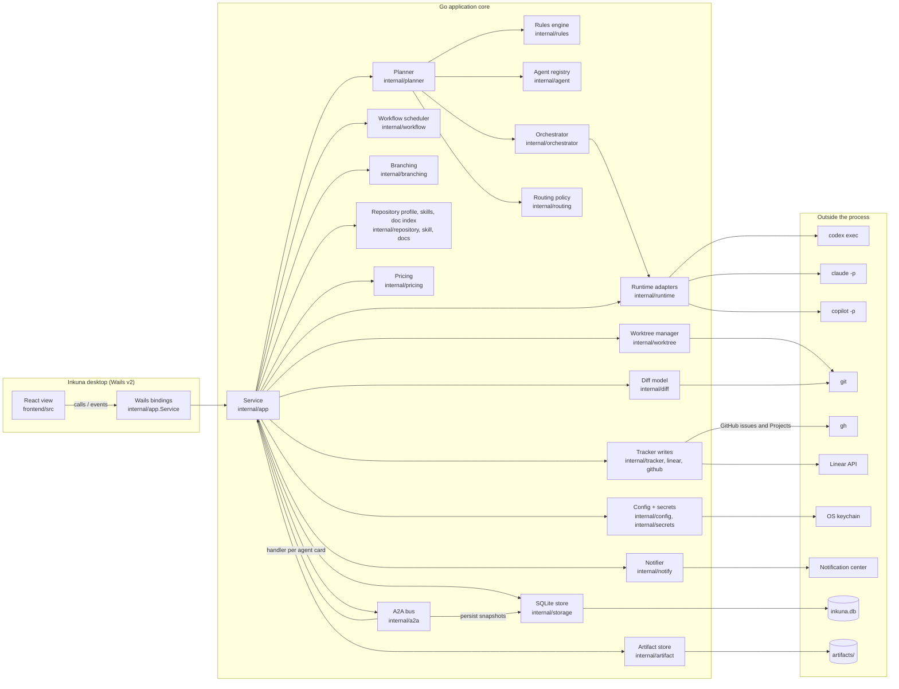

| Component | Package | Responsibility |
| --- | --- | --- |
| Service | `internal/app` | Wails-bound facade. Plans, approves, executes, and observes runs. Owns the A2A handlers for worker agents and the human agent. |
| Workflow scheduler | `internal/workflow` | Runs a round of a workflow's DAG: ready steps in waves under the concurrency limit, only the restart set, each fed the latest results of the steps it depends on (`ExecuteRound`, `RestartSet`). |
| Planner | `internal/planner` | Turns a task into a workflow: rules choose the flow, the registry supplies candidates, the orchestrator staffs `auto` stages and scores every agent stage for its own work, routing picks models. |
| Rules engine | `internal/rules` | Declarative YAML `when`/`then` document per repository (`.inkuna/rules.yaml`) with built-in defaults. |
| Agent registry | `internal/agent` | Markdown + frontmatter definitions layered builtin < global < repository. Renders A2A Agent Cards. |
| Orchestrator | `internal/orchestrator` | Runs the configured headless runtime read-only, with no tools and a strict JSON schema, on a compact brief of the task, stages, agents, and skills, then validates the decision. A plan with the same inputs reuses a kept decision. Deterministic fallback when unavailable. |
| Routing policy | `internal/routing` | Versioned mapping from a complexity score to a model and reasoning effort inside the selected runtime; `inkuna.yaml` may replace a runtime's bands. |
| A2A bus | `internal/a2a` | In-process broker implementing the A2A 0.3 data model: cards, tasks, messages, parts, artifacts, streaming events. |
| Runtime adapters | `internal/runtime` | One contract for every declared CLI: built-in adapters for `codex exec`, `claude -p`, and `copilot -p`, which start each CLI without the user's personal setup, and argument templates for runtimes added in `inkuna.yaml`. Normalizes events, extracts structured output, redacts secrets, and refuses permission-bypass flags. |
| Tracker writes | `internal/tracker`, `internal/linear`, `internal/github` | Reads `.inkuna/tracker.yaml`, lowers it by the repository's `inkuna.yaml` entry, picks the Linear or GitHub issues adapter for the tracker `branching.yaml` names, and makes every write through a `tracker.Guard` that refuses what the two files do not allow and records each write ([mcp-and-trackers.md](mcp-and-trackers.md#trackers-153)). |
| Branching | `internal/branching` | Reads `.inkuna/branching.yaml`, names a run's branch, resolves where worktrees go, and validates proposed configuration ([branching.md](branching.md)). |
| Worktree manager | `internal/worktree` | Creates each run's branch and worktree, commits per step, removes clean worktrees under the cleanup policy, and reads commits and diffs. |
| Diff model | `internal/diff` | A run's changes for review: the files a scope changed, then one file's hunks on demand, highlighted, with changes within lines marked. Read-only git by commit hash; no Wails or SQLite ([below](#reviewing-a-runs-changes)). |
| Repository profile, skills, doc index | `internal/repository`, `internal/skill`, `internal/docs` | What planning and every agent step know about a project: its root, branch, languages, and manifests (`repository.Inspect`), its `.inkuna/skills` (`skill.Discover`), and its docs ([docs-index.md](docs-index.md)). |
| Pricing | `internal/pricing` | A versioned table of model prices that `inkuna.yaml` may override, used to cost every model call ([cost accounting](#cost-accounting)). |
| HTML report | `internal/report` | Renders a run's changes as one self-contained HTML page for `inkunactl diff` ([the HTML page](#the-html-page)). |
| Artifact store | `internal/artifact` | Content-addressed blobs (SHA-256) shared by every agent. |
| SQLite store | `internal/storage` | Projects, tasks, workflows, runs, events, executions, inputs, A2A tasks, artifact index, commits. WAL with `synchronous=NORMAL`, so commits sync at checkpoints and the database stays consistent; transactions begin `IMMEDIATE`, since a deferred one that reads and then writes fails with `SQLITE_BUSY` when another connection commits in between, whatever the busy timeout. Every timestamp is stored as UTC text with all nine fractional digits (`timestamp` in `internal/storage/timestamp.go`), because queries order and compare timestamps as text, which is time order only at one fixed width. Opening the store applies the migrations in `internal/storage/migrations` it has not applied, each in its own transaction that checks again under the write lock, so the app and `inkunactl` opening it at once apply each one once; a database with a migration the build does not know, which a newer build ran, is refused (`storage.NewerDatabaseError`). |
| Subprocesses and time | `internal/proc`, `internal/clock` | `proc.Command` ends a subprocess with everything it started when its context ends (its process group on Unix, `taskkill /T` on Windows), so a timed-out fetch or a cancelled check leaves nothing running; git, checks, `gh`, diff, and the runtime adapters use it. A worker the call stops with no context ended, because its event could not be stored or its run was already active, is asked to stop and always waited on, and whatever of its process tree is still running after the close grace (`proc.WaitDelay`) is killed: the CLI if it ignored SIGTERM, or a process it started that did, which nothing could reach after the call (`stopAndReap` in `internal/runtime`). `clock.Now` never returns the same time twice in a process, for IDs and the times the store orders by, since Windows' wall clock advances in steps of up to milliseconds. |
| Config + secrets | `internal/config`, `internal/secrets` | `inkuna.yaml`, environment overrides, keychain-backed secrets. |
| Notifier | `internal/notify` | Desktop notifications for input requests and run completion. |

## Task lifecycle

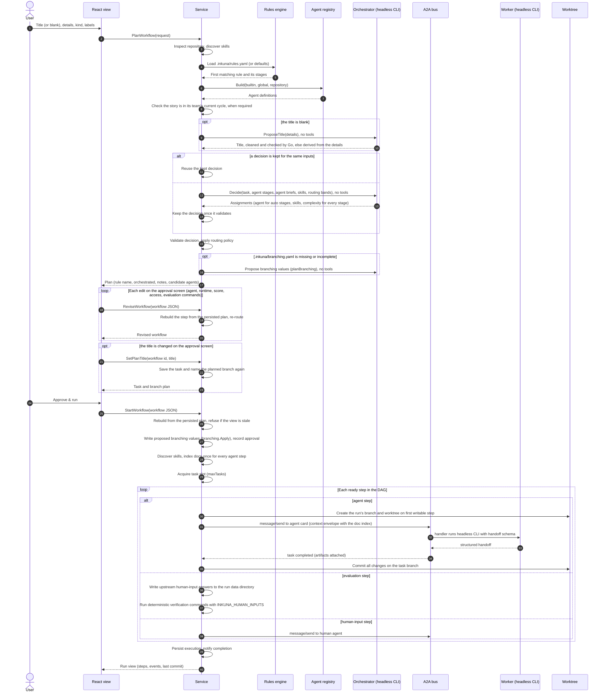

Every agent step is built a compact context envelope (`domain.ContextEnvelope`): objective, its stage's title and prompt, acceptance criteria, constraints, allowed paths, summaries, decisions, and risks from dependency handoffs, artifact references, selected skill bodies, or a reference to a skill's file for one delivered on demand (`SkillIndex`), agent instructions, the step's MCP servers and tracker grant, a round's feedback and digests of the previous round and turn, a resumed step's note, prior human responses, peer messages, and the repository's doc index. `domain.ApplyBudgets` holds each part to its budget. The envelope is stored as the step's record; the worker prompt sends each part a worker can act on once, as markdown sections ([agents.md](agents.md#what-a-worker-receives)). Workers never see other workers' transcripts.

The doc index (`docs`) reaches every agent step, whether a rule named its agent or the orchestrator staffed it, and lists the docs in that step's working directory. The checkout's index is taken when the run starts. The worktree's is taken when the worktree is created from a commit, so steps working there are never told about uncommitted docs the worktree lacks. The index holds each doc's repository-relative path and frontmatter, never a body, and is capped at 400 entries and 64 KB: deprecated docs are dropped first, then the oldest, and `metadata.docsTruncated` is set ([docs-index.md](docs-index.md#in-the-context-envelope)). The remote advisor handoff has no field for the index itself. The dependency summaries and artifact references it does carry may still mention what a local worker read in the docs.

## Human input

A worker returns a handoff with `status: "input-required"` and a `humanInput` block, or a rule declares a `human-input` stage. Both paths pause the run and mark the agent's thread in the Messages view as needing a reply. A review gate asks there too, with an Approve button, and a reply to it requests changes ([Run states](#run-states)). A thread is one A2A task; replying is only possible while its task is `input-required`, so a working or finished agent cannot be interrupted. Threads, their messages, and answered questions stay until a person deletes their task or run ([Data lifecycle](#data-lifecycle)). A `human-input` stage's question is marked as one (`inputs.stage`), and its thread lists the documents of the steps it follows, as a review gate's does. A check pause (`inputs.check_pause`) accepts only one of its options: re-run the checks, send to the writer, or fail the run. A pending question whose run is no longer live is shown as expired rather than answerable.

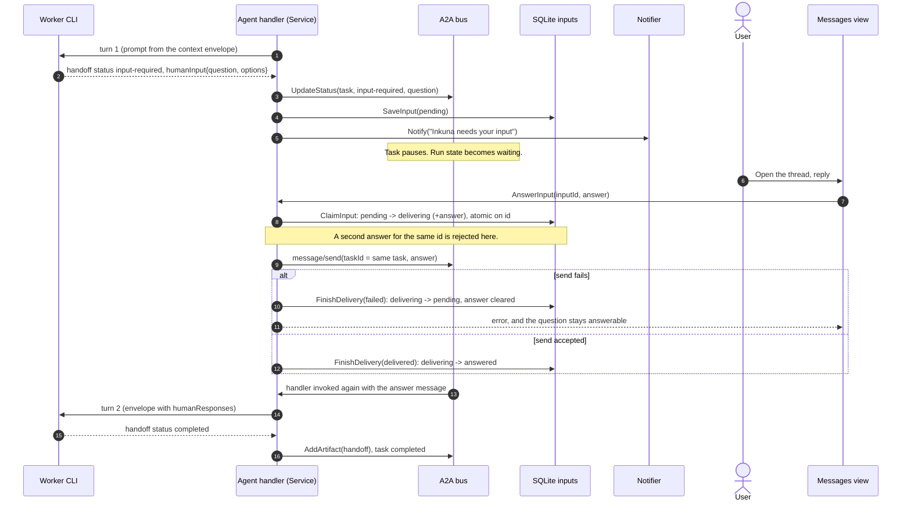

The answer continues the same A2A task (same `taskId` and `contextId`), so the task history holds the question, the pause message, and the answer. Delivery is two-phase and keyed by the input id: the input moves to `delivering` before the message is sent and to `answered` once delivery succeeds; a failed send restores `pending`, and a retry during `delivering` is rejected so an answer is never appended twice. The bus only accepts a follow-up from the agent that owns the paused task and rejects messages for a task that is still working. There is no cap on how often a worker may pause: each answer, peer round, or permission retry starts another turn of the same step, and a step ends only when the worker finishes, the run is cancelled, or a turn exhausts its wall-time budget. Cancelling a run cancels its pending inputs.

## Peer messaging

Workers can ask another agent for help before finishing by returning `status: "waiting-peers"` with a `messages` list. Inkuna relays each request as a new A2A task in the same context.

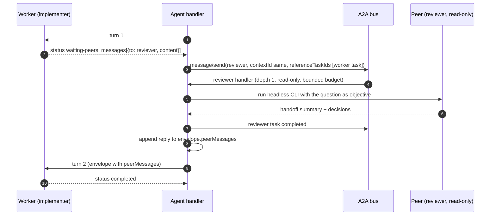

Peers always run read-only with a 600 second budget, and a peer cannot itself ask further peers (depth is limited to one). Peer tasks get their own step run rows so their events are attributable. Messages addressed to an agent that later runs in the same task are also delivered through the envelope.

## Usage accounting

Every model call Inkuna makes is recorded as one row of the `usage` table, whether it completed, failed, timed out, or was cancelled: each worker turn, each peer's answer, and each orchestrator call made while planning (proposing a title when none was written, staffing, and proposing branching configuration when it was missing). A plan that reuses a kept staffing decision makes no staffing call, so it has no staffing row. This is the yardstick for reducing prompt size, so it records what was spent rather than what a run produced.

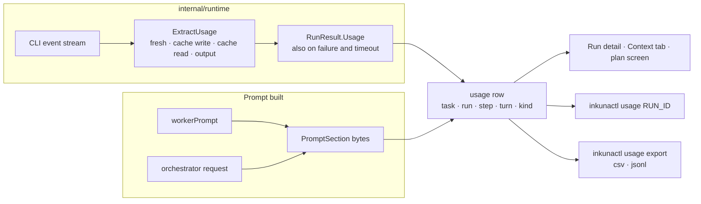

- **Tokens.** `domain.Usage` splits input three ways that never overlap: `inputTokens` read fresh, `cacheWriteTokens` written to the prompt cache, and `cacheReadTokens` served from it; `TotalInputTokens` is their sum. `longCacheWriteTokens` are the part of the cache writes that last an hour, which cost more. Claude reports the three directly, and the one-hour writes under `usage.cache_creation`. Codex counts both cache reads and cache writes inside `input_tokens`, so they are taken out of it. Copilot reports on stdout only each message's output tokens (`assistant.message`), never its input; its final `result` carries no tokens, so it no longer replaces the messages' count with zeros as it did before costs were recorded. `reportedCents` is the cost the runtime itself reported, in fractional cents, and `premiumRequests` the Copilot premium requests the call used; what each call cost is decided from these ([cost accounting](#cost-accounting)).
- **Resumed sessions.** The totals a CLI reports at the end of a resumed call cover the whole session, not only that call: Claude Code's `total_cost_usd` (its tokens are the call's own), Codex's tokens on `turn.completed`, and Copilot's `usage.premiumRequests` on its result (its messages' output is the call's own). Each call returns the totals as it read them (`RunResult.SessionUsage`); the worker keeps them with the session, and the call that resumes it passes them back (`RunRequest.SessionUsage`) so the runtime records only the difference (`runtime.CallUsage`). A call whose totals never arrive, such as one whose output outran its budget, offers no session to resume, so the next turn starts over with the digest rather than count the session again. Checked on 2026-10-19: against stored Claude Code results; with Copilot 1.0.79, whose resumed call reported 0.66 premium requests after 0.33; and with Codex 0.162.1 resumed against a local stub server, where the second call reported 3,000 input tokens after 1,000 and 2,000.
- **Failed calls.** When a CLI fails, times out, or is cancelled after it started, `Start` still returns the last usage the stream reported, and the row's `outcome` says how the call ended (`completed`, `failed`, `timed-out`, `cancelled`). A worker that returns a `failed` handoff is a `failed` call. The runtime's totals (Claude's `result`, Codex's `turn.completed`) replace everything; until they arrive, the usage is the sum of the messages the model finished (Claude's `assistant` events, counted once per message id, and Copilot's `assistant.message` output), so a call cut off before its totals still reports them. Copilot's are the only tokens it reports; its `result` adds the premium requests.
- **Prompt sections.** When a prompt is built, the byte size of each part is recorded with the row: the output schema (sent beside the prompt), the agent's instructions, Inkuna's protocol, and each context section with its heading: the objective, the stage, the resume note, the feedback, the previous round, the constraints, dependency summaries, dependency outputs, decisions, risks, the previous turn, human responses, peer messages, each skill, the skill index, and the doc index, with acceptance criteria, allowed paths, and commands as `envelope`. Rows from before the prompt was markdown measured the envelope's JSON instead, and carry the instructions it repeated as `instructions` named `agentInstructions`. An orchestrator prompt has the schema, its instructions, its directive, and one section per field of its request. Bytes are exact and the sections add up to the row's `promptBytes`; the app shows roughly four bytes to a token.
- **Prompts.** A worker or peer call stores its prompt, exactly as its runtime received it, as a `prompt` artifact before the call starts, and its row names it by `prompt_digest`. Orchestrator calls, and calls made before prompts were kept, have none. Like the row, the prompt is a record: one that cannot be stored becomes a warning and the call goes on.
- **Where a row belongs.** A worker or peer row names its run (`execution_id`), step, and turn; a peer's answer counts against the step and turn of the worker that asked. A planning call happens before its run exists, so it has no run and belongs to its task: a run's usage is its own rows plus the planning rows of its task, planning first. Each planning call is stored as soon as it returns, past the planning deadline if need be, so a plan that then fails and is never saved still leaves its calls recorded under its task id.
- **Where it shows.** The run detail shows totals (input, the share of input read from cache, output) and a row per call. Storing a row emits `inkuna:usage` with the run id, and the run detail and Context tab read usage again on it: a cancelled run ends without waiting for its CLI to stop, so the call's row can arrive after the run's last update. The Context tab shows the section breakdown and the stored prompt of the step call it is set to, the latest by default. While a call runs, the Context tab lists it with the outcome `running`, its sections, and its prompt: the service holds a started call until its row is stored, and the outcome is never stored. The plan screen shows each orchestrator call. `inkunactl usage [--sections] RUN_ID` prints the same rows with exact counts, so a change to prompts can be measured before and after.

Recording is a record of the run, not part of it: a row that cannot be stored becomes a warning on the step's timeline, or a note on the plan, and the run goes on.

A binary that embeds Inkuna can register a usage sink. Each row is then also queued for it, in the transaction that stores the row, and delivered from the outbox, without its prompt sections or digest ([extensions.md](extensions.md#usage-sink)).

## Cost accounting

Each usage row also records what the call cost, in fractional cents, and where that figure came from: `reported` by the runtime, `estimated` from the call's tokens (or Copilot's premium requests) and a pricing table, or `unknown`. An unknown cost is counted, never valued at zero, and figures from different sources are never summed as one: `domain.TotalCost` keeps reported and estimated sums apart and counts the unknown calls, and the best available total adds each call's best figure.

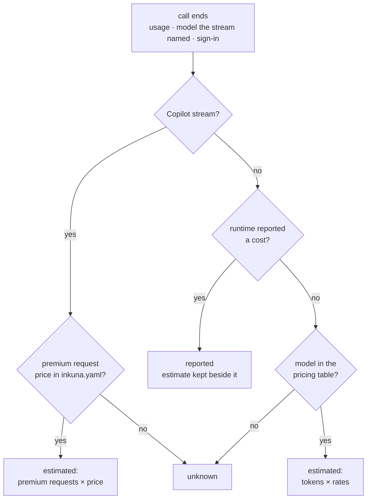

| Runtime | What its stream reports | Cost source |
| --- | --- | --- |
| Claude Code | `total_cost_usd` on its result; the model on its init event and messages; `apiKeySource` on its init event | `reported`, with the estimate kept beside it; `estimated` for a call cut off before its result |
| Codex | tokens on `turn.completed`, no cost and no model | `estimated` from the model Inkuna asked for, `unknown` when it asked for none |
| Copilot | each message's output tokens and model; on its result, `usage.premiumRequests`, which is premium requests (0.33 for Claude Haiku 4.5, 1 for Claude Sonnet 5), not dollars | `estimated` from premium requests when `pricing.premiumRequest` is set, otherwise `unknown`, as is a call cut off before its result or on a model that takes none |
| Template | what its declared `output` stream reports; `text` reports no measured tokens | as the stream it writes; `text` stays `unknown` even when its model has a price |

- **The pricing table.** `internal/pricing/prices.v1.json` gives each model's rates in US dollars per million tokens for input, five-minute and one-hour cache writes, cache reads, and output, seeded from Anthropic's and OpenAI's published prices with the page and the day each was read. `inkuna.yaml`'s `pricing` block adds or replaces models ([configuration.md](configuration.md#model-prices)). A row records the table's version (`pricing_version`); prices that change get a new version, and old rows keep the figure they were given. Rates hold for each provider's shorter prompts; a call is not priced at a long-prompt tier.
- **A stale table.** A reported cost keeps the estimate beside it (`estimated_cents`). With current prices the two agree: the table reproduces Claude Code's `costUSD` to the hundredth of a cent for the calls checked, once one-hour cache writes are priced at their own rate. A large gap between them means the table needs a new version.
- **The model.** `model` is the one Inkuna asked for, which can be an alias (`opus`) or empty when routing leaves the choice to the CLI. `model_used` is the one the stream named, and it is what prices the call; Codex names none, so its calls are priced by the model asked for.
- **Subscriptions.** Claude Code prices a call at API list prices even when it is signed in to a subscription, which bills nothing per call. Its init event's `apiKeySource` is `none` for a subscription login, so the row records `auth_mode` `subscription`, or `api-key` for any key, and the run view and `inkunactl usage` say that such a reported cost is what the call would cost through the API, not a bill.
- **Where it shows.** The run detail's usage table shows each call's cost marked by source (≈ for an estimate, `unknown` otherwise) with a hint saying where it came from, and the run's total. `inkunactl usage` prints the same, with the reported and estimated sums and the unpriced calls spelled out. What a whole task cost is read from the same rows ([below](#cost-per-task)).

Rows stored before costs had sources were migrated as they were measured: a cost the built-in `claude` runtime reported stays reported, and every other old row is unknown. A runtime added in `inkuna.yaml` stored its own name, so whether it wrote Claude Code's stream or Copilot's, whose figure was premium requests, cannot be told, and its figure is dropped rather than taken for money. A resumed Claude Code call recorded before this kept its session's cost so far, which cannot be told apart afterwards.

### Cost per task

The unit of cost is the Inkuna task: every call made for it, which is each plan and re-plan and every run, failed and cancelled ones included. Two bindings read it from the `usage` rows, which stay the only copy of the numbers; nothing is summed into a second table.

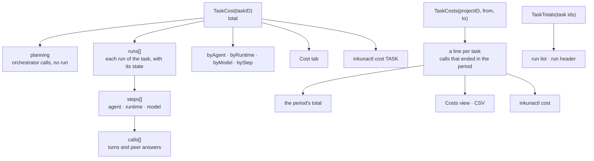

- **Totals.** Every level carries the same `domain.CallTotals`: the tokens (fresh input, cache writes, cache reads, and output), the cost by source (`domain.CostTotal`: reported and estimated sums side by side, and the count of unknown calls), `bestCents`, `subscriptionCents`, the number of calls, and `durationMs`. `bestCents` is the best available total: each call's reported cost where it has one, otherwise its estimate. Unknown calls add nothing to it and are counted instead, so with any of them it is a floor, not a total. `subscriptionCents` is the part of the reported sum that Claude Code reported while signed in to a subscription, which is what those calls would cost through the API, not a bill. `durationMs` adds up how long each call ran, so calls that ran side by side each count, and the levels add up.
- **The breakdown.** `TaskCost(taskID)` returns the task's total; its planning, which is the calls with no run, in the order they ended; and each of its runs in the order they started, with its state and times, a run that made no call included at zero. A run's view finishes before its record is stored, so a run still held live takes its state and end from its view, as the run header does; otherwise the Cost tab, which reloads when the run's state changes, could reload in between and keep showing a finished run as running. A run's steps come in the order their first call started, each with its calls in the order they ended: the worker's turns and the answers of the peers it asked. A step's agent, runtime, and model are those of its latest worker turn, since a peer may be another agent on another runtime; the model is the one the stream named, else the one asked for, which is the one that priced it. A call still running is not counted until its row is stored.
- **Groups.** The same calls grouped by agent, runtime, model, and step id, most expensive first, with ties by key. Agents, runtimes, and models include planning (the orchestrator is an agent), so each grouping adds up to the task's total; steps group the runs' calls across runs, so they add up to the total less planning. A model key is empty for calls whose runtime chose the model and did not say which.
- **A period.** `TaskCosts(projectID, from, to)` sums, per task, the calls that ended from `from` up to, but not including, `to`, with the most expensive task first (ties most recently active first) and the period's total. An empty `projectID` takes every project's tasks, and an empty bound leaves that side open. Both bounds are RFC 3339 times. A task's line carries its project, title (derived from the objective for a task from before titles), objective, and kind, its latest run in the period or not, the task's state ([A task's state](#a-tasks-state)), and when its latest call in the period ended. A plan that failed before its task was saved left its calls under a task id no project has, so `TaskCost` finds them but no period counts them.
- **At a glance.** Each run in the run list, and a run's own view, carries `taskCost`: what every call made for its task has cost so far, read in one query for the listed tasks (`Store.TaskTotals`). A cost is a record beside the runs, so one that cannot be read leaves them without it rather than failing the list.
- **Storage.** The `usage` table is indexed on task and end time (`usage_task_time`), which serves both reads, and runs on task and start (`executions_task_idx`). Times are stored as RFC 3339 with their fractions trimmed, which do not sort as text within a second, so SQL narrows a period to whole seconds and Go applies the exact bounds.

Where it shows:

- **The Tasks list and the run header** show the run's task cost: Go's `bestCents`, marked ≈ when any part is an estimate, with the unpriced calls counted beside it (`≈$0.42 + 2 unpriced`) and never shown as free. A card whose cost includes a subscription login's figures says it is API-equivalent; the header's hint spells out the sources and opens the Cost tab.
- **The Cost tab** of a run shows its task across every run: totals (cost, tokens in and out, the share of input read from cache, calls, and time in calls), planning on a line of its own with its calls, a bar per run split by step on one scale, and a breakdown table that switches between step, agent, runtime, and model. Every row opens onto its turns and peer answers, with each call's cost and source. Grouped by step, planning has its own row, so the rows add up to the task. Bars measure the best available cost, or tokens when nothing in the task has a price, and say which. A step keeps one color across runs, assigned in the order steps first started from the eight categorical series tokens, validated as adjacent pairs on the panel surface (`index.css`); a ninth step and later share the neutral. Hovering or focusing a segment reads it out under the bars, and the table holds every value.
- **The Costs view**, under Work, lists tasks by cost for a range of local days, both ends included (the last 30 by default), for one project or all of them, with a total row and a link to each task's latest run. Export CSV writes the listed rows, in their order, through the system save dialog (`SaveCSV`, written through a temporary file beside the target).
- **`inkunactl cost [--since DATE] [--csv]`** prints every task, the most expensive first, and their total; `--since` takes a local date (`2026-10-01`) or an RFC 3339 time. **`inkunactl cost TASK [--by step|agent|runtime|model] [--csv]`** prints the task's totals, its planning, each run with its steps, and its calls grouped as asked (steps by default, with planning as its own row). `--csv` prints the rows with the same columns as the view's export: `calls`, the four token counts, `duration_ms`, and `reported_usd`, `estimated_usd`, `unknown_calls`, `best_usd`, and `subscription_usd` in dollars. In both exports a text cell that a spreadsheet would run as a formula, one that starts with `=`, `+`, `-`, `@`, the full-width `＝`, a tab, a carriage return, or a line feed, gets a leading apostrophe, since objectives, names, and step ids come from users and repositories.
- **`inkunactl usage export [--since DATE] [--format csv|jsonl]`** writes every stored call, oldest first, as a usage sink receives it ([extensions.md](extensions.md#usage-sink)): `Store.UsageSince` reads each row with its project and principal from its run, or its task for a planning call, and `UsageRecordOf` (`internal/app/outbox.go`) builds the same `extension.UsageRecord` a sink gets, with the same ID. `--since` takes what `inkunactl cost` does and keeps calls that ended at or after it. `jsonl`, one record per line, is exactly the sink's JSON. `csv`, the default, flattens it to snake_case columns, from `id`, `installation`, and `principal` through the five token counts and `premium_requests`, then the cost: `cost_source`, and the call's one figure in `reported_cents` or `estimated_cents` by its source, so each column sums one kind and the two add up to `bestCents`. `pricing_table_cents` is the pricing table's figure, which a reported call carries beside its own, and `pricing_version` the table's version; both are blank when the table did not price the call. A call nothing priced leaves every figure blank and reads `unknown`, never zero. Text cells are marked as in `cost --csv`. It reads only what history deletion left, where a sink received every call.

## What a worker's CLI loads

A headless CLI brings its user's whole setup into every call unless told otherwise: hooks, plugins, skills and slash commands, auto-memory, global instructions, MCP servers, and dozens of tools. A worker needs none of it, so the built-in adapters start each CLI from its own system prompt plus Inkuna's prompt and the repository's `CLAUDE.md` or `AGENTS.md`. The flags apply to read-only and writable steps alike, and to the orchestrator's calls, which go further ([below](#the-orchestrators-calls)).

| Runtime | Off | Kept |
| --- | --- | --- |
| Claude Code | MCP servers but the step's own (`--strict-mcp-config`, with an empty `--mcp-config` or the step's file, [below](#mcp-servers-a-step-is-granted)), skills and slash commands (`--disable-slash-commands`), every tool but `Read`, `Glob`, `Grep`, `Bash`, and on writable steps the edit tools (`--tools`), so no subagents, web access, or scheduling tools. Through `--settings`: hooks, the repository's too (`disableAllHooks`), auto-memory, the global `CLAUDE.md` and rules (`claudeMdExcludes`), the user's output style, and the built-in git commit and pull request instructions, since Inkuna commits for the worker. Session files for a call nothing will resume, the orchestrator's and a peer's (`--no-session-persistence`); a step's own worker keeps its session for its next turn ([below](#continuing-a-worker-across-turns)). | User settings, because an `apiKeyHelper` or provider environment there is how some users sign in. Their plugins still load but add nothing: the hooks, skills, MCP servers, and tools they would contribute are off. The repository's `CLAUDE.md`, but not its settings ([below](#the-repositorys-claude-code-settings)). |
| Codex | The user's `config.toml` (`--ignore-user-config`), which is where MCP servers and hook trust live; `-c mcp_servers={}` does not clear them. Hooks, the skill listing, connector apps, subagents, image generation, and web search (`-c` overrides, which an older Codex ignores rather than refusing). Session files for a call nothing will resume (`--ephemeral`), as for Claude Code. Subagents take two kinds of switch, because Codex's model catalog gives each model a multi-agent version. `features.multi_agent=false` removes them from a v1 model (`gpt-5.6-luna`), but a v2 model, every other model Codex 0.162.1 lists, keeps its collaboration tools whatever the feature flags say. For those, `features.multi_agent_v2.max_concurrent_threads_per_session=1` leaves no thread beyond the worker's own, so `spawn_agent` fails with "agent thread limit reached"; `wait_agent_enabled=false` drops the wait tool; and an empty `root_agent_usage_hint_text` and `multi_agent_mode_hint_text` drop the `<multi_agent_role>` and `<multi_agent_mode>` developer messages, about 3.5 KB a request. | Authentication in `CODEX_HOME`, the repository's `AGENTS.md`, and a global `~/.codex/AGENTS.md`, which has no switch. On a v2 model, the definitions of `spawn_agent`, `send_message`, `followup_task`, `interrupt_agent`, and `list_agents` (about 4.9 KB), which no switch removes; calling `spawn_agent` fails. |
| Copilot | The built-in GitHub MCP server (`--disable-builtin-mcps`), every other MCP server it would start but the step's own (`--disable-mcp-server`, below), installed plugins (`COPILOT_PLUGIN_DIR_ONLY`), custom instructions, and every tool outside the step's allowlist. | User hooks, which have no switch. |

Copilot ignores `--sandbox`, with only a warning on stderr, unless its sandbox feature is on, and `--experimental` would turn on every experimental feature with it. So Copilot workers also get `COPILOT_CLI_ENABLED_FEATURE_FLAGS=SANDBOX`, which switches on that one feature. Shell commands then run in the OS sandbox: Seatbelt on macOS, bubblewrap (`bwrap` 0.5 or later) on Linux, where without it every shell command fails rather than running unconfined. The sandbox confines filesystem access to the paths in Copilot's default policy (the working directory, the temp directory, `PATH` directories, and the user profile; see `copilot help sandbox`), so a command cannot write elsewhere. It also gives commands an empty global git config (`GIT_CONFIG_GLOBAL=/dev/null`), so the user's credential helpers do not reach them.

Copilot has no switch against the user's `mcp-config.json`, and a server listed there starts with the worker, inside the sandbox, even though the allowlist hides its tools. So before each call Inkuna runs `copilot mcp list --json` with the worker's environment and directory and passes `--disable-mcp-server=<name>` for every server it reports, except one the step is granted: the step's own configuration replaces the user's server of that name, and disabling the name would switch off both. Copilot's listing is asked rather than the file read, because Copilot accepts comments and trailing commas there and knows every place a server can come from. When the listing fails, the worker does not start, and the error carries Copilot's reason.

`--exclude-dynamic-system-prompt-sections` moves Claude Code's per-machine sections (working directory, git status) into the first message, so the system prompt is the same in every worktree and a run's first call reads it from cache instead of writing it again.

`runtimes.<name>.userConfig` gives the user's setup back to one runtime ([configuration.md](configuration.md#what-a-workers-cli-loads)). Claude Code then keeps hooks, memory, global instructions, the output style, and skills (adding the `Skill` tool); Codex loads `config.toml`, its hooks, and its skills; Copilot loads installed plugins. The tool limits, Claude Code's strict MCP configuration, and the git instructions stay as above, and no server of the user's starts unless `userMcp` names it ([below](#the-users-own-mcp-servers)): before each call Inkuna lists Codex's (`codex mcp list --json`) and switches each other one off with `-c mcp_servers.<name>.enabled=false`, and disables Copilot's as it does without `userConfig`. Either listing failing stops the call.

Measured on 2026-10-18 for one small read-only task in this repository (read `go.mod`, return the handoff), with Claude Code 2.1.302 on `haiku` and Codex 0.162.1 on `gpt-5.6-luna`:

| Call | Before | After |
| --- | --- | --- |
| Claude Code, first turn (input, cache write, and cache read) | 31,898 tokens | 9,453 tokens |
| Claude Code, whole call (3 turns) | 67,411 tokens | 22,521 tokens |
| A researcher step in the app, same task in a two-file repository (7 turns, `inkunactl usage`) | 151,495 tokens | 45,301 tokens |
| Codex, whole call | 27,428 input tokens | 16,437 input tokens |
| Codex, one request with no tool calls | 12,399 input tokens | 7,997 input tokens |
| Copilot, first request (`claude-haiku-4.5`) | 4,885 prompt tokens | 4,635 prompt tokens |

Before, the Claude Code call carried 26 tools, 131 slash commands, 34 skills, 14 agent types, 10 plugins, 3 hooks, and the user's auto-memory; after, 5 tools and none of the rest.

### The repository's Claude Code settings

A Claude Code worker never loads the repository's `.claude/settings.json` or `.claude/settings.local.json` (#268). A headless call skips Claude Code's workspace trust prompt, so those files would apply to every repository Inkuna plans, one just cloned included. Measured with Claude Code 2.1.325: a repository's `apiKeyHelper` ran as a shell command when the worker started, before any permission check, read-only steps too; its `env` applies the same way. Its hooks did not run, since `disableAllHooks` in `--settings` wins, and its allow rules did not widen what the worker may run, but nothing in Inkuna depended on either.

So `--setting-sources` names no project or local source: it is empty when the user's settings arrive filtered in `--settings`, and `user` when the call loads the user's own MCP servers or has no settings file of its own. The project source also governs the repository's `CLAUDE.md`, which a worker keeps: the working directory is added with `--add-dir`, and `CLAUDE_CODE_ADDITIONAL_DIRECTORIES_CLAUDE_MD=1` in the worker's environment makes Claude Code read an added directory's `CLAUDE.md` without its settings. Since the files are never read, nothing in them stops a call either; an allow rule there that would widen a granted server's tools used to refuse it.

### The user's own MCP servers

`runtimes.<name>.userMcp` names servers from the user's own CLI setup that every local agent step on that runtime is given, with all their tools ([configuration.md](configuration.md#your-own-mcp-servers)). Planning records each runtime's list in the plan (`WorkflowSpec.UserMCP`) and gives each step its runtime's (`WorkflowStep.UserMCP`); approval rebuilds the step's list from the plan's record for the runtime it ends up on, and refuses a plan whose runtimes name other servers by then (`checkUserServersUnchanged`). Only names are compared: a server's definition is the CLI's. A run sent back later drops a name its runtime no longer opts in to.

When a step starts, `resolveUserServers` asks the runtime about each name in the step's working directory (`ResolveUserServers`): Claude Code's `claude mcp get <name>`, or its whole `claude mcp list` when a claude.ai connector is among them, since only the listing gives a connector's URL; Codex's `codex mcp list --json` with `codex mcp get --json <name>` for each; Copilot's `copilot mcp list --json`. A server that is ready, or that the CLI says nothing of until a call starts it, is given. One that needs signing in, where the CLI can sign in (an HTTP server on Claude Code or Codex), pauses the step before its first turn with an inbox request, kind `sign-in`, offering *Sign in* or *Skip*. Signing in runs `claude mcp login` or `codex mcp login`, which opens the browser; a sign-in that fails is asked again with its reason, and Skip runs the step without the server. Any other server is left out with a warning on the timeline. The envelope records each name with what the CLI said of it (`UserMCPServers`), for the Context tab, and the prompt names the given ones. Peers and the orchestrator get none.

| Runtime | Servers | Tools | Secrets |
| --- | --- | --- | --- |
| Claude Code | No `--strict-mcp-config`: the call loads the user's configuration, with the granted servers' file in `--mcp-config` if any, and `allowedMcpServers` in its `--settings` starts only the granted servers and the user's listed ones. A server from Claude Code's own configuration is matched by `serverName`; a claude.ai connector or a plugin's HTTP server only by its `serverUrl`, the URL `claude mcp list` prints; a plugin's command server by `serverCommand`. The call keeps the user's settings source, without which Claude Code starts none of the servers in its user configuration (`~/.claude.json`), so a rule in the user's `settings.json` that would widen a declared grant stops the call instead of being filtered out. A project, local, or user settings file that sets `allowedMcpServers`, `enableAllProjectMcpServers`, or `enabledMcpjsonServers` stops the call too. | `--allowedTools mcp__<name>` for each, the name with every character but letters, digits, `_`, and `-` made `_`, as Claude Code names the tools (`mcp__claude_ai_Gmail`). A server whose name becomes one with `__` in it is refused, since Claude Code would read the rule as one tool of another server, and so is one whose name becomes a granted server's. | In the user's configuration, which Inkuna does not read. The call runs its shell commands in Claude Code's sandbox, as for a declared server's secrets, which also denies reading `.claude.json`, `.credentials.json`, and the configuration directory's `backups`, which holds earlier copies of `.claude.json`; `Read` rules deny them to the file tools. The envelope keeps a server's URL without its user information, query, or fragment, where a credential can sit. |
| Codex | Without `userConfig`, the server's entry from `codex mcp get --json` as `-c mcp_servers.<name>.*` overrides, with `--ignore-user-config` kept: command, arguments, working directory, URL, its tool filters, and its timeouts. With `userConfig`, the server from `config.toml`. Either way it is `required` and approved, so one that cannot start stops Codex before the model runs: the runtime returns a `UserServerError`, and the step drops the server and runs the turn again, or asks the user to sign in when Codex says it needs OAuth. | All of them, or the user's own `enabled_tools` and `disabled_tools`. | A literal value in the entry's `env` or `http_headers`, a variable its `env_vars`, `bearer_token_env_var`, or `env_http_headers` names that Inkuna's own environment has: in Codex's environment, passed on by `env_vars`, `bearer_token_env_var`, or `env_http_headers`, and kept from the model's shell by `shell_environment_policy.exclude`, as for a declared server. A literal value for a variable every CLI is started with, such as `PATH`, is no secret and goes in the server's own `env`. |
| Copilot | Not disabled. A name Copilot's allowlist would read as one of its own tools, or cannot hold, is refused. | `--available-tools` gains the server's name, which allows every tool its own configuration exposes, and `--allow-tool=<name>`. | In Copilot's configuration. |

A server the CLI's stream says did not start once the call is under way (Claude Code's init event, Copilot's `session.mcp_servers_loaded`) is noted on the timeline, and the call goes on without it. Every value the runtime hands Codex is scrubbed from the events, output, and failures Inkuna keeps, as a declared server's are.

### MCP servers a step is granted

A step is granted the MCP servers its stage and its agent name, from those `inkuna.yaml` declares ([configuration.md](configuration.md#mcp-servers)). Planning refuses a stage that names an undeclared server, leaves an agent's undeclared one out with a note, refuses a stage's servers on a remote advisor or an argument template, and leaves an agent's off a template with a note (`planner.Build`, `planner.DropUnsupportedServers`). The approval screen lists each step's servers and their tools, and warns on a read-only step that its servers reach beyond the worktree, a tracker's server included: its chip says "declared read tools", because which tools only read is the declaring person's word, not something Inkuna checked. Changing a step's agent there swaps that agent's servers for the new one's; the stage's stay, read back from the step's `stageMcp` metadata (`planner.Restaff`), and `StartWorkflow` refuses an approval whose servers differ from that derivation or that names a server no longer declared (`planner.CheckServers`). The plan keeps a digest of each declared server as the screen shows it (`mcpServerDigests`: name, description, command or URL, tools, tracker, and the names of the secrets its `env` and `bearer` give it, never their values, so rotating a credential needs no new plan), and approval refuses a step granted a server whose definition has changed since, even under the same name, so the run never starts a server the person was not shown; plan the task again to approve the new one. A peer consulted over A2A is given none.

When the step starts, `mcpGrant` resolves each server's secrets from the run's configuration snapshot. A missing secret, or a server no longer declared, fails the step before its CLI starts. The envelope records the servers, without secrets, for the Context tab, and the prompt lists each with its description and tools. The runtime adapter then gives the CLI exactly those servers, as verified with stub servers on 2026-10-29 (Claude Code 2.1.312, Codex 0.164.0, Copilot 1.0.79):

| Runtime | Servers | Tools | Secrets |
| --- | --- | --- | --- |
| Claude Code | `--strict-mcp-config --mcp-config <file>`, the file holding only the granted servers. | `--allowedTools mcp__<server>` for a server granted whole, or `mcp__<server>__<tool>` per listed tool. Claude Code still shows the model a server's other tools, but a call to one is denied, and a denied MCP tool is never offered to the user as a grant. Claude Code adds the allow rules of every settings file it loads to these, so a call given servers gets the user's settings without the rules that would allow a listed server's other tools, sign-in and every other setting kept, merged under Inkuna's own in a `--settings` file beside the servers' configuration, readable only by the user and removed with it, since the user's settings can hold credentials; `--setting-sources ""` keeps Claude Code from loading the user's file again. The repository's project and local settings never load ([below](#the-repositorys-claude-code-settings)). | In the file, which a `--disallowedTools Read(//<dir>/**)` rule keeps from Read, Grep, and Glob, since a bare `Read` rule reads any absolute path. A permitted shell command could still run code that reads it, or `ps`, which shows a running server's environment, so a call given a server's secrets runs its shell commands in Claude Code's sandbox (`sandbox` in `--settings`). The sandbox builds on the user's own sandbox settings and keeps what they deny reading; the operating system denies the commands that directory too (and macOS's sandbox denies `ps`). Writes and the network stay as they were: open when the user's commands ran unsandboxed, so a command that worked still works, and as the user set them otherwise. The user's `excludedCommands` are dropped, since they would run outside the sandbox, and filesystem isolation stays on. Claude Code exits rather than run a command unsandboxed (`failIfUnavailable`), never retries one outside it (`allowUnsandboxedCommands: false`), and still runs only the commands the step allows (`autoAllowBashIfSandboxed: false`). The sandbox needs macOS's `sandbox-exec`, or bubblewrap and socat on Linux; without them, or on any other system, the call does not start and says why. |
| Codex | `-c mcp_servers.<name>.command`, `.args`, or `.url`, with `--ignore-user-config` kept. Each is `required`, so one that cannot start stops Codex before the model runs, and its calls need no approval (`default_tools_approval_mode="approve"`), which `codex exec` could not ask for. | `enabled_tools`, which hides the others entirely. | In Codex's own environment, passed to the server by `env_vars` or `bearer_token_env_var` (`INKUNA_MCP_<SERVER>_BEARER`), and kept from the model's shell by `shell_environment_policy.exclude`; without that, the shell sees them. Codex gives each server only its own variables. Two servers that set one variable to different secrets, or a variable the worker already has with another value, are refused. |
| Copilot | `--additional-mcp-config @<file>`. | `--available-tools` gains `<server>-<tool>` per listed tool, or the server's name for all of them, which is what decides: a tool left off does not exist for the call. `--allow-tool=<server>(<tool>)` is passed too. | In the file. Copilot's sandbox refuses its `view` tool the run's data directory. |

The file is written for each call under `<data dir>/runs/<run>/mcp/`, readable only by the user, never in the temporary directory (Copilot's sandbox lets the model read that), and removed when the call ends. A granted server that does not start stops the call at once rather than letting the step work without it: Claude Code reports each server's status in its `init` event and Copilot in `session.mcp_servers_loaded`, and the adapter ends the CLI when a granted server's is `failed` or `needs-auth`; Codex stops itself, as each server is required.

Copilot runs a command server inside its sandbox, which allows the working directory, `PATH` directories, the temp directory, and the caches of the build tools it recognises, so a server whose files live elsewhere cannot start, and it refuses a server on `localhost`, a URL server included, while `sandbox.userPolicy.network.allowLocalNetwork` is off in Copilot's `settings.json`. Only the user's Copilot settings change that; such a server fails the call with Copilot's reason.

### The orchestrator's calls

Staffing, the title proposal, and the branching proposal are classification calls: their request carries everything they need. So they run with no tools (`RunRequest.NoTools`), in a directory that holds no repository, and so no repository's `CLAUDE.md` or `AGENTS.md`: staffing in `<data directory>/orchestrator`, which stays empty, and the title and branching proposals each in a temporary directory. `orchestrator.readTools` gives staffing back the read-only tools above, and runs it in the repository.

| Runtime | No tools |
| --- | --- |
| Claude Code | `--tools ""`. Its structured output tool is not one of the built-in tools and stays. |
| Codex | `-c features.shell_tool=false`, `features.unified_exec=false`, `features.view_image=false`, `features.sleep_tool=false`, and `features.goals=false`. The rest have no switch: the patch tool, which the read-only sandbox refuses, the MCP resource tools, which find no servers, and the clock, question, and subagent tools. With no shell the call reads no files, so it gets `--skip-git-repo-check`, without which Codex refuses a directory outside a git repository. |
| Copilot | `--available-tools=none`. Copilot reads an empty allowlist as every tool, so the list names one that does not exist, which leaves none. |

A template runtime's arguments decide its tools, so its read-only arguments are all it gets.

Measured on 2026-10-18 for one staffing call in this repository, an implementation task whose `default` rule has one `auto` stage, with Claude Code 2.1.302 on `haiku`. Before, the call also carried the four read tools' definitions and the repository's `CLAUDE.md`:

| Staffing call | Before | After |
| --- | --- | --- |
| Prompt | 9,417 bytes | 4,393 bytes |
| `agents` | 5,138 bytes (A2A cards) | 1,116 bytes (briefs) |
| `skills` | 1,339 bytes (all five) | 783 bytes (the three named) |
| `task` and `repository` | 1,049 bytes | 525 bytes |
| Input tokens (cache write, read, and uncached) | 12,229 | 4,664 |
| The same request planned again | another call | no call, 61 ms |

## A worker's output

A worker's CLI blocks as soon as the pipe it writes to is full, so Inkuna reads its stdout and stderr to the end, whatever they hold. The step's output budget (`maxOutputBytes`, 4 MiB for an agent step) bounds what is recorded, not how long the worker runs. Once its stdout passes the budget, one warning on the timeline says so, and the rest of its events are read but not kept. Inkuna still takes the result, the usage, the session, and a reported failure from them, so the step ends as it would have. A Claude Code worker's stream carries the files it reads, and about one Claude Code session in ten over 100 KB passes 3 MB (measured on 2026-11-24), so a budget that stopped the worker would fail ordinary implementer steps.

A line longer than 4 MiB on stdout, or 64 KiB on stderr, is skipped with a warning, even when it is the last thing the worker prints, and the lines after it are still read. A skipped line still counts toward the budget it was written past. Stderr becomes timeline warnings up to 256 KiB, and the rest is read and dropped, with one warning saying so. For a runtime declared with plain-text output, whose answer is the last JSON object it prints, Inkuna keeps at least the latest budget's worth of the transcript to find that answer in.

## Continuing a worker across turns

A step can take its worker several turns: the worker stops to ask the user, to ask its peers, or for a permission the user then grants, and each turn is a new CLI process. Each later turn resumes the session of the turn before it and is sent only what is new: the answer, the approval, or the replies, under `# Continue`. A runtime that cannot resume is sent the whole prompt again, with a digest of the previous turn: what it stopped for, its summary, and the paths it changed ([agents.md](agents.md#continuing-after-a-pause)).

| Runtime | Keeps the session | Resumes it | Session id from |
| --- | --- | --- | --- |
| Claude Code | without `--no-session-persistence` | `--resume <id>` | `session_id` on its init and result events |
| Codex | without `--ephemeral` | `codex exec resume <id>`, with the sandbox as `-c sandbox_mode=…`, since `resume` takes no `--sandbox` | `thread_id` on `thread.started` |
| Copilot | always | `--resume=<id>` | `sessionId` on its result |

Each was checked against the CLI: a resumed call carries the earlier conversation, and takes its tools, permission, sandbox, model, and output schema from the new call, so a granted permission applies and nothing else carries over. A turn that resumes runs in the same working directory as the turn before, which Claude Code needs to find the session. Sessions are kept where each CLI keeps the user's own: Claude Code's under its projects directory, by the worktree's path; Codex's under `sessions` in `CODEX_HOME`; Copilot's under `session-state`. Inkuna does not delete them. Only a step's own worker keeps one; the orchestrator's calls and a peer's answer keep none. A resumed call that fails before the model acts, as one whose session is gone does, runs again from the whole prompt with the digest; one that times out, is cancelled, or fails after the model wrote a message or called a tool is not run again, so no work is done twice. The runtime decides what counts as acting from its CLI's stream (`RunResult.Acted`): a CLI's startup and bookkeeping events, such as Claude Code's init event, Codex's thread and turn events, Copilot's session events and turn markers, and the message Claude Code makes up for an API error, do not.

A feedback round resumes a session too. After each turn, the step run's row keeps the session its worker ran in (`runs.session`), the runtime that keeps it, when its cache expires, and the totals the runtime reported for it, which a resumed call's own usage is counted from. A round's target looks up the session its last run of the step left, and resumes it when that run was on the same runtime, in the same working directory, and its cache still has the 30-second margin left; the session then holds the target's own earlier work and nothing of any other agent's, and the round sends only its feedback ([feedback-loop.md](feedback-loop.md#what-the-target-receives-50)). The row outlives the process, and the CLIs keep sessions on disk, so this works after a restart too. Otherwise the round starts a new session with a digest of that run, and the step's timeline says why.

Measured on 2026-10-18 with Claude Code 2.1.302 on `haiku`. The step documents the HTTP handlers of a small Go service: the worker reads the code, asks the user how to group the handlers, and writes the document after the answer. Each option ran twice with the answer given within seconds; the digest and resume ran once more with the answer six minutes later. Input-priced tokens weigh each call's tokens the way Anthropic prices them: fresh input 1, cache writes 2 (Claude Code wrote to the one-hour cache, which costs twice the input price; the five-minute cache costs 1.25), cache reads 0.1, and output 5.

| After the answer | Before: the whole prompt again | Digest of the previous turn | Resume the session |
| --- | --- | --- | --- |
| Turns | 3 (it asked the same question twice more) and 1 | 1 each | 1 each |
| Model turns | 38 and 12 | 10, 12, 12 | 4, 4, 4 |
| Files read again | 21 and 5 | 4, 4, 5 | none |
| Prompt sent | 4,014 bytes | 4,473 to 4,587 bytes | 1,764 bytes: the 1,255-byte schema, 280 bytes on what it stopped for, and the 229-byte answer |
| Input tokens (from cache) | 187,321 (159,311) and 80,064 (71,725) | 62,513 to 102,388 (55,311 to 93,370) | 44,033 to 50,316 (41,840 to 47,364) |
| Input-priced tokens | 138,443 and 47,638 | 34,120 to 48,072 | 16,179 to 23,612 |
| The whole step, input-priced | 180,275 and 74,903 | 61,957 to 74,372 | 39,329 to 58,634 |

Resuming halves what the turn after an answer costs and cuts its model turns to a third, and the worker neither reads the code again nor asks again. The digest alone stopped the repeated question, but not the reading: a summary names what was found, not enough to write from. So the built-in runtimes resume, and the digest is the fallback.

A resumed turn is cheap because it reads the session from the provider's prompt cache. Once that cache has expired, the turn sends the whole session again at full price, so a turn resumes only while its session is still cached, and otherwise starts over with the digest. The step's timeline says so when it does. Each call reports when its cache expires (`RunResult.CacheUntil`). The lifetime counts from the call's last model request, not from its end, since a long final reply ages the cache while it is being written. The CLI sends a request when it starts and again after each tool result, so the last request went out no earlier than the last tool result before the model's final output. For Codex, whose stream counts a tool's start and finish as the model acting, only its finished tool items mark a new request. The lifetime itself:

- **Claude Code** reports it in its stream, as the tokens written to the five-minute or the one-hour cache (`usage.cache_creation`). On a subscription it is an hour. The shortest one a call reported counts, since a resume reads the whole session.
- **Codex** reports nothing. OpenAI keeps a prefix for five to ten minutes of inactivity, so Inkuna counts five.
- **Copilot** bills each request rather than its tokens, so its sessions are always resumed.

A turn that would start within 30 seconds of its session's cache expiring counts as expired, since the CLI takes a moment to start and send its request.

Measured the same way with the answer 65 minutes later, past Claude Code's one-hour cache:

| After an answer 65 minutes later | Resume the session | Start over with the digest |
| --- | --- | --- |
| Model turns | 5 | 7 |
| Files read again | none | none |
| Input tokens (cache write, read) | 67,561 (18,200, 49,353) | 57,085 (6,231, 50,844) |
| Input-priced tokens | 56,883 | 30,011 |

Within the cache's lifetime, resuming costs about half what starting over does. Past it, starting over costs about half what resuming does. Peer replies and permission approvals usually arrive well within the cache's lifetime, so those turns resume.

## Run states

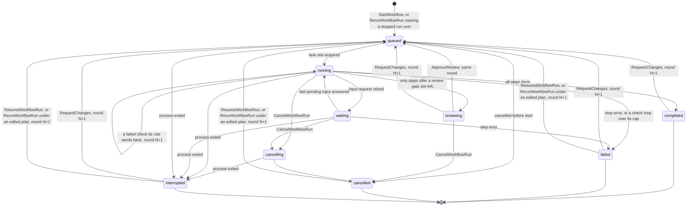

`interrupted` is applied at startup by `MarkInterruptedExecutions` to any execution that was still active when the previous process exited. What counts is the state last saved: each change to a run's header is saved (`persistRun`), and a save that fails, as when the database stays busy past its timeout, is tried once more; when that fails too, it is logged and the run's timeline warns that a restart will show it as last saved, which for a run that ended can be `interrupted`. Checks that were running are marked cancelled and queued ones skipped, and a tracker change caught mid-write is failed so a person can retry it. Its `pending` and `delivering` inputs are cancelled at the same time; an answer caught mid-delivery is not replayed after a restart because the run and its A2A tasks no longer exist.

So "the previous process" must have exited: only one Inkuna at a time uses a data directory. Before it opens the store, the service takes the operating system's lock on `inkuna.lock` in the data directory (`internal/filelock`) and holds it until it quits. While another Inkuna holds it, startup fails with `ErrDataDirInUse` and opens nothing, so the first one's live runs are not marked interrupted and the questions waiting in its inbox are not cancelled. The lock belongs to the open file, so a crash never leaves it held. The desktop also sets Wails' single-instance lock, named by the data directory (`app.InstanceID`): a second launch of the app brings the running window forward and exits before it reaches the service. Inkunas on different data directories run side by side.

Quitting the app (`Service.Shutdown`) cancels every active run and closes every runtime adapter Inkuna built, the ones a configuration save replaced included, before it waits for the runs to end. Closing an adapter ends every CLI it started, whether a run's worker or a call made outside a run, such as the orchestrator planning a request, proposing a title, or proposing branching. It cancels each call, Copilot's server listing included, asks each process group to stop, and kills any group with a process still in it five seconds later, even once its call has returned, since a process the CLI started may have outlived it. The adapter starts nothing more. Nothing else ends a call made outside a run, and the app would quit with its model still running. A worker left running by a crash, rather than a quit, is not ended this way.

That one ends at the next start on the data directory. Every worker and check Inkuna starts, and every CLI call outside a run, carries `INKUNA_INSTANCE` in its environment, the data directory's instance ID (`app.InstanceID`, `Spec.Instance`), and what they start inherits it. Only one Inkuna uses a data directory, so once the next one holds the lock, and before `MarkInterruptedExecutions` lets a run be resumed beside them, any process carrying its ID was left by an earlier one (`proc.EndLeftOver`). It reads only its own user's processes and asks each to stop, with its process group: every worker and check leads one, and what it starts that drops the mark stays in it. A group is left alone only when its leader shows an environment without the mark, since Inkuna did not start it; one whose leader ended, or hides its environment, goes. macOS hides the environment of its own system binaries, such as `/bin/sh` and `/usr/bin/make`, so a check run by `make` is found through its marked commands and ended with its group. Two seconds later Inkuna looks again, so a number reused since is not hit, and kills what still carries the mark, with the groups judged again. Windows cannot cheaply read another process's environment and ends nothing at startup. It ends them sooner instead: Inkuna holds one job object with `JOB_OBJECT_LIMIT_KILL_ON_JOB_CLOSE` for its whole life, and every worker, Copilot server listing, and check joins it as it starts (`proc.Start`), with what it starts after. However Inkuna ends, Windows closes the job's handle and ends everything in it. A process starts suspended and runs once it is in the job, so it cannot start a child that escapes first. Inkuna itself stays out of the job, so what it opens for the user, such as a browser for a link, outlives it.

`reviewing` is a run paused at a review gate, an approval stage with `review: true` (`internal/app/review.go`). Its goroutine has ended, so it holds no task slot and nothing of it runs, and it survives a restart: `MarkInterruptedExecutions` leaves it and its gates' questions alone. Each gate is a question to the `human` agent, marked as a review in the inbox; `ApproveReview` carries the run on past every gate it is paused at, in the same round, and `RequestChanges` sends it back for the next round. Either one, or `CancelWorkflowRun`, moves the run out of `reviewing` with one conditional update, so whichever comes first wins.

A run that `failed`, was `cancelled`, or was `interrupted` can be resumed where it stopped while its worktree still holds what it left (`ResumeWorkflowRun`, `internal/app/resume.go`): a new round runs the steps that stopped or never started, with everything after them, and keeps the branch's commits and the results of the completed steps outside that set. What the stopped steps left uncommitted is kept for them unless the person discards it. See [Feedback rounds](feedback-loop.md#resuming-a-stopped-run-171).

Such a run can also be rerun with an updated plan (`internal/app/rerun.go`, `internal/app/failure.go`). Its detail says why it stopped, step by step, from what Go recorded (`RunFailure`: each step's error, the tool calls its last turn was refused, `runs.denials_json`, and its failed checks), and suggests fixes to its plan from the refusals. Rerun opens the approval screen on the plan the run ran under (`PlanRerun`), with the fixes the person ticked made; `ReviseRerun` rebuilds each edit as a first approval's is. Approving resumes the run, a new round of the same run under the edited plan in which the steps the person edited also run again with everything after them, or starts it over, a new run of the task in a fresh worktree that records the run it came from (`executions.rerun_of`) while the old run stays as it was (`RerunWorkflowRun`). **Save these changes to the rule…** opens the Rules editor on the run's rule with the plan's access changes made, unsaved (`RerunRuleEdits`), for the person to save through `SaveRules`. See [Rerunning with an updated plan](feedback-loop.md#rerunning-with-an-updated-plan-68).

A completed, failed, interrupted, or reviewing run can be sent back with `RequestChanges` (`internal/app/rounds.go`), which starts its next feedback round ([feedback-loop.md](feedback-loop.md)): it runs the targets, every step without a completed result, and everything downstream of them (`workflow.RestartSet`, `workflow.ExecuteRound`), on the same worktree and branch, and reuses every other step's last result from `runs.handoff_json`. Round 1's step runs keep `<run>-<step>`; round N's are `<run>.r<N>.<step>`. A cancelled run cannot be sent back. An evaluation stage whose rule sets `onFailure: feedback` starts the next round itself when its checks fail, in place, with each failed check as an item for its target, until a stage would pass its `feedback.maxRounds` (`internal/app/checkloop.go`); a stage that names `feedback.systemExitCodes` first pauses the run in Messages on a failure only a person can fix, and re-runs its checks, sends them back, or fails as the person answers; `workflow.FailedError` names every step of the batch that failed, so stages that fail together go back in one round. `RunRounds(runID)` reads each round back from SQLite, its step runs, events, and feedback, so the run detail can show any round; a run no longer in memory shows its current round from the same rows (`internal/app/history.go`).

### A task's state

A task's state is derived, never stored: it is its latest run's state, one of the run states above. A task that never ran is `approved` once one of its workflows was approved (`workflows.state`), and `planned` before that. The latest run is the last inserted for the task: a resume or a new feedback round runs again in the same `executions` row, and starting over inserts a new one, so a task whose run failed and was started over reads as the new run does. `Store.TaskStates` (`internal/storage/store.go`) returns it for a list of tasks and `Store.TaskState` for one; both, and the cost reads behind the Costs view and `inkunactl cost`, derive it with `taskStateSQL`. `tasks.state` is the state the task was planned in: `SaveTask` writes it while the task is planned, nothing moves it on, and nothing reads it.

## Reviewing a run's changes

`internal/diff` models what a run changed, for the app's review views and for `inkunactl diff`'s HTML page, which render the same model. It imports nothing from Wails or SQLite: the app resolves a run to the facts the model needs, and the model reads everything else from git.

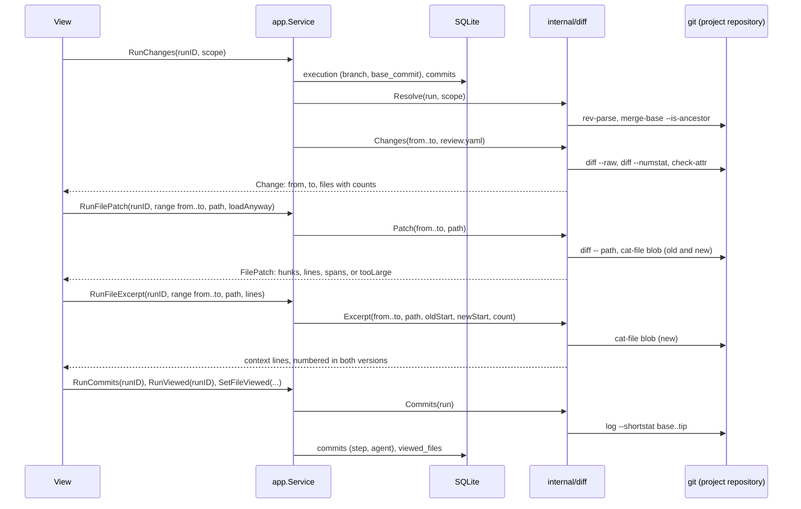

**Where git runs.** Every command runs read-only in the project repository, never in the run's worktree, with commits named by full hash. A worktree shares its repository's objects, so a run's changes stay readable after its worktree is removed. The commands pin the settings a user's git configuration could change in their output (quoted paths, prefixes, colour, external diff and text conversion drivers), take pathspecs literally, and run with `GIT_OPTIONAL_LOCKS=0`, so viewing never writes to the repository or waits on a worker's lock.

**The base commit.** When a run's first writable step sets up its workspace, Inkuna records the commit it starts from (`executions.base_commit`): the new worktree's `HEAD`, or the checkout's when worktrees are off. Runs from before the column existed fall back to the parent of their first recorded commit; a run with neither has no changes to show.

**Scopes.** A scope picks the two commits to compare, and every commit it names must be on the run's branch, between its base and its tip. For a rebased branch that no longer contains its base, every scope measures from where the branch now leaves the base's history, so a `range` of the `branch` scope's two commits still resolves:

| Scope | Compares | Refused when |
| --- | --- | --- |
| `branch` | The base to the branch's tip as it is now, so it includes later commits on the branch. A rebased branch is measured from where it now leaves the base's history. | The branch was deleted. |
| `commit <sha>` | The commit's first parent to the commit. | The commit is the base or not on the branch. Once the branch is deleted, only the run's own recorded commits are accepted. |
| `range <from>..<to>` | Two commits, as for the changes since a feedback round started ([feedback-loop.md](feedback-loop.md#in-the-app-51-62)). | Either end is off the branch, or `from` does not come before `to`. |

Commits are accepted only as hexadecimal hashes, so nothing a view sends can be read as a ref or an option.

**On demand, never cut.** `RunChanges` returns the files with their status (added, modified, deleted, renamed, or copied), modes, line counts, and binary and generated flags, but no patches. It also returns the two commits it compared; for the `branch` scope the view loads each file with a `range` of those, so the patches match the list even when the branch moves on, and for a `commit` scope it loads each file with the commit scope itself, which still resolves once the branch is deleted. `RunFilePatch` loads one file. A patch over 1 MB or 20,000 lines comes back `tooLarge` and `loadable`, with a reason, and loads when asked again with `loadAnyway`, up to 10 MB or 200,000 lines; past that it comes back `tooLarge` and not loadable. A patch is never cut short. `RunFileExcerpt` reads unchanged lines from the newer version of a file the patch left out, at most 1,000 at a time, to expand the context around a hunk; each `FilePatch` says how many lines that version has (`newTotal`), so the view knows whether there is anything below the last hunk.

**Generated files.** Views collapse generated files. Three sources decide, each able to override the one before: the built-in list (lockfiles such as `go.sum`, `package-lock.json`, `yarn.lock`, `pnpm-lock.yaml`, and `Cargo.lock` at any depth, plus `ui/dist/**` and `frontend/wailsjs/**`); `linguist-generated` in the `.gitattributes` of the newer commit compared; and the `generated` list in the repository's `.inkuna/review.yaml` ([inkuna-directory.md](inkuna-directory.md#reviewyaml)), where a pattern starting with `!` shows a path again.

**Highlighting and changes within lines.** Each line comes with spans that join to its text. A span carries a highlighting class and whether it changed within the line. Chroma, picked by file name, tokenizes each version of the file whole, so a line inside a block comment that a hunk starts in is still a comment; a version over 1 MB is not highlighted. Within each hunk, the deleted and added lines at the same position in a run of changes are compared word by word, and the words one lacks are marked; a pair that is mostly different is left unmarked, as is one too long to compare, and once a patch's comparisons reach a shared budget, the rest of its pairs are too. The classes and line tints come from one stylesheet, `diff.Stylesheet`, which the app keeps a copy of in `frontend/src/diff.css` (a test keeps it current) and the HTML page includes. Its colors are the app's dark tokens, with each token's value as the fallback for a page that does not define it, and every highlighting color keeps at least 4.5:1 contrast on the added and deleted line tints.

**Commits.** `RunCommits` lists the commits on the run's branch, oldest first, from where it leaves its base to its tip, the same commits a `commit` scope accepts; once the branch is deleted, the run's recorded commits stand in. Git is the source of the list: each commit's subject, body, author, date, whether it is a merge, and how many files, added lines, and deleted lines it changed, counted with the Changes view's diff flags and, for a merge, against its first parent, so the counts match what its `commit` scope shows. The run's commit records add the step that made each commit and that step's agent, which `commitStep` stores with the record (`commits.agent`, migration 015); a record from before then takes the agent the run's workflow gave its step. A commit Inkuna has no record of, such as one made by hand in the worktree, comes back `external`, with neither. Each commit record also carries the round that made it (`commits.round`, migration 017); `RunCommits` does not return it yet.

### The Changes tab

The run view's Changes tab renders the model like a pull request's Files changed page:

- **Files, Commits, and Checks.** The tab has three views, like a pull request's tabs, and opens for a run that has not written yet, whose Checks are already there. Checks lists the commands of each evaluation step run (`RunChecks`, recorded in the `checks` table, migration 016) with their status, exit code, and duration; a failed or running one starts open. Its log (`CheckLog`, the `check` artifact, or the log so far while the command runs, read from the byte offset the view has whenever an `inkuna:check` event says it grew) shows with line numbers and ANSI colours, a search, a jump to the first line that reads as an error, and a download (`SaveCheckLog`). The run header's "k of N checks passed" opens it. See [rules.md](rules.md#stages) for what a check keeps. Files is the diff, below. Commits lists the branch's commits in branch order, under a header wherever the step that made them changes (the step and its agent, or external), each with its hash, subject, author, date, file count, and added and deleted lines, and a button that copies its full hash. Choosing a commit, or All changes at the top, shows its files.
- **Layout.** A header with "N files changed, +A −D", a scope picker (All changes, or any one commit from `RunCommits`, which shows that commit's message above its files, with Previous and Next to step along the branch's commits), a Unified or Split toggle, "k of N viewed", and Refresh. Below it, a file tree grouped by folder, with each file's status, counts, and Viewed mark, and a filter that narrows the tree and the diff alike, beside every file's diff in tree order. The page scrolls; the tree and each file's header stick to the top.
- **Loading.** A file's patch loads once the file is near the viewport and open, a few at a time. Viewed files and generated files start collapsed, a generated file with a Load diff button; a too-large patch shows Go's reason and loads with `loadAnyway` when asked; binary files, renames, and mode changes with no changed lines say so instead.
- **Long files.** A file's rows render in chunks of 50, only those within a screen of the viewport; the rest keep their place as empty blocks of the height they last had. Lines wrap, so a chunk first drawn above the screen can be taller than its block was, and the view scrolls by the difference so what is on screen stays still.
- **Context.** Each gap between hunks, above the first, and below the last has an expander that reveals 20 lines toward the hunk next to it, or the whole gap when it is no longer than that. Two hunks whose gap is fully revealed join, and the second's header goes.
- **Viewed.** Marking a file viewed collapses it; opening or collapsing a file by hand holds for that version of it. One mark's writes go to Go in order, and when the latest one fails, the screen goes back to the mark Go last confirmed. A mark is a `viewed_files` row: the run, the path, and the file's blob (`File.blob`: its content after the change, or before it for a deleted file). A file whose content changes again has a new blob, so it reads as not viewed; marks on other blobs stay, so a commit scope showing an earlier version still finds its own. `SetFileViewed` refuses a blob that is not a hash and a run that does not exist.
- **A moving branch.** All changes reads the branch's live tip, but the tab keeps the change it loaded, so nothing moves under the reader. When the run commits again, the commit list refreshes, and a notice says how many commits the branch has gained, with a Refresh that loads them.
- **Keys.** `j` and `k` move to the next and previous file, and `v` marks the current one viewed, except while typing in a field or when a dialog is open.
- **Per viewer.** The Unified or Split choice is kept in the webview's `localStorage`; Split falls back to Unified when the diff column is too narrow for two versions side by side.
- **Comments.** On All changes, a line's number picks it for a comment, and a drag picks a range; threads sit under their last line, and those not on the diff's lines, outdated ones among them, are listed above it. `RunComments(runID, tip)` places the run's threads with `diff.Place`, and says whether comments can be written now; `SaveComment`, `DeleteComment`, `ResolveThread`, and `CommentTarget` do the rest. See [feedback-loop.md](feedback-loop.md#line-comments-62).

`frontend/mock.html` renders the tab from fixtures for a visual check without a run, including a 19,000-line file for the scrolling check (`npm run dev --prefix frontend`, then `/mock.html`; `?moved` shows the moving-branch notice).

### The HTML page

`inkunactl diff RUN_ID` renders the same model as one self-contained page (`internal/report`), for reading a run's changes outside the app or sharing them as a file. It reads the run from Inkuna's database and artifact store, as the app does, and starts nothing, so it can run beside the app. It writes `<data dir>/reports/RUN_ID.html` (or `--out FILE`) through a temporary file, prints the path, and with `--open` runs `open` on macOS or `xdg-open` on Linux from argv, never through a shell.

- **Scope.** All of the branch's changes, or one commit: `--commit SHA`, or `--step ID` for the commit a step recorded. `inkunactl diff` has no flag for the changes since a round; the Changes tab shows them with a `range` scope.
- **Content.** A header with the run's title, branch, base, scope, "N files changed, +A −D", and "k of N checks passed". Then the file tree beside every file's diff, highlighted, with changed words marked and a missing final newline marked ⊘, each file collapsible and a generated file starting collapsed. The patches load through `diff.Patches`, which lists the range once for all of them. Then the run's sent line comments, read only: under their lines on All changes, and the rest in a Comments section with the excerpt each was sent with ([feedback-loop.md](feedback-loop.md#line-comments-62)). Then the branch's commits, by step and agent or as external, and the checks: each one's status, exit code, and duration, with a failed one's kept log, its ANSI colours kept, collapsed below it; a log that can no longer be read is noted on its check and costs the page nothing else. A patch over the soft caps is left out with a note to run again with `--include-large`, which loads it up to the hard caps; past them it is never included.
- **Interaction.** A small inline script switches between the unified and split layouts, both rendered into the page, filters the files, keeps Viewed marks (per run, path, and blob) and the layout in the browser's storage when it allows it (a page written with `--split` opens split whatever was kept), and moves between files with `j` and `k` and marks one viewed with `v`.
- **Self-contained and safe.** The page's CSS is the app's dark tokens and `diff.Stylesheet`; there are no fonts, images, or links off the page. Everything from the run is escaped by `html/template`, and a Content-Security-Policy with `default-src 'none'` allows only the page's own style and script, named by their SHA-256 hashes, so nothing on the page can load from the network or run as script, even if it slipped past the escaping.
- **Stable.** The same run renders the same bytes; only `inkunactl diff` itself puts the time on the page. A golden-file test holds the page for a fixture run.

## Configuration precedence

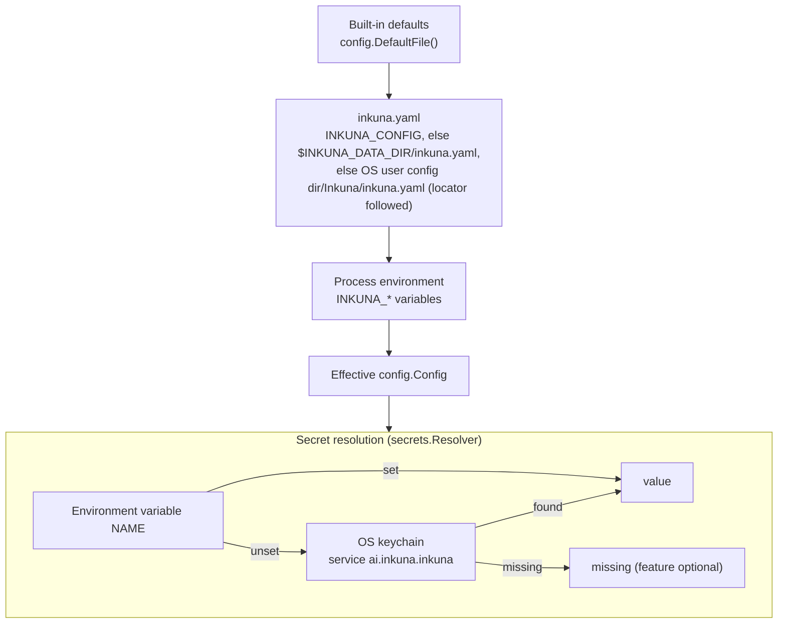

Secret names are declared in `inkuna.yaml`; values are never written to YAML or SQLite, and every secret Inkuna resolves, a worker's or an MCP server's, must be declared there. A worker's environment gains only the secrets declared for its runtime plus those its agent definition lists. A granted MCP server's secrets are delivered for the server, not the worker ([MCP servers a step is granted](#mcp-servers-a-step-is-granted)): in the call's own configuration file for Claude Code and Copilot, and for Codex in its own process environment, which `shell_environment_policy.exclude` keeps out of the model's shell. What else a server's process inherits is up to the CLI that starts it: Codex passes a server only `HOME`, `PATH`, `LC_CTYPE`, and its own variables, while a server Claude Code or Copilot starts may also inherit the CLI's environment, the worker's own secrets included.

## Data model

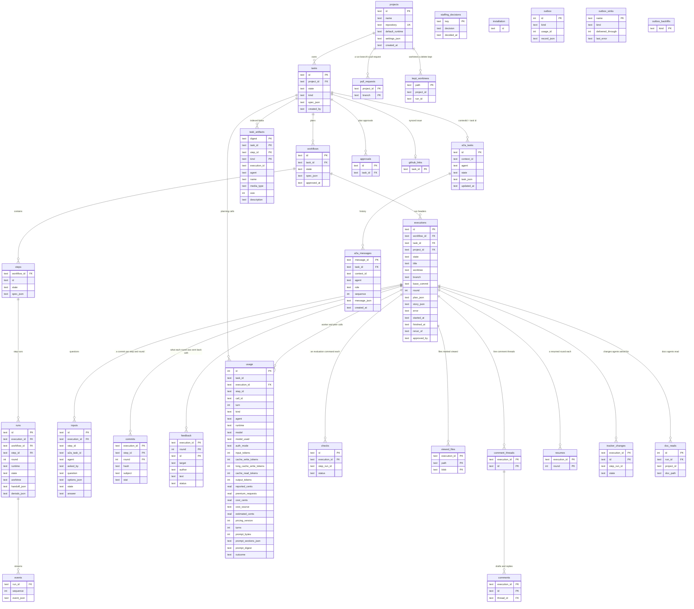

`staffing_decisions` keeps each validated staffing decision under the hash of the call that made it, for a plan with the same inputs to reuse ([agents.md](agents.md#how-the-orchestrator-chooses)). `usage` has one row per model call ([usage accounting](#usage-accounting)), with its cost and where that came from ([cost accounting](#cost-accounting)), indexed by task and end time for what a task or a period cost ([cost per task](#cost-per-task)); it keeps a prompt as the byte size of its sections and, for a worker or peer call, the digest of the prompt in the artifact store. Large content (context envelopes, prompts, the full text of envelope parts a budget cut, handoffs, diffs, declared outputs, the orchestrator decision) lives in the content-addressed artifact store and is indexed in `task_artifacts` by kind: `context`, `prompt`, `full-text`, `handoff`, `diff`, `output`, `document` (a stage's plan, [agents.md](agents.md#plan-documents)), `archive` (what a completed run left in `.inkuna/out`), `decision`, `check` (an evaluation command's log), and `remote-request` and `remote-reply` (what a remote advisor was sent and returned). A2A artifacts reference blobs with `inkuna://artifact/<digest>` URIs. `installation`, `outbox`, `outbox_sinks`, and `outbox_backfills` hold what is delivered to the audit and usage sinks a binary that embeds Inkuna registers ([extensions.md](extensions.md#storage)): the outbox is empty without one, and no foreign key reaches it.

## Data lifecycle

Inkuna keeps every task, its plan, and everything its runs produced until a person deletes it (#64). Deleting is `DeleteTasks(taskIDs, options)`, or `DeleteRun(runID, options)` for one run of a task that has others, in the app (`internal/app/delete.go`), and `inkunactl tasks delete` from the terminal. Both go through `TaskHistory`, so they decide the same way; `PreviewDeleteTasks`, `PreviewDeleteRun`, and `inkunactl tasks list --finished` show what a delete would take before it does. The app's previews give a run's reason from memory before the store's, as a delete does, since a stored state can still say `queued` after the run has started.

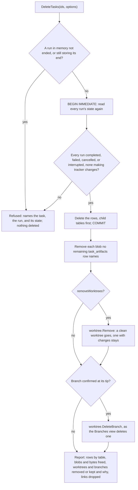

- **Only finished tasks.** A task is deleted only when every run it has ended: `completed`, `failed`, `cancelled`, or `interrupted`. A run that is queued, running, waiting for an answer or a permission, paused for review, being cancelled, or sent back for another round refuses the whole call with the task, the run, and its state, and nothing is deleted. So does a run still making the tracker changes its approval released, and a task that does not exist. The states that allow a delete are listed, not the ones that refuse it, so a state added later refuses until someone decides. A plan that never ran has no runs and can be deleted.
- **One transaction.** The app checks the runs it holds in memory, which are ahead of the store, under `workspaceMu`, so no run is sent back or resumed meanwhile. The rows then go in one `BEGIN IMMEDIATE` transaction that reads each run's state again with SQLite's write lock held, which is what makes a delete from `inkunactl` beside the app safe. Each child table goes before the parent its foreign key names: a step run's events, then the step run; a comment, then its thread; a run's feedback, commits, checks, viewed files, resumes, tracker changes, questions, doc reads, and usage, then the run; the run, then the plan's steps and the plan; the task's A2A tasks and messages, its `task_artifacts`, `approvals`, and `github_links`; and the task last. Migration 026 adds the indexes these deletes look rows up by. `DeleteRun` removes one run's rows the same way, with its A2A tasks (each names its run in its metadata, and a question's is on its input) and the artifacts it indexed, and keeps the task, its plan, its planning calls, and its other runs; it refuses a task's only run, which goes with the task. Storing the same content for the same step twice keeps one `task_artifacts` row, under the run that stored it first, so an index row that another run's check log, prompt, handoff, or messages still refer to moves to that run instead of going. `storage/delete_test.go` fails when a table that holds a task's rows is not deleted with it. The outbox is not one: what was queued for a sink from a deleted task's rows is still delivered ([extensions.md](extensions.md#usage-sink)).
- **Blobs.** After the rows, each blob the deleted rows indexed is removed unless another task still indexes it. Every blob Inkuna stores is indexed in `task_artifacts` when it is stored (`storeArtifact`), so a blob no row names is one nothing reads. In the app, `artifactMu` is held for reading while a blob is stored and indexed and for writing while a delete checks and removes one, so content stored again in between keeps its blob.
- **Worktrees and branches stay unless asked.** With `removeWorktrees`, each deleted run's worktree goes through `worktree.Remove`, which keeps one with uncommitted or untracked changes. A worktree a delete leaves, other than one another run still works in, is recorded in `kept_worktrees` (migration 027), since nothing else says the directory is Inkuna's once its run's rows are gone; see [disk usage](#disk-usage). A branch is deleted only when `deleteBranches` names it under its project, since two projects can each have a branch of one name, with the commit the person confirmed, after the preview showed its tip and how many commits only it has, and then only as `DeleteBranch` deletes one ([branching.md](branching.md#deleting-branches-without-an-upstream)): without an upstream, not the base, still at that commit, with the worktree it is checked out in going too only when it is one of the deleted runs' and clean. A worktree or branch another run still works on, and the branch a run committed to in the project checkout, are kept. The rows go before any of this, so nothing can resume a run while its worktree goes, and whatever is kept is in the report with why.
- **Nothing outside Inkuna changes.** Deleting a task forgets its links to tracker issues, its run stories and any `github_links` rows, and the report lists them; it never writes to GitHub or Linear.
- **Beside the app.** The app forgets a deleted run at once. A delete from `inkunactl` changes only the store, so the app may still list a deleted run it holds in memory until it restarts; acting on it fails, since its rows are gone. Sending a run back, resuming it, and the check loop all claim the run with a conditional update of its stored state, so a delete from `inkunactl` either sees the run reopened and refuses, or deletes it first and the reopen finds nothing to claim. `inkunactl` does not share the app's `artifactMu`: a step in the app that stores content identical to a blob being freed, at that moment, can lose its blob.

### In the Tasks view

The Tasks view lists runs, newest first, and filters them by state (completed, failed, cancelled, interrupted, or not ended), project, and age (older than a day, a week, 30 days, or 90 days, by when the run ended, or started if it has not). **Select** turns on selection, which is by task: ticking any run of a task picks the task. `WorkflowRuns` carries `deleteRefused` on each run, Go's reason for refusing its task now, judged on the runs in memory and then on the stored ones (`storage.TaskStandings`, by the same rules as a delete); a run with one has no checkbox, and its tooltip gives the reason. **Select all finished** picks every task the filter shows that has none, and a delete takes only the picked tasks the filter still shows, so a filter changed since never widens it. An ended run's detail has **Delete…** too: for a task with other runs it offers deleting only this run (`DeleteRun`, the default) or the whole task, and for a task's only run it deletes the task.

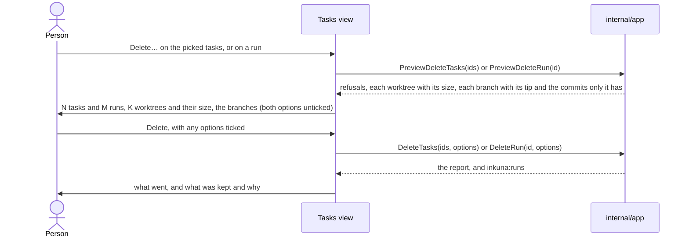

The confirmation is an in-app dialog. It lists Go's refusals, if any, and while there are some nothing can be deleted. **Also remove worktrees** and **Also delete branches** start unticked. A branch with commits no other branch has is listed by name with how many, and ticking **Also delete branches** deletes only the branches whose commits are all elsewhere: one with unmerged commits needs its own tick, which names the commits it would lose. Each branch goes at the tip the preview showed. After the delete, the dialog shows Go's report, including every worktree and branch kept and why, and the list drops the deleted runs at once, before `inkuna:runs` refreshes it.

### Removing a project

Removing a project takes it out of `inkuna.yaml` and marks it removed rather than deleting its row, so its history stays readable under its name unless the person deletes that too, through `DeleteTasks` ([configuration.md](configuration.md#projects)). It never touches the repository, its branches, or its runs' worktrees.

### Disk usage

`StorageUsage` measures the artifact store (`artifact.Store.Usage`) and every worktree Inkuna made that is still on disk, once each: those a run records and has not removed, and those a delete kept. It lists the kept ones with their size, project, branch, the deleted run they came from, and why they were kept. A kept worktree whose directory is gone, or that a run records as its own again, is no longer one a delete kept, so its record is dropped as it is listed. Settings shows this under **Disk usage**, measured when the view opens and on **Measure again**, since measuring walks every worktree. **Remove…** on a kept worktree asks first, as **Remove worktree** does in the run view, and then `RemoveKeptWorktree(path)` removes it only when Inkuna recorded keeping it, no run records it, it is not the project checkout, and it has no uncommitted or untracked changes. Its branch and commits stay; the Branches view deletes a branch.

Settings also shows **Third-party notices**: the copyright and license text of every Go module and npm package the app is built from, which their licenses require to go with every copy. `internal/notices` generates `THIRD_PARTY_NOTICES` at the repository root from what `go list -deps` finds in the main package for each platform `task package` builds, the Go standard library, the production packages in `frontend/package-lock.json`, and the two build tools whose code lands in the page (Vite's module preload polyfill and Tailwind's base styles). Each entry is the package's own license files verbatim, or the License section of its README when it ships no file. Its test fails when the committed file no longer matches, or when a shipped package has no license text, and `task notices` rewrites it. The page imports the file as `virtual:third-party-notices`, so every build carries it, in a chunk loaded only on **Show notices**.

### Pull requests

`CheckPullRequests` links each run branch to the pull request opened from it, with one `gh pr list` per project when the Tasks view opens, at most every five minutes unless the person presses **Check pull requests**, and stores the links in `pull_requests` (migration 028), keyed by project and branch. The runs list and a run's detail carry the link (`WorkflowRunView.PullRequest`): the list shows its number and state, the workspace section links it, and the **Pull request merged** state filter lets **Select all finished** and **Delete…** take merged tasks together. Deleting history stays the person's choice. A repository whose `worktrees.cleanup` is `merged` has the check remove the clean worktrees of ended runs whose pull request merged, keeping their branches ([pull requests](branching.md#pull-requests)).

### From the terminal

`inkunactl tasks list [--finished]` prints each task with its runs, state, and when it last ran; `--finished` lists only the tasks a delete accepts. `inkunactl tasks delete [--remove-worktrees] [--delete-branches] TASK...` prints the preview, asks once before deleting, and with `--delete-branches` asks again for each branch it could delete, naming its tip and the commits that would be lost. Anything but yes is no.

## Trust boundaries

Inkuna treats every model output as untrusted input and enforces policy in Go.

Epic #149 changes two boundaries below. Workers start the MCP servers a step is granted (#151, [MCP servers a step is granted](#mcp-servers-a-step-is-granted)). Inkuna writes to a run's tracker with the project's credential, only as far as `.inkuna/tracker.yaml` allows and, for changes an agent asks for, only after a person approves the run. #153 built the writes and the ceiling: every one goes through `tracker.Guard`, which refuses a write the two files do not allow before it reaches the adapter and puts every write, made or not, on the run's timeline. Since #154 a run makes Inkuna's own updates to its story, In Progress, its result, and Done on request, within the settings it was approved under, which a later change can lower but never raise ([Inkuna's own updates](mcp-and-trackers.md#inkunas-own-updates-154)); none of them ever fails a run. Since #155 an agent asks for tracker changes in its handoff; Go checks each when the step ends and makes it only once a person approves the run at a review gate after the step ([Changes an agent asks for](mcp-and-trackers.md#changes-an-agent-asks-for-155)). [mcp-and-trackers.md](mcp-and-trackers.md) is the design.

**What Go validates**

- Orchestrator decisions: every agent stage must be assigned exactly once, a stage a rule staffed must keep the rule's agent and takes only its own skills, the agent must exist and must not be the orchestrator, a read-only agent can never be assigned to a `worktree-write` stage, complexity must be 1 to 10 with a rationale, and every selected skill must exist in the repository. A rejected decision falls back to deterministic staffing and the plan records why. A kept decision a later plan reuses is validated again.
- Rules: unknown fields are rejected, the flow must end with an `approval` stage, dependencies must be declared earlier, a rule can narrow but never widen an agent's permission, and every command is an argv array that runs no shell and carries no permission-bypass flag, with an agent stage's commands plain words, since each is allowed as one exact command line ([rules.md](rules.md#stages)). A shared stage from a global or built-in library passes the same checks once expanded, and a plan records a digest of each one its rule used, so approval refuses the plan once one has changed and a library's commands run only as the approval screen showed them ([rules.md](rules.md#changes-between-planning-and-approval)).
- Agent definitions: names are lower-case slugs matching the file name, `auto`, `orchestrator`, and `human` are reserved, permission must be `read-only` or `worktree-write`, and frontmatter keys Inkuna does not know are ignored and kept (`Definition.Extra`), so saving an agent preserves them.
- Approval: on each agent step the user may change the agent, the runtime, the complexity score, and the step's access (its permission, the commands its worker may run without asking, and its allowed paths), and on each evaluation step its commands; every other step and every other field must match the persisted plan (`validateApprovalChanges`). `ReviseWorkflow` (called on every edit) and `StartWorkflow` both rebuild each step from the persisted plan and those inputs with the planner's own `Restaff` and `EditCommands`: the previous agent's skills, turn budget, and pinned model leave with it, the new agent's are applied, a read-only agent is refused on a `worktree-write` step, a remote agent stays read-only, forces the remote runtime, and a local one cannot claim it, an agent's pinned runtime beats the edit, commands pass the rules' argv checks, allowed paths stay inside the repository, a step feedback goes to stays writable, and routing runs again ([rules.md](rules.md#changing-a-steps-access-at-approval)). Each access change is recorded on the step (`WorkflowStep.AccessEdits`) against the plan, marked when it widens the step, and the approval screen warns about those. Planning also records where each step came from when its rule used a shared stage or group (`WorkflowStep.From`: the shared stage, the groups it came through, the definition's scope and file, which for the repository's own is its rules file, and the fields the flow overrode), kept with the plan so a later edit to a library cannot change what an approved plan shows; an approval that sends another one back is refused like any other change outside staffing and access, and the approval screen and the run's step list show it as a badge, "shared: verify-and-approve (global)", that opens on the definition's file and the overridden fields ([rules.md](rules.md#expansion)). Planning notes each of the repository's own definitions the rule used that replaces a global or built-in one. Planning also records what each agent and evaluation step's stage gave it (`WorkflowStep.RuleAccess`), which an approval must leave as it is; a rerun carries a change into the rule only where the rule still gives what it recorded ([rules.md](rules.md#saving-a-reruns-changes-to-the-rule)). `StartWorkflow` then refuses the approval if its agent, runtime, model, score, skills, permission, commands, or allowed paths differ from that derivation (the view is stale: an agent, skill, or routing band changed after the plan was shown, or the view was not revised for an edit Go settles itself, such as the paths a step made read-only gives up), and runs Go's derivation, never the view's copy. The app keeps what Go last accepted on the approval screen, the steps, a rerun's resume, and a saved title, while another screen is open, so coming back shows and approves the plan as edited, not as first planned; a refused edit is not kept, nor one Go answers after the screen closed (the screen that opened since never showed it), while a title Go saved then is still kept, and a new plan or rerun drops them. A step must be staffed with a defined agent before a run starts.
- Handoffs: statuses are normalized; declared output paths must stay inside the working directory and under 8 MB; peer targets must be defined workers other than the sender. Each tracker change is checked against the step's kinds, the repository's settings, and the tracker (`tracker.Guard.Check`), kept pending or refused, and taken out of the stored handoff; none is made before the run is approved.
- Runtime streams: an `error` or `turn.failed` event from Codex, an `is_error` result from Claude, or an error event from Copilot fails the step even when the process exits zero, so a rate limit or provider outage never masquerades as a completed worker.
- Configuration: unknown keys are rejected so credentials cannot sneak into YAML; secret names must look like environment variable names.
- Change review: a scope names commits only by hash, each must lie on the run's branch between its base and its tip, and a file must be one the scope changed. Viewing runs read-only git in the project repository and never writes to it ([Reviewing a run's changes](#reviewing-a-runs-changes)).
- Extension policies ([extensions.md](extensions.md#policy)): a binary that embeds Inkuna may register policies, which Go asks at a plan or review approval, a tracker write, an MCP grant, an allowed permission, and a rules, agent, or `inkuna.yaml` save, only once every check here has passed. A policy can refuse what Go allowed, never allow what Go refused, and one that errs or does not answer in time refuses.
- Remote advisors ([remote-a2a.md](remote-a2a.md)): an external A2A agent is only ever a read-only step's staff. Planning, the orchestrator check, workflow validation, and run start each refuse it a `worktree-write` step. It is sent a purpose-built handoff with no instructions, paths, commands, or transcripts, only to the origin whose Agent Card the user reviewed and pinned (HTTPS on a public address by default; an entry marked `allowInsecure` by hand in `inkuna.yaml` may use plain HTTP or a private address, which gives that protection up for that agent), and what it returns reaches other agents as a labelled, untrusted summary.

**What agents can and cannot do**

- Read-only steps run with the runtime's read-only sandbox; writable steps run inside a dedicated worktree, never the user's checkout, unless the repository's branching configuration turns worktrees off. Then they run in the checkout only when it is clean, on a branch other than the base, one run at a time ([branching.md](branching.md)).
- Workers receive only the secrets declared for their runtime and agent, and only if those names are declared in `inkuna.yaml`. The process environment is not inherited wholesale: the runtime adapters start from a non-secret baseline (path, home, locale, temp, TLS and proxy settings, provider config-directory variables) and add the declared secrets, so an API key sitting in the user's shell never reaches a worker unless it is declared. An `evaluation` stage's checks start the same way, with every secret `inkuna.yaml` declares, since an agent can edit what a check runs and reads the log of one that fails. Their logs hide the declared secrets' values and those of the credential-looking variables in Inkuna's own environment that the check was not given.
- Workers start only the MCP servers their step is granted from those `inkuna.yaml` declares, with only the tools each declaration lists on their allowlist, and a server's secrets reach the server, never the worker's arguments, prompt, or shell. A step granted none starts none, unless its runtime's `userMcp` names some of the user's own servers, which every step on it is given with all their tools. Codex skips `config.toml`, or with `userConfig` is told to switch off each server there it is not given, and Copilot is told to disable the built-in GitHub server and every server of the user's it lists but those, or the worker does not start. Copilot's shell commands run in its OS sandbox, which Inkuna switches on with the one feature flag it needs, and a Claude Code worker given a server's secrets or any of the user's own servers runs its shell commands in Claude Code's sandbox, which keeps them from the servers' configuration. Permission-bypass flags are never used. See [What a worker's CLI loads](#what-a-workers-cli-loads).
- The step's permission becomes each CLI's own flags. Codex gets `--sandbox read-only` or `workspace-write`. Claude Code gets an explicit `--allowedTools` list: a read-only step may read and search and has the edit tools denied, while a writable step adds the edit tools and `--permission-mode acceptEdits`, which accepts edits inside the working directory (the worktree) and nothing beyond it. A headless CLI refuses every call that would need a prompt, so without those flags no write in the worktree succeeds. Shell commands are allowed one exact command line at a time: the stage's `commands`, plus anything approved below.
- **Permission requests.** When a worker is refused a tool call, the step does not silently finish without it. Claude Code lists the refused calls in its final result (`permission_denials`); Inkuna turns the grantable ones into one inbox request on the worker's A2A task (`input-required`), offering *Allow for this run* or *Deny*. The request is a one-line heading (who was denied how many commands or tools, on which step) and a stored list of what it asks for, which Messages shows numbered, each command in its own block; the worker is told the heading and the list when it is approved. Approval re-runs the turn with exactly that command line or tool added to the allowlist and tells the worker to retry; declining finishes the step with the handoff the worker produced without it, at no further cost. An approval lasts for that run only, is never written to `inkuna.yaml` or the rules, and is asked at most once per denial. Four things can never be approved this way: a file edit (only the step's `permission` decides that, so a read-only step stays read-only and a writable step stays inside its worktree), the shell as a whole, a command line a rule's `commands` could not list (quotes, or a character such as `*`, `?`, `;`, `&`, `|`, `$`, or `~`, which the CLIs read as a pattern or as more than one command, so approving `rm -rf build/*` would also allow `rm -rf build/ ~/src`), and a command that appears to carry a credential, which is redacted and logged instead of stored. Such a refusal stays a warning in the run. Peers never raise requests. To allow a command on every run, add it to the stage's `commands` in `.inkuna/rules.yaml`; to allow it for one run from the start, add it to the step's commands on the approval screen.
- Workers can pause for human input, ask peers (one level deep, read-only), and declare outputs. They cannot push, open pull requests, or commit on the user's behalf outside the worktree.
- **Human answers reach checks from Inkuna, not from agents.** A deterministic `evaluation` stage that must verify what the user approved reads it from the file `INKUNA_HUMAN_INPUTS` names, not from anything in the worktree. Inkuna writes that file read-only before each of the stage's commands, from the answers it recorded in its own store for the `human-input` stages upstream of the stage in the same run, and keeps it in the run's data directory, outside the worktree or checkout a writable step is given. Because it is written again before every command, a command, such as a repository script an agent edited, cannot change what the next command reads. Commands run as the user, so this is not a sandbox: a command could still change the file's mode and rewrite it for itself. An agent that made a change therefore cannot also author the record of who approved it. A human-input step records its answer as answered before it completes, so every stage after it finds the answer.
- A worker's turns per step are not capped; each turn has the worker wall-time budget. Peers answer within 600 seconds. Model turns within one invocation (`--max-turns`) are bounded only when the agent definition sets `maxTurns`; otherwise they are unlimited, as is the orchestrator's planning call unless `orchestrator.maxTurns` is set.

**Approval gates and least privilege**

- Planning is read-only. The orchestrator runs with read-only permission, no tools unless `orchestrator.readTools` is set, and a strict output schema.
- Nothing executes until the user approves the plan. Human-input stages and worker questions pause execution until answered.
- Inkuna auto-commits each writable step on the run's branch, named by the repository's branching configuration, and never pushes. GitHub writes, pull requests, and integration remain manual; the one push or pull request Inkuna makes is a settings share the user confirms in the Branches view, of the settings files it listed ([branching.md](branching.md#sharing-settings-edits)). A worktree is removed only under the cleanup policy the repository chose or from the run view, only when it is clean, and never with its branch.
- Concurrency is bounded by `concurrency.maxTasks` (runs) and `concurrency.maxWorkers` (steps within a run).
- Runs active when the process dies are marked `interrupted`; nothing resumes on its own. A person can send an interrupted, completed, or failed run back with `RequestChanges`, which runs the plan it was approved with ([feedback-loop.md](feedback-loop.md)). Rerunning a stopped run with an edited plan is a new approval, held to every check a first one is; a fix Go suggests changes nothing until the person ticks it and approves the plan ([feedback-loop.md](feedback-loop.md#rerunning-with-an-updated-plan-68)).
