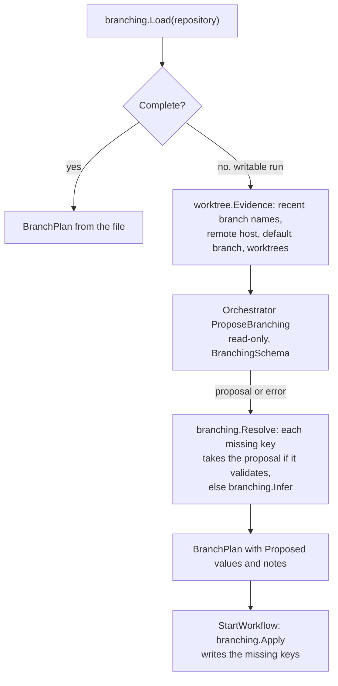
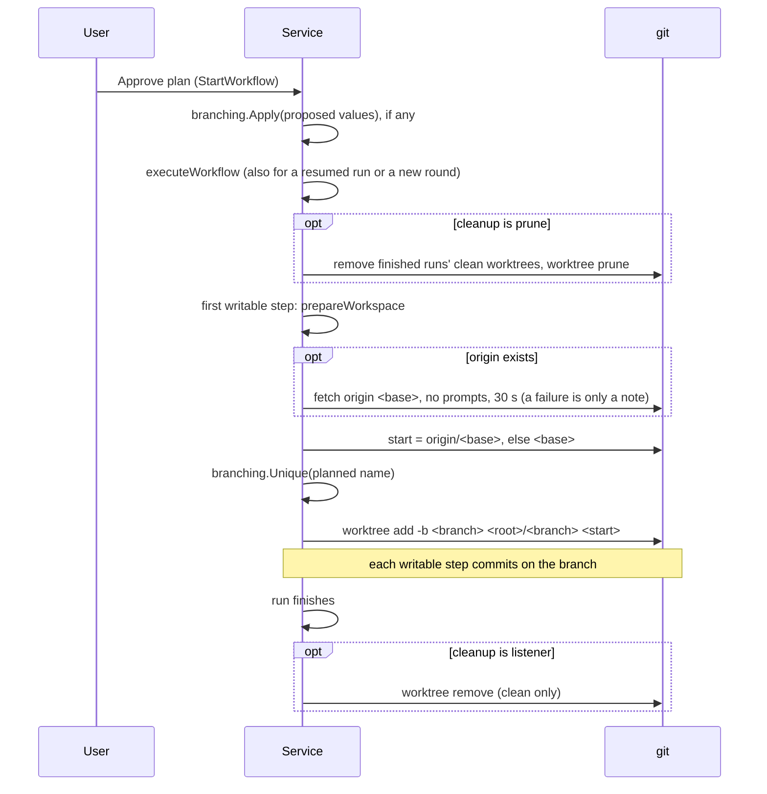
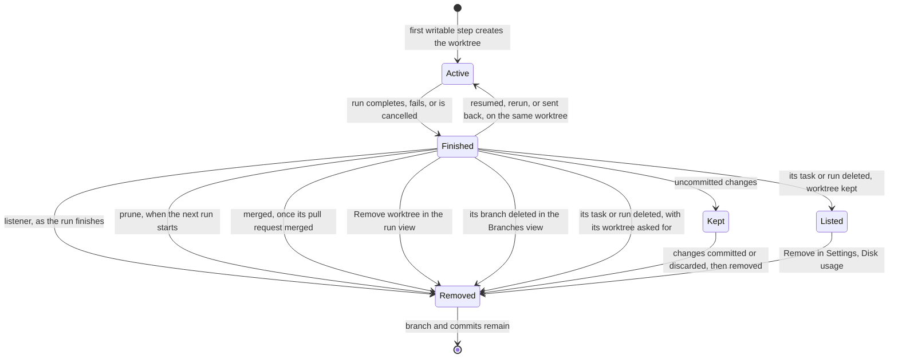
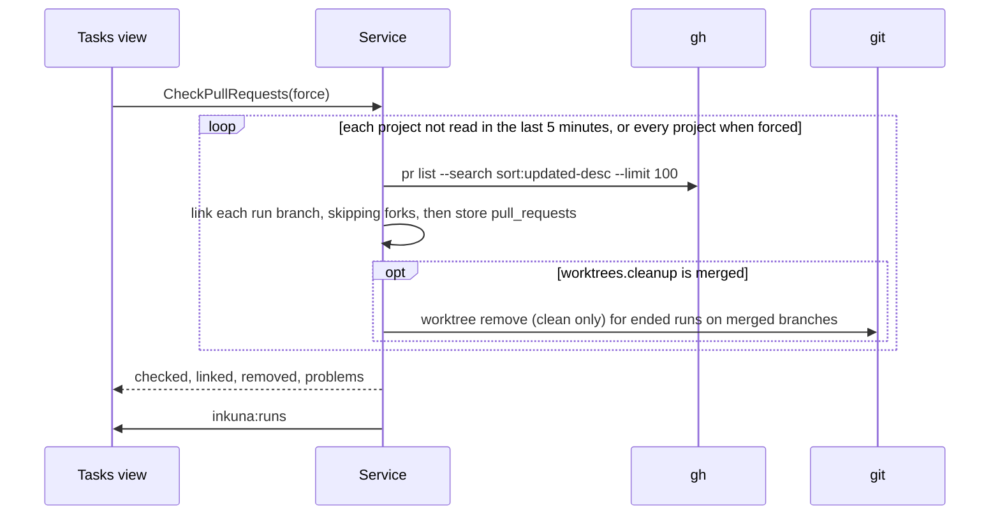
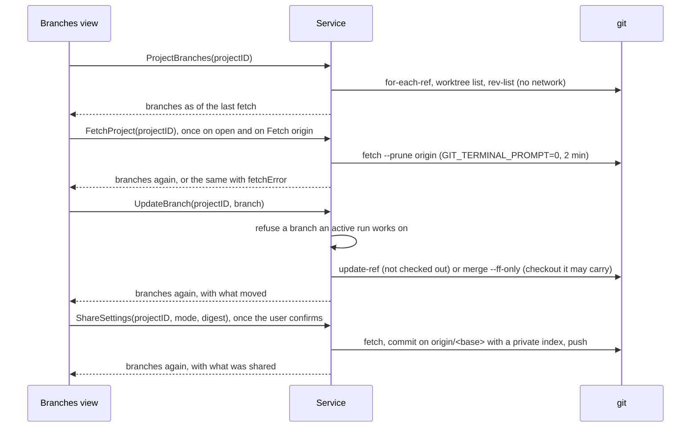
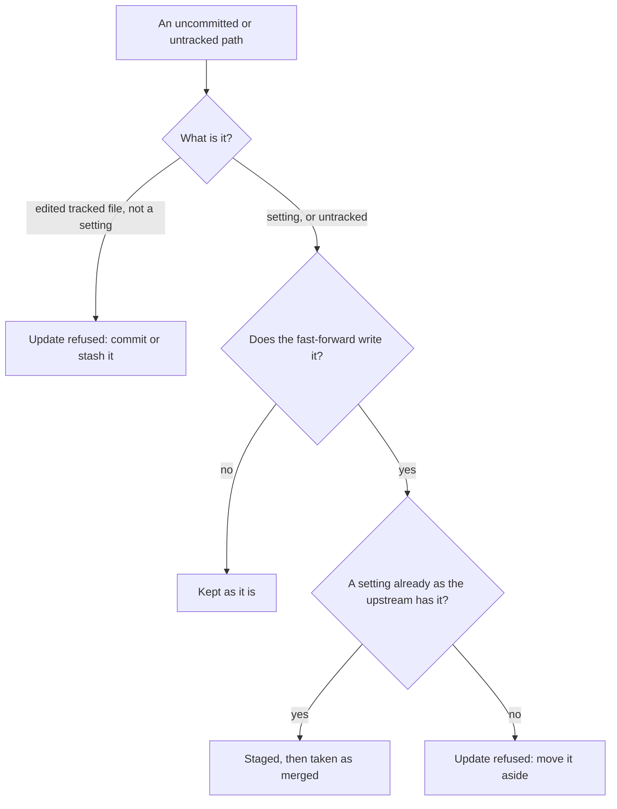
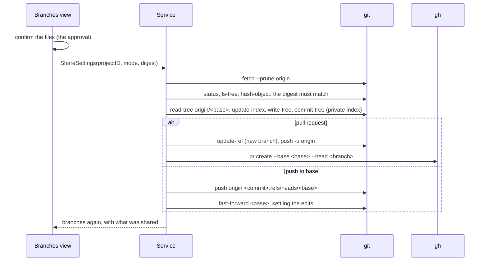
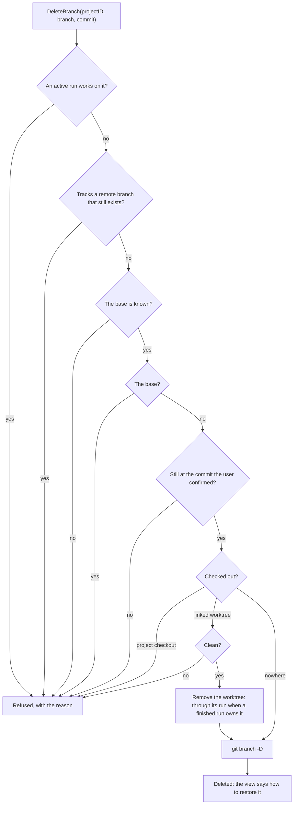

# Branching and worktrees

A repository's `.inkuna/branching.yaml` decides how work on it is branched: which tracker its stories come from, how a branch is named, which branch new work starts from, and whether writable work happens in a worktree, where those worktrees live, and when Inkuna removes them. Inkuna's runs and `inkunactl branch new` read the same file through `internal/branching`, so a branch made by a run and one made by hand follow the same rules. When the file is missing or incomplete, planning has the orchestrator propose the missing values, Go validates them, and approving the plan writes them.

## The configuration

```yaml
version: 1
tracker: linear            # linear | jira | github | none
branch:
  base: main
  pattern: "{type}/{story}-{slug}"
  types: [feature, bug, chore, refactor, hotfix, enabler]
  kindTypes:
    documentation: enabler
  maxLength: 50
worktrees:
  enabled: true
  location: ../{repo}-worktrees
  cleanup: listener        # listener | prune | merged | manual
out:
  cleanup: archive         # archive | remove | keep
```

| Key | Required | Meaning and validation |
| --- | --- | --- |
| `version` | no | `1`. |
| `tracker` | yes | Where stories come from: `linear`, `jira`, `github`, or `none`. Decides the story id format in branch names and which tool an interactive agent uses to read a story. Inkuna's intake (request, GitHub, Linear) is unaffected. |
| `branch.base` | yes | The branch new work starts from. A plain branch name: letters, digits, `.`, `_`, `-`, `/`; never an option or a revision expression. |
| `branch.pattern` | yes | The branch name, from `{type}`, `{story}`, and `{slug}`. Must contain `{slug}`; any other text is limited to letters, digits, `.`, `_`, `-`, `/`; a sample rendering must be a valid git branch name. |
| `branch.types` | no | Allowed `{type}` values, lower-case. Default `feature, bug, chore, refactor, hotfix, enabler`. |
| `branch.kindTypes` | no | Task kind to type, for runs whose labels name no type. Each value must be in `types`. |
| `branch.maxLength` | no | Cap on the whole name; `0` (default) is none, otherwise at least 12. |
| `worktrees.enabled` | no | Default `true`. `false` runs writable steps in the project checkout on the branch it has checked out. |
| `worktrees.location` | no | Directory worktrees are created under. Relative paths resolve against the repository and `{repo}` is its directory name; `~/` and absolute paths are allowed. Empty means `<data dir>/worktrees/<repo>`. A location inside the repository is refused, because its worktrees would appear as untracked files in the checkout. |
| `worktrees.cleanup` | no | `listener`, `prune`, `merged`, or `manual` (default). See [Cleanup](#cleanup). |
| `out.cleanup` | no | What a completed run does with `.inkuna/out`: `archive` (default), `remove`, or `keep`. See [.inkuna/out after a run](#inkunaout-after-a-run). |

Unknown keys are rejected. A key that is present is always validated, even when other required keys are missing. `internal/branching/self_test.go` keeps Inkuna's own file complete.

## Naming a branch

`{type}`, `{story}`, and `{slug}` are substituted into the pattern. Without a story id, `{story}` is dropped together with the `-`, `_`, `.`, or `/` that joined it to its neighbour, so `{type}/{story}-{slug}` becomes `feature/add-login` and `{story}/{slug}` becomes `add-login`. A pattern is only accepted when it renders a valid branch name both with and without a story.

| Tracker | Story id in the name | Where a run finds it |
| --- | --- | --- |
| `linear`, `jira` | `MAD-12` (key, upper-cased) | The imported issue's reference (key or URL), then a task label, then a key that leads the title, then one that leads the objective (`MAD-12: ...`). A key elsewhere in either is ignored, so `UTF-8` is never a story. |
| `github` | `12` | An `/issues/12` URL in the reference, then a label, the title, or the objective containing `#12`. |
| `none` | never | |

A run's type is the first task label equal to a configured type, then `kindTypes` for the task kind, then a conventional type for the kind when the configuration lists it (implementation `feature` or `feat`; bugfix `bug`, `fix`, or `bugfix`; documentation `docs`, `doc`, `enabler`, or `chore`; skill-authoring `chore` or `enabler`; research `spike` or `chore`; review `chore`), then the first type. The slug comes from the task's title, without the story id; a task from before titles takes it from the objective's first line. A title changed on the approval screen names the planned branch again (`SetPlanTitle`), with the values a plan proposed for a missing configuration applied as approval will write them.

The two callers treat a bad name differently, on purpose:

| | `inkunactl branch new` (a person or agent naming a branch) | An Inkuna run (`Config.ForTask`) |
| --- | --- | --- |
| Unknown type, malformed story id | Refused | Not possible: the run derives both |
| Over `maxLength` | Refused, naming the length | The slug is shortened at a word boundary |
| Name already taken locally or on origin | Refused | `-2`, `-3`, ... is appended (`branching.Unique`) |

## When the configuration is missing

A configuration is incomplete when the file is absent or lacks `tracker`, `branch.base`, or `branch.pattern`. Planning only acts on that for a run with a writable step; a read-only run plans as before, carrying only the cleanup policy of an existing file.



The orchestrator sees only the evidence: up to 40 recent branch names, origin's host, its default branch, the current branch, and other worktrees' paths. It never sees file contents: the call runs read-only in an empty temporary directory, not in the repository. Go checks each proposed value on its own: the tracker must be one of the four, the pattern must pass the pattern rules, and the base must be a branch the evidence shows. A rejected value falls back to `branching.Infer`, which reads the same evidence deterministically (keys like `ABC-12` in branch names mean Linear, or Jira on an Atlassian host; numbered names on a GitHub remote mean GitHub; a `type/` prefix in branch names adds `{type}/` to the pattern; existing `../<repo>-worktrees` worktrees set the location). The same fallback runs when the orchestrator is disabled or fails. The plan's notes say where every value came from.

Nothing is written at planning. Approving the plan writes the values, at the repository root planning read them from: a missing file is created with every key and a comment for each; an existing file gains only the keys it lacks, through the YAML node tree, so its own values and comments are untouched. Commit the file to keep it. `inkunactl branch init` shows the same proposal outside a run, and `--write` applies it.

## How a run gets its working directory

The plan carries a `domain.BranchPlan` (`workflow.branching`): whether to use a worktree, the branch name, the base, the worktree root, the cleanup policy, and any proposed values. The approved workflow cannot edit it. Only a title change on the approval screen (`SetPlanTitle`) names the branch again, in the persisted plan, and `StartWorkflow` runs that copy.



Starting from `origin/<base>` after a fetch means a stale local copy of the base never hides merged work. The main checkout is never switched; `git worktree add --no-track -b` creates the branch and checks it out in one step. `--no-track` matters: a branch that tracked `origin/<base>` would pull from the base and, with `push.default=upstream`, push straight to it. What setup did (the start point, a numbered name, a failed fetch) is recorded as events on the first writable step.

The fetch never waits for an answer nobody is there to give. Git's credential prompts are off: `GIT_TERMINAL_PROMPT=0` for the terminal, and an empty `GIT_ASKPASS` so git runs no askpass program (`GIT_ASKPASS`, `core.askPass`, or `SSH_ASKPASS`) that could open a window. When git would run plain `ssh`, it runs `ssh -o BatchMode=yes`, so a passphrase or host-key question fails at once. An SSH command the user chose (`GIT_SSH`, `GIT_SSH_COMMAND`, `core.sshCommand`, or `ssh.variant`) is left as it is. A fetch that still waits, such as one on an SSH agent that is locked or waiting for approval, gives up after 30 seconds, and the run starts from the last fetched copy with a note saying the fetch timed out. Go stops waiting on such an `ssh` two seconds after the git that started it ends. The `ssh` itself is not killed; it ends when its agent answers.

**Worktrees off.** Writable steps run in the project checkout and commit on whatever branch it has checked out. Because each step's commit stages everything, Inkuna refuses the run, at approval and again at the first writable step, when:

- the checkout has uncommitted or untracked changes, which would land in Inkuna's commit;
- HEAD is detached;
- the checked-out branch is the base, since committing there would integrate unreviewed work;
- another run is already writing in that checkout (checked when the step starts; one run at a time).

Use `inkunactl branch new` (which switches the checkout to the new branch when worktrees are off) before starting such a run. When such a run's plan also proposes configuration, approval writes the file and then stops, asking for it to be committed, because the written file would otherwise make the checkout dirty; approving again after the commit starts the run.

Plans made before branching configuration existed have no `branching` and keep the original behaviour: an `inkuna/<run>-<step>` branch from `HEAD` in `<data dir>/worktrees`.

## Cleanup



| Policy | When a worktree goes |
| --- | --- |
| `listener` | As soon as its run finishes. |
| `prune` | When a run, or a new round of one, starts in the same project: every other finished run's worktree, including runs from before the policy was chosen. The newest run's worktree stays for review until then. |
| `merged` | Once a pull request from its branch has merged, as the [pull request check](#pull-requests) finds it: every finished run's worktree on that branch, including runs from before the policy was chosen, unless a run on the branch is active again. |
| `manual` | Only when the user presses **Remove worktree** on a finished run. That button works under every policy. |

Deleting a finished run's branch from the Branches view also removes its worktree, through the run, so the run records it as **Remove worktree** does (see [Deleting branches without an upstream](#deleting-branches-without-an-upstream)).

Deleting a finished task or run removes its worktree when the person asks for that, and deletes its branch only when they confirm it at its tip after seeing how many commits only it has, through the same checks as the Branches view ([data lifecycle](architecture.md#data-lifecycle)). Its rows are gone by then, so there is no run left to record the removal on; the delete's report lists every worktree and branch it removed or kept. A worktree the delete kept, other than one another run still works in, is recorded instead, and Settings lists it under **Disk usage** with its size until it is removed there, after the same confirmation and with the same checks as **Remove worktree**: only a clean one goes, and its branch stays ([disk usage](architecture.md#disk-usage)).

Choosing `listener`, `prune`, or `merged` in the configuration is the standing approval for that cleanup. Whatever the policy:

- only the worktree directory and git's record of it are removed; the branch and every commit on it stay;
- a worktree with uncommitted or untracked changes is kept and the run view says why (untracked files count even when `status.showUntrackedFiles` hides them; ignored build output does not);
- the project checkout is never removed: runs that worked in it are marked `checkout`, and `worktree.Remove` refuses anything that is not a linked worktree of the repository;
- the removal time is stored on the run (`executions.worktree_removed_at`), so cleanup survives restarts and is never repeated;
- the run's commit stays viewable, because the run view reads it by hash from the project repository, which shares every worktree's objects.

### Pull requests

Inkuna does not open a run's pull request; the person pushes the branch and opens it. `CheckPullRequests` finds it: for each project with a run on a branch and an `origin`, one `gh pr list --state all --search sort:updated-desc` reads the 100 most recently updated pull requests with the branch each came from, so one that merged since the last check is among them. Each run branch is linked to the newest of its pull requests that merged, else its open one, else its newest, as **Mark done** picks one; a pull request from a fork is skipped, since its branch only shares a name. The links are stored in `pull_requests`, keyed by project and branch, so the Tasks view shows them after a restart and offline; a branch the check found nothing for keeps the link an earlier check found, and the link of a branch no run is on any more is forgotten.

The Tasks view checks when it opens and on **Check pull requests**. A project read in the last five minutes is skipped unless the person asked, and a failed read waits as long, so a missing `gh` sign-in is said once rather than each time the view opens. The check never deletes history: the **Pull request merged** state filter, **Select all finished**, and **Delete…** do that when the person chooses ([data lifecycle](architecture.md#data-lifecycle)).

Under `merged`, after recording the links the check removes the worktrees their merges allow. The policy is read from the project checkout's `branching.yaml` when the check runs, not from each run's plan, as `prune` applies the starting run's policy to every finished run; choosing `merged` therefore also clears the runs from before. A branch a run is active on again keeps every worktree. Each removal goes through `removeWorktree`, as **Remove worktree** does, so a dirty worktree is kept and the check says why, and the removal is recorded on the run.



## .inkuna/out after a run

`.inkuna/out` holds what a run's steps leave for the steps after them: a stage's plan document and the files workers declare ([agents.md](agents.md#plan-documents)). All of those are already artifacts of the run, so the directory is only scratch once the run is done. When a run completes, before it reports completed and before the checkout is free for another run, `cleanOut` in `internal/app` applies `out.cleanup` to `.inkuna/out` of every directory the run's steps worked in (`storage.RunDirectories`): its worktree, and the checkout when a read-only stage ran there before the worktree existed.

| Policy | What happens |
| --- | --- |
| `archive` | The regular files the task's artifacts do not already hold, matched by digest, are packed into one `inkuna-out-<run>.tar.gz` artifact of kind `archive` (`-worktree` or `-checkout` is added when the run worked in both), and the directory is removed. Symbolic links are neither followed nor packed. Leftovers over 8 MB, or an archive that cannot be stored, keep every file where it was. |
| `remove` | The directory is removed. |
| `keep` | Nothing happens. |

The run view's workspace notes say what was archived or emptied, or why the directory was kept. A run that fails or is cancelled keeps its `.inkuna/out`, and a configuration that cannot be read keeps it too, since nothing is removed on a guess. Emptying the directory never loses what a later round needs: before a step starts, Inkuna puts back any stored output under `.inkuna/out` that its dependencies list and that is missing.

## Keeping branches in sync

Runs fetch only `origin/<base>`, and only as they create a worktree, so nothing else tells a user that their `main` is behind `origin/main`, that a branch they pushed moved on another machine, or that a run's branch has fallen behind the base. The **Branches** view, under Work, shows that for one project, fast-forwards a branch that is only behind, and shares the settings edits sitting in the project checkout ([Sharing settings edits](#sharing-settings-edits)). It talks to origin through git and the credentials git already has (an SSH key, a credential helper, or the GitHub CLI's login once `gh auth setup-git` has run), so GitHub is not required: any `origin` works, and a repository without one is still listed, compared with its base locally.



Each local branch, most recently committed first (up to 100), carries:

| Field | Meaning |
| --- | --- |
| `state` | `synced`, `behind`, `ahead`, `diverged` (both), `gone` (its upstream was deleted on the remote; the fetch prunes it), or `local` (it tracks nothing, like every run branch). |
| `ahead`, `behind` | Commits against its upstream, from what the last fetch saw. |
| `behindBase` | Commits on `origin/<base>` (else the local `<base>`) the branch lacks. The base is `branch.base` from the configuration, else origin's default branch. |
| `checkedOut`, `main`, `dirty` | Where it is checked out, whether that is the project checkout, and whether that checkout has uncommitted or untracked changes (which may or may not hold it back; see below). |
| `updatable`, `reason` | Whether **Update** is offered, and why not for a branch that is behind. |
| `unique` | For a `local` or `gone` branch, the commits no other local branch, tag, or remote-tracking ref has: what deleting it would drop. |
| `deletable`, `deleteReason` | Whether **Delete** is offered, and why not for a `local` or `gone` branch. |

The view reads local state first, so it appears at once and offline, then fetches. `fetchedAt` is when `FETCH_HEAD` was last written; a failed fetch empties that file, so it never passes for a fresh one. A fetch that fails is reported beside the branches rather than replacing them, and one that origin refused for credentials says how to give git some. Terminal prompts are off because the desktop app has no terminal to answer them.

**Update fast-forwards and nothing else.** Go refuses, with the reason the view shows:

- a branch with no upstream, a gone upstream, or commits its upstream lacks (`ahead` or `diverged`): Inkuna never merges or rebases, so a run's branch that is behind the base stays as it is;
- a branch checked out in a checkout with uncommitted edits to tracked files that are not settings, naming them;
- a branch whose fast-forward would write a path the checkout has its own uncommitted or untracked version of, naming them;
- a branch an active run works on, by name or by the checkout it has checked out.

A branch nobody has checked out moves with `git update-ref` against the value it was measured at, so a change made meanwhile is never overwritten. One that is checked out, in the project checkout or a worktree, moves with `git merge --ff-only` in that checkout. Fetches, updates, sharing, and deletions are serialized, so none of them measures refs another is still moving.

**A checkout's settings edits and untracked files ride along.** The settings are what Inkuna reads from the project checkout and its views save there: everything under the repository's `.inkuna/` except `.inkuna/out/`, and a rules file `inkuna.yaml` keeps elsewhere in the checkout (`worktree.SettingsAt`). Saving in the Rules or Agents view, or approving a branching proposal, leaves such an edit uncommitted in the checkout, and local logs or scratch scripts sit there untracked. Neither stops an update. `planCarry` in `internal/worktree` sorts the checkout's `git status` against the paths the fast-forward writes (`git diff --name-only` from the branch to its upstream):



A settings edit the upstream already has, which is what an edit looks like once it has been shared and merged, is staged just before the merge so git takes it as merged instead of refusing it; the checkout ends with nothing uncommitted there, and the update reports it under `settled`. A setting staged one way and edited another is not staged over, since the index holds a version found nowhere else. If the merge fails anyway, the paths it staged are unstaged again. Git itself refuses any fast-forward that would overwrite a local change, so these checks name the paths first; they never widen what git allows.

### Sharing settings edits

Settings edits in the project checkout are in effect at once, since Inkuna plans from the checkout, but nobody else has them, and the base cannot take a later change to the same file while they sit there. When the checkout has any, the view lists them above the branches (`settings` in `BranchSyncView`, from `worktree.ReadSettings`), each as added, modified, or deleted against the checkout's commit, and offers **Open pull request** and **Push to `<base>`**. A file under a directory since replaced by a file is listed as deleted. When the edits cannot be read, the branches still show, and the settings say why nothing can be shared:



- **One commit, built aside.** Go fetches, then commits the files as the checkout has them on top of `origin/<base>`, through a private index (`GIT_INDEX_FILE`), so the checkout's branch, index, and files are never touched. The parent is the `origin/<base>` commit the conflict check measured, so a fetch made meanwhile cannot slip in an unchecked change; origin then refuses the push as not a fast-forward. Where `core.fileMode` is false, a file keeps the mode the checkout's commit gives it. The commit is signed when `commit.gpgSign` is set, since `commit-tree` ignores it, and carries an `Inkuna-Settings: <digest>` trailer.
- **The digest is the approval.** The view confirms the file list first, and sends back the digest Go reported with it: the paths and content not yet on the base. Go refuses a digest that no longer matches, and refuses again if a file changes between reading it and committing it, so an edit made after the user looked is never pushed.
- **Never undo origin's change.** A file `origin/<base>` changed after the checkout's commit is not shared, since the checkout's version would revert it. The view says to copy the edit aside, discard it, update, and make it again. A file the base already has as the checkout does is listed as already on the base and left out.
- **Pull request.** The branch is named by this configuration as a `chore` when `branch.types` allows one (`chore/inkuna-settings-rules` for one file), numbered when taken, or `inkuna/settings` without a complete configuration. It is pushed with an upstream, so the Branches view shows it and, once its upstream is deleted after merging, offers to delete it. On GitHub, `gh pr create` opens the pull request; when gh cannot, the view links GitHub's page for opening one. Elsewhere it says to open one on origin. The checkout keeps the edits until the pull request merges and an update settles them; until then the view says which branch shares them and does not share them again.
- **Push to the base.** The commit is pushed straight to `<base>`. Origin takes it only as a fast-forward, so a protected base, or one that moved meanwhile, refuses it and nothing changes. On success Go fast-forwards the local base, unless a run writes on it, and the edits settle.

### Deleting branches without an upstream

Every run's branch tracks nothing, and a branch whose pull request merged usually loses its upstream when the remote deletes it, so these pile up. The view offers **Delete** on a `local` or `gone` branch. It confirms first, saying how many commits exist only on that branch (squash-merged branches count here too, since their commits never reach the base by ancestry) and which worktree goes with it. `DeleteBranch(projectID, branch, commit)` then checks in Go:



The base is `branch.base` in `.inkuna/branching.yaml`, else origin's default branch as `origin/HEAD` records it. With neither, as in a repository without origin, the base could not be told from the rest, so no branch is deletable, and the view says to set `branch.base` or run `git remote set-head origin --auto`.

Nothing is removed until every check has passed. The result names the commit the branch pointed at, and the view says how to restore it (`git branch <name> <sha>`); its commits stay recoverable by hash until git collects unreachable objects. A run whose branch is gone still lists its commit, and the run view shows it while git keeps the object.

### On Projects

Each project card shows whether its repository is out of sync: the branch checked out in the project checkout against its upstream, how many branches are out of sync (behind, diverged, or gone) and how many track nothing, and when origin was last fetched. **Branches →** opens the full view. `ProjectSync(projectID, fetchIfStale)` reads a summary from a handful of git calls, one `for-each-ref` and one `worktree list` covering every branch, rather than a call per branch as the Branches view makes. The card asks first without fetching, so it shows at once, then with `fetchIfStale`. Go fetches only when neither a fetch (`FETCH_HEAD`) nor an attempt in this session is newer than 10 minutes, so dashboard refreshes and repeat visits do not fetch again, and an unreachable origin is not retried on every visit.

## inkunactl branch

| Command | What it does |
| --- | --- |
| `inkunactl branch new --type TYPE [--story ID] [--base BRANCH] [--push] DESCRIPTION...` | Run from anywhere in the repository, including a worktree. Validates the name, fetches and starts from `origin/<base>` (the fetch is the one a run makes, without prompts and for at most 30 seconds), and creates the worktree at the configured location (or switches the checkout when worktrees are off). Pushes only with `--push`, printing the GitHub branch URL when origin is on GitHub. Prints JSON. |
| `inkunactl branch init [--write] [--no-orchestrator] [REPOSITORY]` | Proposes the missing keys from the repository's branches, using the configured orchestrator unless told not to. `--write` applies them. |
| `inkunactl branch show [REPOSITORY]` | Prints the configuration, its missing keys, and where worktrees will be created. |
| `inkunactl init [REPOSITORY]` | Adds `.inkuna/out/` to the repository's `.gitignore` unless a `.gitignore` there already ignores it ([inkuna-directory.md](inkuna-directory.md)). Prints JSON. |

The `inkuna-branch` skill in Inkuna's own `.inkuna/skills` tells an interactive agent how to use these: read the story from the configured tracker with whatever tool it has, pick the type, run `branch new`, and work in the result. It tells Inkuna workers the opposite: their branch already exists, so they never create, switch, or push one.

## Invariants

- Branch names, bases, and paths reach git as separate arguments, after `--` where git allows it, and are validated first; nothing goes through a shell.
- Inkuna's runs never push. Only `inkunactl branch new --push`, run by a person or with their permission, and a settings share the user confirms in the Branches view publish anything, and a share pushes only the settings files it listed, at the digest the user saw.
- Fetching from the Branches view or a project card moves only remote-tracking refs. Updating a branch is a fast-forward the user asked for, never a merge, rebase, or push, and never on a branch an active run works on. It never overwrites an uncommitted or untracked file, and it carries only settings edits and untracked files.
- Only the user deletes a branch, from the Branches view or while deleting the task or run that made it, and only one without an upstream that is neither the base nor checked out in the project checkout, at the commit they confirmed.
- The orchestrator's proposal is advice: each value is validated in Go, and the user sees and approves every value before it is written.
- A worktree is created outside the repository and removed only clean, and a branch is never deleted by cleanup.
