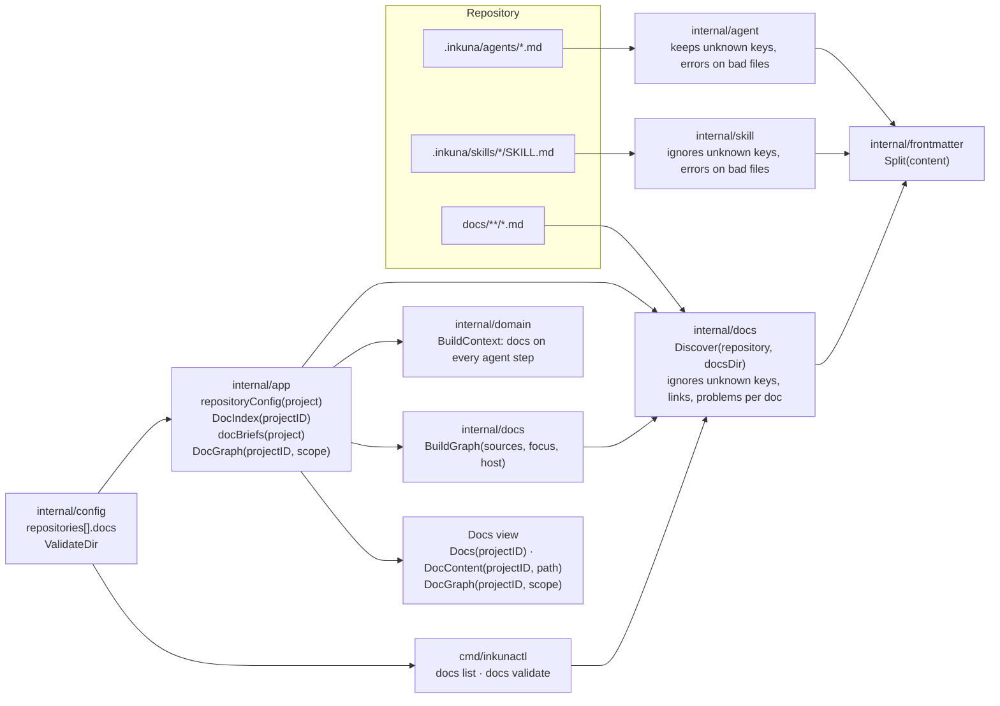
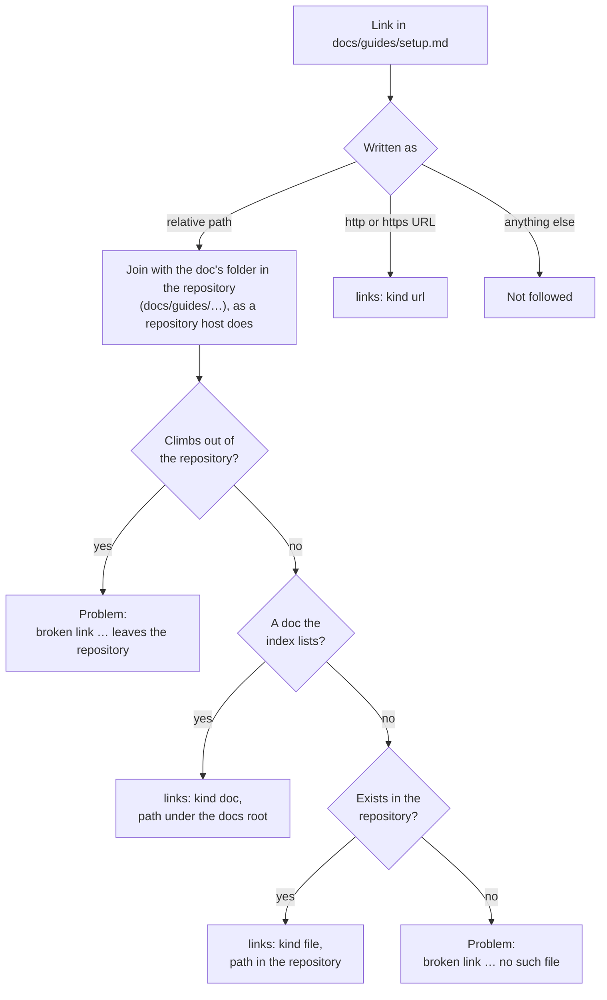
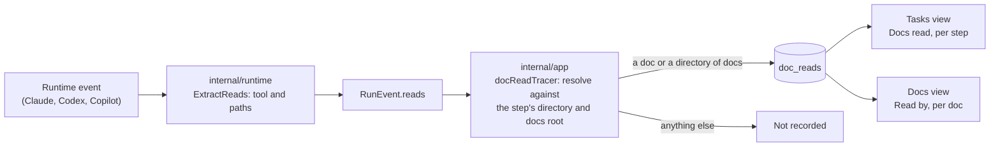

# Docs index

Inkuna indexes each project's documentation so planning, `inkunactl`, and the app read one description of which docs exist and what state they are in. The index is read-only and carries no bodies: agents open the docs they need from the worktree. This document is the contract for a doc's frontmatter, how discovery works, and how `inkunactl` checks it. Every agent step receives the index in its context envelope; the Docs view browses it, and the later parts of the docs-awareness epic (read tracing and the link graph) build on it too.

## Frontmatter contract

Every Markdown file under the docs root begins with YAML frontmatter, the same shape agents and skills use:

```markdown
---
title: Rules engine
lastUpdated: 2026-09-25
author: Brandon Manning
tags: [rules, planning]
status: current
---

# Rules engine
...
```

| Field | Required | Meaning and validation |
| --- | --- | --- |
| `title` | yes | Non-empty. Shown in place of the file name. |
| `lastUpdated` | yes | A `YYYY-MM-DD` date. Quoted or bare; both decode as the same string. |
| `author` | yes | Non-empty. The human who approved the last change, not the agent that wrote it. |
| `tags` | yes | A non-empty list of strings. Which tags mean what is a repository convention, not Inkuna's. |
| `status` | yes | `draft`, `current`, or `deprecated`. |

A key the contract does not name is ignored, as in agent and skill frontmatter, so a doc can carry keys for other tools, such as a site generator's; Inkuna never writes a doc. Inkuna owns only this contract. Repository conventions, such as an allowed tag vocabulary or a required `area` tag, belong to that repository's own check, for example an evaluation stage. Such a stage can also hold `author` to what the user said, rather than to what the agent that edited the doc wrote: it reads the answers to the `human-input` stages upstream of it from the file `INKUNA_HUMAN_INPUTS` names ([rules.md](rules.md#stages)).

A doc that breaks the contract is still indexed. Its entry keeps whatever could be read and lists each violation under `problems`: `missing frontmatter`, `frontmatter is not closed`, `frontmatter: yaml: …` for a header that is not valid YAML, `title is required`, `status "final" must be draft, current, or deprecated`, and so on. A broken relative link is a problem too (see [Links and the doc graph](#links-and-the-doc-graph)). Unlike a malformed skill, one bad doc never stops planning; it is shown with its problems so someone can fix it.

## Where docs live

The docs root is `docs/` inside the repository unless `inkuna.yaml` says otherwise:

```yaml
repositories:
  - name: handbook
    path: /src/handbook
    docs: documentation/handbook
```

`docs` is relative to the repository and must stay inside it: an absolute path or one that climbs out with `..` fails configuration validation. A docs root that does not exist gives an empty index, not an error, so a repository without documentation plans normally.

Before walking, discovery resolves symbolic links in both the repository and the docs root and rejects a docs root that resolves outside the repository, so a linked `docs/` or a linked parent directory cannot expose files elsewhere on disk. It then walks the resolved root recursively and indexes every regular `*.md` file (case-insensitive extension). Entries whose name starts with `.` are skipped, directories and files alike, and symbolic links inside the tree are not followed. Paths in the index are slash-separated and relative to the docs root, sorted so the order is stable across platforms.

## Components



`internal/frontmatter` is the one splitter. It works on byte offsets into the original content so LF and CRLF files produce the same header and an untouched body. Agent loading keeps the keys it does not read with the agent (`agent.Definition.Extra`), and skill loading ignores them; both still fail on a malformed file because a broken agent or skill must surface immediately. The app resolves every per-repository override (`rules`, `docs`) through the same lookup, so the two cannot drift, and `inkunactl` finds a repository's entry with the app's `config.File.Repository`, so the CLI and the app read the same docs root.

## Reading the index

`Service.DocIndex(projectID)` returns the resolved docs root and the entries:

```json
{
  "path": "/src/inkuna/docs",
  "docs": [
    { "path": "architecture.md", "title": "Inkuna architecture", "lastUpdated": "2026-09-25",
      "author": "Brandon Manning", "tags": ["architecture"], "status": "current" },
    { "path": "notes/todo.md", "title": "", "lastUpdated": "", "author": "", "tags": [],
      "status": "", "problems": ["missing frontmatter"] }
  ]
}
```

## Links and the doc graph

Discovery also reads each doc's links: inline, reference-style, and angle-bracket links, found with a Markdown parser so a link shown inside a code block is not followed. Images, same-doc anchors (`#…`), links from the repository root (`/…`), and schemes other than `http` and `https` are skipped. A fragment or query is dropped before a link resolves. Each doc keeps its links in order under `links`, repeated as often as it repeats them:



A relative link counts from where the doc sits in the repository, so a docs root declared as `handbook` resolves `../README.md` from `handbook/…`. Resolution reads only whether a path exists, never its content, and matches docs by exact path, as a repository host does; on a case-insensitive disk a link whose case differs from the doc's is a `file` link, not a `doc` link. `Read` resolves a single doc's links against the same index, listing paths only, so the Docs view shows the same problems as the tree.

The doc graph is built on demand by `DocGraph(projectID, scope)` from every registered project's index; nothing is stored. A project's origin remote (`git remote get-url origin`, read as `host/owner/repo` for https, ssh, and scp-style URLs) is how a URL finds it. Each link from a doc becomes an edge to one node:

| Link | Node |
| --- | --- |
| `doc` | That doc. |
| `file` | The doc's own project (its repository node). |
| `https://<github host>/<owner>/<repo>/blob\|tree/<ref>/<path>` in a registered project | The doc at `<path>` when it is one in that project's index; the ref may contain slashes, so each split is tried. Otherwise that project's repository node. |
| Any other URL into a registered project's repository (issues, the repository page) | That project's repository node. |
| A repository on the GitHub host that no registered project's origin names | An external repository node, one per `owner/repo`. |
| Any other URL | Not graphed. |

The GitHub host is `github.host` from `inkuna.yaml` (`github.com` by default), so GitHub Enterprise links work the same way. Edges count repeated links between the same pair, and a doc's links to itself are dropped. Scope `project` keeps the browsed project's docs, including unlinked ones, and every edge that starts or ends in that project, so a doc in another project that links in appears too. Scope `all` keeps every registered project. A registered project that cannot be indexed, such as one whose repository moved, is left out with a warning; the browsed project must index.

## From the terminal

`inkunactl docs list REPOSITORY` prints the index in the same shape as `DocIndex`. `inkunactl docs validate REPOSITORY` prints one `path: problem` line per problem, with paths relative to the repository, then a summary:

```text
docs/notes/todo.md: missing frontmatter
docs/rules.md: status "final" must be draft, current, or deprecated
docs/: 14 docs, 2 failing
```

It exits 0 when no doc fails, 1 when any does, and 2 when the check cannot run: a usage error, an invalid `inkuna.yaml`, a docs root that cannot be read, or a ref git cannot resolve. A multi-line YAML error is folded onto its line.

Both subcommands honour `repositories[].docs`. `REPOSITORY` matches its `inkuna.yaml` entry by path; a worktree with no entry of its own takes its main checkout's, as a run's worktree does.

A repository that fixes its docs as each one is touched passes `--changed-since REF`. Missing frontmatter and broken links then fail only in docs the current branch changed: in a commit since the merge base of `REF` and `HEAD`, staged or unstaged, or untracked and not ignored. Each stage counts on its own, so a change still counts when a later stage undoes it, such as a staged edit restored on disk. The merge base keeps docs changed only on `REF`'s side, such as on `main` after the branch left it, from counting. Invalid frontmatter fails whether or not the doc changed. Without the flag, every broken link fails. The summary counts the docs it let through:

```text
docs/: 14 docs, 1 failing, 6 unchanged since origin/main with missing frontmatter or broken links
```

## In the Docs view

The Docs view, under Work, browses one project's docs. Four bindings, keyed by project ID like `Rules` and `Agents`, back it: `Docs` and `DocContent` below, `DocGraph` for the Graph tab and Linked from, and `DocReads` for Read by.

- `Docs(projectID)` returns the resolved docs root and the index as a tree, `docs.Tree`: each folder's subfolders and docs sorted by name, with each doc's frontmatter and problems. Only folders that hold a doc appear.
- `DocContent(projectID, path)` returns one doc's index entry and the Markdown after its frontmatter; a doc whose frontmatter is missing or unclosed keeps its whole content. `docs.Read` serves only what discovery could have listed: a clean, slash-separated path relative to the docs root, naming a `*.md` regular file of at most 2 MiB, with no `.` or `..` segment, no absolute path, no hidden entry, and no symbolic link below the docs root. The root itself is resolved and confined exactly as for discovery.

The tree flags each doc with problems, frontmatter or broken links, with Go's problem text and can be narrowed to one status, one tag, or docs with problems. The rendered doc shows its title, status, tags, `lastUpdated`, and author above the body. Rendering keeps a doc from acting on the app:

- Markdown is GitHub-flavoured (tables, task lists, strikethrough, autolinks, footnotes). Raw HTML is dropped and Markdown images are not loaded, so a doc cannot inject markup.
- Mermaid code blocks draw as diagrams. Mermaid loads only when a doc has one and runs with `securityLevel: "strict"`, which encodes labels, disables click handlers, and sanitizes the SVG it returns. Inkuna's own docs are held to drawing: `frontend/src/views/docs/diagrams.test.ts` parses every diagram in `docs/` with the same `mermaid` and fails, naming the file and line, when one does not. The usual cause is a `;` in a sequence diagram's message, which Mermaid reads as the end of the statement.
- Neither can reach the network. Strict Mermaid still fetches an image node's URL while drawing and lets a diagram set CSS, so sanitizing its output is not enough. Instead, the page's Content-Security-Policy loads images, stylesheets, fonts, and media only from the app itself (and `data:`/`blob:` where needed), and blocks a request before it is sent. A diagram with a remote image fails to draw and shows Mermaid's error with its source. Markup that slipped past the sanitizer cannot run script either, which could call every bound method: scripts come only from the app (`script-src 'self'`, no inline script or handler), requests only go to it (`connect-src 'self'`), and the page takes no frames, `<base>`, or form submissions. `main_test.go` checks the policy in the built `ui/dist/index.html`, which `task ci` builds before testing. The Vite dev server that `wails dev` uses allows an inline script and a websocket, for React's refresh and hot reload (`frontend/vite.config.ts`); the built page does not.
- Headings get the anchors a repository host gives them: lowercase, punctuation dropped, spaces as hyphens, and repeats numbered `-1`, `-2` in document order. Ids carry the host's `user-content-` prefix, which footnotes already have, so `#install-1` and `#user-content-fn-1` both land, and a footnote and its reference link to each other.
- A relative link resolves against the doc's own folder, as a repository host renders it. One that lands on a doc in the tree opens in the view, at its heading when it names one, and Back returns to the previous doc. `http`, `https`, and `mailto` links open in the system browser. Any other link, such as one that leaves the docs root or names a source file, is shown but not followed. The view only picks the target; `DocContent` decides whether it may be read.

The Graph tab draws the doc graph with `@xyflow/react`, placed by a `d3-force` layout that is seeded, so the same graph always lands the same way, and runs in short slices that yield to the page, so thousands of docs never freeze it. It shows this project or all projects. A node is coloured by its project: the browsed project first, then the other registered projects oldest first, so adding a project never repaints the others. In a force layout any two nodes can sit side by side, and only three hues stay apart for every reader when they do, so projects past the third share a neutral grey. A node from another project also shows that project's name, so a colour is never the only cue. A draft doc or an external repository has a dashed border, a deprecated doc is faded, and ⚠ marks a doc with problems. Edges run between node borders with an arrow, thicken with their count, and show it when it is more than one; two docs that link to each other get a line each, so neither count hides the other. Double-clicking a doc opens it, switching project when it belongs to another; double-clicking an external repository opens it in the browser. A table under the graph lists the same links as text, each doc a button that opens it.

Selecting a node, with a click or with Enter or Space once it has keyboard focus, or dragging it focuses it. Its neighbourhood, the docs it links to and the docs that link to it, is marked, and everything else fades; a control widens the neighbourhood to two hops. The focus bar names the focused node and how many are linked, and has Open and Clear. Escape or a click on the background clears the focus. React Flow's selection follows the focus, and the graph is read-only: Backspace never removes a node.

With animation on, focusing pulls the neighbourhood toward the focused node with a short force run, and dragging the focused node brings its neighbourhood after it. Only the neighbourhood moves: every other node is pinned in place, still pushing the moving ones away so nothing lands on another. Clearing the focus eases every node back to the layout. With animation off, focusing marks and fades without moving anything. Animate focus is off by default when the system asks for reduced motion (`prefers-reduced-motion`); once the reader changes it, the choice is kept in the app's browser storage for later sessions, and the view still works when that storage is unavailable.

The focus is built to stay responsive at about 500 docs with 1,500 links. Focusing marks only the neighbourhood and fades the rest through a class on the graph, so it changes a handful of nodes rather than every one. The force run advances by elapsed time, up to eight steps a frame, so a graph whose frames are slow to draw settles in the same time as a small one, and it stops once the steps fall under a pixel. React Flow's handlers stay the same between frames, so each frame redraws only what moved. Measured in the app at that size: focusing takes one frame under 100 ms, and frames during the motion run at a median of 17 ms (one hop) to 25 ms (two hops), with the 95th percentile at 42 ms.

Below each doc, Linked from lists the docs that link to it, most links first, including docs in other projects. It comes from the project-scope graph, which loads with the tree; the all-projects graph loads only when that scope is chosen.

Inkuna does not watch the docs folder; Reload reads the tree, the open doc, and the graph again.

## In the context envelope

The app indexes each directory a run's steps work in once, through the same lookup as `DocIndex`: the checkout when the run starts, and the worktree when it is created. It hands each agent step its own directory's entries through `domain.BuildContext` as `docs` ([agents.md](agents.md#what-a-worker-receives)). A worktree is created from a commit, so an uncommitted doc in the checkout is listed for steps that work in the checkout and not for steps that work in the worktree. Each path is relative to the repository rather than the docs root (`docs/architecture.md`), so a worker can open it from its working directory without being told where the root is. The domain type, `domain.DocBrief`, mirrors the fields above and omits empty ones.

The envelope keeps at most 400 entries and 64 KB of compact JSON. Over either limit, deprecated docs are dropped first, then those with the oldest `lastUpdated` (a date that does not parse counts as oldest), ties by path, until the index fits; the rest keep their order and `metadata.docsTruncated` is `"true"`. The envelope's own byte budget can cut the index further, in the same order, before it cuts anything else ([agents.md](agents.md#budgets)); `docs` is then listed in `metadata.truncated` too. Index errors, such as a docs root that is a file, do not stop the run: agent steps run without the index and each records why in its events.

## Which docs agents read

Inkuna records which docs an agent opened during a task, in order, so a run can be followed through the docs it relied on. Each record carries the Inkuna task ID (`TaskSpec.ID`, the ID the Tasks view shows), the run, the step, the agent, the runtime, the doc's path under the docs root and that root as the step had it configured, the tool, and when it was opened. It is stored in SQLite (`doc_reads`, indexed by task and by project, docs root, and path) and keeps paths only, never a doc's content.



Each runtime's event stream is read in the shapes recorded from the real CLIs (`internal/runtime/testdata/reads`, recorded with Claude Code 2.1.302, Codex CLI 0.162.1, and Copilot CLI 1.0.79 under Inkuna's own flags):

| Runtime | What counts as a read |
| --- | --- |
| Claude | A `tool_use` block for `Read` (`file_path`), `Grep` or `Glob` given a `path`, or `Bash` (its `command`). |
| Codex | A completed `command_execution` item that exited 0. Codex reads through its shell (`/bin/zsh -lc '…'`); the same command is also reported when it starts, and only the completion counts, so a read is never recorded twice. |
| Copilot | A `tool.execution_start` for `view` (`path`), `grep` or `glob` (`path` or `paths`), or `bash` (its `command`). |

A shell command is read, best effort, by a small parser: it follows quoting, `&&`, `;`, and pipes; a shell's `-c` argument; and `cd`, which counts only in the shell it ran in. A nested shell starts in its parent's directory, and a `cd` inside parentheses, a nested shell, a pipeline, or a background job does not move the commands after it. Shells disagree on the last command of a pipeline (zsh runs it in the current shell, bash in a subshell), so a `cd` there leaves the directory unknown and the commands after it uncounted. It counts the files given to `cat`, `less`, `more`, `nl`, `bat`, `tac`, `head`, and `tail`, the files after a `sed` script (`sed -i` is an edit and does not count), the paths after an `rg` or `grep` pattern, and input redirections (`< file`). The tool is recorded as `shell:<program>`.

The app then resolves each path against the step's working directory, resolving symbolic links, and keeps it only when it lands inside the project's docs root: on a doc the index could list (a `*.md` regular file, no hidden segment), or on a directory, recorded as `dir/` (the root itself as `/`). A path that is missing, outside the root, or not a doc is dropped. A trace that cannot be stored is reported as a warning in the step's events and never fails the step.

In the Tasks view, the Context tab lists a step's reads in order with their times and tools, and marks each doc **delivered** when the doc index in the step's envelope listed it, matched under the docs root the step had, so changing the docs directory later does not relabel old reads; a summary counts the delivered docs it opened and the docs it found on its own. In the Docs view, **Read by** under a doc lists the latest reads of it (task, step, agent, runtime, time), newest first, at its path under today's docs root; a read made while the root was elsewhere was of another file and is not listed; the task ID opens that run in the Tasks view.

Limits:

- A search across a whole directory is recorded as a search of that directory, not as an open of each file in it.
- A read through a tool that does not name a file is invisible: a glob without a path, a shell command Inkuna cannot parse, a path held in a variable or written as a glob, or a script that reads files itself.
- Claude and Copilot report a call when it starts, so a read that then fails is still recorded; Codex reports it once the command completes, and only a command that exited 0 counts.
- Paths are recorded as the agent wrote them, under the docs root. On a case-insensitive disk, a path whose case differs from the doc's file name still resolves, but is recorded in its own case, so the doc's Read by does not list it.

Invariants that later work keeps:

- Indexing never writes a doc.
- No doc bodies leave the index: the orchestrator request and the context envelope receive the fields above only, and not `links`.
- Tracing which docs an agent read stores paths only, never content.
- Link resolution checks whether a repository path exists and never reads it.
- The remote advisor handoff never carries the index. What it does carry, dependency summaries and artifact references, may still mention docs a local worker read.
- Doc paths stay confined to the docs root; neither the index nor `DocContent` follows a link or a symlink outside it.
