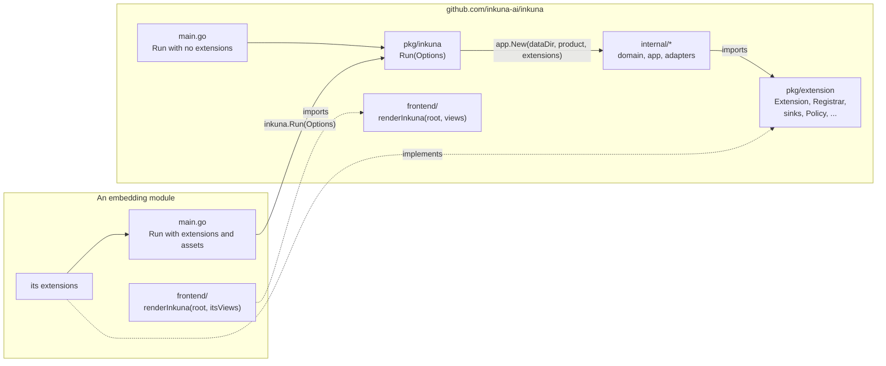
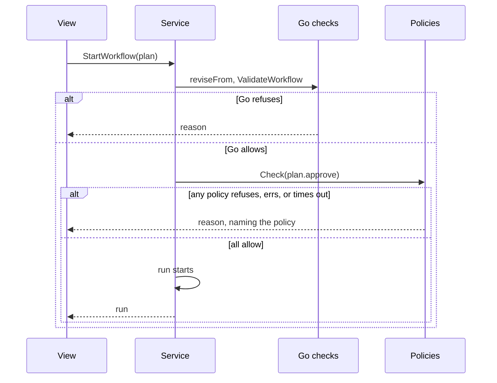
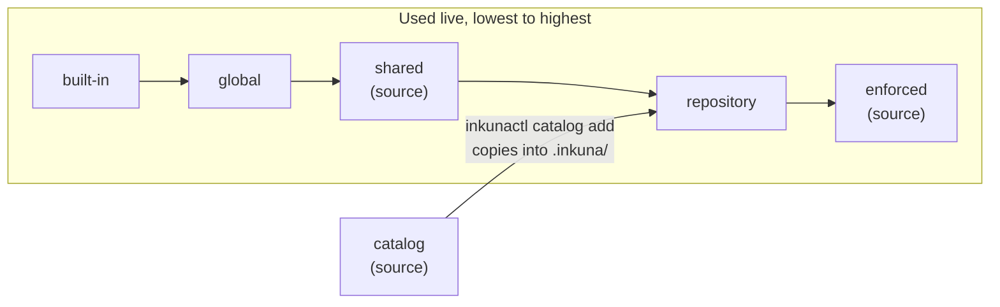
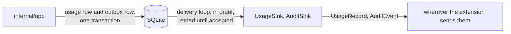

# Extension API

Another Go module can embed Inkuna and plug extensions into it: sinks that receive what Inkuna records, policies that can refuse what Go allowed, an identity provider, definition sources, and screens of its own. Everything in Inkuna lives under `internal/`, which Go does not let another module import, so without a public seam there is nothing to plug into. This document designs the public seam: a composition root, `pkg/inkuna`, and a small set of extension points, `pkg/extension`. Built with no extensions, Inkuna behaves exactly as it does today. It is a design. So far `pkg/inkuna.Run` (#232), registering extensions with capabilities (#233), capability-gated extension screens (#234), the identity provider (#235), audit and usage sinks fed through the outbox (#236), policies at every decision point (#237), the `extensions:` configuration section (#238), definition sources, with the `catalog` mode applied (#239), `inkunactl usage export` (#240), and the secret store and notifiers (#241) are implemented; the rest is not (#204, #205, #230).

## Decisions

| Decision | Choice | Why |
| --- | --- | --- |
| Seam | A narrow `pkg/` API, never an opened `internal/` | `internal/` can keep changing freely. Only `pkg/` is a promise to another module. |
| Public types | `pkg/extension` defines its own types, and `internal/app` converts at each call | Exposing `domain` structs would make every field of every internal type public API. |
| Validation | Go's checks always run, and an extension can only refuse | Go stays the only validator ([architecture.md](architecture.md#trust-boundaries)). |
| Storage | SQLite stays the store, and the store is not an extension point | Most of what it holds (worktrees, sessions, runs in flight) belongs to one machine, and a pluggable store would make nearly every domain type public. Records leave through sinks instead. See [Storage](#storage). |
| Modes | Every shared definition carries a mode, and a mode a build does not apply fails closed | New modes can be built later without changing the API, and none is ever applied as something weaker. |

## Embedding Inkuna



- **Versions.** An embedding module pins a tagged Inkuna release.
- **Where a seam starts.** A feature that needs a new extension point adds it here, with a no-op default and tests, before anything implements it.

## `pkg/inkuna`: the composition root

`pkg/inkuna.Run` builds the service with `app.New` and calls `wails.Run` with the assets and `*app.Service` bound, as `main.go` used to do itself. `app.New` (`internal/app/service.go`) creates every dependency itself: the secret store (the keychain unless an extension registers one), runtimes from `inkuna.yaml`, the notifier, the store, and the A2A bus.

```go
package inkuna

// Options is what a binary that embeds Inkuna passes to Run.
type Options struct {
	Assets  fs.FS  // the built frontend; required
	Icon    []byte // the macOS Dock image outside an app bundle; nil leaves the default
	Bind    []any  // extra Go objects the frontend may call
	DataDir string // "" discovers it as Inkuna always has

	Product    extension.Product     // the window title and the name in Settings; zero is Inkuna's own
	Extensions []extension.Extension // registered in order before startup
}

// Run starts the desktop app and returns when it quits.
func Run(options Options) error
```

Inkuna's own `main.go` checks that its frontend was built, then calls `inkuna.Run(inkuna.Options{Assets: assets, Icon: appIcon})`. `Run` passes the product and the extensions to the service, `app.New(dataDir, product, extensions)`, which registers the extensions before it reads any configuration. With the zero product and no extensions it behaves exactly as before. `inkunactl doctor` builds its service that way.

- **Assets.** `go:embed` reaches only files under the embedding package, and the built `ui/dist` sits beside the root package, so `pkg/inkuna` cannot embed it. Every binary passes the bundle it was built with, and `Run` refuses to start without one. Inkuna's `main.go` passes its own. An embedding binary builds its own bundle (see [The view](#the-view)) and passes that.
- **Icon.** The Dock icon outside a bundle is set by cgo code in `pkg/inkuna` (`setDockIcon`), from the bytes the binary passes. Inkuna's `main.go` embeds `build/appicon.png` on macOS only. `pkg/inkuna` also links the `UniformTypeIdentifiers` framework on macOS, which Wails uses without linking, so every binary built through `Run` links it.
- **Bind.** Wails generates TypeScript for every bound object, so an extension's screen calls its own Go service, bound beside `*app.Service`, rather than a method added to Inkuna's.
- **inkunactl.** It uses internal packages directly and constructs a `Service` only for `doctor`. An embedding binary whose CLI applies its policies needs a `pkg/inkuna` entry for the CLI too. See [Open questions](#open-questions).

## `pkg/extension`: extension points

An extension is a value with a name that registers what it provides:

```go
package extension

// Extension is one unit an embedding binary plugs into Inkuna.
type Extension interface {
	Name() string // lower-case, unique in the build, used in errors and in inkuna.yaml
	Register(Registrar) error
}

// Registrar is implemented by Inkuna and is valid only during Register.
// Today it has Capability, Identity, AuditSink, UsageSink, Policy,
// DefinitionSource, SecretStore, and Notifier; each other method arrives
// with its point.
type Registrar interface {
	Capability(Capability)
	AuditSink(AuditSink)
	UsageSink(UsageSink)
	Policy(Policy)
	Identity(IdentityProvider)
	DefinitionSource(DefinitionSource)
	SecretStore(SecretStore)
	Notifier(Notifier)
	OnShutdown(func(context.Context) error)
	// Later: TrackerProvider.
}
```

The registrar is the part Inkuna implements, so Inkuna can add methods to it without breaking an extension. Each point's own interface is the part an extension implements, so it stays small and never gains a method. New behaviour arrives as a new interface. One extension may register several points, so they can share one client and one sign-in.

`Run` refuses to start, naming the extension, when:

- an extension is nil, or its name is not a lower-case letter followed by lower-case letters, digits, or hyphens, or is `inkuna`, which namespaces Inkuna's own;
- two extensions share a name;
- `Register` returns an error;
- Inkuna refuses something it registered, such as a capability outside its namespace;
- a registrar is used after its `Register` returned, while later extensions are still registering. Once the app has started nothing reads a registrar again, so a call then panics rather than being dropped;
- an identity provider or a secret store is nil, or more than one of either is registered, by one extension or by several;
- an audit or usage sink, a policy, a definition source, or a notifier is nil.

Registration is all or nothing: the first refusal stops startup, so an app never starts with part of an extension in place.

### Where each point attaches

```mermaid
flowchart TB
    subgraph App["internal/app"]
        Events["appendRunEvent<br/>(every run event)"]
        Bus["a2a.Bus observers<br/>(every task snapshot)"]
        Guard["tracker.Guard.write<br/>(every tracker write)"]
        Approve["startApproved, ApproveReview,<br/>RequestChanges"]
        Grant["executeAgentStep, serveAgentTask<br/>(MCP grants, allowed permissions)"]
        Saves["SaveRules, SaveAgent,<br/>SaveConfiguration"]
        Caps["Capabilities() binding"]
        Usage["recordUsage, recordPlanningCall<br/>(every model call)"]
        Loaders["agent.Build, rules.LoadLibrary,<br/>skill discovery, catalog"]
        Resolver["secrets.Resolver<br/>(after the environment)"]
        Notify["notify.Multi<br/>(beside the desktop)"]
    end
    Audit["AuditSink.Record"]
    UsageSink["UsageSink.Record"]
    Policy["Policy.Check"]
    Capability["Capability"]
    Identity["IdentityProvider.Current"]
    Source["DefinitionSource.Snapshot"]
    Secrets["SecretStore.Get, Set, Delete"]
    Notifier["Notifier.Notify"]
    Resolver --> Secrets
    Notify -- "queued, in order" --> Notifier
    Usage --> UsageSink
    Identity -- "principal" --> Approve
    Identity -- "principal" --> Usage
    Source -- "checked like local files" --> Loaders
    Events --> Audit
    Bus --> Audit
    Guard --> Audit
    Approve --> Audit
    Guard -- "after Go's checks pass" --> Policy
    Approve -- "after Go's checks pass" --> Policy
    Grant -- "after Go's checks pass" --> Policy
    Saves -- "after Go's checks pass" --> Policy
    Capability --> Caps
```



### Capabilities

```go
// Capability is a feature this build has, reported to the view.
type Capability struct {
	ID    string // namespaced by extension, e.g. "example.audit"
	Label string // required
}

// Product is what the view names the app; the zero Product is Inkuna's own.
type Product struct {
	Name    string // required whenever Version is set
	Version string
}
```

A capability's ID is its extension's name, a dot, then lower-case letters and digits, separated by single dots or hyphens, and is unique in the build. The `Capabilities()` binding (`internal/app/extensions.go`) returns the product, and the capabilities of Inkuna and of every extension in registration order, each with the extension that registered it. The product carries `inkuna` when it is Inkuna's own, and Settings names an embedding product and what its extensions add beside Inkuna's build. Today the view learns what exists only from fixed bindings (`Dashboard`, `Configuration`, `AuthenticationStatus`, `Runtimes`), and navigation is a static list in `App.tsx`. Inkuna's own views stay unconditional. A capability gates only what an extension adds.

### Audit sink

```go
type AuditEvent struct {
	ID           string    // "<installation>/audit/<n>", unique, stable across redelivery
	Time         time.Time
	Kind         string    // "run.event", "a2a.task", "tracker.write", "approval", "config.save", ...
	Installation string
	Project      string
	Task, Run    string
	Actor        string    // "user", an agent's name, or "inkuna"
	Principal    string    // the person on whose behalf, by Principal.ID; see Identity
	Summary      string
	Fields       map[string]string
}

type AuditSink interface {
	Record(context.Context, AuditEvent) error
}
```

`pkg/extension` types carry JSON tags, so a sink that forwards them as JSON sends the same names everywhere. Every source of audit events has one choke point:

| Kind | Choke point | What it carries |
| --- | --- | --- |
| `run.event` | `Store.AppendEvent`, which `Service.appendRunEvent` (`internal/app/workflow.go`) calls for every run event | The event's kind, step, step run, sequence, and any artifact's digest, and the run's task, project, and approver, queued in the event's own transaction. Never the event's summary: summaries are written for the run's timeline, and every kind can hold what a worker, a command, or a person wrote, redacted of secrets but not of content. A tool event names a command or starts its output, a file change carries the tool's input, a warning a line of stderr, an error a failed check's log or the worker's failure, a completion the worker's handoff, and a lifecycle event can quote a step's prompt. A `message` event is what an agent said, part of its transcript, and a `usage` event belongs to the usage sinks, so neither is audited. The actor is the step's agent for tool calls, file changes, and completion, and `inkuna` otherwise. |
| `tracker.write` | The run event `recordTrackerWrite` appends for a `tracker.Guard` write | Recorded with its own kind instead of `run.event`, by its structured fields: the tracker, action, kind or update, issue, outcome, and URL. Its description and reason stay out, since they can quote the comment or title it wrote. |
| `a2a.task` | A second observer on the bus (`a2a.WithObserver`, now a list, so `notifyThread` keeps its own) | A task when it is sent and each time its state changes, once per state: an artifact added to a task that has ended records nothing more. Its agent, state, and how many messages and artifacts it holds, never what they say. |
| `approval` | `startApproved`, `resumeRun`, `ApproveReview`, `requestChanges`, `AnswerInput` | `Fields["decision"]` is `plan.approve`, `run.resume`, `run.rerun`, `review.approve`, `review.changes`, or `input.answer`, with the principal who decided. The summary is Inkuna's wording alone, without the run's title, and the run, task, and project are named by ID. An answer names the option chosen when it was one offered, never written text. |
| `config.save`, `rules.save`, `library.save`, `agent.save`, `agent.delete` | `saveConfigurationLocked`, `SaveRules`, `SaveGlobalDefinition`, `SaveAgent`, `DeleteAgent` | The file's path and the `sha256:` digest of the bytes the save wrote, never its content. The digest is of what was written, not of the file read back, which another save could have replaced by then. |
| `history.delete` | `DeleteTasks`, `DeleteRun` | The task and the runs removed. |

Saves and deletions never asked for a principal before, so their events name one when the identity provider answers and leave it empty when it does not, rather than undoing the change.

**Delivery.** With an audit sink or a usage sink registered, Inkuna stores each record in an outbox table before handing it on (`internal/storage/outbox.go`). A delivery loop per sink (`internal/app/outbox.go`) then gives it the records of its kind in order, so a slow or failing sink never blocks a run and a crash never loses a record:

- **Names.** A sink is named by its extension, its kind, and its place among that extension's sinks of the kind: `example/audit`, then `example/audit-2`. The outbox keeps how far each name has got, so a restart carries on where it stopped. A sink added to a data directory later is given every record of its kind still in the outbox.
- **Retries.** One `Record` call may take a minute. A record the sink refuses, panics on, or does not answer in time is offered again after a wait that doubles from a second to five minutes, and nothing after it is offered until it is accepted. A call that ignores its context runs apart, so it cannot stop the loop, and a sink has one call running at most: a retry after a timeout waits for the call still running, which is for the same record, rather than starting another.
- **At least once.** How far a sink got is saved after each batch, before each wait, and, when a save failed, again once the sink has nothing left to do, so a record accepted just before a crash may be offered again. A sink must be idempotent on the record's ID, which is the same at every offer.
- **Doctor.** Doctor shows a row per sink the data directory has had, `Sink example/audit`: how many records wait, and, while it is stuck, how many times in a row it refused and what it last returned. A sink the data directory has but this build does not register shows as missing, with its backlog and any refusal it last recorded.

With no sink registered, nothing is written to the outbox and no loop runs.

**Invariant.** An audit event carries only what Inkuna has already persisted, in the redacted form it persisted it. It never carries a secret value, a worker transcript, or file content.

### Policy

```go
// Decision is something Go has already decided to allow.
type Decision struct {
	Point     string            `json:"point"`             // PointPlanApprove ("plan.approve"), ... one per row below
	Project   string            `json:"project,omitempty"` // the project's ID; empty for inkuna.yaml and global agents
	Actor     string            `json:"actor"`             // "user", the step's agent for mcp.grant, "inkuna" for its own tracker updates
	Principal Principal         `json:"principal"`         // with their groups, for role-based policies
	Details   map[string]string `json:"details,omitempty"` // the point's facts, below
}

type Verdict struct {
	Refuse bool   `json:"refuse"`
	Reason string `json:"reason,omitempty"` // shown to the person, as Go's reasons are
}

type Policy interface {
	Check(context.Context, Decision) (Verdict, error)
}
```

A policy runs only after all of Go's own checks have passed, so it can refuse what Go would allow but never allow what Go refused. The first version can only refuse. Narrowing, such as dropping one MCP server from a grant rather than refusing the step, would need a policy to return a changed decision, and Go would have to prove it a subset of the one it allowed. It comes later, point by point, if an extension needs it.

`Service.decide` (`internal/app/policy.go`) asks the policies in registration order and stops at the first refusal. Each is given its own copy of the decision, so one cannot change what the next is asked. A detail with no value is left out, a list is sorted and comma-separated, and commands are one per line, since a command can hold a comma. A saved file is named by its path and the `sha256:` digest of the bytes the save would write, never by its content.

| Point | Where it is checked | Details | On refusal |
| --- | --- | --- | --- |
| `plan.approve` | `startApproved`, after `reviseFrom`'s checks, `checkApprovalCurrent`, and the checkout check, before a proposed `branching.yaml` is written | `workflow`, `task`, `rule`, `rerunOf`, `steps`, and the agent steps' `agents`, `runtimes`, `models`, `permissions`, `mcpServers`, `userMcpServers`, `trackerKinds` | The run does not start; the plan shows the reason. |
| `review.approve` | `ApproveReview`, after `resumable`, before the run moves | `run`, `task`, `workflow`, `round`, `gates`, `approvedBy` | The gate stays paused. |
| `tracker.write` | `tracker.Guard.write`, after `allow`'s checks, through `Guard.SetPolicy` | `tracker`, `action`, `kind` or `update`, `issue`; never what the write says | The write is refused like one `tracker.yaml` forbids, and recorded so. |
| `mcp.grant` | `executeAgentStep`, once `mcpGrant` resolved the step's servers, for a step granted any server or given any of the user's own | `run`, `task`, `step`, `agent`, `runtime`, `permission`, `servers`, `userServers`; never a secret | The step fails before its CLI starts. |
| `permission.grant` | `serveAgentTask`, when a person allows a worker's permission request | `run`, `task`, `step`, `agent`, `runtime`, `permission`, `commands`, `tools` | The request stays denied: the step finishes with the denied turn's handoff, and the run says why. |
| `rules.save` | `SaveRules`, after `editedRules` | `path`, `digest` | Nothing is written. |
| `agent.save` | `SaveAgent`, after its validation and name checks | `agent`, `scope`, `renamedFrom`, `runtime`, `permission`, `secrets`, `mcpServers`, `path`, `digest` | Nothing is written. |
| `config.save` | `saveConfigurationLocked`, after its validation, for every write of `inkuna.yaml`, Settings' and connecting or removing a project's alike | `path`, `digest`, `repositories`, `mcpServers`, `secrets` | Nothing is written, and the running configuration is unchanged. |

- **Who.** The principal is asked for at each check, from the identity provider or the OS user, unless the decision already asked: approving a plan or a review reuses the principal the approval records, and `permission.grant` the one `AnswerInput` asked for when the person allowed it, kept by the request's input ID until the worker asks, and forgotten when the run's assignments are released; a decline keeps nothing; an allowed request Inkuna has no such record of refuses. Inside a run, at `mcp.grant` and `tracker.write`, it is the person at this machine when the check is made, beside the run's approver where a detail names one. A provider that cannot name anyone refuses the decision before any policy is asked.
- **Only what Go would do.** A decision describes what Go is about to do, after every refusal of Go's own: a second start of a workflow with a run going or another approval under way (`reserveStart` holds the workflow from the check to the run's registration), an empty tracker edit or an untitled issue, and a user's server its runtime no longer offers never reach a policy, so a policy's reason never hides Go's. A decision whose project Inkuna could not look up is refused rather than asked without one.
- **Failing closed.** A policy that returns an error, panics, ends its goroutine without returning (`runtime.Goexit`), or does not answer within ten seconds (`policyTimeout`) refuses. A policy runs apart, so one that ignores its context cannot hold a decision past the deadline, and the message of an error it returns is read there too, so one whose message blocks or panics refuses as well. A check given up on keeps running until the policy returns, so a policy may have eight running at once (`policyInFlight`), abandoned ones included; past that a decision is refused at once, saying the policy is still deciding earlier requests. A panic's value goes to the log, not to the person.
- **Reasons.** A policy is named as a sink is, by its extension and its place among that extension's policies: `example/policy`, then `example/policy-2`. A refusal reads `policy "example/policy": Only release managers approve plans`, one without a reason `policy "example/policy" refuses this`, an error `policy "example/policy" could not decide, so this is refused: …`, and a timeout `policy "example/policy" did not decide within 10s, so this is refused; try again`.
- **Locks.** `config.save` and `plan.approve` hold `configMu` while the policies answer, so the configuration cannot change between Go's checks and the write or the run's start; a slow policy holds up other saves for at most its deadline. `agent.save` holds `agentFilesMu` from the check that the name is free to the write, as an agent deletion does, so two saves cannot both find a name free. `permission.grant` asks without the step's lock.
- **The deadline wins.** An answer that arrives as the deadline passes refuses: `askPolicy` checks the deadline after it has an answer, since either may be taken first when both are ready.
- **No policy, no change.** With no policy registered, `decide` returns at once and asks no one who is acting, so a build without policies behaves as before.



### Usage sink

Every model call is already one `usage` row ([architecture.md](architecture.md#usage-accounting)), written by `Service.recordUsage` and `Service.recordPlanningCall` (`internal/app/usage.go`) through `storage.Store.RecordUsage`. A usage sink receives the same call as a typed record, so costs can be summed and audited without parsing an audit event's string fields:

```go
// UsageRecord is one model call and what it cost, as Inkuna stored it.
type UsageRecord struct {
	ID           string  // "<installation>/<usage row id>", unique across machines, stable across redelivery
	Installation string  // random, made once per data directory
	Principal    string  // Principal.ID of who started the work: the run's approver, or the task's creator for planning calls
	Project      string
	Task, Run    string
	Step, Call   string
	Turn         int
	Kind         string  // "worker", "peer", "orchestrator"
	Agent        string
	Runtime      string
	Model        string  // the model Inkuna asked for
	ModelUsed    string  // the model the stream named
	AuthMode     string  // "api-key", "subscription", or ""
	Outcome      string  // "completed", "failed", "timed-out", "cancelled"
	StartedAt    time.Time
	FinishedAt   time.Time
	Tokens       Tokens  // input, cache write, one-hour cache write, cache read, output
	Premium      float64 // Copilot premium requests
	Cost         Cost    // Source ("reported", "estimated", "unknown"), Cents, EstimatedCents, PricingVersion
}

type UsageSink interface {
	Record(context.Context, UsageRecord) error
}
```

- **Sums stay honest.** A record carries the cost's source and pricing version as the row has them, so a sink can keep reported and estimated sums apart and count unknown calls, as `domain.TotalCost` does, and can reprice estimates when a pricing version is found wrong.
- **One transaction.** `RecordUsage` writes the outbox row in the same transaction as the usage row whenever a usage sink is registered. A planning call is stored before its task is, so `recordPlanningCall` names the project and the person planning (`Store.RecordUsageFor`); any other call's are read from its run. Deleting history deletes a task's usage rows (`internal/storage/delete.go`), so a sink fed by reading the `usage` table later would lose every call of a task deleted before delivery. Deletion never touches the outbox.
- **Backfill.** The first time a data directory starts with a usage sink registered, every existing usage row is queued once, oldest first, and the outbox records that it did (`outbox_backfills`). A usage row is queued at most once, so a call recorded while the backfill runs is not queued twice. Calls recorded later by a build without a usage sink are not queued.
- **Never a prompt.** A record carries counts and figures only: no prompt, prompt section text, transcript, or file content. Section byte sizes stay local.

**Without a sink.** `inkunactl usage export [--since DATE] [--format csv|jsonl]` writes the same records from the local `usage` table, so anyone can audit their own costs: `Store.UsageSince` reads each row with the origin `queueUsage` would give it, and `UsageRecordOf` builds the record a sink receives, with the same ID. `jsonl` writes one `UsageRecord` per line as a sink's JSON; `csv` flattens it, with a reported cost and an estimated one in separate columns and an unknown cost left blank rather than zero ([architecture.md](architecture.md#cost-per-task)). `--since` keeps calls that ended at or after a local date or an RFC 3339 time. Unlike a sink, it sees only what history deletion left.

### Identity

```go
// Principal is the person Inkuna is acting for.
type Principal struct {
	ID     string   // stable, from the identity provider; the OS user name by default
	Name   string
	Email  string
	Groups []string // as the identity provider names them, e.g. "platform-team"; none by default
}

type IdentityProvider interface {
	Current(context.Context) (Principal, error)
}
```

- **The default.** With no provider registered, the principal is the OS user (`os/user.Current`): its user name as the ID, with no groups, and Inkuna behaves as today. A build without a provider never refuses a decision for want of a name: when the OS cannot name its user, the ID is empty, as on rows from before principals were recorded.
- **Where it is read.** `Service.principal` (`internal/app/identity.go`) asks before every decision that needs a person changes anything: planning a task (`PlanWorkflow`), approving a plan or starting a run over (`startApproved`), resuming a run (`resumeRun`), approving a review (`ApproveReview`), sending changes or replying to a review (`requestChanges`), and answering input (`AnswerInput`). Policies ask at every policy point ([Policy](#policy)). The ID is stored on the task, who created it (`tasks.created_by`, through `Store.CreateTask`), and on the run, who approved it (`executions.approved_by`), so a usage record names who started the work even when it is delivered days later. Both are written with the row and never change: renaming a plan keeps its creator, and a resume or a new round keeps the run's approver. Migration 034 adds the two columns, empty for existing rows.
- **Failure.** When the provider returns an error, names no one (an empty ID), or does not answer within 30 seconds, the decision is refused before anything changes, with the provider's reason and its extension's name, such as `identity provider "example": Sign in to continue`. Runs already started go on, under the principal they recorded.
- **Not for models.** A principal goes to records and policies only. It is stored apart from the task's spec, which prompts are built from, and never enters a worker's or the orchestrator's prompt.

Role-based approvals need nothing more: a policy reads `Decision.Principal.Groups` and refuses, for example, a `tracker.write` approved by someone outside `release-managers`.

### Definition sources

Agents, skills, stages, groups, and rules come today from three places: built-in, the global directories, and the repository's `.inkuna/` ([rules.md](rules.md#where-definitions-come-from), [agents.md](agents.md)). The catalog offers more to copy in ([inkuna-directory.md](inkuna-directory.md#the-catalog)). A definition source adds definitions from outside the machine, already filtered by the source to those the principal may use in the project:

```go
type DefinitionKind string // "agent", "skill", "stage", "group", "rule"

// DefinitionMode says how Inkuna uses a definition.
type DefinitionMode string

const (
	ModeCatalog  DefinitionMode = "catalog"  // offered to copy in, used only once added
	ModeShared   DefinitionMode = "shared"   // used live, below the repository, which can override it
	ModeEnforced DefinitionMode = "enforced" // used live, above the repository, which cannot override it
)

type Definition struct {
	Kind    DefinitionKind
	Name    string
	Mode    DefinitionMode
	Scope   string            // who it is shared with, as the source names it ("team:platform"); shown and recorded
	Version string            // changes whenever the content does
	Files   map[string][]byte // by slash-separated path, in the formats Inkuna reads: "<name>.md", an agent
	                          // file; a skill's "SKILL.md" and the files beside it; "<name>.yaml", a library
	                          // file defining only Name or a rules file holding only that rule
}

type Snapshot struct {
	Version     string
	Definitions []Definition
}

// Project identifies a repository to a source.
type Project struct {
	Name   string
	Remote string // origin's URL, so a source can share by repository
}

type DefinitionSource interface {
	Snapshot(context.Context, Principal, Project) (Snapshot, error)
}
```

Each mode places a definition differently:



| Mode | Agents, stages, groups | Skills | Rules | Built |
| --- | --- | --- | --- | --- |
| `catalog` | Listed beside the built-in catalog, named by source and scope; `catalog add` copies them in, as it copies built-in items today | Copied into `.inkuna/skills/` | Copied first under `rules:`, as today | Yes (#239) |
| `shared` | A layer between global and repository: `agent.Build` and `rules.LoadLibrary` gain it, and the repository wins by name | Join the repository's skills, which win by name | Matched after the repository's rules, before `default` | Later; listed as not applied |
| `enforced` | Above the repository: a repository definition of the same name is replaced, and the plan says so | Attached to every agent step in the project, as `conventions` is here | Matched before the repository's rules | Later; refuses plans |

The interface carries all three modes now, so shared and enforced definitions can be built later without changing the API. This build applies `catalog` only. Until a mode is built, Go treats it so that nothing weaker than it promises happens (`sources.Read`, `internal/sources/read.go`):

- A `shared` definition that this build does not apply is listed as not applied, with the reason, and ignored. Ignoring it loosens nothing. A plan notes each one.
- An `enforced` definition that this build does not apply refuses every plan in the project, naming the definition and its scope: `definition source "example/source" enforces rule "release" for team:platform, which this build does not apply, so plans in this project are refused until the source changes it or a build that applies it is used`. Applying it as `shared` or ignoring it would let a repository override what was required of it.
- A mode or kind Go does not know is handled as `enforced`: it refuses.

A source is named as a sink is, by its extension and its place among that extension's sources: `example/source`, then `example/source-2`.

**When Go asks.** `Service.readSources` (`internal/app/sources.go`) asks every source at once, for the principal and the project: its name, and its origin's URL with any user information an `http` or `https` URL holds left out, since that can be a token. It asks before each plan (`PlanWorkflow`, before anything is spent), again at approval (`startApproved`, before `configMu`, so a plan made before a source came to enforce something is refused too), whenever the catalog is listed or added from for a project, and once for every project when the app starts. A source runs apart and has 30 seconds (`sourceTimeout`); one that errs, panics, or does not answer in time is one that cannot be reached, and its reason is shown. A build without sources asks no one, not even who is acting.

**Catalog mode.** A source's `catalog` definitions are checked as items of the built-in catalog are (`catalog.FromSource`): each file in its kind's format and named as its definition, no name shared with another of the source's definitions or taken by a built-in, everything it needs built in or offered by the same source, and the catalog's own requirements, such as a description and a rule's narrowing `when`. Unlike the built-in catalog, one that fails is not fatal: it is reported, with Go's reason, and left out with every definition that needs it. The rest are listed beside the built-in catalog, each naming its source and scope, in Settings' catalog dialogs (`CatalogItems`, whose listing carries each source's report) and by `inkunactl catalog list`, and added as built-in items are, from the source that offers them (`AddCatalogItem(project, name, source, global)`, `inkunactl catalog add NAME --source SOURCE`). An added agent records `catalogSource`, `catalogScope`, and `catalogVersion` beside `catalog:`. A source shares a definition for a project, so one is never added to the global directories. Skills are a catalog kind for every catalog: a skill is copied whole into `.inkuna/skills/<name>/`, through a temporary directory beside it renamed into place, so a plan never finds half of one, and an agent brings the catalog's skills it names. Skills can be added only to a repository.

**Checked like local files.** Every definition is parsed and checked by the same code as a file on disk: an agent as an agent file, a skill by `skill.LoadFS` (the `fs.FS` form of `skill.Load`), a stage or group by `rules.ParseLibrary`, a rule by `rules.Parse`. When shared skills are applied, the five call sites that discover skills today, each reading the repository's `.inkuna/skills`, become one service method that adds the source's skills. A shared definition that fails will be reported, in Settings under **Stage library** and by `inkunactl stages list`, as a broken library file is, and skipped; an enforced one that fails refuses plans in the project. A source definition gets no more than a repository definition would: the MCP servers and secrets it names must still be declared in `inkuna.yaml`, and every grant goes through the same checks.

**Offline.** Go keeps the last snapshot each source gave for each repository in `<data dir>/sources/`, one JSON file per source and repository, replaced atomically (`internal/sources/cache.go`). When the source cannot be reached, the kept snapshot is used, and the plan notes how old it is; an `enforced` definition in it keeps refusing plans. With no snapshot kept, the source adds nothing, and the plan says so. A kept snapshot is the last one Go saw for the project, so nothing else records whether one held `enforced` definitions.

**inkunactl.** It registers no extensions, so it cannot ask a source. `inkunactl catalog list`, `show`, and `add` offer what the app kept of the repository's sources, checked as the app checks it, and `inkunactl catalog sources [REPOSITORY]` prints each kept snapshot's report: what this build does with each definition, and why. A name that two sources offer, or a source and the built-in catalog, is chosen with `--source`; without it the built-in catalog's item is taken.

**Recorded.** A plan records each snapshot it was made with (`WorkflowSpec.Sources`): the source, the snapshot's version, when it was given, and whether it was a kept one. A `catalog` definition is copied before any plan uses it, so it is a repository definition by then and no plan uses one as a source's; when shared and enforced definitions are applied, a plan records each it used with its mode, scope, version, and digest (`rules.Definition.Digest`), so a run can be traced to the exact definition that shaped it. Expansion already records each stage's `from:` scope and file; the scopes gain `shared` and `enforced`, and the file names the source and version.

**Inkuna only consumes snapshots.** Who may see a definition, and publishing one, are the source's business. An extension that offers publishing from the app does it with its own screen and a service bound through `Options.Bind`.

### Secret store

```go
// SecretStore keeps the values of the secrets inkuna.yaml declares, in place of the OS keychain.
type SecretStore interface {
	Get(ctx context.Context, name string) (string, error) // ErrSecretNotFound when it holds none
	Set(ctx context.Context, name, value string) error
	Delete(ctx context.Context, name string) error        // not an error when it holds none
}
```

- **In place of the keychain.** A build has at most one. With one registered, `app.New` gives it to `secrets.Resolver` where `secrets.Keyring{}` would go (`internal/app/extension_services.go`), so every secret Inkuna resolves, declares, stores, or forgets goes through it: a worker's or an MCP server's environment, the Linear key, and Settings' **Store**, **Remove value**, and **Forget**. A configuration save keeps it.
- **The environment still wins.** `Resolver.Resolve` reads the environment first and asks the store only for a name the environment leaves empty, as it does the keychain.
- **Checked first.** Inkuna checks a name is an upper-case environment variable name and refuses an empty value before the store is asked, as `secrets.Keyring` does. `ErrSecretNotFound`, or an empty value, is a missing secret; any other error is shown beside the secret, prefixed with the extension's name. Go enforces a 30-second deadline: each call runs on a goroutine of its own (`callExtension`), so a store that ignores its context still answers in time, as an error, and one that panics fails the call, with what it said going to the log, never to the person.
- **Its own source.** A value from the store reports the extension's name as its source (`secrets.Labeled`), where the keychain's is `keychain`, so Settings and `inkunactl config` say where it came from.
- **inkunactl.** It registers no extensions, so `inkunactl secret` and the setup wizard keep using the keychain.

### Notifier

```go
// Notifier receives every notification Inkuna asks the user to look at, beside the desktop one.
type Notifier interface {
	Notify(context.Context, Notification) error
}

type Notification struct {
	Title, Body string
	Kind        string // "input-required", "review-required", "completed", "failed", "tracker-failed"
	Reference   string // the run to open, or for input-required the inbox item
}
```

- **What the desktop gets.** `applyConfig` adds every registered notifier to a `notify.Multi` after Inkuna's own, the desktop notifier or, with `notifications.desktop` off, none, so each receives the same notifications in the same order whether or not the desktop shows them.
- **Never holds up a run.** Each notifier has a queue of its own and one goroutine that hands it notifications in order (`extensionNotifier`). While 64 wait, a new one is dropped and logged. A call is abandoned after 30 seconds, by Go, as a secret store's is, so a notifier that ignores its context costs each notification the deadline and the next one goes; an abandoned call that returns later can land after the ones behind it. An error is logged, never retried: a notification is a prompt to look, and what it points at is in the inbox and the run.
- **Content.** A notification's body is what the desktop shows: a run's title, the question a worker asked, or the tracker write that failed, so it can hold what a worker or a repository wrote. Inkuna does not filter it further, so a notifier that sends it off the machine sends that text with it.

### Later points

| Point | Today | What it needs |
| --- | --- | --- |
| Tracker provider | `domain.Tracker`, chosen by a switch on the kind in `internal/tracker/open.go` | Public mirrors of the issue, fields, and draft types; a provider keyed by kind; `tracker.yaml` accepting a registered kind. Every write still goes through `tracker.Guard`. |

**Runtimes have no extension point.** `runtime.AgentRuntime` carries `RunRequest`, `RunResult`, and the whole event model, which would make most of the engine public. Self-hosted models are already reachable as runtimes declared in `inkuna.yaml` ([configuration.md](configuration.md#declaring-runtimes)).

## Storage

Each machine keeps its own SQLite database, whatever extensions are registered. `internal/app` holds a concrete `*storage.Store` and calls more than a hundred of its methods. Its SQL is SQLite's (`json_each`, pragmas, and a migration history of its own), and much of what it holds only means something on the machine that made it: worktrees, CLI sessions, runs in flight, kept worktrees, viewed markers. A pluggable store would make nearly every domain type public API and put a network between every step and its state.

What leaves the machine is records, through the outbox, and nothing else:



- **The tables.** Migration 035 adds `installation` (a random ID made once per data directory, which every record carries), `outbox` (each record, as JSON, with the usage row it came from), `outbox_sinks` (how far each sink got, its last error, and its refusals in a row), and `outbox_backfills`. No foreign key reaches them, so deleting history leaves them alone.
- **The public types are the wire contract.** `UsageRecord` and `AuditEvent` are versioned with `pkg/extension`, so whatever receives them can tell which Inkuna versions it serves.
- **Credentials stay out of the data.** An extension's tokens live in the OS keychain or the environment, never in `inkuna.yaml` or SQLite, and never reach a worker.

## Configuration

`inkuna.yaml` decodes strictly (`KnownFields`), so an extension cannot add a key of its own. Instead there is one new section, keyed by extension name, whose body the extension decodes strictly itself:

```yaml
extensions:
  example:
    endpoint: https://records.example.com/inkuna
```

An extension that implements `extension.Configurable` receives its section through `Configure(yaml.Node) error`:

- **When.** Once, in `app.New`, after every extension has registered and `inkuna.yaml` has been read and validated, and before the app opens. Each configurable extension is called in registration order, with the zero `yaml.Node` when the file has no section for it, so it can keep defaults or refuse to start unconfigured. Refusing an absent section also stops a first launch before the setup wizard has written the file, so an extension that can start without settings should.
- **Errors.** An error stops startup as an invalid `inkuna.yaml` does, prefixed with the file and the section: `…/inkuna.yaml: extensions.example: endpoint must use https`. A section for a registered extension that does not implement `Configurable` is refused the same way, since nothing would read it.
- **Strict decoding.** `extension.DecodeConfig(section, &settings)` decodes the section with unknown keys refused, as everywhere else in the file, and reports the lines they have in `inkuna.yaml`, both of them for a duplicate key. `yaml.Node.Decode` alone cannot refuse unknown keys. The zero Node or an empty section leaves `settings` as it was.
- **Saves.** `config.File.Extensions` keeps each section as a `yaml.Node`, comments included, and is never sent to the view. Aliases are expanded when the file is read (`internal/yamlnode`), so a section stands alone: a save encodes the sections apart from the rest of the file and in sorted order, where a kept alias could name an anchor that is gone or written after it. An alias inside the node it names, or one expanding past 16384 nodes, is refused like any other parse error. A Settings save keeps every section as it was loaded, as it keeps `remoteAgents`, so a section changes only by editing the file, and takes effect at the next start.

**An extension that is not in the build.** A section whose name no extension in the build has is kept and ignored, and Doctor reports it as `Extension <name>`: missing, naming the section. Refusing to load would be what strict decoding suggests, but the same `inkuna.yaml` is read by builds without the extension: `inkunactl`, which registers none, Inkuna's own app opening an embedding product's data directory, and an older build of the product. Each of them must still open the data directory and keep the section when it saves. A misspelt name is the cost, and Doctor is where it shows.

An extension's secrets follow the existing rules: they are declared under `secrets`, and resolved from the environment and then the store. They are never exported to a worker unless a runtime or MCP server declares them.

## The view

The frontend is something another bundle can import:

```ts
// frontend/src/extension.tsx
export type ExtensionViewID = `${string}.${string}`; // a capability ID

export interface ExtensionView {
  id: ExtensionViewID;          // the capability Go reports for this screen
  label: string;
  group: "work" | "configure";  // listed after Inkuna's own screens in that group
  glyph?: string;               // beside the label, and alone in the narrow sidebar; "•" by default
  render(): React.ReactNode;
}
export function renderInkuna(root: HTMLElement, views: ExtensionView[]): Root;
```

`main.tsx` calls `renderInkuna(root, [])`. An embedding frontend imports `extension.tsx` from its Inkuna checkout, passes its views, and builds its own bundle, which `Options.Assets` serves. `renderInkuna` refuses two views with one ID, since only one could ever be shown, and returns the React root so a test can unmount it.

- **Gated by Go.** A view is listed and rendered only while Go's `Capabilities()` binding reports its ID, so a build that lacks the extension never shows its screen. With no views the app never asks: it looks and behaves as it did before.
- **Navigation is data.** `frontend/src/navigation.ts` holds Inkuna's screens, which are never gated, and adds each shown extension screen at the end of its group. The `View` union in `types.ts` is `BuiltInView | ExtensionViewID`. Go namespaces every capability by its extension, so a capability ID always has a dot and never equals a built-in view's name.
- **No second copy of a rule.** The view keeps no copy of any rule: extension screens show Go's reasons as Inkuna's own do.

## Invariants

| Invariant | Where Go enforces it |
| --- | --- |
| An extension never loosens a decision. | Policies run only after Go's checks pass, and can only refuse. |
| A policy failure refuses. | `askPolicy` (`internal/app/policy.go`) treats an error, a panic, or a timeout as a refusal; `internal/app/policy_test.go` covers allow, refuse, error, and timeout at every point, and that a policy is not asked about what Go refused. |
| No secret reaches a model or a sink. | Records are built from persisted, redacted rows; extension secrets resolve like any other. |
| A slow or failing notifier never holds up a run. | Each notifier is fed from its own bounded queue by its own goroutine, and each call is abandoned at its deadline whether or not the notifier watches its context; `internal/app/extension_services_test.go` notifies past the queue with a notifier that never answers, and past a call that ignores its context. |
| The environment wins over any secret store. | `secrets.Resolver` asks the store only for a name the environment leaves empty; `internal/app/extension_services_test.go` checks a registered store is not asked. |
| A slow or failing sink never holds up a run. | Records are queued in SQLite and delivered by a loop per sink; a `Record` call is bounded and runs apart from the loop. `internal/app/outbox_test.go` runs a workflow to the end with one sink hung and another refusing. |
| A usage sink never misses a call. | `RecordUsage` writes the outbox row in the usage row's transaction; history deletion does not touch the outbox. |
| A usage record carries no prompt or content. | `UsageRecord` has no field for one; it is built from the usage row's counts and figures. |
| A principal never reaches a model. | Prompts are built without it; it goes only to records and policies. It is stored in its own columns, never in a task's spec, and `internal/app/identity_test.go` checks every prompt of a task planned and approved under a provider. |
| A source definition is checked like a local file and granted no more. | Each kind goes through the parser and checks its local file does (`catalog.FromSource`, `internal/catalog/source_test.go`); MCP servers and secrets must be declared in `inkuna.yaml`. |
| An enforced definition is never applied as anything weaker. | `sources.Read` refuses the project's plans for an enforced definition, or one of a mode or kind the build does not know, at planning and at approval, from a kept snapshot when the source cannot be reached; `internal/app/sources_test.go` covers each mode. |
| No shell, no push, no provider permission bypass. | Unchanged: extensions get no hook into how commands run. |
| Inkuna with no extensions behaves exactly as today. | `app.New` with no extensions takes the paths it does now; the existing suite runs unchanged. |
| `pkg/` names no `internal/` type. | `pkg/inkuna/publicapi_test.go` reads every `pkg/` package as the compiler type-checked it (`go list -export`) and fails when an exported identifier, field, or method refers to a type in an `internal/` package. |
| The API works from outside the module. | `examples/embed/`, a separate module with a `replace` of this one, builds a binary from `pkg/` alone in `task ci` (`build:example`), registering a sample extension with a capability and an `extensions:` section under its own product. |

## Stability

`pkg/inkuna` and `pkg/extension` are the only public API. While the module is `v0`, a breaking change to them is allowed but called out in the release notes. API diffs are checked in CI against the last tag. A breaking change is removing or changing an exported identifier, or adding a method to an interface an extension implements. Adding a `Registrar` method, an `Options` field, or a new interface is not one. Neither is a new `DefinitionMode` or `DefinitionKind`, since a build that does not know one refuses rather than misreads it, nor a new field on `UsageRecord` or `AuditEvent`, which a receiver must accept as JSON it may ignore.

## Open questions

- **An embedding binary's `inkunactl`.** Should `pkg/inkuna` also export the CLI (`RunCLI(args, Options)`), so its writes (`tasks delete`, `branch new`, catalog adds) pass through registered policies, and its catalog asks the sources rather than reading what the app kept? Until then, policies govern the app only.
- **Outbox retention.** How long are delivered records kept, and is there a cap on undelivered ones? Nothing is pruned yet: every record stays in the outbox, which is also what lets a sink added later be given what is still there.
- **How stale an enforced snapshot may be.** Should a cached snapshot holding `enforced` definitions expire, refusing plans until the source is reached again, and after how long?
- **Enforced rules and gates.** Matching an enforced rule first replaces a repository's flow. What may be wanted instead is a required stage, such as a security review, inserted into whichever flow matched. That needs its own design when enforcement is built, and may be a fourth kind rather than a rule.

## Plan

The issues under #204 follow this order:

1. `pkg/inkuna.Run(Options)`, with `main.go` calling it and no change in behaviour, plus `examples/embed/` built in CI.
2. `pkg/extension` with `Extension`, `Registrar`, and capabilities; the `Capabilities()` binding; the check that `pkg/` names no `internal/` type.
3. The view: `renderInkuna(root, views)` and capability-gated extension views.
4. Identity: `IdentityProvider` with the OS user as the default, the principal stored on tasks and runs, and refusals when it fails.
5. The outbox, with the audit sink and the usage sink, the installation ID, the backfill, and Doctor's backlog report.
6. Policies at each point in the table above, with the principal in each decision.
7. The `extensions:` configuration section.
8. Definition sources: every type and all three modes in `pkg/extension`, `catalog` mode built, `shared` reported as not applied, and `enforced` refusing (#239, done).
9. `inkunactl usage export` (#240, done).
10. Secret store and notifier extension points (#241, done).

The `shared` and `enforced` modes, tracker providers, and the CLI entry follow when an extension needs them.
