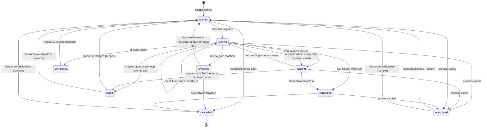
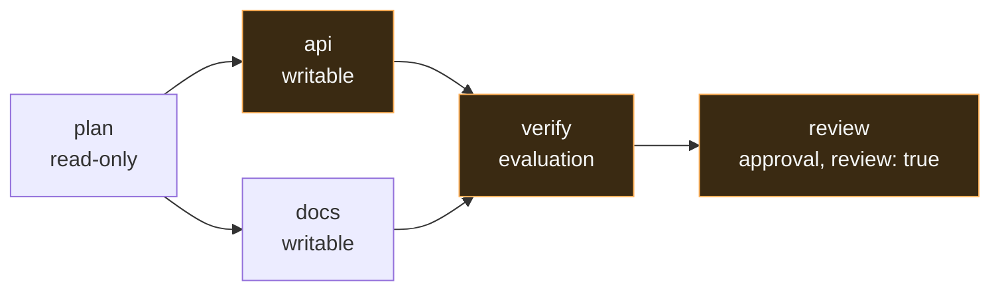
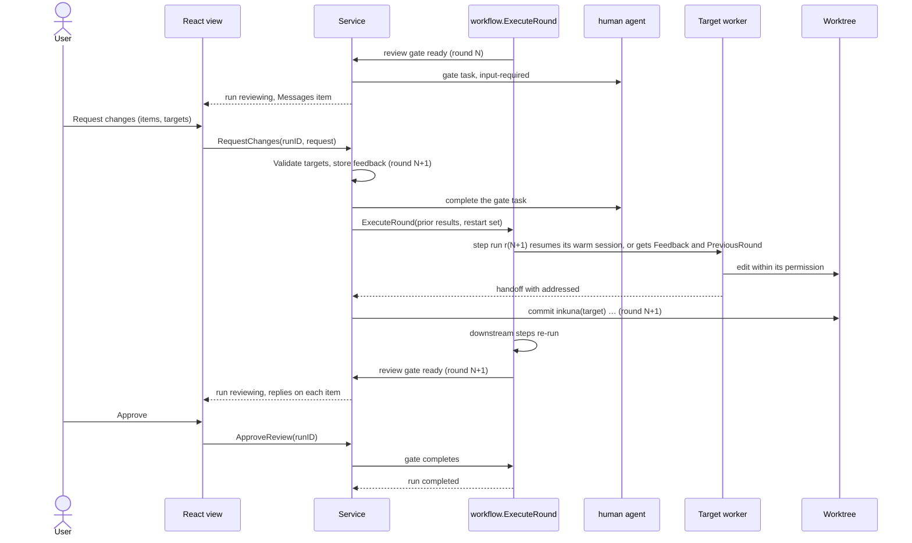
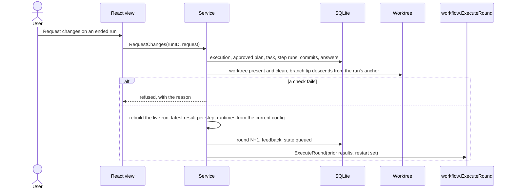
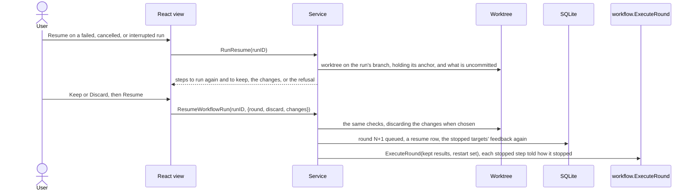
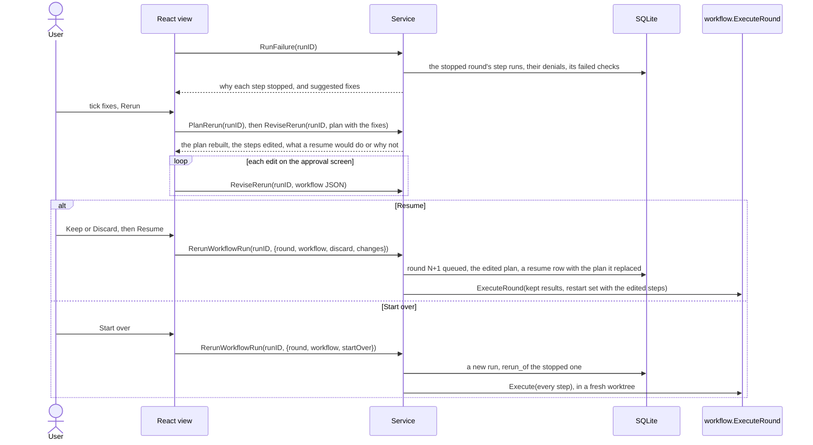
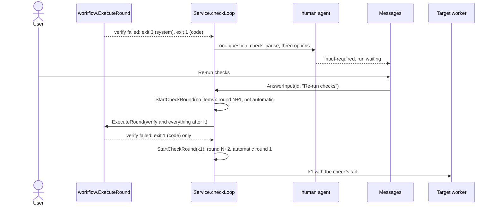
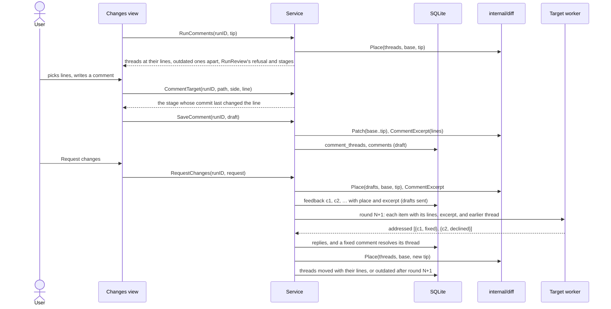

# Feedback rounds

A feedback round sends a run's work back to the stages that wrote it, with what to fix, and runs those stages and everything downstream of them again on the same branch. A person starts a round from a run paused at a review gate or from a run that has ended. A failing check starts one by itself only when its rule opts in, and only up to a cap. Without rounds a run would be one pass: whatever it produced would be final, and the only way to fix it would be a new request that starts from nothing. A run that stopped can also be resumed, or rerun with an updated plan, in a round with no feedback of its own. [Decisions](#decisions) records the choices behind the design.

## Terms

| Term | Meaning |
| --- | --- |
| Round | One pass over some of a run's steps. Round 1 is the run as approved; each later round re-runs a restart set. |
| Feedback item | One thing to fix: a piece of the person's text, a line comment, or a failed check. Each names the stage it is for. |
| Target | A writable agent stage that receives feedback items in a round. A round can have several. |
| Restart set | The steps a round runs: every target, every step without a completed result, and everything downstream of them. |
| Review gate | An approval stage with `review: true`. It pauses the run until a person approves or requests changes. |
| Reopen | Requesting changes on a run that has completed, failed, or been interrupted. |
| Resume | Running a run that failed, was cancelled, or was interrupted again from where it stopped, in a round with no feedback of its own. |

## Rules

Five fields, all optional. A rules file that sets none of them plans runs that never pause for review and fail on a failed check. Of the built-in rules (`rules.Default`), only `feature` sets any: its approval is a review gate with `feedback.target: implement` ([rules.md](rules.md#built-in-default-rules)). So no run pauses unless its rule asks.

| Field | On | Meaning |
| --- | --- | --- |
| `review` | approval stage | `true` pauses the run here for Approve or Request changes. |
| `feedback.target` | approval or evaluation stage | The stage feedback goes to by default. It must be upstream of this stage, an agent stage, and writable (worktree or branch write). Default: the nearest upstream writable agent stage, the one with the fewest dependency steps between them, ties broken by order in the file. |
| `onFailure` | evaluation stage | `fail` (the default), which fails the run, or `feedback`, which sends the failed commands back to `feedback.target` instead of failing the run. |
| `feedback.maxRounds` | evaluation stage with `onFailure: feedback` | How many automatic rounds this stage may start. Default 2, at most 5. |
| `feedback.systemExitCodes` | evaluation stage with `onFailure: feedback` | Exit codes, each from 1 to 255, with which the stage's checks say the environment broke rather than the code. On a stage that lists any, a check that exits with one, could not start, or was stopped by a signal pauses the run for the person instead of starting a round ([A failure only a person can fix](#a-failure-only-a-person-can-fix)). |

```yaml
version: 1
rules:
  - name: feature
    match:
      kinds: [implementation]
    stages:
      - id: implement
        kind: agent
        agent: implementer
      - id: verify
        kind: evaluation
        dependsOn: [implement]
        commands: [[go, test, ./...]]
        onFailure: feedback
        feedback:
          target: implement
          maxRounds: 2
          systemExitCodes: [3]
      - id: review
        kind: approval
        dependsOn: [verify]
        review: true
```

`internal/rules` validates each field with the rest of a flow (`Flow.Validate`): the target exists, is upstream, is an agent stage, and is writable; `onFailure` and `maxRounds` appear only on evaluation stages, `review` only on approval stages; the cap is from 1 to 5. Decoding stays strict, so a misspelt field is an error. A stage that leaves `permission` blank is read-only for research and review tasks, so planning (`Flow.Workflow`) settles whether the target can write and names the default one: a named target the task makes read-only is a planning error; with none named and no writable agent stage upstream, a review gate can only be approved, which the plan notes, and a check loop is a planning error. `domain.WorkflowStep` carries the fields to the engine, and the plan approved for a run keeps them, so a rules edit made after the run started never changes its rounds.

## Run and step states

A run is `reviewing` while it is paused at a review gate, nothing is running, and the gate step is `reviewing` too. A reviewing run holds no task slot, so a person taking their time never holds up other runs; Approve and Request changes queue it for one again. A run that has ended can be reopened unless it was cancelled, since cancelling was a choice, and goes back to `queued` as a new run would. A run that stopped before it finished, cancelled included, can be resumed instead ([Resuming a stopped run](#resuming-a-stopped-run)), which also queues it in a new round. A round the check loop starts follows on while the run is still running.



`reviewing` survives a restart: `MarkInterruptedExecutions` marks only runs that were queued, running, waiting, or cancelling, so a run paused at a gate is still paused when the app opens again, and Approve or Request changes rehydrates it as a reopen does.

The run records its current round. Each step run records the round it belongs to, and its id stays unique: round 1 keeps `<run>-<step>`, so existing rows, check ids, usage call ids, and artifacts keep their names, and round N writes `<run>.r<N>.<step>`. A stage id can be any non-blank text, so no suffix on `<run>-<step>` is safe: round 2 of `implement` as `<run>-implement-r2` would be round 1 of a stage named `implement-r2`. A run id is `run-<nanoseconds>` (`newID`) and never holds a dot, so the dot after it sets every later round apart from every round-1 id, and the round number, digits ended by the next dot, cannot run into the stage id. Commits record the round too, and each later round's commit subject says it: `inkuna(implement): Fix the empty-name case (round 2)`.

## What a round re-runs

A round runs its restart set and reuses every other step's latest result. The restart set is the union of:

- every target named by the round's feedback items;
- every step without a completed result: the step that failed, steps cancelled with it, and steps that never started, including a step an earlier round was to run again and never started, since its last completed run checked or built on work that round changed;
- everything downstream of those.



Feedback for `api` re-runs `api`, `verify`, and `review` in round 2. `plan` and `docs` keep their round 1 results: `docs` is a parallel sibling, not downstream of the target, so its handoff and its commit stand. Had the feedback named `docs` as well, both would re-run, each with only its own items.

`workflow.ExecuteRound` takes a `Round` with the prior results and the restart set, schedules only the restart set, and feeds every step the latest results of the steps it depends on. DAG validation and the concurrency limit are unchanged, and writable steps still run one at a time.

Each kind in a later round:

| Kind | In the restart set |
| --- | --- |
| agent, target | Gets its feedback items. See [What the target receives](#what-the-target-receives). |
| agent, downstream | Runs as in round 1, with the new handoffs of its dependencies. It never sees the feedback. |
| agent, remote advisor | Runs again on the new handoffs, through `AdvisorHandoff` alone, so the feedback items never leave the machine. What a target wrote in its own handoff can restate them, and leaves under the advisor's rules as any handoff does (see [Invariants](#invariants)). |
| script, evaluation | Runs again. An evaluation's checks are new rows with the new step run id. |
| approval | Records "Approval recorded" without pausing, as in round 1, since the plan was approved, unless it is a review gate, which pauses again. |
| human-input | Asks again in Messages, offering the previous round's answer as a one-click reply. |

## Feedback

A round's feedback is a list of items, kept in a `feedback` table, and each target's envelope as sent is kept in its `context` artifact, so the record a target was given never changes after the fact. The table holds every item whole; an item the budget cuts keeps its full text in a `full-text` artifact, as any cut part does. A person's request is held to 16 KiB an item and 32 KiB in all (`maxFeedbackItemBytes`, `maxFeedbackBytes`), which bounds what it stores.

| Field | Meaning |
| --- | --- |
| `execution` | The run the item belongs to. |
| `round` | The round the item was sent in. |
| `id` | `f<n>` for the person's text, `c<n>` for a line comment, `k<n>` for a failed check, unique in the round. The target's `addressed` list names these. |
| `target` | The stage the item is for. |
| `author` | `human` or `check` (`from` in the message metadata). |
| `text` | What to fix. For a check, its command and how it ended: `exited with code N`, or `could not run:` and why. |
| `comment_id`, `path`, `side`, `line`, `end_line`, `commit_hash`, `excerpt` | A line comment's draft, where its lines were when it was sent (on the branch's version at `commit_hash`, or for removed lines in the branch's base), and the excerpt of the diff around them that the target was sent. |
| `check_id`, `tail` | A failed check's id and the last 4 KiB of its kept log, cut at a line start. The full log stays in its check artifact. |
| `status`, `note` | `open` until the target replies, then `fixed`, `declined`, or `question`, with the target's note; `no-reply` if the round ends without one. |

An item is keyed by its run, round, and id, so the same id in another round or run is another item.

The person writes one or more items in the review bar, each a text for one target, numbered `f1`, `f2`, … in the order given, and each line comment becomes an item for the target the person picks for it. The default is the stage whose commit last changed that line (`git blame` at the tip; for a removed line, the latest commit that changed its file), when it is a writable agent stage. When that commit is external or came from any other stage, the default is the stage the review bar starts on ([In the app](#in-the-app)). Go refuses an item whose target is not a writable agent stage of the run, so none is stored without one.

## What the target receives

A target in round N continues from its own last turn, by resuming its session while the prompt cache still holds it, as a worker continues across turns ([architecture.md](architecture.md#continuing-a-worker-across-turns)), and otherwise from a digest of it.

- **Warm.** The target's last step run left a session that its runtime can resume and whose cache lasts past now plus the 30-second margin, on the same runtime, in the same working directory. The round resumes that session and sends only a `# Feedback (round N)` section: the items for this target, the branch's changes so far, and what to do. The session holds everything else, the target's own work and reasoning, and nothing of any other agent. When a dependency of the target re-ran in this round, as when the round also targets a stage upstream of it, the message also carries that dependency's new handoff, its summary, decisions, risks, and outputs, under the budgets those sections have in round 1, so a resumed target works from the latest results as every other step does.
- **Cold.** Otherwise the target starts a new session with its full envelope, built as in round 1 from the latest results of its dependencies, plus two fields: `Feedback`, the round's items for this target and the branch's changes, and `PreviousRound` (`domain.RoundDigest`). The step's timeline says which it was, and why a round started cold.

What the sections hold:

- **Items.** Each item has its id, who sent it (`human` or `check`), and its text. A line comment adds `comment` `{path, line, endLine, side, excerpt, thread}` ([Line comments](#line-comments)), and a failed check `check` `{command, exitCode, error, outputTail}` ([The check loop](#the-check-loop)).
- **The branch's changes.** The range from the run's `BaseCommit` to the branch's tip and the files it changed, each with its added and deleted lines, listed by Inkuna as the Changes view's branch scope lists them (`branchChanges`), at most 50 with a count of the rest (`domain.MaxDigestChanges`). Inkuna lists them itself because a target may not be allowed to run git.
- **The previous round.** The target's latest run of the step before this round that completed, or failing that the latest that ended: its summary, the paths it changed, and a line for each item that run was sent, with its id, its reply, what it asked, and the reply's note, held short. Its other runs are one line each, the latest 10 (`domain.MaxEarlierRounds`): the round, how it ended when it did not complete, its items and their replies, shorter still, and its summary.

The session id, its runtime, its cache expiry, and its usage are kept on the step run's row as well as in the in-memory assignment, since a reopened run, or one rehydrated after a restart, has no assignment. The session's usage is kept (`runs.session_usage`) because a runtime counts a resumed call's usage from the totals its session reported before. The CLIs keep sessions on disk, so a warm resume works after a restart too, within the cache's lifetime. A warm resume whose session turns out to be gone fails before the model acts and runs again cold, as a turn's does.

Two budgets bound these sections, as the envelope's other budgets bound the rest ([agents.md](agents.md#budgets)): `feedback` (default 16 KiB) and `previousRound` (default 8 KiB, like `previousTurn`). An item too long for its share is cut with a pointer to its full text, never dropped, and a check's output keeps its end. The `feedback` budget never cuts an item below 256 bytes (`domain.MinFeedbackText`), so a round with many items can go past it; the envelope's budget still bounds the whole, and refuses the step as it would any envelope too large to send.

The protocol text says the feedback comes from the user or from a failed check, to fix what it asks within the step's permission, and to report on each item. The handoff carries `addressed`, a list of `{item, status, note}`:

```json
{
  "addressed": [
    {"item": "f1", "status": "fixed", "note": "Empty names now return an error."},
    {"item": "c1", "status": "declined", "note": "The cache is per request; a global one would leak between users."},
    {"item": "k1", "status": "question", "note": "Should the fixture keep the old date format?"}
  ]
}
```

A reply's item is matched by the id it starts with, so `f1: Handle an empty name` and `[f1] …` both name `f1`; the prompt also says `item` is the id. `fixed` and `declined` set the item's status and note. A `question` also goes through the human-input flow: the step waits in Messages, and the answer comes back to the target as a human response in its next turn. The question is put to the user once for each item and note, and one raised while the step waits for its peers is asked once they have replied. The target may reply on that item alone in its next turn, since replies are kept across a step's turns. Go drops an entry naming an unknown item, with a warning on the timeline, and an item the handoff never mentions ends the round as `no-reply`. Neither fails the step. The statuses are written once the target's step ends, whatever way it ends, and the Context tab shows each round's items with their replies.

Stages downstream of a target get its new handoff like any other dependency, and never the feedback.

## A2A mapping

- **The gate.** A review gate is a task to the `human` agent in `input-required`, as a human-input stage's question is. Approve completes it. Request changes completes it with the feedback as its answer, and the engine starts the next round.
- **The round.** Each target's step run in round N is a new A2A task to its agent, as in round 1. The feedback goes in that task's first message, in the envelope's data part, with `round` and `from` in the message metadata; `from` lists who sent the items, `human`, `check`, or both. A warm resume sends the same message into the resumed session.
- **The reply.** The target's `addressed` list comes back in the data part of its A2A handoff artifact, and Messages shows it as the agent's reply in the run's thread.
- **The check loop.** A round the check loop starts has items from `check` only, and no gate task is raised. A system failure on a stage that names `feedback.systemExitCodes` instead sends the `human` agent a task marked `checkPause`, answered with one of its three options ([A failure only a person can fix](#a-failure-only-a-person-can-fix)).

## At a review gate

- **The gate waits for everything else.** Steps that do not depend on a paused gate keep running, and the run turns `reviewing` once only gated work is left, so the person reviews everything the round could do. A step that fails meanwhile fails the run.
- **One review per pause.** A run paused at two gates at once, on parallel branches, is approved by one `ApproveReview(runID)`, and a request for changes from either sends the run back from both; their Messages items close together.
- **The gate's step run** is `reviewing` while it waits, then `completed` ("Approved") or `changes-requested`. That last state is not completed, so the gate is never reused and the next round pauses there again.
- **Messages answers a gate too.** Its item has an **Approve** button, and a reply there requests changes from the gate's target alone. The run detail's review bar does both with a choice of targets ([In the app](#in-the-app)). A gate with no target offers Approve only, and `RequestChanges` refuses a run paused only at such gates.



Approve completes the gate and the run carries on, in the same round, to whatever follows it, and a target after the gate gets the round's feedback then; approving the last gate ends the run at once, without waiting for a task slot. Approve also makes the tracker changes the steps before the gate asked for, which the review bar lists beside it, apart from the run; a round that runs a step again, whether a person or a check loop starts it, discards that step's changes still waiting, since it may ask again ([mcp-and-trackers.md](mcp-and-trackers.md#at-the-review-gate)). An extension's policy can refuse an Approve after Go's own checks pass (`extension.PointReviewApprove`, [extensions.md](extensions.md#policy)), and nothing moves. A reply in Messages counts only while its review is still open, so one that lands after an Approve or another reply is refused. Cancel ends the run as `cancelled`: a reviewing run has nothing running, so it ends at once, after a restart too, and its gates' questions are withdrawn.

Nothing is approved unread. The gate's Messages item and the review bar, which offer Approve, and its task in the run's Messages tab first list what it follows: each agent step before it, directly or through others, that left a plan document or declared outputs, with links to them. `GateArtifacts(runID, gateID)` walks the plan in Go and reads each step's result from the round whose result stands, so a step kept from an earlier round links that round's document. What the steps changed in the code is in the Changes tab. A `human-input` stage's question gets the same list, under **Read before answering**: Go marks the question as a stage's when the stage asks it, so the person answering an interview or approving a plan opens the document from the question instead of the run's artifacts.

The gate's question is an inbox item (`inputs`) marked as a review, with the target a reply sends changes to; the human agent records it before the A2A task reports `input-required`, so the run never shows `reviewing` without one. Approve, Request changes and Cancel each move the run with one conditional update from `reviewing` in that round, so any two of them race safely: the first wins and the others are refused, and a Cancel that loses cancels the round the winner started. A gate's A2A task asked before a restart is put back on the bus (`Bus.Restore`) to be completed or cancelled. What a review sends back reaches only its targets, as feedback: the answers given to the run's questions, which remote advisors receive, leave reviews out.

## Reopening an ended run

`RequestChanges(runID, request)` on a completed, failed, or interrupted run rehydrates the run and starts a round. An ended run may no longer be in memory, since only the latest 50 finished runs are kept there (`evictTerminalRuns`), so the round rebuilds it from SQLite. Before anything runs, Go checks, and refuses with a reason naming the one that failed:

- the run was not cancelled, and no other run is active on its branch;
- its worktree was not removed, still exists, is on the run's branch, and has no uncommitted changes;
- every agent a step to run again needs is still defined, and, with worktrees off, the checkout is free;
- its branch exists and its tip is the run's anchor or descends from it. The anchor is Inkuna's last commit on the run or, when the run made none, because its workers changed no files or it stopped before its first commit, the commit its workspace started from (`BaseCommit`). Commits made by hand on top are kept: the round builds on them, and the Commits view shows them as external, as for any run. A branch rewritten so that the anchor is no longer on it is refused, as is a deleted one.

A run that never created a workspace, because it stopped before its first writable step, has no worktree or branch to check: the round creates them as round 1 would have. A run from before `BaseCommit` was recorded (migration 013) that made no commit has a workspace but no anchor, and is refused. A run from before the approved plan was kept (`executions.plan_json`, migration 017) reads its workflow only while that is still the plan it ran, and is refused once its task was planned again.



The round runs the plan approved for the run, read back from SQLite, not the rules as they stand now: a round is part of the run the person approved, with the same permissions each step had. Runtimes, budgets, and remote agents come from the configuration as it is when the round starts, as a new run's would.

## Resuming a stopped run

`ResumeWorkflowRun(runID, request)` picks up a run that failed, was cancelled, or was interrupted, where it stopped. It starts a new round with no feedback of its own. Its restart set is every step without a completed result as the run stands, and everything downstream of those (`RestartSet` with no targets); a completed step outside that set keeps its result, and one downstream of a step that runs again runs again too. The round runs on the run's worktree and branch, under the plan the run was approved with, as a reopen does. A cancelled run can be resumed, though it still cannot be sent back for changes: resuming it is as deliberate a choice as cancelling it was. `RunResume(runID)` says what a resume would do now (the steps it runs again, as each stood when the run stopped; the steps it keeps; and what is uncommitted in the workspace) or why the run cannot be resumed.

Go refuses, with the reason and nothing changed, when:

- the run is queued or running, is paused at a review gate (Approve or Request changes moves it on), or completed (Request changes runs more of it);
- every step already holds a completed result;
- its worktree was removed or is gone, is on another branch, or its branch no longer holds the run's anchor, as a reopen checks (`checkWorkspace`);
- another run is working on the branch, or an agent a step to run again needs is no longer defined;
- the request names a round other than the one the run stopped in, as a second resume of the same round does.

**Uncommitted changes.** A writable step commits only when it completes, so one that fails or is cancelled partway leaves its edits uncommitted. A reopen refuses a dirty worktree; a resume does not, because the person sees the changes first (`worktree.PendingChanges`) and chooses. **Keep**, the default, leaves them for the steps that run again, and the next writable step's commit takes them. **Discard** throws them away before the round starts (`worktree.Discard`): tracked files go back to the last commit and untracked files are deleted, while ignored files and `.inkuna/out` stay. The request names the paths the person saw, and a discard is refused when the workspace no longer holds exactly those. It is also refused, before it changes anything, when an ignored file is at a path staged for deletion: restoring the last commit would overwrite that file, and `worktree.PendingChanges` lists only the deletion, never the file. Before discarding, Go keeps the files in a commit no ref points to, and the index file whole, since no tree can hold a version staged apart from the file's own or an unmerged path's stages (`worktree.TakeSnapshot`). A resume refused once they are gone puts back the files and then the index (`worktree.PutBack`), so what was staged, and how, is as it was, and says so; if they cannot all be put back, the refusal names the commit that holds their files.

**What a stopped step is told.** Each agent step that started in the round the run stopped in and did not finish gets a `Resumed` section (`domain.ResumeNote`): the round, whether it failed, with the error, was cancelled, or was cut short when Inkuna stopped, and, for a step that writes, the uncommitted paths the person kept or that they discarded them. A step that never started gets none. A step with a `Resumed` section starts a new session rather than resuming its attempt's: a session is kept only once a turn completes, so any session the attempt kept ends partway through work it never finished.

**Feedback the stopped steps never finished.** When the round that stopped was a round of feedback, every target of it that runs again gets its items again in the new round, open, with the line comments they were sent as, whether it stopped partway or never started. `StartResumeRound` copies them, and moves the comments, in the transaction that starts the round. Only a target that started and did not finish also gets a `Resumed` section, and its Previous round digest is then left out when it would only repeat the stopped attempt.

**Recorded.** Each resume is a row in `resumes`, with whether the person discarded. The round selector labels the round "resumed", and the check loop counts a stage's automatic rounds from a person's last round, a resume included, so carried check items never count as a round the checks started.



## Rerunning with an updated plan

The most common reason a run fails is a step that was not allowed to do its job: a command its worker was refused, or a write a read-only step could not make. A resume runs the plan exactly as it was approved, so it would fail the same way. A rerun fixes the plan first, on the approval screen, and then runs it again.

**Why it stopped.** `RunFailure(runID)` lists, for a run that failed, was cancelled, or was interrupted, each step of the round it stopped in that did not finish, or finished refused something, in the plan's order:

- how it ended, and a failed step's error;
- the tool calls its last turn was refused, as its runtime reported them. After each worker turn the step run's row keeps that turn's denials (`runs.denials_json`, `Store.SetStepDenials`), replacing the turn before's, so when the step ends they are what it was still refused: one the person allowed from the inbox is gone once the step retried with it. Each says whether it was a write a read-only step was refused (an edit tool, which only the step's permission decides) and whether the person could have allowed it for the run and did not. Only Claude Code reports refusals in a structured form; for Codex and Copilot steps the reason is the step's error and its failed checks;
- its checks that failed, with each command's exit code or why it could not start.

It also says the run stopped (`stopped`), so the run's detail offers Rerun when no step says why: a run that stopped between steps, or before its first. A refusal shows its tool, its command, and its detail, the call's input as the runtime reported it.

**Suggested fixes.** From the refusals, Go suggests changes to the plan (`suggestFixes`): for a refused shell command line that a step command can allow exactly (`agentruntime.AllowedCommandFor`: plain words only, the checks a rule's command meets), "Allow `go test ./...` on step `fix`", which adds it to the step's commands; for a write a read-only step was refused, "Make step `fix` worktree-write", which says so when the step's agent is read-only too. A suggestion is one of the approval screen's own edits ([rules.md](rules.md#changing-a-steps-access-at-approval)). None is made until the person ticks it, and none takes effect until they approve the plan.

**The rerun.** Rerun opens the approval screen on the plan the run ran under (`PlanRerun`), with the ticked fixes made and rebuilt by Go. Every edit goes through `ReviseRerun`, which rebuilds the plan from the run's plan exactly as `ReviseWorkflow` rebuilds a first plan from the persisted one (`reviseFrom`), and says what a resume under it would do. The access notes the run was approved with stay on its steps, and an edit of the same field replaces its note (`planner.mergeEdits`); one to commands or allowed paths an earlier approval widened stays marked as widening, since it is made against the run's plan rather than the rule. The screen offers two ways, both a new approval that `RerunWorkflowRun` holds to Go's derivation as `StartWorkflow` does (`approveRerun`):

- **Resume**, the default when the run can be resumed: `ResumeWorkflowRun` under the edited plan. It is a new round of the same run, on its worktree and branch, with the uncommitted changes kept or discarded as for a resume. Its restart set is the resume's, every step without a completed result, plus every step the person edited (`personEdits`: an agent step's agent, runtime, score, or access, an evaluation step's commands), with everything after them; an edited step that had completed runs again too. A completed step neither edited nor after an edited one keeps its result. An approval that edits nothing is a plain resume under the approved plan. `StartResumeRound` stores the edited plan as the run's plan in the transaction that starts the round, and the round's `resumes` row keeps the plan it replaced and the steps the person edited. The rounds before it keep the plan they ran (`Store.RoundPlan`), the round selector labels the round "resumed with fix edited" for an edited step `fix`, and when the run's history is read back the edited steps count as that round's targets (`standing`, `roundRestart`), so an edited step that never started holds no result for a later resume to keep.
- **Start over**: a new run of the task under the edited plan, from a fresh worktree on a new branch, that runs every step (`startApproved`). It records the run it started over from (`executions.rerun_of`), which its detail names; the stopped run stays as it was. The task lists both, and its cost counts every run.

Go refuses a rerun, with the reason and nothing changed, for the reasons it refuses a first approval (an edit it would not accept, an approval that does not show its rebuilding of the edits) and, for a resume, for the reasons it refuses a resume, such as a worktree that was removed or is gone or a branch that moved. The screen shows a resume's refusal and keeps Start over. A run that is not stopped cannot be rerun.

**Saving to the rule.** The changes are the run's. **Save these changes to the rule…** opens the Rules editor on the rule the run was planned from, with the plan's access changes made to its stages and not saved (`RerunRuleEdits`), and lists what it made and what it left out: a stage the rule no longer has, or one the rule has changed since the run was planned, including allowed paths that making the stage read-only would drop. The rerun screen keeps its edits for the person to come back to. See [rules.md](rules.md#saving-a-reruns-changes-to-the-rule).



## The check loop

When an evaluation stage with `onFailure: feedback` fails, Inkuna does not fail the run. A stage can pause for the person only when its `feedback.systemExitCodes` lists at least one code. On such a stage, a failed check that exits with a listed code, could not start, or was stopped by a signal is a system failure, and the run first pauses, with no round started until the person answers ([A failure only a person can fix](#a-failure-only-a-person-can-fix)). On a stage that lists no codes nothing pauses: a check that could not start or was stopped by a signal goes back like any other failure. The failures that go on to feedback, every failure on a stage that lists no codes and those the person sends to the writer, take the automatic-round path: Inkuna makes one item per failed command, `from: check`, with the command, how it ended (`exited with code N`, or `could not run:` and why, since a missing tool may be the target's to fix), and the tail of its kept log without its colours, and starts a round for `feedback.target` in place: the run keeps running and keeps its task slot. The stage counts the rounds it started since a person last sent the run back or resumed it; when a failure would start one more than `feedback.maxRounds`, the run fails, with an error naming the stage and its cap. Rounds a person starts never count toward it, and each one lets the check loop run up to `feedback.maxRounds` again, so total cost stays bounded by the rounds a person starts. A cancelled check is not a failure, and a stage that failed without a failed check, as when its inputs file could not be written, fails the run.

Several opt-in evaluation stages can fail in the same round when they run side by side, in the batch the round stops after; steps already running finish first, and steps after a failure never start. If one more round would take any of the failed stages past its `feedback.maxRounds`, the run fails, with an error naming that stage and its cap; no round starts and no stage's count changes. Otherwise their failures go into one automatic round, with one item per failed command for its own stage's target, and the round counts once for each stage that failed. Go makes that choice and changes the counts in one transaction. A failure in a stage that did not opt in fails the run, even when another stage's failure would have started a round.

Each automatic round shows on the timeline as check feedback: the step's timeline in the round that failed says which round it starts and how many of the stage's rounds that is ("Round 3 sends a failed check back to implement (automatic round 2 of 2)"), and the round selector marks the round "check". No notification is sent until the run ends or pauses. Its usage and cost are recorded like any other round's, and the person can cancel at any point.

## A failure only a person can fix

Some checks fail because the environment broke, not the code: the database is down, a tool is missing, a sign-in expired, a download failed. Sending those back to the writer wastes a turn and one of the stage's rounds, and a writer that guesses may code around the failure, for example by skipping a test. A stage that names `feedback.systemExitCodes` sends them to the person instead.

**What is a system failure.** On a stage that lists any codes, a failed check is a system failure when it exited with a listed code, could not start (no exit code, and `could not run:` says why), or was stopped by a signal (`domain.FailedCheck.System`). Inkuna does not time a check out itself, so a check that hangs is stopped by a signal from the tool running it or by cancelling the run. Every other failed check is a code failure, and a stage that names no codes treats every failure as one.

**The pause.** When any failed stage of the round has a system failure, `checkLoop` asks before starting a round (`pauseForChecks`). It asks one question in Messages, on the first stage with one, as a task to the `human` agent: the round, the stages, and the writer, then each system failure's command, how it ended, and the end of its log without colours, and the round's code failures beside them. The code failures wait, since the broken environment may have caused them too. The run is `waiting`, as for any question, and keeps its task slot. A restart interrupts it as it interrupts any waiting run, and resuming it runs the failed stages' checks again, which is what Re-run checks does. Cancel withdraws the question. The question is marked `check_pause` and takes only one of its three answers, which `AnswerInput` holds it to; Messages shows the three as buttons and no reply box. Its answer only says what the run does next, so no worker or check is given it (`AnsweredInputs` leaves it out).

| Answer | What happens |
| --- | --- |
| **Re-run checks** | `rerunChecks` starts the next round in place with no feedback: every step without a completed result, which is the failed stages, and everything after them. The failed stages' commands run again against the worktree as it is now, so a script fixed on the branch takes effect, and no writer runs. A failure in that round is decided afresh: a code failure goes back to the writer, a system failure pauses again. |
| **Send to the writer** | Every failed check, system or not, goes back to the stage's target as a code failure, in an automatic round that counts toward `feedback.maxRounds` as any does. |
| **Fail the run** | The run fails with the stage's error, saying the person chose to fail it. |

**Rounds.** The pause is not a round, and a round Re-run checks starts carries no `check` feedback, so neither counts toward a stage's `feedback.maxRounds`. Neither is a round a person sent back or resumed, so neither resets the count either. The paused stage's timeline says the run paused and why, then which round runs its checks again; the round selector shows that round unmarked.



## Line comments

A person reads a run's changes in the Changes view and comments on lines of them, as on a pull request, and the comments go back to the stages that wrote those lines with the next request for changes. Only the All changes scope takes comments, so every thread is numbered against one diff and follows it from round to round; a commit's diff and the changes since a round show none.



- **Drafts.** Picking a line's number in the All changes diff, or dragging across the numbers of lines on one side of a hunk, opens a form under the last line with the stage the comment is for, Go's default picked. Lines of the branch's version (added or unchanged) and lines it removed are the two sides; a comment's lines are in one hunk, as Go checks against the patch, and a removed-line comment covers only removed lines. **Add comment** saves a draft (`SaveComment`), which shows as a thread under its lines and can be edited or deleted until it is sent. A form still being written survives switching tabs, and drafts are in SQLite, so they survive closing the app. A comment, a reply, or an edit to a draft is saved only while the run can be sent back, when `RunReview` has no refusal; otherwise, as while a round runs, the view shows no comment buttons and shows Go's reason. Deleting a draft and resolving a thread work at any time.
- **Send.** `RequestChanges` sends every draft of the run with the person's text, numbered `c1`, `c2`, … in the order their threads were started, after the text's `f` items; a request may be drafts alone. The review bar counts the drafts it will send, and **Approve** leaves them as drafts. Before sending, Go follows each draft's thread to the branch's tip and refuses, naming the draft, one whose lines changed since it was written, or one for a stage that does not write. Each item keeps where its lines are at the tip and an excerpt of the diff there: the hunk lines from three before to three after the commented ones, `>` before those, a range over 20 lines keeping its first and last ten, and each line held to 160 bytes. Comment bodies count toward the request's 32 KiB with the text. The drafts are marked sent, and their threads moved to the tip, in the transaction that starts the round, which fails if a draft is gone.
- **What the target is sent.** An item's `comment` is `{path, line, endLine, side, excerpt, thread}`, where `thread` is a line for each earlier comment in the thread and its reply. The prompt line reads ``[c1] On `name.go` lines 7–8 (the branch's lines): …``, then the earlier thread, then the excerpt fenced. The `feedback` budget cuts an excerpt or a thread as it cuts an item's text.
- **Replies.** The target's `addressed` entry for an item settles its comment: `fixed` resolves the thread for the target, and `declined` or `question` stays as the target's reply in the thread, which stays open; a question also goes to Messages, as for any item. An item left without a reply shows "did not reply".
- **Threads.** A thread lists each comment with its round, item, and the target's reply. A reply adds a draft to an open thread, sent with the next request for changes with what the thread said before, and a thread holds one draft at a time. The person can resolve a thread or reopen it to reply. A resolved thread folds to a line.
- **Outdated.** Once a round stops, at a review gate or at its end, Go follows every thread to the branch's tip (`outdateComments`, `diff.Place`). A thread on the branch's lines is outdated after that round once a commit after the one it was placed on changes any of them or adds a line between them; one on removed lines, once the branch no longer removes them all. Lines that only moved carry the thread with them. The view places threads afresh each time it reads them, so a commit made by hand outdates a thread too. An outdated thread takes no reply. It stays visible: in the Changes view's list of comments not on the diff's lines, with the excerpt it was last sent with, and as its round's feedback in Messages and in the target's Context tab, with its place and excerpt.
- **The HTML page.** `inkunactl diff` shows sent comments read only: on All changes, each thread under its last line in both layouts, and every other thread, outdated or on another scope, in a Comments section with its excerpt. Drafts stay in the app.
- **Local only.** Comments are stored in SQLite and sent only to the run's own targets. `AdvisorHandoff` has no field for them, so no remote advisor receives them, and nothing posts them to GitHub.

## In the app

- **Review bar.** On the run detail when the run is reviewing or has ended. At a gate it is open, with **Approve** and **Request changes**. On an ended run a **Send back for changes** button opens the same form, and there is no Approve. The form has a row per item, each a target picker and a text box; **Add another item** adds a row, and a stage can take several items, each its own `f<n>` with its own reply. What the bar offers comes from Go (`RunReview`): the round under review, whether Approve applies, the stages a request may name, the one the picker starts on, and the reason changes cannot be sent now. That reason is a cancelled run, an approve-only gate, a run with no stage that writes, or what `checkReopenable` would refuse, such as a dirty worktree. At a gate the worktree is checked too, since a round runs its targets there; an Approve that would run steps after the gate needs it as well, so it is offered only when nothing follows the gate or the worktree passes. The bar shows Go's reason in place of what Go would refuse, with **Check again**, since a worktree can change while the run does not; it also asks Go again when the form opens and after a refusal. `RequestChanges` checks everything again, and a refusal shows its reason above the form, which keeps what was written.
- **Resume bar.** On the run detail of a run that failed, was cancelled, or was interrupted, above the review bar. It says which steps a resume runs again and which it keeps, from Go (`RunResume`), or Go's reason the run cannot be resumed, with **Check again**. **Resume…** opens a confirmation listing the steps that run again, each with how it stood, and what is uncommitted in the workspace, with **Keep them** chosen and **Discard them for good** offered; discarding turns the button into **Discard and resume**. `ResumeWorkflowRun` checks everything again, and a refusal shows its reason and asks Go again.
- **Targets.** The picker offers every writable agent stage of the run, the set `RequestChanges` accepts. At a gate that includes a stage after the gate, which gets its items once the gate is approved and the round carries on to it. It starts on the paused gate's target. On an ended run it starts on the rule's target for the run's last approval stage, else on the last stage that writes.
- **Messages.** A gate is an input-required item. A round's target's thread shows the round's feedback as a message from `human` or `check`, and the target's replies as its message: each item's status and note, or "no reply". Go attaches them to the target's A2A task (`RunMessages`, `Thread`), matching the task's step and the round its first message names, and tells Messages about the thread again once the replies are stored, which is after its task last changed. A question a later round asks again, the same step's same question, offers the answer given before as a one-click reply (`previousAnswer`).
- **Rounds.** `RunRounds` reads each round back from SQLite: every step as the round left it, its events, and its feedback with the replies. A step the round kept shows its latest earlier run, marked "kept from round K"; a step the round was to run again but never started, as when it failed first, is pending in it. The round's restart set is worked out again from what is stored, by the same rule `RequestChanges` and `ApproveReview` use to decide which results a round reuses. The run detail opens on the current round, with a round selector beside the step list once there is more than one. It follows a new round unless another was picked, and marks a round a check started "check" and a round a resume started "resumed". **All rounds** lists each round's own steps and heads the timeline by round. The current round of a live run comes from the run view, so it updates as the run goes. A run no longer in memory shows its current round from SQLite, after a restart too, and an approval that carries a round on past its gate keeps that round's timeline.
- **Changes since round N.** The Changes view's scope picker offers "Changes since round N started" for each round after the first. It is the `range` scope (`diff.ScopeRange`) from the commit the round built on (`since`) to the branch's newest commit; when the branch moves on, the view says so, as it does for all the changes, and a refresh takes the range to the new tip. `since` is the run's last commit from an earlier round, else the commit its workspace started from, the reopen check's anchor at the time. Commits made by hand between rounds are inside the range; the Commits view marks them external.
- **Run list.** A run paused at a gate shows "awaiting review", and a run past round 1 shows its round.
- **Calls.** Each round's turns count from 1, so a call made in a later round is labelled with its round ("Round 2 · Turn 1 · implementer"), and the run detail's usage table gains a Round column once a run has been sent back.
- **Line comments.** Drafts on lines of the Changes view, sent with Request changes as items with excerpts, shown as threads that the target's replies resolve or answer. A comment on a line a later round changes becomes outdated. `inkunactl diff` shows sent comments read-only. See [Line comments](#line-comments).

## Storage

The migrations in `internal/storage/migrations` that rounds rely on, by table:

| Table | Change |
| --- | --- |
| `executions` | `round`, the current round, 1 for every existing run, and `plan_json`, the plan the run was approved with (migration 017). `rerun_of`, the run a run started over from, set when it is first saved and never changed (migration 029). |
| `runs` | `execution_id`, backfilled by matching each row to the run of the same workflow whose id, followed by `-`, starts the row's id. That covers a step's own row, `<run>-<step>`, and its peers' rows, `<run>-<step>-peer<n>-<agent>`, which store the parent step's `step_id`, so removing `-<step>` would not recover the run for them. It never splits on hyphens, which stage ids can hold. A run id holds one hyphen, after `run`, so one run's id and a hyphen never starts another's, and every row of one run gets the same value. A row from before runs were recorded (migration 003) matches none, keeps no run, and is never reopened. Also `round` (1 for existing rows, a peer's being its step's) (migration 017). `session`, `session_runtime`, `cache_until`, and `session_usage` (migration 019). `denials_json`, the tool calls the step run's latest turn was refused (migration 029). |
| `commits` | `round`; the key becomes (execution, step, round), so a round never overwrites an earlier round's commit (migration 017). |
| `feedback` | One row per item, as in [Feedback](#feedback), unique on (execution, round, id) (migration 017). `check_id` and `tail` (migration 020); a stage's automatic rounds are counted from the rows whose check belongs to it. The comment columns (migration 021). |
| `inputs` | `review`, set on a review gate's question, and `review_target`, the step a reply sends changes to, empty for a gate that can only be approved (migration 018). `MarkInterruptedExecutions` leaves a reviewing run's questions open. `check_pause`, set on the question a run asks when its checks fail in a way only a person can fix (migration 030). `stage`, set on a `human-input` stage's question, which Messages shows with the documents of the steps it follows (migration 031). |
| `comment_threads` | One row per thread (migration 021): its run, path, side, `line` and `end_line`, `base` and `commit_hash` (the commit its new-side lines are numbered in, moved on as the thread follows its lines), the round it was started in, `state` (`open` or `resolved`) with `resolved_by` (`human` or `agent`), and `outdated_round`, 0 until its lines change. |
| `comments` | One row per comment (migration 021): its thread, body, target, `state` (`draft` or `sent`), and once sent the `round` and `item` of the feedback item it went as, which holds the reply. |
| `resumes` | One row per round a person started by resuming the run (migration 024): its run, its round, and `discarded`, set when they threw away what the stopped steps left uncommitted. A resumed round carries no feedback of its own, so this row is what marks it. `replaced_plan_json`, the plan the run ran under before a resume under an edited plan, and `edited_steps`, the steps the person edited, both empty for a plain resume (migration 029). |

Checks carry their step run id, and usage its call id, so both tell rounds apart without a round column.

## Invariants

- **Nothing pushes.** Each round's writable steps commit on the run's branch locally; GitHub writes stay approval-gated. Enforced where commits are made (`commitStep`).
- **A round has the permissions it was approved with.** It runs the approved plan from SQLite; nothing in a round can widen a step's permission. Enforced by rehydrating the stored `WorkflowSpec`, which Go validated at approval. The one way to give a step more is a rerun under an edited plan, which is a new approval Go validates as a first one, and whose widening the approval screen marks.
- **Comments stay local.** Line comments live in SQLite, go only to the run's targets as feedback items, and are never posted to GitHub.
- **Feedback items stay on the machine.** Remote advisors re-run only through `AdvisorHandoff`, which has no field for feedback items, line comments, or check tails, so those are never sent (`domain.BuildAdvisorHandoff`). It still carries the summaries, decisions, and artifact references of upstream handoffs, and `advisorParts` sends text artifact bodies to an advisor allowed them (`sendArtifacts`). A target's `addressed` replies, which restate its feedback, are left out of its stored `handoff` artifact for that reason; the step run's row keeps them. A target may still restate its feedback in its summary, decisions, or risks, and that leaves under the advisor's existing rules, as any handoff does; nothing filters it.
- **A target sees only its own past.** It may resume its own session, which holds its own earlier work. It never receives another agent's transcript, and stages that are not targets see only handoffs.
- **Automatic rounds are capped; human rounds are not.** Enforced in `Store.StartCheckRound`, which counts the automatic rounds and starts the round in one transaction.
- **A failure only a person can fix never reaches a writer unasked.** On a stage that names system exit codes, a round with a system failure starts no writer round until the person answers, and a pause or a re-run never counts toward `feedback.maxRounds`. Enforced in `checkLoop`, and `AnswerInput` takes only the pause's own answers.
- **One round at a time.** `RequestChanges` refuses a run that is queued, running, waiting, or cancelling. Its request names the round the person reviewed, and Go starts the next round, under the run's lock, with one conditional update that moves the run from that round, reviewing or ended, to the next round and `queued`. A second call for the same round, from a double click or a second window, matches nothing and is refused as already sent, and the `feedback` key keeps its items from being written twice.
- **A reopen never guesses.** A missing or dirty worktree, a branch that no longer holds the run's anchor, or a run with no anchor is refused with the reason, never repaired.
- **A resume throws nothing away unasked.** Uncommitted changes are kept unless the person chooses Discard, and a discard is refused unless the workspace holds exactly the paths the person saw. A resume refused after its discard puts the changes back from their snapshot. Enforced in `ResumeWorkflowRun`.
- **A resume has the first run's permissions too.** It runs the approved plan from SQLite, as a reopen does, so it needs no new approval. A rerun's resume runs the plan the person approved for it, and keeps the plan each earlier round ran.
- **A suggestion changes nothing on its own.** Fixes Go suggests from a run's refusals are made only when the person ticks them, on the approval screen, and take effect only when they approve the rerun.

## Decisions

The choices behind the design, and why:

1. **How a target continues from its earlier work.** By resuming its own session while the prompt cache is warm; otherwise a new session with a digest of its previous run. It is the one exception to workers never getting earlier transcripts, and it covers the target's own session only: a target never sees another agent's.
2. **Which rules have review gates.** Rules opt in with `review: true`, and any ended run can be reopened without one. Of the built-in rules only `feature`, for larger implementation tasks, ends with a review gate, which sends feedback to `implement`.
3. **A branch that moved before a reopen.** Commits made on top of Inkuna's last commit are accepted and the round builds on them. A rewritten or deleted branch, a missing worktree, or uncommitted changes are refused.
4. **Which ended runs can be reopened.** Completed, failed, and interrupted. Cancelled runs cannot be sent back for changes, since cancelling was a choice, but any run that stopped, cancelled included, can be resumed.
5. **A human-input stage in a later round.** It asks again, offering the previous answer as a one-click reply.
6. **Remote advisors downstream.** They re-run on the new handoffs, through `AdvisorHandoff` alone, never with the feedback items.
7. **Targets per round.** Several. Each item names its target, the restart set is the union, and each target gets only its own items. The check loop uses its rule's single target.
8. **The check loop's cap.** `maxRounds` defaults to 2, at most 5, counted since a person last sent the run back or resumed it. Human rounds never count.
9. **A run paused at two gates.** One Approve approves both; a request for changes from either sends the run back from both.
10. **Other work at a gate.** Steps that do not depend on the gate finish first, and the run turns `reviewing` once only gated work is left.
11. **What a target gets about the branch's changes.** The commit range and the files it changed, listed by Inkuna, since a target may not be allowed to run git.
12. **How the review bar collects what to change.** A row per item, each with its target; a stage can take several items.
13. **The bar on an ended run.** Collapsed behind a button, with Go's reason in its place when the run cannot be sent back. A gate shows the form open.
14. **Which round the run detail opens on.** The current one, with kept steps marked; **All rounds** shows every round with headings.
15. **Which failed checks go back.** Any, including a command that could not start; the target is told what happened. A stage that names `feedback.systemExitCodes` pauses for the person on those instead.
16. **How an automatic round announces itself.** On the timeline and with the round's label; no notification until the run ends or pauses.
17. **Which diffs take comments.** All of the branch's changes only, so threads have one set of line numbers from round to round.
18. **When drafts can be written.** Only while the run can be sent back, at a review gate or once it has ended; while a round runs the comment buttons are off and say why.
19. **What a person can do in a thread.** Reply, which sends a new comment on the same lines with what the thread said, and resolve or reopen it.
20. **A resume under an edited plan.** A new round of the same run: one run keeps its worktree and branch, and its earlier rounds keep the plan each ran. Only starting over makes a new run, which records the run it started over from.
21. **Saving a rerun's changes to the rule.** Never by itself. **Save these changes to the rule…** opens the Rules editor on the run's rule with the plan's access changes made, unsaved, and the person saves them there ([rules.md](rules.md#saving-a-reruns-changes-to-the-rule)).
22. **Which refused writes the failure reason shows.** Those a runtime reports in a structured form, which today is Claude Code's (`agentruntime.ExtractDenials`). Codex and Copilot sandbox refusals are not read from their output.
