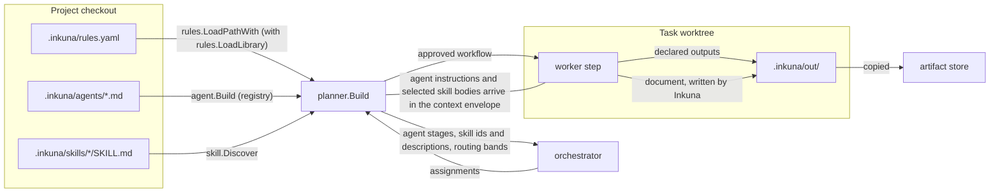
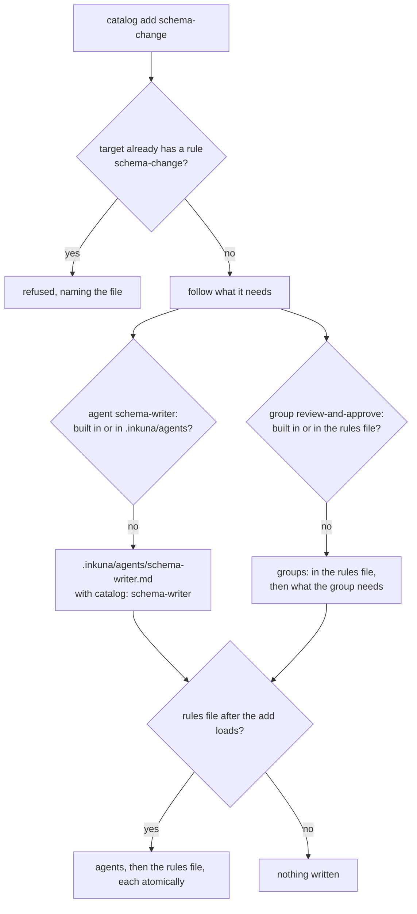

# The .inkuna directory

A repository tells Inkuna how to work on it through a `.inkuna/` directory at its root: which flows tasks go through, which specialist agents exist, and which skills those agents receive. The directory is committed with the code, so changes to it are reviewed like code. Inkuna's own repository has one, and Inkuna plans changes to itself from it exactly as it would for any other project.

## Layout

| Path | Read by | Contract | Commit it |
| --- | --- | --- | --- |
| `.inkuna/rules.yaml` | `internal/rules` at planning, the Rules view | [rules.md](rules.md) | yes |
| `.inkuna/agents/<name>.md` | `internal/agent` at planning, the Agents view | [agents.md](agents.md) | yes |
| `.inkuna/skills/<id>/SKILL.md` | `internal/skill` at planning | [Skills](#skills) below | yes |
| `.inkuna/branching.yaml` | `internal/branching` at planning and run start, `inkunactl branch` | [branching.md](branching.md) | yes |
| `.inkuna/review.yaml` | `internal/diff` when a run's changes are shown | [review.yaml](#reviewyaml) below | yes |
| `.inkuna/tracker.yaml` | `internal/tracker` before any write to the repository's tracker, Settings, Connections | [mcp-and-trackers.md](mcp-and-trackers.md#inkunatrackeryaml) | yes |
| `.inkuna/out/` | written by workers and by Inkuna (a stage's plan document), copied into the artifact store | [agents.md](agents.md#declaring-outputs) | no, ignore it: `inkunactl init` adds it to `.gitignore` |

Every part is optional. Without a rules file Inkuna uses its built-in rules, built from the built-in `profile`, `verify`, and `approval` stages, which a global stage library can replace ([rules.md](rules.md#where-definitions-come-from)); without agents or skills directories the repository adds none; without a tracker file Inkuna writes nothing to the repository's issue tracker; without a complete branching configuration, planning proposes the missing values and approving the plan writes them. `inkuna.yaml` can point a repository's rules elsewhere with `repositories[].rules` ([configuration.md](configuration.md)).

`.inkuna/out/` is scratch space for the steps of one run, never part of its changes. Inkuna's own commits leave it out whether or not the repository ignores it (`worktree.CommitAll` excludes it from what it stages), so a plan document never lands on a run's branch, and neither a round's start nor a run in the checkout counts what is left there as uncommitted work (`worktree.Changes`). Ignoring it keeps it out of everyone else's git as well: `inkunactl init [REPOSITORY]` appends `.inkuna/out/` to the repository's `.gitignore`, atomically and once, and does nothing when a `.gitignore` in the repository already ignores it. An ignore in `.git/info/exclude` or a global excludes file does not count, since a clone does not get it. A run in a repository that does not ignore it warns once on its timeline. When a run completes, what is left there is archived or removed as `out.cleanup` in `.inkuna/branching.yaml` says ([branching.md](branching.md#inkunaout-after-a-run)).

Inkuna reads `.inkuna/` from the checkout a project points at, not from a task's worktree. A worker that edits `.inkuna/` changes what later plans do only once its branch is merged into that checkout, and the change goes through the same approval and review as any other. An edit made in the app's Rules or Agents view goes the other way: it is saved into the checkout and used at once, and sits there uncommitted. Such edits never hold back an update of the checkout's branch, and the Branches view shares them to origin as a pull request or a push to the base ([branching.md](branching.md#sharing-settings-edits)).



## Skills

A skill is a directory under `.inkuna/skills/` holding a `SKILL.md`: YAML frontmatter with `name` and `description`, then the instructions. It is the same shape Claude Code uses for skills.

```markdown
---
name: design-docs
description: Writing and updating design docs in docs/.
---

# Design docs
...
```

| Part | Required | Meaning |
| --- | --- | --- |
| `name` | yes | Must equal the directory name, which is the skill's id. |
| `description` | yes | Shown to the orchestrator, which never sees the body. |
| body | no | The instructions a worker receives. |
| `inkuna.yaml` | no | A manifest beside `SKILL.md`: `version: 1`, `taskKinds` (shown to the orchestrator), `requiredCapabilities` (shown in the app), `compatibility` (platforms), `delivery` (`inline`, the default, or `on-demand`), and `actions` that `inkunactl skill run` executes. |

A malformed skill stops planning, as a malformed agent does. Validate one with `go run ./cmd/inkunactl skill validate .inkuna/skills/<id>`.

A step receives a skill in three ways:

1. **The rule stage lists it** under `skills`. This is strict: a skill the repository does not have is a planning error.
2. **The agent definition lists it** under `skills`. A skill the repository lacks is skipped, so one global agent can serve many repositories.
3. **The orchestrator picks it** for an `auto` stage. Go rejects a pick the repository does not have.

The worker gets the selected skill bodies in its context envelope, whatever its runtime, each within the skill budget ([agents.md](agents.md#budgets)). A skill with `delivery: on-demand` is sent as its id, description, and path instead, for the worker to open when it needs it, wherever the worker can read the file; elsewhere it goes inline.

`inkunactl skills export .inkuna/skills both .` writes copies into `.claude/skills` and `.agents/skills` so interactive Claude Code and Codex sessions can load them as native skills. The copies do not update themselves; re-run the export after a change rather than committing them.

## review.yaml

`.inkuna/review.yaml` says how the review views show the repository's changes. Its one setting lists more paths to collapse as generated, on top of the built-in lockfiles, `ui/dist/**`, and `frontend/wailsjs/**`, and on top of `linguist-generated` in `.gitattributes` ([architecture.md](architecture.md#reviewing-a-runs-changes)).

```yaml
version: 1
generated:
  - docs/api/          # everything inside docs/api
  - "*.pb.go"          # at any depth
  - "!go.sum"          # show a built-in default again
```

Patterns follow `.gitignore`: one without a slash before its end matches a name at any depth, one with a slash is relative to the repository root, a trailing slash matches only what is inside a directory, `**` spans directories only as a whole path component (a leading `**/`, a `/**/` inside, or a trailing `/**`; elsewhere, as in `src/**.go`, it is a `*`), and a pattern starting with `!` clears what an earlier one, a default, or `.gitattributes` flagged. The last pattern that matches decides. The file is decoded strictly: an unknown key, a version other than 1, or a pattern that cannot match, such as an unclosed `[`, is an error the Changes view reports.

## The catalog

Inkuna ships a catalog of agents, skills, rules, shared stages, and groups that a repository can adopt rather than write from scratch, and a binary that embeds Inkuna can offer more through a definition source ([below](#from-definition-sources)). Nothing in it is used until it is added. Adding copies the item into `.inkuna/`, or with `--global` into this machine's global directories, where it is reviewed like code and edited like any other file. It is a copy, not a reference: a later Inkuna never changes it underneath.

```sh
inkunactl catalog list [REPOSITORY]                # every item: name, kind, description, what it needs
inkunactl catalog show NAME [REPOSITORY]           # one item, with its file
inkunactl catalog add NAME [REPOSITORY]            # into the repository, . by default
inkunactl catalog add NAME --global                # into the global agents or stage library directory
inkunactl catalog add NAME --source SOURCE         # the item a definition source offers the repository
inkunactl catalog sources [REPOSITORY]             # what the repository's definition sources shared
```

The catalog lives in `internal/catalog/items/`, one file per item, in the formats Inkuna reads elsewhere:

| Kind | File | Added to the repository | Added with `--global` |
| --- | --- | --- | --- |
| agent | `agents/<name>.md`, an [agent file](agents.md#file-format) | `.inkuna/agents/<name>.md` | `<first agents directory>/<name>.md` |
| skill | `skills/<name>/`, a skill's directory with its `SKILL.md` | `.inkuna/skills/<name>/`, whole | refused: skills live in a repository |
| shared stage | `stages/<name>.yaml`, a [stage library file](rules.md#where-definitions-come-from) defining only `<name>` | under `stages:` in the rules file | `<first stage directory>/<name>.yaml` |
| group | `groups/<name>.yaml`, a stage library file defining only `<name>` | under `groups:` in the rules file | `<first stage directory>/<name>.yaml` |
| rule | `rules/<name>.yaml`, a rules file (`version: 2`) holding only that rule | first under `rules:` in the rules file | refused: rules have no global scope |

A stage or group file opens with a comment that describes it, since neither has a description field; a rule has `description`. Each item lists what it needs: the agents its stages name, other than `auto` and `human` (the user), the shared stages and groups it uses, directly or through a group, built-in ones included, and the catalog's skills those agents name. An agent may name a skill the catalog does not have, which a repository may have of its own.

**What an add brings.** Adding an item also adds each agent, skill, shared stage, and group it needs that the target lacks, and says which. A repository has a skill that has a directory in `.inkuna/skills/`; a global add brings no skill, since a global agent finds its skills in whichever repository it works in. A repository has an agent that is built in or has a file in `.inkuna/agents/`, and a shared stage or group that is built in or defined in its rules file; the global directories have those built in or in one of their files. What the target has is used as it is and not looked into further, so a repository's own `verify` is kept and what the catalog's would have needed is not added. A repository copy of a name a global directory also defines replaces the global one for that repository, and the add says so.

**It never overwrites.** An item whose name the target already uses for its kind is refused, naming the file that has it, and nothing is written. The kinds are an agent file, a rule (ignoring case), or a shared stage or group, which share one namespace. Everything is checked before anything is written: the rules file as it would be after the add has to load against the stage library, and each new global definition has to pass the library's checks. Each file is written atomically through a temporary file in the same directory. A new file is hard-linked into place, which fails rather than replace a file made after the check; on a file system without hard links it is created exclusively instead, which never replaces one either. The rules file is renamed over the old one and keeps its permissions, and only if it is still as the add read it: one changed in the meantime, by another add or an editor, is refused, and the add's agent files are removed again. When the rules file cannot be written, the agent files written before it are removed again. A repository whose rules file does not load is refused until it is fixed.

**The rules file.** An add edits the repository's rules file in place, the one `repositories[].rules` in `inkuna.yaml` names when it names one, keeping its comments and indentation (blank lines between entries are not kept), and raises its `version` to 2 when what it adds needs it. The edited file must say everything it said before, with only the additions; a file that takes a value through a YAML merge (`<<`) or an alias the edit would change is refused, to be added to by hand. A rule goes first, so it is tried before the rules already there; move it to change that. A repository with no rules file used the built-in rules, so adding a rule, stage, or group to it writes the built-in rules with the addition, and the repository keeps the flows it had.

**What it records.** An added agent records the item it came from as `catalog: <name>` in its frontmatter, a key Inkuna does not read and so keeps when the agent is saved ([agents.md](agents.md#file-format)); one from a definition source records `catalogSource`, `catalogScope`, and `catalogVersion` too. Rules and stage library files decode strictly, so what is added to them records nothing. A skill is copied whole: its files go to a temporary directory beside `.inkuna/skills/`, which is renamed into place, so a plan never discovers half of one.



Go is the only validator of what ships. `catalog.Load` refuses the whole catalog when an item:

- does not decode strictly (an agent's frontmatter may hold only keys Inkuna reads) or is not named as its file;
- shares a name with another item of any kind, or takes the name of a built-in agent, rule, stage, or group, compared without case, since rules are chosen by name ignoring it;
- needs an agent or definition that is neither built in nor in the catalog;
- is a rule whose `when` holds for every task, which, placed first, would take every flow: one with no condition, or only conditions every task meets (every task kind, an empty keyword, complexity 1 to 10, or a `minPriority` of 0 or less).

`internal/catalog/self_test.go` adds each item alone to an empty repository and plans every flow of the result, built-in ones included, for each kind of task that reaches it. It plans once with the agents the add brought and once with every catalog agent, and fails the build if a flow does not plan or if fallback staffing would give an `auto` stage to an agent other than the one the built-in agents alone would give it. Fallback staffing takes the first specialist for the task kind in name order, so a catalog agent named before the built-in of its kind would take that built-in's stages whenever the orchestrator is unavailable: a writable implementation agent before `implementer`, or a research agent before `researcher`. A catalog specialist takes a stage only when a rule names it or the orchestrator picks it. A catalog rule's stages list no skills, which a repository may not have; an agent may list them, and a repository without one skips it.

### From definition sources

A binary that embeds Inkuna can register a definition source ([extensions.md](extensions.md#definition-sources)), which shares agents, skills, shared stages, groups, and rules for a project. Those it shares in `catalog` mode are offered beside the built-in catalog, each naming its source and the scope it was shared with, and added in the same way. They are checked as the built-in catalog's items are, needing only what is built in or offered by the same source. One that fails is not fatal, as it is for the built-in catalog: it is reported with Go's reason and left out, with every item that needs it. A source shares for a project, so its items are never added globally.

The app asks the sources when the catalog is listed and when an item is added, and keeps the last snapshot each gave in its data directory. `inkunactl` registers no extensions, so it offers what the app kept for the repository, and `inkunactl catalog sources` prints it, with what this build does with each definition. An item two catalogs offer by one name is chosen with `--source`; without it the built-in catalog's is taken. The catalog dialogs show each source that could not be reached, and each definition not offered, such as one that fails its checks or a `shared` one this build does not apply, with Go's reason.

**What it holds.** The catalog's agents are general versions of the specialists a repository might write for itself, not tied to any one repository, and none lists skills, MCP servers, or tracker kinds:

| Agent | Permission | Task kinds | Job |
| --- | --- | --- | --- |
| `security-reviewer` | read-only | review | Reviews a change for leaked secrets, injection, authentication and authorization, unsafe input, and widened permissions |
| `migration-writer` | worktree-write | implementation | Writes forward-only schema and data migrations, with the tests that run them, and asks before a change that loses data |
| `ui-engineer` | worktree-write | implementation | Frontend work that follows the repository's components, styles, and accessibility |
| `upgrader` | worktree-write | implementation | Upgrades the dependencies the objective names, reads their changelogs, and fixes what breaks |
| `refactorer` | worktree-write | implementation | Restructures code without changing behaviour, kept honest by the existing tests |
| `resource-profiler` | read-only | research | Finds where time or memory goes, from measurements, and recommends a fix with the measurement that proves it |
| `release-notes-writer` | worktree-write | documentation | Writes release notes from the commits and pull requests in a range |

`upgrader` and `resource-profiler` are named to sort after `implementer` and `researcher`, for the reason above.

| Shared stage or group | What it is |
| --- | --- |
| `security-review` (stage) | A read-only agent stage run by `security-reviewer` |
| `review-and-approve` (group) | `reviewer`, read-only, then `approval` with `review: true`; with no feedback target, a person's changes go back to the nearest writable stage before the group, in whichever flow uses it |

Each rule matches implementation tasks by keywords in the objective and acceptance criteria. Keywords match as text anywhere, so each is long enough not to match unrelated words, and a rule's conditions all have to hold, so a rule that named labels too would match only tasks with both.

| Rule | Also matches | Keywords, among others | Flow |
| --- | --- | --- | --- |
| `security-sensitive` | bugfix | authentication, authorization, oauth, password, secret, token, permission, crypto | profile, an `auto` writable change, verify, `security-review`, then `approval` with `review: true` |
| `schema-change` | | migration, database schema, schema change, alter table | profile, `migration-writer`, verify, `review-and-approve` |
| `dependency-upgrade` | | upgrade dependencies, dependency update, bump, dependabot | profile, `upgrader`, verify, `review-and-approve` |
| `refactor` | | refactor, restructure, without changing behaviour | profile, `refactorer`, verify, `review-and-approve` |
| `test-coverage` | | test coverage, untested, missing tests | profile, `test-writer`, verify, `review-and-approve` |

`test-coverage` names coverage rather than tests, since most tasks ask for passing tests in their acceptance criteria. Each rule is added first, so a repository that adds several tries the last one added first; reorder them in the rules file to change that. `internal/catalog/items_test.go` plans each rule for the tasks it is written for and for unrelated ones that share a word with its keywords.

The app's `CatalogItems` binding lists the catalog with where a project and the global directories already have each item (`catalog.Presence`), `PreviewCatalogItem` says what an add would write, and its notes, without writing anything (`catalog.Preview`), and `AddCatalogItem` adds an item to a project or the global directories, with the same checks. The Agents view adds agents from it, and the Rules view rules, shared stages, and groups ([agents.md](agents.md#editing-agents-in-the-app), [rules.md](rules.md#adding-from-the-catalog)).

## Conventions

A repository's conventions have to reach every agent that works on it, and each runtime looks in a different place:

| Agent | Reads on its own | Reaches the conventions skill |
| --- | --- | --- |
| Claude Code, interactive or as an Inkuna worker | `CLAUDE.md` | as a worker, through the rule stage |
| Codex, interactive or as an Inkuna worker | `AGENTS.md` | as a worker, through the rule stage |
| Copilot CLI as an Inkuna worker | nothing: Inkuna runs it with `--no-custom-instructions` | through the rule stage |
| A runtime declared in `inkuna.yaml` | whatever that CLI reads | through the rule stage |

Only the context envelope reaches every runtime, so the conventions belong in a skill, and every agent stage in the repository's rules lists that skill. `CLAUDE.md` and `AGENTS.md` become pointers to it rather than copies, so there is one text to change. Claude Code imports it (`@.inkuna/skills/conventions/SKILL.md`); `AGENTS.md` tells the reader to open it.

## Inkuna's own directory

Inkuna's repository follows this pattern. The `conventions` skill holds what used to be the contributor guide, and `CLAUDE.md` and `AGENTS.md` point to it. Its `branching.yaml` names branches `<type>/<issue>-<slug>` from GitHub issues (`<type>/<slug>` without one), starts them from `origin/main`, creates worktrees in `../inkuna-worktrees`, and prunes finished runs' worktrees when the next run starts. Its `review.yaml` collapses `frontend/src/diff.css`, which `internal/diff` generates; `internal/diff/self_test.go` fails the build if the file stops parsing or stops marking `frontend/src/diff.css` generated. Its `tracker.yaml` names the GitHub Project whose Status field holds an issue's status (`inkuna-ai`'s project 1, with `In progress` and `Done`) and turns every write off, so Inkuna's runs on itself write nothing to its issues yet; `internal/tracker/self_test.go` fails the build if the file stops being valid.

**Skills**

| Skill | For |
| --- | --- |
| `conventions` | Architecture boundaries, safety model, configuration and secrets, code and test gates, docs, the `.inkuna` directory, and the change workflow. Every agent stage gets it. |
| `inkuna-branch` | Creating a branch and worktree by `branching.yaml` with `inkunactl branch new`, whichever tracker the story comes from. Tells Inkuna workers never to create one. |
| `design-docs` | The frontmatter contract, Mermaid diagrams, and README links for `docs/`. |
| `wails-frontend` | The React view, Wails bindings, Tailwind, frontend checks, and the built `ui/dist`. |
| `sqlite-migrations` | Numbered, forward-only migrations and the storage code that uses them. |

**Agents.** General Go work stays with the built-in `implementer`; repository agents exist only where the instructions or permission differ.

| Agent | Permission | Task kinds | Skills |
| --- | --- | --- | --- |
| `security-reviewer` | read-only | review | `conventions` |
| `migration-writer` | worktree-write | implementation | `conventions`, `sqlite-migrations` |
| `ui-engineer` | worktree-write | implementation, bugfix | `conventions`, `wails-frontend` |

**Rules.** The file replaces the built-in rules, so it restates the built-in `bugfix` and `read-only` flows. Its own `docs` flow stands in for the built-in `documentation` one, and it does not adopt the built-in `feature` flow. The first match wins.

| Rule | When | Stages |
| --- | --- | --- |
| `inkuna-directory` | kind `skill-authoring` | profile, author (`auto`, may write `.inkuna/`, `docs/`, `CLAUDE.md`, `AGENTS.md`), verify (Go tests for the planner, docs, branching, agents, skills, and rules), approval |
| `security` | implementation or bugfix mentioning secret, keychain, credential, sandbox, permission, or trust boundary | profile, implement (`auto`), security review (`security-reviewer`), verify, approval |
| `schema-change` | implementation or bugfix mentioning migration, sqlite, or database schema | profile, migrate (`migration-writer`), review (`reviewer` with `sqlite-migrations`), verify, approval |
| `bugfix` | kind `bugfix` | profile, reproduce (`researcher`), fix (`auto`), verify, approval |
| `read-only` | kind `research` or `review` | profile, investigate (`auto`, read-only), approval |
| `docs` | kind `documentation` | profile, write (`documenter` with `design-docs`), verify (`go test ./internal/docs/...`), approval |
| default | anything else | profile, worker (`auto`), verify, approval |

The `security`, `schema-change`, `bugfix`, and default flows let their writer run `go test`, `go vet ./...`, and `gofmt -w .` without asking, and verify with `task deps` and then `task ci`, the handoff gate, because a fresh worktree has no `frontend/node_modules`. The `inkuna-directory` and `docs` flows run only the Go tests of the packages they touch. For the same reason a worker cannot build the frontend or run its tests, and the frontend skill tells it to say so in its handoff; `task ci` builds `ui/dist`, which is never committed, before the tests run.

### The self-test

`internal/planner/self_test.go` plans every flow in Inkuna's rules with `planner.Build`, using the real registry and skills and deterministic staffing. It fails `go test` when:

- a flow would not plan: an unknown agent, a missing stage skill, or a read-only agent on a writable stage;
- a repository agent declares a skill `.inkuna/skills` does not have, which planning would otherwise skip without a word;
- an agent step would not receive the `conventions` skill;
- fallback staffing would give a writable `auto` stage to anything but `implementer`.

`internal/branching/self_test.go` separately fails the build when `.inkuna/branching.yaml` is incomplete or no longer names a GitHub issue's branch as `feature/<issue>-<slug>`.

The fallback check exists because fallback staffing takes the first specialist for the task kind in name order. A repository specialist named before `implementer` (a `frontend-engineer`, say) would take every writable stage whenever the orchestrator is unavailable. That is why the UI specialist is named `ui-engineer`.
