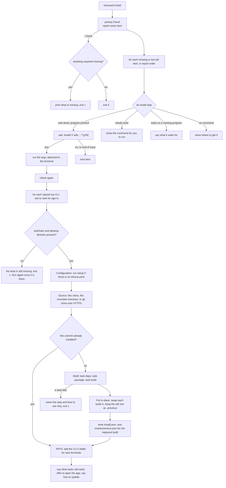
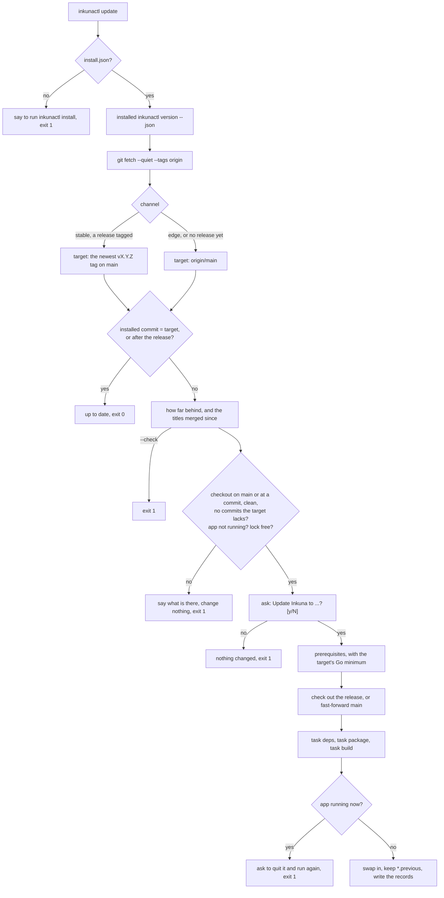
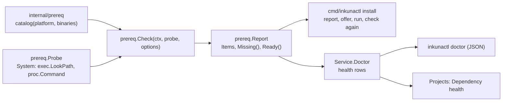

# Installing and updating Inkuna

`inkunactl install` is the guided way to install Inkuna on macOS, Linux, or Windows. It checks what Inkuna needs and offers to install what is missing, writes the configuration when there is none, builds the app and `inkunactl` from a checkout of the repository, puts them in place, and adds `inkunactl` to `PATH`. It says what each step will do and asks first. It runs only user-level commands you agree to, never `sudo`, and never through a shell. `inkunactl update` brings an install up to date with its channel, the newest release or `origin/main`, and `inkunactl update --rollback` goes back to the build it replaced ([Updating](#updating)). Each release also has downloads for each platform, which need none of the build's prerequisites ([Downloading a release](#downloading-a-release)).

## Downloading a release

Each [release](https://github.com/inkuna-ai/inkuna/releases) carries the app and `inkunactl` built for macOS, Windows, and Linux. `.github/workflows/release.yml` builds them on each platform's GitHub runner when a `vX.Y.Z` tag is pushed on `main`, and names them by `info.productVersion` in `wails.json`, which the tag must match.

| Platform | Files | Installing |
| --- | --- | --- |
| macOS, Apple silicon and Intel | `Inkuna-<version>-macos-universal.dmg`, `inkunactl-<version>-macos-universal.tar.gz` | Open the disk image and drag Inkuna to Applications. Put `inkunactl` from the archive in `~/.local/bin`. |
| Windows, x86-64 | `Inkuna-<version>-windows-amd64-installer.exe` | Run the installer. |
| Linux, x86-64 | `inkuna-<version>-linux-amd64.tar.gz` | Extract it, and put `inkuna` and `inkunactl` in `~/.local/bin`. |

Every download also holds `LICENSE.md`, `NOTICE`, and `THIRD_PARTY_NOTICES`. The release lists `SHA256SUMS`, the SHA-256 of each file (`shasum -a 256 --check --ignore-missing SHA256SUMS`). Each file also has a GitHub build attestation, so `gh attestation verify <file> --repo inkuna-ai/inkuna` checks that this repository's release workflow built it.

- **macOS.** The app and `inkunactl` each hold both architectures, joined with `lipo`. They are signed ad hoc, not with a Developer ID, and not notarized. So the first time it opens, macOS says it cannot verify Inkuna, and **Open Anyway** in System Settings > Privacy & Security opens it from then on.
- **Windows.** The installer is the NSIS script in `build/windows/installer/project.nsi`, built by `wails build -nsis`. It installs for the current user, without administrator rights, into `%LOCALAPPDATA%\Programs\Inkuna`, the folder `inkunactl install` uses, with the same Start menu shortcut. `package_test.go` fails the build when the two drift apart. It installs the WebView2 runtime when it is missing, and registers an uninstaller in Settings > Apps, which removes the program and its shortcut but not the configuration, the database, or keychain secrets. It does not change `PATH`: to run `inkunactl` from any terminal, add that folder to your user `PATH`. The installer is not signed, so SmartScreen may ask you to confirm it (**More info**, then **Run anyway**).
- **Linux.** The build runs on Ubuntu 22.04, so it needs glibc 2.35 or later, and the GTK 3 and WebKitGTK 4.1 runtime libraries (`sudo apt install libgtk-3-0 libwebkit2gtk-4.1-0` on Ubuntu). The archive holds the app icon as `inkuna.png` for a desktop entry of your own. There is no `.deb` yet.

`inkunactl update` updates only an install `inkunactl install` made, since it builds from that install's checkout. For a download, it finds no [install record](#the-install-record) and says to run `inkunactl install`, which builds from source and replaces the download in place, because both use the same locations. Otherwise, update a download by installing the next release over it.

A pull request that changes `release.yml`, `build/`, `wails.json`, or `Taskfile.yml` builds every download without publishing anything, so a broken package shows before a tag. The files are attached to that workflow run.

## Running it

On a new machine, with Git and Go installed, one line clones the repository and starts the wizard:

```sh
git clone https://github.com/inkuna-ai/inkuna.git && cd inkuna && go run ./cmd/inkunactl install
```

The clone needs no GitHub sign-in. `go run` needs Go, so on a machine without it, install Go first ([go.dev/doc/install](https://go.dev/doc/install)). The wizard then checks everything else. Once installed, `inkunactl install` runs from anywhere and finds its checkout from the [install record](#the-install-record).

```sh
inkunactl install          # check, offer to install and sign in, then build and install Inkuna
inkunactl install --check  # only report the prerequisites; exit 1 when something required is missing
inkunactl install --yes    # agree to the install's own steps without asking (see below)
```

The wizard is safe to run again. Each step checks what is already done and skips it, so a second run, or one after a failure or a `sudo` command you had to type, picks up where the last one stopped. A run that finds everything done builds nothing and asks nothing.

`--yes` is for a run with no one to answer, such as CI. It answers yes to the questions about Inkuna's own install: which checkout to build from, cloning it, building, putting the build in place, and changing `PATH`. Installing other software, signing in, and opening the app still ask, and without a terminal the answer is no.

## What it checks

| Item | Platforms | Minimum | How it is checked |
| --- | --- | --- | --- |
| Git | all | | `git --version` |
| Go | all | 1.25, the `go` directive in `go.mod` | `go version` |
| Node.js | all | 22 | `node --version` |
| npm | all | | `npm --version` |
| Task | all | 3 | `task --version` |
| Xcode Command Line Tools | macOS | | `xcode-select -p` |
| C compiler | Linux | | `cc --version` |
| GTK 3 | Linux | | `pkg-config --modversion gtk+-3.0` |
| WebKitGTK 4.1 | Linux | | `pkg-config --modversion webkit2gtk-4.1` |
| WebView2 runtime | Windows | | `reg query` of the runtime's `EdgeUpdate` client key, per machine then per user |
| GitHub CLI, signed in | all | | `gh --version`, then `gh auth status` |
| Codex CLI, signed in | all | | `codex --version`, then `codex login status` |
| Claude Code, signed in | all | | `claude --version`, then `claude auth status` |
| GitHub Copilot CLI | all | | `copilot --version` |

Every item is required except the provider CLIs, which are alternatives: at least one must be installed and signed in. GitHub Copilot CLI has no command that reports whether it is signed in, so it counts once it is installed, and the report says its sign-in was not checked. If Copilot is your only provider, the wizard offers `copilot login`.

The programs are the ones configuration chooses: `INKUNA_GIT_BINARY`, `INKUNA_GO_BINARY`, `INKUNA_NODE_BINARY`, `INKUNA_NPM_BINARY`, `github.binary`, and `runtimes.<name>.binary` ([configuration](configuration.md)). A provider CLI's `runtimes.<name>.versionArgs`, for a wrapper with its own version command, replaces `--version` (`prereq.OptionsFor`). Task has no override.

## Install commands

| Item | macOS | Windows | Linux |
| --- | --- | --- | --- |
| Git | `brew install git` | `winget install --id Git.Git` | the package manager's `git` |
| Go | `brew install go` | `winget install --id GoLang.Go` | [go.dev/doc/install](https://go.dev/doc/install). Distribution packages are often older than 1.25. |
| Node.js and npm | `brew install node` | `winget install --id OpenJS.NodeJS.LTS` | [nodejs.org/en/download](https://nodejs.org/en/download), with nvm or fnm |
| Task | `brew install go-task` | `winget install --id Task.Task` | `go install github.com/go-task/task/v3/cmd/task@latest` |
| Xcode Command Line Tools | `xcode-select --install` | | |
| C compiler | | | `build-essential`, `gcc`, or `base-devel` |
| GTK 3 | | | `pkg-config libgtk-3-dev`, `pkgconf-pkg-config gtk3-devel`, or `pkgconf gtk3` |
| WebKitGTK 4.1 | | | `libwebkit2gtk-4.1-dev`, `webkit2gtk4.1-devel`, or `webkit2gtk-4.1` |
| WebView2 runtime | | `winget install --id Microsoft.EdgeWebView2Runtime` | |
| GitHub CLI | `brew install gh` | `winget install --id GitHub.cli` | `dnf install gh` or `pacman -S github-cli`; on Debian and Ubuntu, [GitHub's apt repository](https://github.com/cli/cli/blob/trunk/docs/install_linux.md) |
| Codex CLI | `npm install -g @openai/codex` | same | same |
| Claude Code | `npm install -g @anthropic-ai/claude-code` | same | same |
| GitHub Copilot CLI | `npm install -g @github/copilot` | same | same |

Every winget command also passes `--exact --source winget`. On Linux the wizard uses the first package manager it finds, in this order: `apt-get` (Debian, Ubuntu), `dnf` (Fedora), `pacman` (Arch). Its commands need `sudo`, so the wizard shows them for you to run. With none of the three, it names the packages to install instead. `go install` puts `task` in `$(go env GOPATH)/bin`, which must be on `PATH`.

Some commands wait on others. A provider CLI installs with npm, which comes with Node.js. Task on Linux installs with Go. A macOS command needs Homebrew ([brew.sh](https://brew.sh)), and a Windows one needs winget, which comes with App Installer from the Microsoft Store. Until that program is there, the wizard says what the command is waiting for and does not offer it.

| Sign-in | Command |
| --- | --- |
| GitHub CLI | `gh auth login` |
| Codex CLI | `codex login` |
| Claude Code | `claude auth login` |
| GitHub Copilot CLI | `copilot login` |

## How the wizard proceeds



Provider CLIs are offered only while no provider is usable. Once one is installed and signed in, the others are left alone. A signed-out CLI gets a sign-in offer either way.

The build needs only the toolchain (Git, Go, Node.js, npm, Task) and the platform's desktop libraries. The GitHub CLI and a provider CLI are needed to run tasks, not to build, so the wizard installs Inkuna without them and ends by listing what is still missing.

## Configuration

When there is no `inkuna.yaml`, the wizard runs the [setup wizard](configuration.md#setup-wizard-and-cli): the data directory, the orchestrator, repositories, and secrets for the keychain. Enter keeps each default. When the file exists, it is left as it is. This step comes before the checkout because setup chooses the data directory the checkout goes in. Install never changes `inkuna.yaml`, the database, or keychain secrets after that; the app runs its own migrations on its next start.

## The source checkout

The wizard builds from one checkout, chosen in this order:

1. **The clone it runs in.** Run from inside a clone of the repository, it offers to build from that clone. A clone counts when the top of its working tree has a `go.mod` for `github.com/inkuna-ai/inkuna`, whatever its remote is called. The offer says when the clone is on a branch other than `main`, since the build then reports that branch's version. The wizard never switches a clone's branch.
2. **The checkout the last install used**, from the install record.
3. **Its own checkout** at `<data dir>/source`, cloned with `git clone https://github.com/inkuna-ai/inkuna.git` after asking. The repository is public, so the clone needs no GitHub sign-in. On the stable channel, the default ([Channels](#channels)), the new clone is then checked out at the newest release, detached (`git checkout --quiet --detach refs/tags/<tag>`), so the install starts where an update would take it. Before the first release, and on the edge channel, it stays on `main`. The channel is read before cloning, so a `update-channel.json` that cannot be read stops the install first; a release checkout that fails removes the new clone, so the next run clones and checks out the release again rather than building `main`.

The wizard builds the checkout as it is: it does not pull. `inkunactl update` brings it up to date (see [Updating](#updating)).

## The build

The wizard runs `task deps`, then `task package` and `task build` in the checkout, each attached to the terminal so its output shows. `task package` makes the app with Wails and `task build` makes `inkunactl`; both stamp the version and commit ([configuration.md](configuration.md#finding-the-version)). The build must leave the checkout's tracked files as they were: a changed file stamps the build `-dirty` and makes every later install build again. So Wails installs the frontend's dependencies with `npm ci` (`frontend:install` in `wails.json`), which follows `frontend/package-lock.json` and never rewrites it, as `npm install` does when the lockfile was written by another npm version. When a step fails, the wizard names it, says to read its output or run it again in the checkout to see why, and stops with exit status 1. Nothing is put in place, so the next run starts at the build.

The wizard then reads the version the build stamped with `bin/inkunactl version --json`. A later run compares the checkout's `git describe --tags --always --dirty` and `git rev-parse HEAD` with what the record says was installed. When they match, the app and CLI are where the layout puts them, and the installed `inkunactl version --json` reports the same version and commit, there is nothing to build. The last check matters because the record belongs to one data directory while the app and CLI are the user's: an install with another `INKUNA_DATA_DIR` may have replaced them. A checkout with uncommitted changes is always rebuilt, since its version does not say which changes.

## Where everything goes

Every location belongs to the user, so nothing needs administrator rights.

| | macOS | Linux | Windows |
| --- | --- | --- | --- |
| App | `/Applications/Inkuna.app`, or `~/Applications/Inkuna.app` when `/Applications` is not writable | `~/.local/bin/inkuna` | `%LOCALAPPDATA%\Programs\Inkuna\Inkuna.exe` |
| `inkunactl` | `~/.local/bin/inkunactl` | `~/.local/bin/inkunactl` | `%LOCALAPPDATA%\Programs\Inkuna\inkunactl.exe` |
| Launcher | | `~/.local/share/applications/inkuna.desktop`, with its icon at `~/.local/share/icons/inkuna.png` | `%APPDATA%\Microsoft\Windows\Start Menu\Programs\Inkuna.lnk` |
| On `PATH` | `~/.local/bin` | `~/.local/bin` | `%LOCALAPPDATA%\Programs\Inkuna` |

`INKUNA_APPLICATIONS_DIR` replaces `/Applications` on macOS, so CI installs into its temporary home. The layout is `install.LayoutFor` in `internal/install/layout.go`. The desktop entry names its icon by full path, since icon themes have no size for the 1024-pixel app icon. The Start menu shortcut is made by the Windows Shell's own link object, `IShellLinkW`, called directly over COM (`install.WriteShortcut`), not from a PowerShell or script-host script, and is renamed into place.

Before putting anything in place, the wizard lists each location and what it replaces, and asks.

## Replacing an earlier install

`install.Place` copies the new build next to the old one, into a hidden staging directory of its own (`.<name>.new-*`), then swaps it in with renames: the installed build becomes `<name>.previous`, replacing the one the last install kept, and the staged copy becomes `<name>`. A copy that fails part way leaves the installed build as it was. If the last rename fails, the old build is renamed back. Renames also let a running `inkunactl` replace itself, which Windows allows, though it refuses to overwrite or delete a running program. Windows also refuses to rename a file another process has open, as a virus scanner such as Windows Defender does with a build that was just written, so on Windows each rename is retried for up to two seconds while the file is held (`internal/install/rename_windows.go`). The previous build stays until the next install or update, so there is always one to go back to (`inkunactl update --rollback`).

The app is not replaced while it runs. Before swapping a build in, install and update look for a process running the installed app's executable (`install.Running` on `Layout.AppProgram`, `Inkuna.app/Contents/MacOS/Inkuna` on macOS) and, when there is one, ask you to quit it and run the command again. The running app would otherwise carry on as the old build beside a database the new one migrates. The check asks the operating system rather than running a command: `/proc` on Linux, `sysctl` on macOS, and a Toolhelp snapshot on Windows. A process matches when its executable is the same file, so a path through a link still matches. macOS gives the path a program was started with, which is relative for one started as `./Inkuna` and says nothing of its directory, so a relative path matches by name: a false match only stops an update, where a miss would replace a running app. When the processes cannot be listed, the wizard says so and goes on.

Only one install runs at a time. After the configuration step the wizard takes `.inkuna-install.lock` beside the installed CLI (`install.Lock` on `Layout.BinDir`), a lock the operating system holds on the open file (`flock` on macOS and Linux, `LockFileEx` on Windows). It lives with the app and CLI rather than in the data directory, because installs with different data directories still put the app and CLI in the same places. A second install stops at once and says another is running. The operating system releases the lock when the process ends, so an install that is killed never leaves it held, and the next one removes any staging directory it left. It finds them by listing the folder and comparing names, not with a glob, since a path such as `/Users/ada [work]` holds characters a glob would read as a pattern. The data directory is made absolute first, so a relative `INKUNA_DATA_DIR` names one checkout, not one per working directory.

## PATH

When the CLI's folder is not on `PATH`, the wizard offers to add it for new terminals. It judges `PATH` as the shell started `inkunactl` with: loading the configuration widens the process's own `PATH` with folders such as `~/.local/bin` so checks and the build find tools there (`config.EnsureSearchPath`), but new terminals do not get that.

- **macOS and Linux:** one line in the startup file the shell `$SHELL` names reads (`install.ShellProfile`):
  - zsh: `export PATH="$HOME/.local/bin:$PATH"` in `.zshrc` in `$ZDOTDIR`, or in the home directory when it is not set.
  - bash on Linux: the same line in `~/.bashrc`.
  - bash on macOS, where Terminal starts login shells: the same line in the first of `~/.bash_profile`, `~/.bash_login`, and `~/.profile` that exists, since a login shell reads only that one. A new `~/.bash_profile` would hide an existing `~/.profile`. With none of them, `~/.bash_profile`.
  - fish: `fish_add_path --global "$HOME/.local/bin"` in `fish/conf.d/inkuna.fish` under `$XDG_CONFIG_HOME`, or `~/.config`.

  The line goes under a comment saying `inkunactl install` added it, and is added once. The wizard appends to the file rather than replacing it, so a startup file linked from a dotfiles repository stays a link.
- **Windows:** the folder is appended to the user `PATH` in the registry (`HKEY_CURRENT_USER\Environment`), and running programs are told the environment changed.

For another shell, when you say no, or when the change fails, the wizard says what to add instead. `PATH` never fails the install: `inkunactl` works by its full path either way.

## The install record

After putting the build in place, the wizard writes `install.json` in the data directory (`install.Record`): the checkout it built from, the version and commit, and where the app and CLI went. The next install reads it to find its checkout and to see whether that build is already installed, and `inkunactl update` to find the checkout to update. Like every file Inkuna reads, it is decoded strictly, and it is replaced atomically.

Beside it, `install.previous.json` has the same shape and records the build kept as `*.previous`, as the installed `inkunactl version --json` reported it just before it was replaced. `inkunactl update --rollback` reads it to say which build it goes back to. It is a file of its own, not a key of `install.json`, because a rollback can install an `inkunactl` from before the key, which would refuse a record with a key it does not know. When the replaced `inkunactl` cannot say its version, the file is removed and the rollback calls it "the previous build".

```json
{
  "source": "/Users/ada/Library/Application Support/Inkuna/source",
  "version": "fed7f80",
  "commit": "fed7f80b6a2c1e4d9f0a7b3c5e8d1f2a4b6c9e0d",
  "app": "/Applications/Inkuna.app",
  "cli": "/Users/ada/.local/bin/inkunactl"
}
```

## Updating

The install wizard ends by offering to open the app and by saying how to update later:

```sh
inkunactl update --check     # fetch origin and say what changed; exit 1 when an update is available
inkunactl update             # the same, then move the checkout, build, and swap the new build in
inkunactl update --yes       # agree to the update without asking, for CI
inkunactl update --rollback  # swap the build the last install or update replaced back in
inkunactl update --channel edge  # follow origin/main from now on; --channel stable goes back
```

An update works on the install recorded in the data directory's `install.json`: its checkout, and the app and CLI where the record says they went. The record wins over the layout, which can choose another place since: on macOS the app goes in `/Applications` only while it is writable, so an install in `~/Applications` is updated and rolled back there. Without a record there is nothing to update, and it says to run `inkunactl install`. It never runs setup, and never changes `inkuna.yaml`, the database, or keychain secrets. The app runs its own migrations when it next starts, as after any install.

### Channels

An update follows one of two channels, recorded in the data directory's `update-channel.json` (`install.ReadChannel`):

- **Stable**, the default, follows the newest release: the highest tag on `origin/main` of the form `vX.Y.Z`, from `git tag --list --merged origin/main --sort=-v:refname v*`. A pre-release such as `v1.0.0-rc.1`, or a tag off `main`, is never followed. Until the first release is tagged, stable follows `origin/main` and says so.
- **Edge** follows `origin/main`, every change as it merges.

`--channel stable` or `--channel edge` (also `--channel=edge`) records the channel, and that update and every later one follow it. The channel is a file of its own rather than a key of `install.json` for the reason `install.previous.json` is: `install.json` is read strictly, and an `inkunactl` from before the key, put back by a rollback, would refuse it. That older `inkunactl` follows `origin/main`, as it always did. Releases are made by tagging `main` ([CONTRIBUTING.md](../CONTRIBUTING.md#releasing)).

**What changed.** It asks the installed `inkunactl version --json` which commit it was built from, runs `git fetch --quiet --tags origin` in the checkout, and compares that commit with the channel's target: the release's tag or `origin/main`. When they match and the build has no `-dirty` mark, the install is up to date. A `-dirty` build of the target's commit is not: its version does not say which uncommitted changes it has, so the update builds that commit as committed. On stable, an install built from a commit after the release, as one from `main` is, is newer: it stays as it is until a newer release, since stable never takes an install back (`git merge-base --is-ancestor <release> <installed>`). Otherwise it says how many commits behind the install is and lists the subject of each, from `git log --first-parent --format=%s <installed>..<target>`, newest first and at most 20. Pull requests are squash-merged under their titles, so each subject is the title of a pull request merged since. When the installed commit is not on the target, as for a build of a branch, it says so and lists what the target has that the install does not. `--check` stops there: it fetches but changes nothing else, and exits 1 when there is an update, so a script can tell.

**What stops it.** Before asking, the update checks everything that would refuse it, so a refusal changes nothing:

- The checkout must be on `main`, or at a commit rather than on a branch, as one at a release is. It must have no uncommitted changes to tracked files (`git status --porcelain --untracked-files=no`) and no commits the target lacks (`git log <target>..HEAD`); a checkout at a commit going to `origin/main` is switched to `main` first, so `main`'s own commits count too (`git log origin/main..main`). Otherwise it lists what is there and stops. Untracked files do not count, as they do not in the version a build stamps. It never stashes or resets, and switches only between `main` and a release.
- The app must not be running ([Replacing an earlier install](#replacing-an-earlier-install)). It checks again just before swapping the build in, in case the app was opened during the build.
- Another install or update must not hold the install lock.

**The update.** It says how it will move the checkout, what it will build and replace, and asks once. Then:

1. **Prerequisites, again**, since a newer version can need more. The check is this `inkunactl`'s, with one addition: the Go minimum is the newer of its own and the `go` directive of the target's `go.mod` (`git show <target>:go.mod`), so a commit that moved to a newer Go is caught before the build rather than in it. Missing build tools stop the update, as they stop an install.
2. **Move the checkout**: to a release, `git checkout --quiet --detach refs/tags/<tag>`; to `origin/main`, `git switch --quiet main` when the checkout is at a commit, then `git merge --ff-only origin/main`.
3. **Build**: the install's build steps, with the same report when one fails.
4. **Swap in**, as an install does: each build replaces the installed one, which is kept as `*.previous`, and `install.json` and `install.previous.json` are rewritten.

The update is run by the installed `inkunactl`, so it replaces itself. On Windows, which refuses to overwrite or delete a running program, that works because the swap renames the running `inkunactl.exe` to `inkunactl.exe.previous` before renaming the new one into place; `TestPlaceAndSwapReplaceARunningProgram` does this with a running program on every platform. An update that stops part way picks up on the next run: the checkout has already moved, so it builds and swaps in.



### Rolling back

`inkunactl update --rollback` swaps the app and `inkunactl` kept as `*.previous` back in with `install.SwapPrevious`, and keeps the builds it replaces as `*.previous` in their place, so a second rollback undoes the first. It says which build it goes back to, from `install.previous.json`, and asks first. It refuses while the app runs, checking before it asks and again after the answer, in case the app was opened meanwhile, and when there is no previous build. Each swap is three renames through a hidden directory beside the build (`.<name>.swap-*`), so a running `inkunactl` can swap itself out on Windows too. When the CLI's swap fails after the app's, the app is swapped back, so the two always match. Afterwards, `install.json` records the build the restored `inkunactl` reports, and `install.previous.json` the one it replaced. Each keeps the checkout its build came from, so after rolling back to a build of another checkout, that checkout is the one the next update fetches and builds.

A rollback leaves the checkout where the update put it, so the next `inkunactl update` builds the channel's target again. It leaves the database too: migrations the newer build ran stay. A build refuses a database that has migrations it does not know (`Store.Migrate`, `storage.NewerDatabaseError`), naming them and saying to update, since its code may misread or damage what the newer build wrote. So before it asks, the rollback compares the database's migrations (`storage.AppliedMigrations`, read-only) with the newest one the build it restores knows, which `inkunactl version --json` reports as `migration`, and warns when that build would refuse the database. A build from before builds reported it opens any database, and the rollback says so. Roll back to recover from a broken build, then update again once it is fixed.

## Invariants

- **Nothing runs without a yes.** `installer.confirm` in `cmd/inkunactl/install.go` treats anything but `y` or `yes` as no, including the end of input. `inkunactl install --check` never asks and never runs anything. `--yes` answers only the install's own questions (`installer.agree`); installing other software, signing in, and opening the app always ask.
- **Configuration and data are never replaced.** The wizard runs setup only when there is no `inkuna.yaml`, and never touches the database or keychain secrets.
- **There is always a build in place.** A new build is copied beside the installed one and swapped in by rename (`install.Place`); the replaced build stays as `.previous` until the next install or update, and `install.SwapPrevious` swaps it back.
- **A running app is never replaced.** Install, update, and rollback check for it before swapping (`install.Running`).
- **An update never moves a checkout it would lose work in.** It moves only a clean checkout, on `main` or at a commit, with no commits its target lacks, and refuses before asking otherwise. On stable it never moves an install back to an older release.
- **No `sudo`.** A step that needs administrator rights carries `Admin` (`prereq.Step`), and `Step.Runnable` is false for it. The catalog's tests check that every `sudo` command is marked `Admin` and none is runnable.
- **No shell.** Install, sign-in, clone, fetch, fast-forward, build, and check commands are argv arrays run directly: checks through `proc.Command`, the commands you agree to through `exec.Command` with the terminal attached.
- **Checks only look.** A check runs version and status commands, never an install or a sign-in. `TestChecksNeverRunAnInstallOrSignIn` holds the catalog to that.
- **The Go minimum follows `go.mod`.** `TestGoMinimumFollowsGoMod` fails when `prereq.GoMinimum` and the `go` directive differ.

## Shared with doctor and the app

`inkunactl doctor` and the app's **Dependency health** on the Projects screen read the same `prereq.Report` (`Service.Doctor` in `internal/app/service.go`), so all three agree on what is installed and how to install it. Each item becomes one health row: present is `ready`, missing or signed out is `missing`, and too old or an unreadable version is `error`. The row's detail carries the version or the problem, the remedy, and, for a missing program, the setting that points Inkuna at one installed elsewhere. The view shows every row's detail. A row that one of the app's screens fixes names it in `action`, and the view offers only that button: **Connections** for a signed-out GitHub CLI or Claude Code, and a missing Linear credential; **Setup** for a missing configuration or a secret that is not set. A CLI that signs in in a terminal, as Codex does, has no action, and its detail gives the command. Runtimes declared beyond the built-in three are still checked with their own version command.



Items are checked concurrently, each command with its own timeout: `timeouts.health` in `inkuna.yaml` or `INKUNA_HEALTH_TIMEOUT`, 3 seconds by default. Tests replace `prereq.System` with a fake `Probe` that answers lookups and command output from tables, so every platform's report is tested on any machine.

## How it is tested

The wizard's tests (`cmd/inkunactl/install_inkuna_test.go`) run every platform's layout on any machine: a temporary home, data directory, and clone, a fake runner whose `task package` and `task build` leave stamped files in the checkout, and a fake Windows user `PATH`. They cover the install paths and the `PATH` change, swapping a build in and keeping the previous one, skipping setup when `inkuna.yaml` exists, a second run that finds everything done, and a build that fails part way. The update's tests (`cmd/inkunactl/update_test.go`) add a fake origin to that rig: up to date, behind with the merged titles, a checkout with uncommitted changes, local commits, or another branch refused, following the newest release past a pre-release, keeping an install newer than it, main until the first release, the channel switched and remembered, the app running refused before the update and after the build, a newer Go in `origin/main`'s `go.mod`, the swap that keeps the previous build, and rollback both ways. `internal/install` tests the channel file, the layout, the swap and the swap back, finding a running program and replacing one, the startup-file and registry `PATH` edits, the desktop entry, the Start menu shortcut read back through the Shell on Windows, and the record.

CI runs the real install and update on macOS, Ubuntu, and Windows (`.github/workflows/ci.yml`): `inkunactl install --yes` from the checkout into a temporary home, then checks the installed `inkunactl` reports the checkout's commit, the app, launcher, and `PATH` change are there, Windows resolves the shortcut to the app, and a second run finds everything done. It then points the checkout's `origin` at a local repository whose `main` is one commit ahead, and the installed `inkunactl` runs `update --check` (behind, with that commit's title), `update --yes` (it replaces itself, and reports the new commit), `update --check` again (up to date), and `update --rollback --yes` (it reports the installed commit again).
