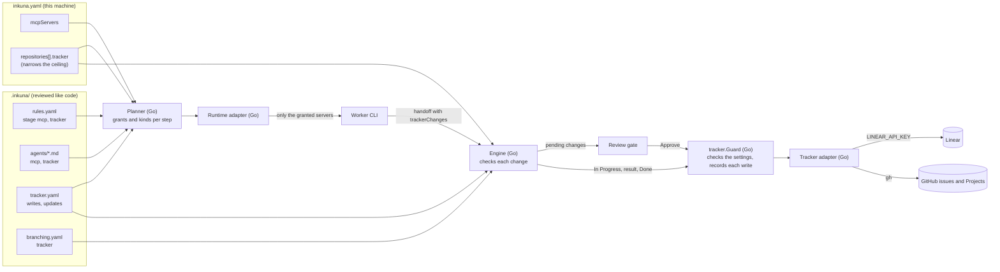
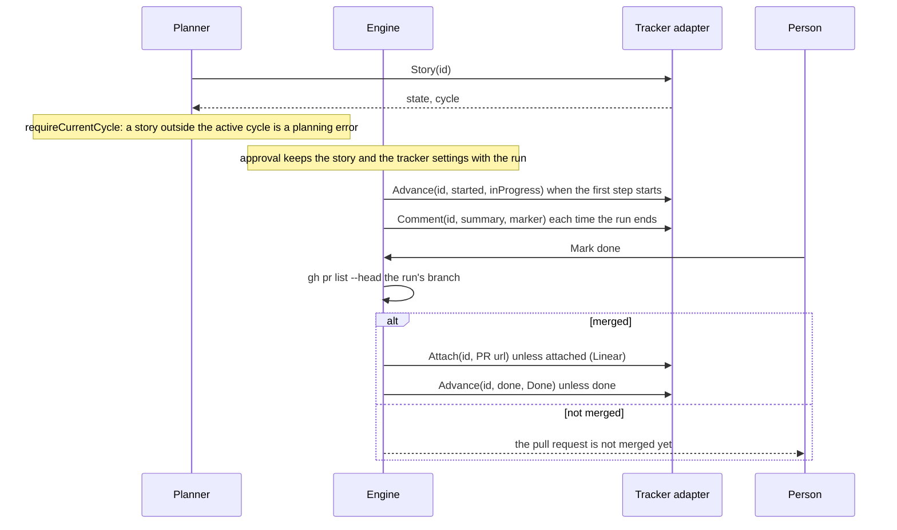
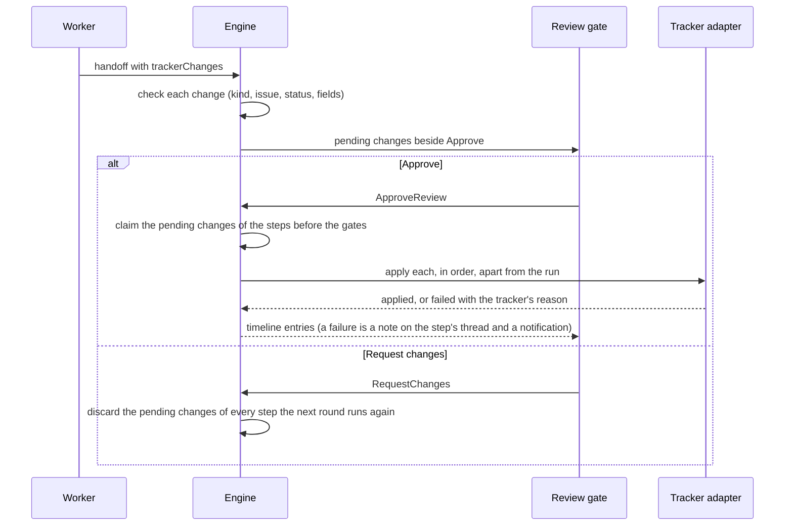
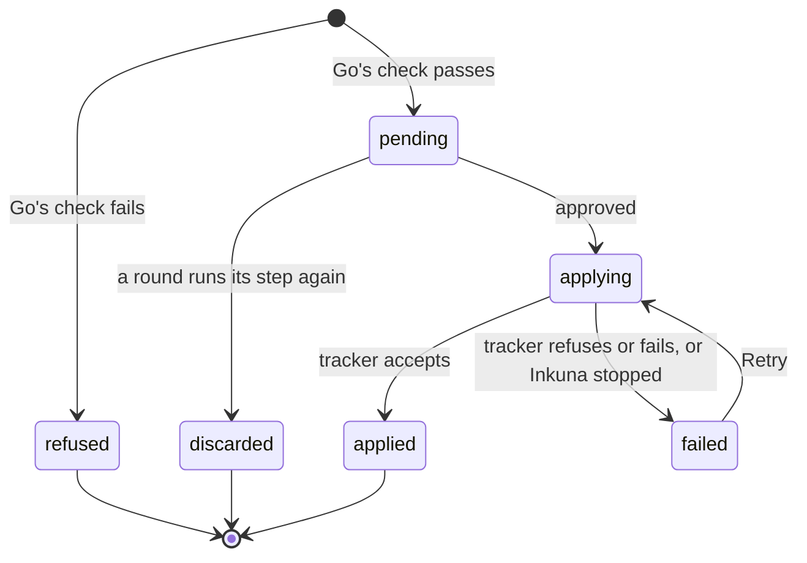

# MCP servers and tracker write-back

Workers can be given MCP servers, and Inkuna can write back to the issue a run came from. A project declares the MCP servers its machine offers, and a rule stage or an agent names the ones its steps get; Inkuna starts exactly those, on Claude Code, Codex, and Copilot alike. A repository says what its runs may change in its issue tracker (Linear or GitHub issues), Inkuna moves the story along as the run progresses, and an agent that wants a change in the tracker describes it in its handoff for Inkuna to make once a person approves the run. No tracker credential ever reaches a worker.

Status: **design**, reviewed in #150, and built. #151, declared MCP servers, is built ([architecture.md](architecture.md#mcp-servers-a-step-is-granted) describes it as it runs), and so are #152, a runtime's opt-in to the user's own servers ([The user's own servers](#the-users-own-servers-152)), #153, the tracker writes and `tracker.yaml` ([Trackers](#trackers-153)), #154, Inkuna's own story updates ([Inkuna's own updates](#inkunas-own-updates-154)), and #155, the changes an agent asks for ([Changes an agent asks for](#changes-an-agent-asks-for-155)). The epic is #149. Each section names the issue that builds it: #151 declared MCP servers, #152 a runtime's opt-in to the user's own servers, #153 the tracker writes and `tracker.yaml`, #154 Inkuna's own story updates, and #155 the changes an agent asks for. [Decisions](#decisions) records the answers given on 2026-10-28.

## Today

- **MCP.** Since #151, a worker starts the MCP servers its step is granted from those `inkuna.yaml` declares, and no others; a step granted none starts none, as before. Since #152, a worker starts the user's own servers only when its runtime's `userMcp` names them; `userConfig` alone starts none ([The user's own servers](#the-users-own-servers-152)).
- **Linear** is an intake source, and since #153 a write target: `internal/linear` reads an issue (`Client.Issue`) and the key's user (`Client.Viewer`), and its `Tracker` adapter makes the writes [Kinds](#kinds) lists. `LINEAR_API_KEY` is declared as "Linear personal API key" ([configuration.md](configuration.md)).
- **GitHub issues** are an intake source, and since #153 a write target through `internal/github.Tracker`. `CreateApprovedBatch` can create issues from approved drafts, but nothing calls it. #155 removed the handoff's `discoveredTasks`, which nothing read; `create` replaces it.
- **Runs write Inkuna's own updates, and what agents ask for.** #153 built the writes, the ceiling, and the guard every write goes through. Since #154 a run moves its story to In Progress, comments its result, and marks it Done on request, as `tracker.yaml` allows, and since #155 an agent asks for changes in its handoff, which Inkuna makes once a person approves the run.
- An agent can already list `LINEAR_API_KEY` under `secrets`, which puts the raw key in its worker's environment ([agents.md](agents.md#file-format)). This design gives tracker writes a path that never does, and leaves `secrets` as it is for other uses.

## Terms

| Term | Meaning |
| --- | --- |
| Declared server | An MCP server listed under `mcpServers` in `inkuna.yaml`. Machine-local, because it names commands and secrets. |
| Grant | The declared servers a step gets: those its agent names plus those its stage names. |
| Tracker | Where a repository's stories live: the `tracker` in `.inkuna/branching.yaml`. Linear and GitHub issues can be written to; `jira` and `none` cannot yet. |
| Story | The issue a run is for, found by `branching.StoryFor`: the imported issue, then a task label, then a key leading the title or objective. |
| Kind | A sort of tracker change: `status`, `comment`, `edit`, or `create`. |
| Tracker change | One change an agent asks for in its handoff, held until a person approves the run. |
| Ceiling | The kinds and updates a repository's `.inkuna/tracker.yaml` allows. A machine's `inkuna.yaml` can lower it, never raise it. |

## Overview



## MCP servers (#151)

### Declaring a server

`inkuna.yaml` lists the servers this machine offers. A server is a command Inkuna starts, or a URL it connects to:

```yaml
mcpServers:
  - name: linear
    description: Linear's own MCP server, for reading issues
    url: https://mcp.linear.app/mcp
    bearer: LINEAR_API_KEY        # a declared secret, sent as Authorization: Bearer
    tracker: linear               # a tracker's own server: read tools only
    tools: [get_issue, list_issues, list_comments, list_cycles, get_project]
  - name: docs-search
    description: Searches the team's design archive
    command: [npx, -y, "@example/docs-mcp@2.1.0"]
    env:
      DOCS_TOKEN: DOCS_TOKEN      # environment variable for the server: declared secret
    tools: [search, read_page]    # optional: only these tools; default all
secrets:
  - name: LINEAR_API_KEY
    description: Linear personal API key
  - name: DOCS_TOKEN
    description: Read token for the design archive
```

| Field | Required | Meaning and validation |
| --- | --- | --- |
| `name` | yes | Lower-case letters, digits, and dashes, starting with a letter, unique, and not a name a CLI gives its own tools (`bash`, `edit`, `write`, …). It names the server to every CLI and in the run. |
| `description` | no | Shown on the approval screen and to the worker. At most 500 bytes. |
| `command` | one of `command` and `url` | An argv array, started directly, never through a shell. |
| `url` | one of `command` and `url` | A streamable HTTP endpoint. `https`, or `http` only to `localhost` or a loopback address. |
| `env` | no | For a `command`: environment variable name to declared secret name, never a variable every CLI is started with. |
| `bearer` | no | For a `url`: a declared secret sent as the bearer token. |
| `tools` | no | The tool names the worker may call. Empty means every tool the server offers. Required when `tracker` is set. |
| `tracker` | no | `linear` or `github`: this server reaches that tracker. Its `tools` must be set and must name only tools that read, because every change to a tracker goes through `trackerChanges` and the review gate ([Changes an agent asks for](#changes-an-agent-asks-for-155)). Go refuses a tracker's server without a `tools` list; which tools only read is the declaring person's call, and the approval screen shows the list. |

Decoding is strict, as for the rest of `inkuna.yaml`. A secret a server names must be declared under `secrets`, and its value comes from the keychain or the environment as any secret's does.

### Granting a server

An agent definition and a rule stage each gain an optional `mcp` list:

```markdown
---
name: researcher
description: Investigates the codebase and its design archive.
mcp: [docs-search]
---
```

```yaml
- id: triage
  kind: agent
  agent: researcher
  permission: read-only
  mcp: [linear]
```

A step gets the union of its agent's and its stage's lists. A stage's list can come from a shared stage or group in the repository's, the global, or the built-in library, and a use may override it ([rules.md](rules.md#shared-stages-and-groups)). A stage that names a server `inkuna.yaml` does not declare is a planning error, because the rules asked for it. An agent that names one is planned without it and the plan says so, as an agent's missing skill is skipped, so one global agent can serve machines that declare different servers. Changing a step's agent on the approval screen swaps the old agent's servers for the new one's; the stage's stay (`Restaff`).

Any step may be granted any server, read-only steps included. A step's `permission` says what it may do to the worktree; a server's tools reach systems outside it, which is a separate decision. The approval screen lists each step's servers, and marks those on a read-only step as able to change systems outside the worktree.

### What each CLI is given

Inkuna writes the granted servers into a configuration file in the run's data directory (`<dataDir>/runs/<run>/mcp/<call>-*.json`, mode 0600, outside every worktree) and removes it when the call ends. The CLI is pointed at that file and nothing else:

| Runtime | Servers | Tools |
| --- | --- | --- |
| Claude Code | `--strict-mcp-config --mcp-config <file>`, so the user's own servers stay off. With no grant, the empty config it has today. | `--allowedTools` gains `mcp__<server>` for a server with no `tools`, or `mcp__<server>__<tool>` for each listed tool. The model still sees a server's other tools, but a call to one is denied and never offered as a grant. |
| Codex | `-c mcp_servers.<name>.command`, `.args`, `.url`, `.enabled_tools`, `.default_tools_approval_mode="approve"` (exec cannot ask, and refuses an MCP call otherwise), and `.required=true` overrides. `--ignore-user-config` stays, so `config.toml`'s servers stay off. | `enabled_tools` from `tools`, which hides the rest. |
| Copilot | `--additional-mcp-config @<file>`. The user's servers are still each disabled with `--disable-mcp-server`, as today, except one with a granted server's name, which the call's file replaces. | `--available-tools` gains `<server>-<tool>` per tool, or the server's name for all; a tool left off does not exist for the call. `--allow-tool=<server>(<tool>)` is passed too. |

A worker's prompt lists its servers with their descriptions under the tools it has, so a model knows what it was given and why.

### Secrets reach the server, never the model

A server's secret values are in its configuration file or in the server's own environment, never in the worker's arguments, its prompt, or the environment its shell commands see:

- **Claude Code and Copilot** read the values from the configuration file, which sits outside every worktree, is readable only by the user, lives only for the call, and is never named to the model. A bare `Read` rule lets Claude Code read any absolute path, so the call also denies Read, Grep, and Glob the file's directory; Copilot's sandbox already refuses its `view` tool there. A Claude Code call given a server with secrets, or the user's own servers, also runs its shell commands in Claude Code's sandbox, and does not start without it, nor when a project settings file would widen its grant ([architecture.md](architecture.md#mcp-servers-a-step-is-granted)).
- **Codex** gets the value in its own process environment, under the server's variable name or `INKUNA_MCP_<SERVER>_BEARER` for a bearer token, `mcp_servers.<name>.env_vars` or `bearer_token_env_var` passes it to the server, and `shell_environment_policy.exclude` keeps it out of the model's shell, which otherwise sees it.

#151 proved each mechanism with a stub server and a scripted stub model, as #39 and #42 proved the preamble flags, and Inkuna refuses to give servers to a template, which cannot keep a secret from its shell. The runtime replaces a server's secret values in every event Inkuna keeps, so a server that echoes its token leaves it in no log.

### What the run records

The step's context envelope gains `mcpServers` (name, description, command or URL, the tools allowed, and the tracker it reaches, never its secrets), so the Context tab shows what each step had, and the approval screen lists it per step. A runtime's capabilities still say whether it starts no server beyond what a step is granted.

## The user's own servers (#152)

`runtimes.<name>.userMcp` names servers from the user's own setup in that CLI, as the CLI lists them, that every step on the runtime is given with all their tools. It is separate from `userConfig`, which brings back hooks, memory, and the rest, and it is now the only way a worker starts one of the user's servers: with `userConfig` and no `userMcp`, Codex and Copilot are told to switch off every server of the user's they would start. The Runtimes view lists a runtime's servers on request (`ListUserMCPServers`) with what the CLI says of each, for the user to tick, and signs in to one that needs it (`SignInUserMCPServer`).

| Runtime | With `userMcp` |
| --- | --- |
| Claude Code | No `--strict-mcp-config`; the user's servers load from their own configuration, `allowedMcpServers` in the call's settings starts only the ticked ones and the granted, and each joins `--allowedTools`. The shell runs in Claude Code's sandbox. |
| Codex | Each ticked server's entry from `codex mcp get --json` is passed as `-c mcp_servers.*` overrides, with `--ignore-user-config` kept, so nothing else from `config.toml` returns; its secrets go in Codex's environment, kept from the shell. With `userConfig`, the server comes from `config.toml` and every other one there is switched off. |
| Copilot | The ticked servers are no longer disabled, and each is allowed with `--available-tools` and `--allow-tool=<server>`. |

The approval screen and the Context tab name the servers that came from the user's setup, and warn that nothing reviews what a step changes through them. A plan records each runtime's `userMcp`, and approval refuses one whose runtimes name other servers by then. Before a step starts, a server that needs signing in pauses it with an inbox request to sign in, which runs the CLI's own sign-in, or skip; any other server that cannot start is left out with a note. Planning calls and peers get none. The full mechanism is in [architecture.md](architecture.md#the-users-own-mcp-servers).

## Trackers (#153)

### The interface

Tracker writes go through one interface, `domain.Tracker`, with an adapter per tracker. The interface is in `internal/domain`, free of any provider's types; the adapters live with their clients as `linear.Tracker` and `github.Tracker`, and `internal/tracker` loads `tracker.yaml` (`tracker.Load`), works out what a machine may write (`tracker.Resolve`), opens the repository's adapter only behind a guard (`tracker.OpenGuard`, `tracker.Guard`):

```go
type Tracker interface {
	Story(ctx context.Context, id string) (TrackerIssue, error)
	Statuses(ctx context.Context, id string) ([]string, error)
	SetStatus(ctx context.Context, id, status string) error
	Advance(ctx context.Context, id string, stage StoryStage, status string) (StageChange, error)
	Comment(ctx context.Context, id, body, marker string) (string, error)
	CheckEdit(fields IssueFields) error
	Edit(ctx context.Context, id string, fields IssueFields) error
	Create(ctx context.Context, draft IssueDraft) (TrackerIssue, error)
	Attach(ctx context.Context, id, url, title string) (bool, error)
}
```

An id is the tracker's own: `ENG-12` for Linear (its URL and Linear's UUID work too), `12` or `#12` for a GitHub issue, or the issue's URL, which must be one of the repository's own: another repository's number would name a different issue. `TrackerIssue` carries the status, whether the issue is done, and for Linear its team, its cycle and whether that is the team's active one, and its attached links, which #154 reads. A write the tracker cannot make as asked, such as a field it does not have or an issue that does not exist, is a `domain.TrackerRefusal` with the reason, which no retry would change; anything else is the tracker's own error. Two methods only read, for checking a change an agent asks for (#155): `Statuses` lists the statuses an issue can be moved to, a Linear team's states but its canceled ones, or the options of the GitHub Project's status field, and refuses when the issue's status cannot be set at all; `CheckEdit` refuses, without asking the tracker, an edit with a field the tracker does not have or a value it never takes, the same refusals `Edit` makes before it writes. Linear sends its errors with the HTTP status of the first one (403 for a missing scope, 400 for an entity it cannot find), and the client reads them whatever the status.

The repository's tracker is the `tracker` in `.inkuna/branching.yaml`. `jira` and `none` have no adapter, so a repository with either gets no writes, and Settings says so. The Linear adapter uses `LINEAR_API_KEY`, found as today (a session key from Connections, then the environment, then the keychain). The GitHub adapter runs `gh` for the repository's `origin`, as the rest of Inkuna's GitHub work does.

### The guard

Every write is made through a `tracker.Guard`, whose methods each serve one purpose: a kind an agent asked for, or one of Inkuna's own updates. `tracker.OpenGuard` is the only way to an adapter (`tracker.open` is not exported, and a test fails the build when code outside `internal/tracker` builds one). When the build has policies ([extensions.md](extensions.md#policy)), a write the settings allow is put to them before it is made (`Guard.SetPolicy`), and one they refuse is recorded as refused, with the policy's reason, as a write the settings forbid is.

| Method | Serves | Acts on |
| --- | --- | --- |
| `SetStatus(id, status)` | `status` | any issue |
| `Comment(id, body, marker)` | `comment` | any issue |
| `Edit(id, fields)` | `edit` | any issue |
| `Create(draft)` | `create` | a new issue, or a sub-issue of any |
| `Start()` | `updates.start` | the run's story, moved to `linear.inProgress` or `github.inProgress` (`Advance` to started) |
| `Report(body, marker)` | `updates.result` | the run's story |
| `Finish()` | `updates.done` | the run's story, moved to Done or `github.done` (`Advance` to done) |
| `Attach(url, title)` | `updates.done` | the run's story |

The guard refuses, before the adapter sees it, a purpose the effective settings do not allow (saying whether `tracker.yaml` or `inkuna.yaml` turned it off), every write to a repository with no adapter or no `tracker.yaml`, and Inkuna's own updates for a run without a story. A test runs every method against every ceiling and override, and checks that exactly the allowed writes reach the adapter.

Start and Finish go through the adapter's `Advance(id, stage, status)`, which Inkuna's own updates alone use: it moves the issue to the status named, or, when a Linear team has no state of that name, to the team's first `started` or `completed` state by its place in the workflow, and says which it chose. It leaves alone an issue already in that status and one already done (a completed Linear state, or a GitHub issue closed as completed), whichever stage is asked for, so it never moves a finished story back. Done on GitHub also closes an open issue as completed, and never reopens one closed as not planned.

The guard hands every write it is asked for, applied, unchanged, refused, or failed, to a recorder as a `domain.TrackerWrite`: the tracker, the write, its kind or update, the issue, what it changed (`status → In Progress`, `comment: …`, `edit: labels +backend; estimate → 2`), the outcome, the reason, and the URL it made. Unchanged is a write that was not needed, such as a story In Progress already or a link attached already; its reason says how the issue already was. A guard cannot be made without one. `Service.storyTracker` opens the guarded tracker for a run and records each write on the run's timeline under one of its step runs, with the write in the event's payload, as a warning when it was not made. It reads the settings from the project's checkout, never a run's worktree, so a step cannot raise its own run's ceiling. With worktrees off a step writes in that checkout, so a run's own updates use the settings it was approved under instead ([Inkuna's own updates](#inkunas-own-updates-154)).

### Kinds

| Kind | Linear | GitHub issues |
| --- | --- | --- |
| `status` | `issueUpdate` with the team's state whose name matches, ignoring case. A canceled state is refused, since it closes the issue as not planned, and an issue already in the state is left alone. | The single-select field on the GitHub Project `tracker.yaml` names (`gh project item-edit`), after adding the issue to the project (`gh project item-add`, which keeps an item already there). The option matches ignoring case, so `In Progress` finds Inkuna's own `In progress`; an option the field lacks is refused with the ones it has. Only on github.com: `gh project` has no `--hostname`, so another host's issue is refused. |
| `comment` | `commentCreate`, or `commentUpdate` for a retry | `gh issue comment`, or a `PATCH` of the comment for a retry |
| `edit` | `issueUpdate`: title, description, labels (by name, from the team's and the workspace's), estimate, priority (0 to 4), assignee (email, display name, name, or `me`), and cycle (the number or name of a current or upcoming one, or `current`). A milestone is refused: it belongs to the issue's project, which Inkuna does not edit. | `gh issue edit`: title, body, labels, assignees, and milestone. An empty milestone is dropped before the edit is made (`TrackerChange.Normalized`), so an agent cannot remove one. Estimate, priority, and cycle are refused, with the reason. |
| `create` | `issueCreate` in the draft's team, or with `parentId` in the parent's team for a sub-issue | `gh issue create`, with `--parent` for a sub-issue (gh 2.94 or later; an older gh reads an issue without its parent) |

A comment or an issue made with a marker is looked up by its marker before a retry makes another. On GitHub the marker ends the body, and a retry finds it there, counting only what gh's own account wrote: in the issue's comments through the REST API, which finds a comment every time, or an issue among the repository's hundred newest through the REST API, which is current at once, and then through `gh issue list --search`, whose index lags. A GitHub issue is therefore not certain to be made only once: when more than a hundred newer issues are opened before search has indexed it, a retry misses it and makes another. Linear turns a body's markup into its own, so its adapter derives the comment's or issue's id from the marker instead (a UUID in version 4 form, which Linear accepts for a new entity), and a retry looks that id up.

Attaching a URL is Inkuna's own (#154), never an agent's. Linear's adapter attaches a link only when the issue has none to the same page, which is how Linear's GitHub integration often attached the pull request already, and says whether it did. A GitHub issue has no attachments, so the GitHub adapter refuses it, and Mark done never asks; a pull request that closes the issue links to it already. Archiving, deleting, and closing as not planned are never offered.

### `.inkuna/tracker.yaml`

The repository sets the ceiling, reviewed like code and shared by everyone who runs Inkuna on it. Without the file, nothing is written.

```yaml
version: 1
writes: [status, comment, edit, create]   # kinds agents may ask for
updates:
  start: true      # In Progress when a run starts
  result: true     # comment the run's summary when it ends
  done: true       # offer Mark done on the run
linear:
  requireCurrentCycle: true      # refuse to plan a story outside its team's current cycle
  inProgress: In Progress        # optional; default below
github:
  project: { owner: acme, number: 3 }
  field: Status
  inProgress: In Progress
  done: Done
```

| Key | Meaning |
| --- | --- |
| `version` | Must be 1. |
| `writes` | The kinds agents may ask for. Empty or absent: none. |
| `updates.start`, `.result`, `.done` | Inkuna's own updates. Each defaults to `false`. |
| `linear.requireCurrentCycle` | Refuse to plan a story that is not in its team's active cycle. |
| `linear.inProgress` | The state for In Progress. Default: the state named "In Progress". Done is the state named "Done". A team without a state of the name gets its first started or completed state instead, and the timeline says which. |
| `github.project`, `.field`, `.inProgress`, `.done` | The GitHub Project whose single-select field holds the status, and the option names for In Progress and Done. `github.project` is required for `writes: [status]`, `updates.start`, or `updates.done` on GitHub; `field` defaults to `Status`, and `inProgress` and `done` to `In Progress` and `Done`. |

It decodes strictly: an unknown key, a second document, or an empty file is an error, and so is a GitHub repository whose `writes: [status]`, `updates.start`, or `updates.done` has no `github.project`. Inkuna reads it and never writes it; people change it, reviewed like code. An invalid file allows nothing and Settings shows why. `internal/tracker/self_test.go` checks Inkuna's own file when there is one, as `internal/branching/self_test.go` does for `branching.yaml`; Inkuna's names its project and turns every write off.

### The machine's override

A repository's entry in `inkuna.yaml` can lower the ceiling on one machine, and Settings edits it: the Repositories panel has a switch per kind and update, marks what `tracker.yaml` does not allow, and lists, for each saved repository, what Go found is left (`ConfigurationView.Trackers`):

```yaml
repositories:
  - name: lantern
    path: /src/lantern
    tracker:
      writes: [comment]                 # kept only where tracker.yaml allows it too
      updates: { start: true, result: false }
```

The effective setting is the intersection (`tracker.Narrow`), and a path declared more than once, or spelt through a symbolic link, is lowered by every entry for it (`config.File.TrackerOverride`): a kind or update is on only when `tracker.yaml` allows it and the override, when it has that key, does too. The override can switch things off, never on. `writes: []` allows no kind, which is not the same as leaving `writes` out.

### Connections

Connections says, per tracker, whether Inkuna can write: can write, some, read only, or unknown, with the reason. A key that can only read keeps intake working, and every write it cannot make reports why. `LINEAR_API_KEY`'s description no longer calls it read-only.

- **GitHub.** `gh auth status --json hosts` lists the token's scopes. `repo` writes issues (`public_repo` only those of public repositories), and `project` sets a Project's field; when the token lacks it, Connections names the declared repositories whose `tracker.yaml` names a project and whose effective settings, after `inkuna.yaml`, allow a `status` write, `updates.start`, or `updates.done`. A fine-grained or app token lists no scopes, which shows as unknown.
- **Linear.** Linear does not report a key's permissions, and a key can be limited to reading, to creating issues, or to commenting, and to some teams. Inkuna asks with three mutations that cannot change anything, since each names an issue or team that does not exist: `issueUpdate`, `commentCreate`, and `issueCreate` (`linear.Client.WriteAccess`). Each names a fresh random id, because Linear lets a client choose a new entity's id, so a fixed one could be made to exist. Inkuna reads a refusal for the key's scope (`Invalid scope: write required`) as no and an entity not found as yes, which assumes Linear checks a key's permissions before it looks the entity up. That assumption is unverified: it has not been confirmed against a live Linear endpoint for `issueUpdate`, `commentCreate`, or `issueCreate`, and the tests only check how Inkuna reads answers of that shape, not that Linear gives them. Any other answer shows as unknown, with the outcome of the last write this session tried. A key limited to some teams is only found out by a write to another team's issue, which says why. A definite answer is kept until the key changes; an unknown one is asked again.

## Inkuna's own updates (#154)



- **The run's story.** Approval finds the story (`branching.StoryFor`, in the tracker `branching.yaml` names) and keeps it with the run, together with the tracker settings of the project's checkout as they are then, before any step can change them (`executions.story_json`). Every update afterwards writes within those settings narrowed by `tracker.yaml` and `inkuna.yaml` as they are now (`tracker.Settings.Within`): a change since can switch an update off, never on, so a step that edits `tracker.yaml` in a checkout with worktrees off cannot raise its own run's ceiling, and a repository whose tracker changed since writes nothing for the run. An update that is off is never tried and leaves nothing on the timeline. The run's detail names its story (`WorkflowRunView.Story`).
- **Cycle.** With `linear.requireCurrentCycle`, planning reads the story before it spends anything, the title call included, and refuses one outside its team's active cycle, saying which cycle it is in, or that it is in none. When Linear cannot be asked, for want of a key or for a failed request, planning refuses too and says why: the repository asked for the check.
- **Start.** With `updates.start`, the story moves to In Progress when the run's first step starts, recorded under that step's run. It is tried once per run, before that step's work, and kept as tried even when it fails; a later round never moves the story again.
- **Result.** With `updates.result`, Inkuna comments each time the run ends, after any step of it started: completed, failed (with the first line of its error), or cancelled, and in how many rounds; its checks ("k of N passed"); its commits on the branch, up to five subjects; and the pull request `gh pr list --head <branch>` finds for the branch, the open one first, with its state. The comment carries a marker (`<!-- inkuna-run:<id> -->`), so a later round's end edits the same comment rather than adding another. It is written apart from the run, one at a time, so a slow tracker never holds up the run's end or the next round, and recorded under the last step run of the round. A run cut short because Inkuna stopped is not reported until a later round of it ends.
- **Done, on request.** With `updates.done`, an ended run with a branch offers **Mark done** (`MarkStoryDone`). Inkuna lists the branch's pull requests; until one has merged it says which one is open or closed and changes nothing. Once one merged, Inkuna attaches it to a Linear story unless it is attached already, and moves the story to Done unless it is done already, which on GitHub also closes the issue as completed when the merge did not. Mark done looks the pull request up itself and never runs on its own: the Tasks view's pull request check ([branching.md](branching.md#pull-requests), #66) records each branch's pull request and, under `worktrees.cleanup: merged`, removes a merged run's worktree, but never moves a story. Nothing happens to the story until someone asks, and asking again changes nothing more.

Each update is idempotent: a story already In Progress or done is left alone, and a pull request already attached is not attached again. Linear's GitHub integration often does these already; Inkuna fills in only what is missing, and the timeline records what it left as unchanged. Each update is on the run's timeline, under one of its step runs. A Start or result that is not made is a warning there and a desktop notification (kind `tracker-failed`), since nobody asked for it at that moment; Mark done says what happened where it was asked, as well as on the timeline. None of them ever fails a run, and a finished run stays finished.

## Changes an agent asks for (#155)

### The handoff field

A step granted at least one kind has `trackerChanges` in its handoff schema, holding only the kinds it was granted and the fields they take (`handoffSchemaFor`); a step granted none does not, so its model cannot produce the field at all. `discoveredTasks`, which nothing read, is gone: `create` replaces it.

```json
{
  "trackerChanges": [
    {"kind": "comment", "issue": "story", "body": "The migration runs in about 4 s on the seed data."},
    {"kind": "status", "issue": "story", "status": "In Review"},
    {"kind": "edit", "issue": "ENG-641", "addLabels": ["backend"], "estimate": 2},
    {"kind": "create", "parent": "story", "title": "Index care_events by circle", "description": "Found while profiling the list query."}
  ]
}
```

Every change has a `kind`, and every kind but `create` an `issue`: `story` for the run's own story, or an id in the tracker's format. The rest are optional fields of one flat object, which keeps the schema strict on every model (#107); Go checks which fields each kind may carry (`domain.TrackerChange.Problem`):

| Kind | Fields |
| --- | --- |
| `status` | `issue`, `status` |
| `comment` | `issue`, `body` |
| `edit` | `issue`, and at least one of `title`, `description`, `addLabels`, `removeLabels`, `estimate`, `priority`, `assignee`, `cycle`, `milestone` |
| `create` | `title`, and any of `description`, `addLabels` (the new issue's labels), `parent` |

A model held to the strict schema sends every field, `null` or empty where it sets none, so Go reads an empty text or list as left out, and a zero `estimate` or `priority` on any kind but `edit` too (`Normalized`). An agent therefore cannot clear a field. One handoff may ask for at most 20 changes (`domain.MaxTrackerChanges`); a comment's body and an issue's description may have at most 10,000 characters, and a title at most 256, GitHub's limit. The prompt's protocol section tells the step which kinds it may ask for and the fields each takes, what the tracker lacks (GitHub issues have no estimate, priority, or cycle; a Linear milestone belongs to its project), which issue its story is, the caps, and that its changes wait for the review gate (`writeTrackerProtocol`). A target sent back in a later round is told that its changes still waiting were discarded, so it asks again for those it still wants.

### The grant and Go's checks

A step's kinds are the project's (`tracker.yaml`, narrowed by `inkuna.yaml`) intersected with what its agent or its stage asks for. Each gains an optional `tracker` list:

```yaml
- id: implement
  kind: agent
  agent: implementer
  tracker: [comment, create]
```

Planning grants each agent step those kinds (`planner.grantTrackerKinds`), notes the ones it asked for that the project does not allow, and keeps the project's kinds with the plan (`WorkflowSpec.TrackerKinds`), so changing a step's agent on the approval screen derives its kinds again within them (`Restaff`); the stage's kinds stay. A remote advisor is given none, and one cannot staff a stage that asks for kinds the project allows. The approval screen lists each step's kinds, and the Agents view and the Rules editor edit them.

A step with kinds needs a pausing review gate (`review: true`) after it, directly or through other steps, where its changes can be seen. Without one, planning fails and says so (`planner.CheckTrackerGates`), as a check loop with nowhere to send its failures does, and approval checks it again.

Approval keeps the tracker settings with the run (`executions.story_json`), as #154 does for a run's story, and does so for a run without a story whose steps may ask for changes, too. When a step starts, its kinds are narrowed to what those settings still allow, given the repository's and this machine's settings now (`trackerGrant`); a kind taken away since planning is noted on the step's timeline, and the step's schema and prompt leave it out. The Context tab shows what the step could ask for.

When the step ends, Go checks every change before it is kept (`tracker.Guard.Check`), and only a step that completed has its changes checked:

- the change is whole and within its caps;
- the step was granted its kind, and the settings allow the kind;
- the issue it names exists, `story` only when the run has one (`Story`, read once per issue);
- a status is one the tracker has (`Statuses`), and is kept as the tracker names it;
- an edit's fields are ones the tracker takes (`CheckEdit`);
- a new Linear issue without a parent goes in the story's team, and is refused when the run has no story.

A change that fails a check is kept as refused, with the reason, on the step's timeline, and is never sent; so is one Go could not check because the tracker could not be asked, saying so. The others wait, pending, and the timeline says so. Changes past the twentieth are refused together and not kept. The handoff Inkuna stores keeps none of them, so the steps after it never see them.

### At the review gate



The review bar lists, beside Approve, the pending changes of every step before the paused gates (`ReviewView.TrackerChanges`): the step, the kind, the issue, what it would set, and a comment's or description's whole text. Approving the run claims them, moving each from pending to applying in one conditional update so a change is never claimed twice, and applies them apart from the run, which has moved on, so a slow tracker never holds the approval (`applyApproved`). One batch is applied at a time, in the order the steps asked, and each through the guard, which records it on the timeline under the step run that asked for it. Each change carries a marker (`<!-- inkuna-change:<id> -->`) as it is made, so a retry edits the comment or returns the issue it made rather than making another. Status and edit changes need none: setting what is set already changes nothing.

A change that fails does not undo the approval or stop the others. It is failed, with the tracker's reason, on the timeline as a warning; a note joins the thread of the step that asked for it in Messages (`storage.AddA2AMessage`, which adds a message to a finished task without changing its state), and a desktop notification of kind `tracker-failed` says so too, since the person may not be watching the run. The run's detail lists every change its agents asked for with how it stands, and offers **Retry** on a failed one whose kind the settings still allow (`RetryTrackerChange`), which applies it again within what the run was approved under and the repository allows now. A change being applied when Inkuna stopped is failed when it starts again (`MarkInterruptedExecutions`), so a person can retry it.

Any round that runs a step again discards that step's pending changes, since the step may ask again: a request for changes discards those of its targets and every step after them, and so does a round a check loop starts or a resume (`discardTrackerChanges`); earlier steps' changes keep waiting. Cancelling a run discards nothing, and makes nothing: its pending changes are made only if the run is resumed and approved at a gate after their steps.



A worker granted the tracker's own MCP server may read the tracker through it, but never change it: such a server is declared with `tracker` and granted only the read tools its `tools` list names ([Declaring a server](#declaring-a-server)). Every change to the tracker goes through `trackerChanges`, is checked against what `.inkuna/tracker.yaml` allows, and waits for the review gate.

### Storage

The `tracker_changes` table (migration 025) holds each change: its run, round, step, the step run and A2A task that asked, its position in the handoff, kind, issue, the change as Go checked it (JSON), state, reason, URL, and when it was made and last changed (`storage.TrackerChange`). Inkuna's own updates are timeline events, not rows; the run keeps only its story and the settings it was approved under (`executions.story_json`, #154).

## Safety conventions

This change replaces two lines of the conventions' Safety section (`.inkuna/skills/conventions/SKILL.md`):

| Before | After |
| --- | --- |
| No provider permission bypasses. No implicit MCP. | No provider permission bypasses. A worker starts only the MCP servers `inkuna.yaml` declares and its agent or stage is granted, or the user's own when they opt a runtime in, never one implicitly. A server's secrets reach the server, never the model. |
| Linear is a read-only intake source. GitHub is the approval-gated execution projection. | Linear and GitHub issues are intake sources, and write-back targets only as far as the repository's `.inkuna/tracker.yaml` allows. Go makes every tracker write with the project's credential; an agent only asks, and its changes wait for a person's approval. A server of the user's own that they opt a runtime in to is the one exception: it is theirs, with every tool, and the approval screen says nothing reviews what it changes. GitHub is the approval-gated execution projection. |

## Invariants

- Go is the only validator. Go builds each CLI's MCP configuration from `inkuna.yaml` and the grant, checks every tracker change, and makes every tracker write.
- No MCP server starts unless it is declared and granted, or the user opted the runtime in to their own.
- No tracker credential and no server secret reaches a worker's arguments, prompt, or shell environment. An agent's own `secrets` list is the one exception, and it is the user's explicit choice.
- Nothing an agent asks for reaches a tracker before a person approves the run, and only kinds both the repository and the step allow are ever sent. A tracker's own MCP server is granted only the read tools its declaration lists, so no change reaches a tracker any other way, except through a server of the user's own that they opted a runtime in to, which has every tool.
- Inkuna never archives, deletes, or closes an issue as not planned.
- Every MCP server a step had and every tracker write Inkuna made, applied or failed, is recorded on the run.
- A failed tracker write never fails or reopens a run.

## Open for the building issues

- **#151**, settled on 2026-10-29 with stub servers on Claude Code 2.1.312, Codex 0.164.0, and Copilot 1.0.79. Only the granted servers start on each, and a step granted none starts none. Their listed tools are the only MCP tools allowed, and a server's secret never reaches the shell. Copilot's `--available-tools` must name a server's tools: it is the gate, and `--allow-tool` exposes nothing it hides. A command server Copilot starts runs inside its sandbox, so it reaches the network but not `localhost`, and only files in the worktree, `PATH` directories, the temp directory, and build caches. Copilot refuses a server on `localhost`, a URL server included, until the user's Copilot settings allow the local network. A granted server that does not start stops the call. A server declared with `tracker` and no `tools` list is refused.
- **#152**, settled on 2026-11-01 with stub servers and the user's own on Claude Code 2.1.312, Codex 0.164.0, and Copilot 1.0.79. Claude Code's `allowedMcpServers`, passed in `--settings` without `--strict-mcp-config`, starts only the servers it lists, the `--mcp-config` ones included; a claude.ai connector or a plugin's HTTP server matches only by `serverUrl`, and connectors connect after the init event. Codex's listing prints a command server's literal `env` values, so they are handed on as declared secrets are. Copilot's listing says nothing of sign-in, and only its stream reports a server that needs it.
- **#153** built the Linear probes in [Connections](#connections), which ask what a key may write without changing anything. Whether they tell a read-only key from a writing one is unverified: that rests on Linear checking a key's permissions before it looks an entity up, which no live Linear endpoint has confirmed. The tests only check Inkuna's reading of answers shaped like `Invalid scope: … required` and `Entity not found`; an answer of another shape shows as unknown rather than as a guess. One check with a live read-only key and a writing key settles it.
- **#155**, settled on 2026-11-03: one handoff may ask for 20 changes, a comment's body and an issue's description may have 10,000 characters, and a title 256.

## Decisions

From the interviews for #149 and #150 on 2026-10-28:

- MCP servers come both ways: declared in `inkuna.yaml` and granted per agent or stage, and, per runtime, the user's own.
- Any step may be granted any server, read-only steps included.
- Write-back covers issue trackers, not only Linear: one interface with Linear and GitHub issues adapters, the tracker named by `branching.yaml`.
- An agent describes the changes it wants in its handoff and Inkuna's Go code makes them, so no credential reaches a worker.
- Agents may change status, comment, edit fields, and create issues and sub-issues; never archive or delete.
- Changes are checked when the step ends, shown beside Approve, and applied when the run is approved. A change that fails does not block the approval; it is reported and can be retried.
- The repository's `.inkuna/tracker.yaml` is the ceiling, and a machine's `inkuna.yaml` can lower it.
- Inkuna moves the story to In Progress on start (refusing a Linear story outside the current cycle), comments the result at the end, and on request marks it Done after the merge, filling in only what the tracker's GitHub integration has not done.
- Inkuna learns of a merge only when asked, from **Mark done** on the run. (#66 later added a pull request check when the Tasks view opens; it links pull requests and can remove worktrees, and never moves a story.)
- For GitHub issues, In Progress and Done are the Status field of the repository's GitHub Project.
- One Linear key, `LINEAR_API_KEY`, no longer described as read-only.

From the #154 interview on 2026-11-02:

- A story update Inkuna makes on its own that fails is a warning on the timeline and a desktop notification. The Messages view lists agent threads, and a failed tracker write is not one.
- With `linear.requireCurrentCycle`, planning refuses a story when Linear cannot be asked, as well as one outside the current cycle.

From the review of #156:

- A tracker's own MCP server is granted read tools only. Every change to a tracker goes through `trackerChanges` and the review gate, so the rule that nothing reaches a tracker before approval has no exception.

From the #155 interview on 2026-11-03:

- A change that fails after approval is a note on the asking step's thread in Messages, as well as a timeline warning, a desktop notification, and Retry on the run.
- One handoff may ask for 20 changes; a body or description may have 10,000 characters, and a title 256.
- A change Go cannot check because the tracker cannot be reached when the step ends is refused, saying so, rather than kept to check later.
- The Agents view and the Rules editor edit an agent's and a stage's `tracker` kinds, as they do MCP servers.

From the #151 interview on 2026-10-29:

- Settings has an MCP servers panel, and the Agents view and the Rules editor an MCP servers field beside Skills.
- A peer consulted over A2A is given no MCP servers; only steps are, and every grant shows on the approval screen.
- The approval screen shows each step's servers and does not edit them.
- A stage that names servers on a remote advisor or an argument template is a planning error; an agent's own servers are left off it with a note.
