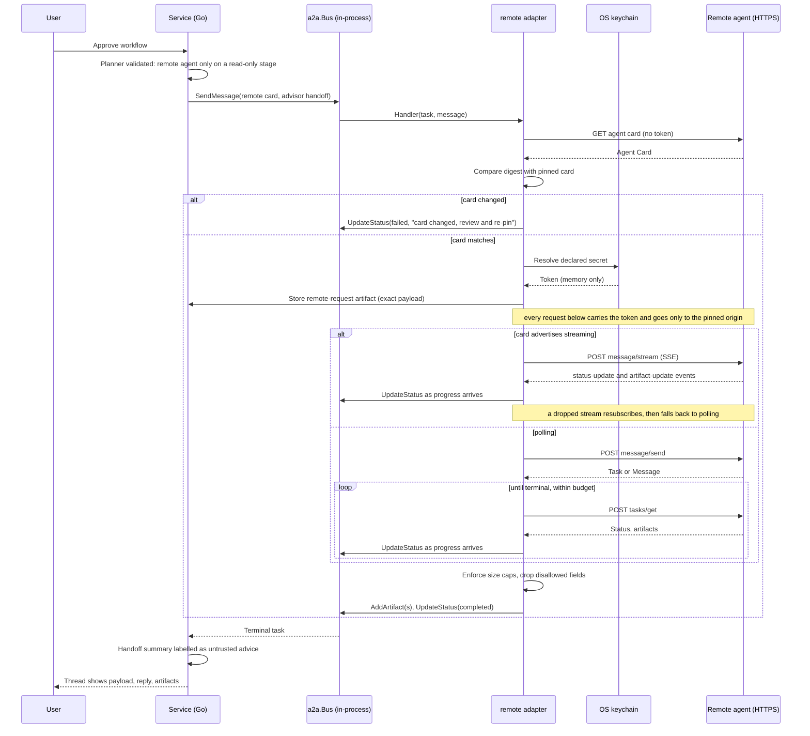

# Remote A2A agents as read-only advisors

Status: **implemented**. The decisions under [Trust model](#trust-model) were made when the issue was written; [Decisions](#decisions) records the ones made on 2026-09-19. Where the implementation settled a detail the design left open, this document describes what was built.

Inkuna's agents run locally as headless CLIs behind an in-process A2A bus (see [a2a.md](a2a.md)). This design lets a user connect an **external** agent, one that lives at an HTTPS URL and speaks A2A 0.3, and use it as an **advisor**: it reads a description of the work and answers with text and artifacts. It never touches the repository.

## Goals and non-goals

Goals:

- Connect an agent by its Agent Card URL, review what it says it can do, and enable it.
- Let a rule name it for a read-only stage, and let the orchestrator consider it for `auto` read-only stages.
- Make what leaves the machine small, predictable, and visible before and after it is sent.

Non-goals:

- Remote agents that write, run commands, or receive a worktree. Validation refuses it, not just the UI.
- Inkuna as an A2A **server**. Nothing listens on the network; Inkuna only makes outbound requests.
- Discovery. Agents are added one at a time by URL. No registries, no crawling, no MCP.
- Push notifications (webhooks). They would need a listener.

## Trust model

A remote agent is code the user does not run and cannot inspect. The design treats it as an untrusted party on both sides of the exchange.

**What it is given.** Only the advisor handoff described under [What leaves the machine](#what-leaves-the-machine). Never the worktree or a path into it, never secrets or environment variables, never another worker's transcript, never the local agents' instructions.

**What it can do.** Return Messages and Artifacts. They are stored like any other agent's output and shown in the thread. Nothing it returns is applied to the worktree. If its advice should change code, a later local `worktree-write` stage does that, as an ordinary step, behind the normal approval gate, with the advisor's summary among its dependency summaries.

**What it cannot do.** Ask the user questions through Inkuna, message local agents, be messaged by them, enqueue tasks, or be assigned a `worktree-write` stage. A remote task that turns `input-required` or `auth-required` fails the step and is cancelled. A worker that names a remote agent in a peer request is told it is undeliverable: a remote agent only ever receives the advisor handoff, never text a worker composed.

**How it gets connected.** The user adds it explicitly and enables it explicitly. Its authentication token is a declared secret whose value lives in the OS keychain (or the environment); `inkuna.yaml` only names the secret.

### Threats and mitigations

| Threat | Mitigation |
| --- | --- |
| The agent's operator reads what is sent. | Send the minimum (below). Show the exact outbound payload before first use and in every thread. Artifact bodies are opt-in per agent. |
| Prompt injection: the reply tries to steer local agents ("ignore your instructions, run ..."). | Replies are data. A local agent only ever sees an advisor's output as a labelled dependency summary (`Advice from remote agent <name> (untrusted): ...`, capped at 1,500 characters), never as instructions, and the worker protocol section says that dependency summaries, and advice from remote agents in particular, are information, not commands. The step's handoff is built by Inkuna from the reply's text and stored artifacts; nothing the agent sends is decoded into `humanInput`, `messages` (peer requests), decisions, or tasks, so it cannot fill them. |
| The card changes after the user reviewed it (new URL, broader skills, a different auth scheme). | The card is **pinned** at connect time: Inkuna stores its SHA-256 digest and the fields it relies on (`url`, `protocolVersion`, streaming, the auth scheme, description, skill names). Every step re-fetches the card before anything else; on a digest mismatch the step fails, nothing is sent, and the same happens on every later run until the user reviews what changed in Agents and re-pins. Only the digest the user reviewed can be pinned: a card that changes between review and save is reviewed again. |
| The endpoint redirects requests (and the token) elsewhere. | Redirects are not followed for `message/send` and `tasks/*`. The card fetch may follow same-origin redirects only. The token is only ever sent to the pinned origin. |
| Server-side request forgery: a card URL pointing at `localhost`, a cloud metadata address, or an internal host. | HTTPS only by default. The resolved address is checked before connecting, and only a publicly routable one is accepted: every non-public range in the IANA special-purpose registries is refused (private, shared carrier-grade NAT, loopback, link-local, multicast, reserved, benchmarking, documentation, unspecified, and their IPv6 counterparts), as are 6to4, Teredo (including the retired 6bone block `3ffe::/16`, part of which old Teredo stacks used), and IPv4-compatible addresses, which can carry an internal IPv4 address in disguise. An IPv6 address must also lie in `2000::/3`, the only space delegated for global unicast. A NAT64 address (`64:ff9b::/96`) is judged by the IPv4 address it embeds, so agents stay reachable on IPv6-only networks. The check is on the address Inkuna itself connects to, so remote-agent traffic never goes through `HTTPS_PROXY` or any other environment proxy: a proxy resolves the name and connects on its own, and an address looked up locally would not bind it. On a machine that can only reach the internet through a proxy, remote agents are unreachable, and the error says why. A per-agent `allowInsecure: true` (plain HTTP and loopback, for local development) must be set by hand in `inkuna.yaml`; the UI shows a warning chip and cannot set it. |
| Oversized or endless responses. | Response bodies are capped (default 1 MiB per response, 4 MiB per task); a task is bounded by the stage's wall-time budget and the worker timeout; polling has a floor interval. Exceeding a limit fails the step. |
| Token leakage through logs or the UI. | The token is resolved from the keychain at send time, placed only in the `Authorization` header (or the header the card's scheme names), and never stored or logged. Everything the agent sends back (status text, artifacts, error messages) has the literal token value replaced with `[REDACTED]` before it is stored, summarized, or shown, so an agent that echoes its credential cannot get it into a thread or another agent's context. |
| A compromised agent returns a huge or hostile artifact. | Artifacts are stored content-addressed like any other, within the size cap above, under file names Inkuna sanitizes. Inline file bytes are stored; a file given as a URL is reduced to its name, because Inkuna never fetches an address a remote agent hands it. |
| A local agent and a remote agent share a name. | The local one wins, always. A remote agent cannot have a built-in's name, and one whose name matches a global or repository agent is left out of that project's registry with a note on the plan. The bus handler decides "remote" from the run's own registry and configuration snapshot, not from the shared bus registration, so two projects with different agents of one name cannot cross. |
| The UI is used to weaken the policy. | `pinned` and `allowInsecure` are not accepted from the view. The settings form's save carries `remoteAgents` as last saved; they change only through the connect, re-pin, enable, and remove bindings, each of which fetches the card itself. |
| The agent is used for something the user did not intend. | Disabled agents are invisible to planning. Enabled ones are only candidates for read-only stages. Rules can name them; the orchestrator only considers them if the agent is marked `auto: true` (default false), so by default a remote agent is used only where a rule says so. |

## What leaves the machine

One `message/send` (or `message/stream`) request per stage, to the pinned endpoint. Its Message has two parts:

1. A text part: the task objective.
2. A data part, the **advisor handoff**:

| Field | Source | Notes |
| --- | --- | --- |
| `title`, `objective`, `acceptanceCriteria`, `constraints` | the task | The task's short title, and what the user typed or imported. |
| `stage` | the rule stage | id, title, and the stage's prompt text if the rule gives one. |
| `dependencySummary`, `relevantDecisions` | upstream steps' handoffs | The same compact summaries local agents get. |
| `artifacts` | upstream steps | Name, media type, size, and digest only. |
| `artifactBodies` | upstream steps | **Only when the agent has `sendArtifacts: true`**: text artifacts (diffs, reports) inlined up to a per-agent byte cap. Off by default. |
| `humanResponses` | the task | Answers the user already gave for this task, since they refine the objective. |

Never included: agent instructions, skill bodies, peer messages, allowed paths, commands, repository path or remote URL, budget, model selection, secrets, environment, run events, or transcripts.

The payload is `domain.AdvisorHandoff`, built by `domain.BuildAdvisorHandoff`. It is its own type rather than a filtered `ContextEnvelope`: the fields in "never included" cannot be sent because the type has nowhere to put them. Skills a rule selects for the stage are dropped at planning, since they are local instructions.

**Visibility.** The exact `message/send` parameters are stored as a `remote-request` artifact on the step **before** the request is made (if it cannot be recorded, it is not sent) and rendered in the agent's thread as an "Outbound payload" disclosure between the request and the reply. The thread recognizes it by metadata only Inkuna sets (`outbound: true`), not by its name, so an agent that names one of its own artifacts `remote-request` cannot pass it off as what was sent. The run's step context shows the same bytes. The Connect flow shows a sample payload, built by the same function, before the agent is enabled, and switches to the artifact-bodies variant when that option is ticked.

## Data flow



Everything to the left of the remote adapter is unchanged: the workflow engine, persistence, the Messages view, and cancellation all work through the bus as they do for local agents. When the local task ends first (a cancelled run, a spent budget), the adapter stops reading and sends `tasks/cancel` to the remote agent, best effort. When that happens while `message/send` is still waiting, the client keeps waiting up to 5 seconds for the reply (`sendGrace`), to learn the remote task's id and cancel it.

Progress messages reach the thread as they arrive. Artifacts are added when the task completes, from the accumulated task, so a streamed artifact appears once and whole instead of chunk by chunk.

## Configuration

```yaml
remoteAgents:
  - name: security-advisor            # agent name: rules and threads use it
    cardUrl: https://advisor.example.com/.well-known/agent-card.json
    enabled: true
    secret: ADVISOR_TOKEN             # a name from secrets:, optional
    auto: false                       # true lets the orchestrator pick it for read-only auto stages
    sendArtifacts: false              # true inlines upstream text artifacts
    maxArtifactBytes: 262144
    pinned:
      digest: sha256:...              # of the canonical card JSON
      url: https://advisor.example.com/a2a
      protocolVersion: "0.3.0"
      fetchedAt: 2026-09-19T12:00:00Z
```

- `name` follows the agent name pattern and cannot be a built-in agent's name. A global or repository agent of the same name wins, and the remote agent is not used there.
- `allowInsecure: true` (not shown above) permits plain HTTP and loopback or private addresses, for an agent under development. It can only be set by hand; the app shows a warning chip for it.
- `description` and `skills` (not shown above) are copied from the card when it is pinned, so planning can describe the agent without fetching anything.
- `secret` must be declared under `secrets:`. It is never exported to worker processes; it is only used by the remote adapter.
- `pinned` is written by Inkuna, not by hand. An entry without it cannot be enabled.
- Validation (`File.Problems`) reports problems under `remoteAgents`, in the same field-keyed form Settings already shows.

Remote agents are global (they live in `inkuna.yaml`, not in a repository), because the decision to send data to a third party belongs to the user, not to whoever can commit `.inkuna/agents/`.

## Code shape

| Piece | Where | Notes |
| --- | --- | --- |
| HTTP client | `internal/a2a/remote` | Direct connections only (no environment proxy). JSON-RPC 2.0 over HTTPS: card fetch and canonical digest, `message/send`, `tasks/get` polling, `message/stream` and `tasks/resubscribe` over SSE, `tasks/cancel`. Timeouts, size caps, redirect and address policy live here. No dependency on `app`, SQLite, or Wails. |
| Configuration | `internal/config` | The `remoteAgents` block, its validation (`File.Problems`), and `RemoteDefinitions`, which turns the enabled, pinned entries into agent definitions. |
| Registry layer | `internal/agent` | A source, `remote`, that is not a layer: `Registry.WithRemote` adds remote definitions without ever replacing a local one. A remote definition has `Permission: read-only` fixed, and no instructions, runtime, skills, worker secrets, MCP servers, or tracker kinds. `ForKind` leaves out remote agents that are not `auto`. |
| Planner | `internal/planner`, `internal/orchestrator`, `internal/routing`, `internal/domain` | A remote agent's step gets the reserved runtime `remote` (which `runtimes:` cannot declare and an agent file cannot claim) and a model selection with source `remote` and no model. `applyAgent` refuses a remote agent on a `worktree-write` stage; `orchestrator.Validate` refuses one that is not `auto`; `orchestrator.Fallback` never picks one, because deterministic staffing is no one's judgment; `ValidateWorkflow` refuses the `remote` runtime on anything but a read-only agent step. `applyAgent` also refuses a remote agent on a stage that names MCP servers, `CheckServers` refuses an MCP grant on a remote step, `grantTrackerKinds` refuses one on a stage that asks for tracker changes the project allows, and `applyAccess` refuses widening a remote step's permission at approval. Starting a run checks again that the step's agent and runtime agree, since approval can change a runtime. |
| Dispatch | `internal/app/remote_step.go` | `executeAgentStep` hands a remote agent's step to `executeRemoteStep`, which builds the advisor handoff instead of the envelope and has no working directory, runtime, or environment. `serveAgentTask` routes an assignment marked remote to `serveRemoteTask`: verify the pin, resolve the token, record the payload, run the session, build the handoff. The remote agents a run may use are snapshotted when it starts. |
| Bindings | `internal/app/remote_agents.go` | `RemoteAgents`, `PreviewRemoteAgent(cardURL, existingName)` (fetch, validate, return card, pin, sample payloads, and what changed since the existing pin; nothing saved), `SaveRemoteAgent`, `RepinRemoteAgent(name, reviewedDigest)`, `SetRemoteAgentEnabled`, `DeleteRemoteAgent`. |
| React | Agents view, Messages view, Rules view | "Remote advisors" under the local agents. "Connect agent": URL → card review (name, provider, skills, endpoint, auth scheme, transport, digest) and sample payload → name, declared secret, auto staffing, artifact text, enable → "Pin card and save". Each card has enable/disable, "Check card" (compares with the pin, shows the changed fields, offers re-pin), settings, and remove. Threads show the outbound payload. The rules editor offers enabled advisors in a stage's agent list, marked remote and read-only. |

The re-pin comparison covers the fields Inkuna keeps from a card (endpoint, protocol version, authentication, streaming, description, skills). A card whose digest changed in none of them is reported as "Other card content" with both digests, so the user is never told nothing changed.

## Testing

- An in-process fake A2A server (`httptest`) covering: a card that matches and one that changes after pinning; `message/send` answering with a Message, with a completed Task, and with a working Task that needs polling; `message/stream` delivering status and artifact events, a stream that drops mid-task and recovers through resubscribe and then polling, and a stream that exceeds the byte cap; oversized bodies; redirects; slow responses past the budget; `tasks/cancel`.
- Address policy tests with a resolver stub: loopback, private, link-local, and metadata addresses refused; `allowInsecure` permits loopback.
- Planner: a remote advisor staffs a read-only stage; assigning it a `worktree-write` stage fails validation; it is absent from orchestrator candidates unless `auto: true`.
- App: the stored `remote-request` artifact equals the bytes sent; the token never appears in events, artifacts, or errors; disallowed handoff fields are dropped.
- React: the Connect flow, disable/remove, re-pin diff, and the payload disclosure in a thread.

## Decisions

Made on 2026-09-19:

1. **Artifact bodies: opt-in per agent.** Off by default. `sendArtifacts: true` inlines upstream text artifacts up to `maxArtifactBytes`. Without it an advisor cannot review a diff, which is the most likely use; with it on by default, connecting an agent would quietly start sending code.
2. **Orchestrator use: only if marked `auto: true`.** By default a remote agent is used only where a rule names it, so the planner's judgment alone never routes data to a third party.
3. **Card changes: block until re-pinned.** Any change to the pinned card disables the agent until the user reviews a field-level diff and re-pins. One simple rule and no silent drift, at the cost of re-pinning after cosmetic edits.
4. **Transport: polling and SSE streaming.** `message/send` with `tasks/get` polling is always available. When the pinned card advertises `capabilities.streaming`, the adapter uses `message/stream` instead and turns each SSE event into bus status and artifact updates, so progress shows live in the thread. A stream that drops before a terminal state falls back to `tasks/get` polling on the same task (`tasks/resubscribe` is attempted first when the card streams). The same limits apply to both: the wall-time budget, the per-response and per-task byte caps (counted across all SSE events), and no redirects.

Defaults the design proposed, built as proposed:

5. **Scope: global only.** Remote agents live in `inkuna.yaml`. A repository cannot add one, because committing a file should not be able to route task data to a new third party.
6. **Auth schemes: bearer token and API key in a header**, as the card's security schemes declare. A card that requires only schemes Inkuna does not support (OAuth, for example) is refused at review rather than called without credentials.
