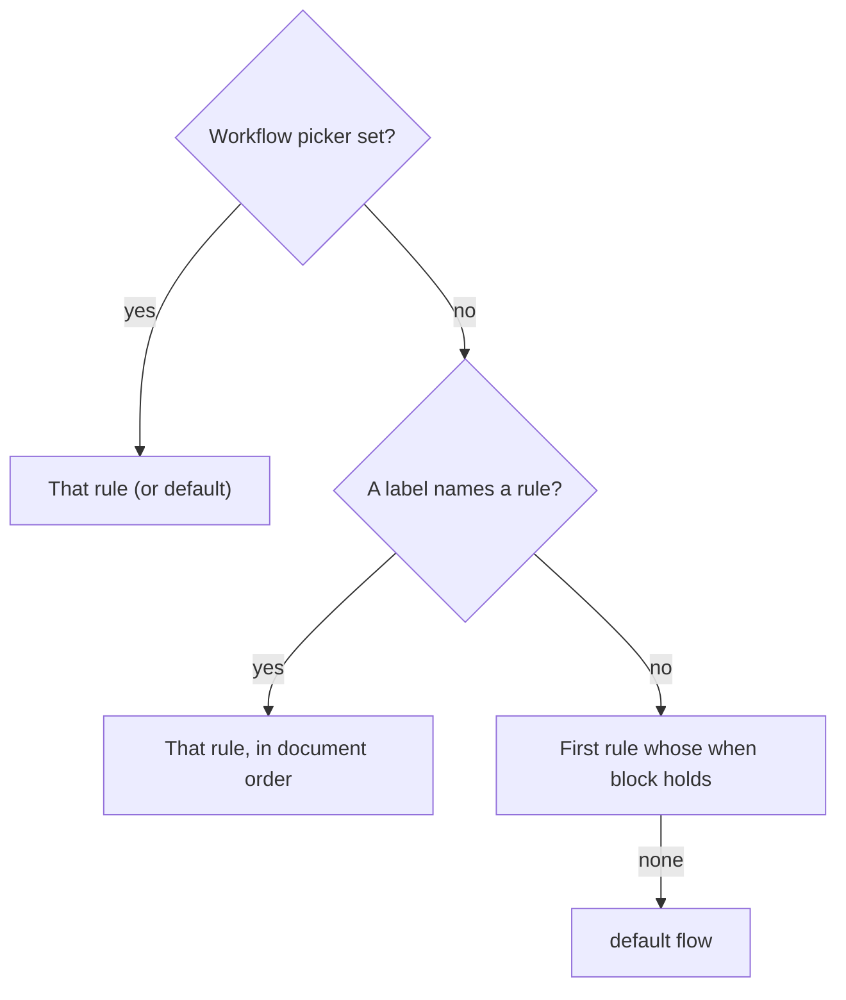
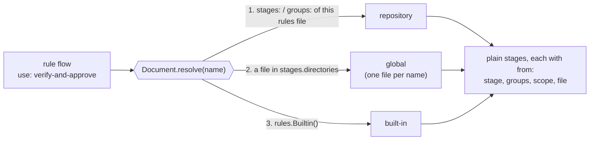
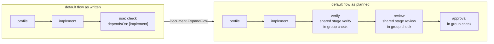
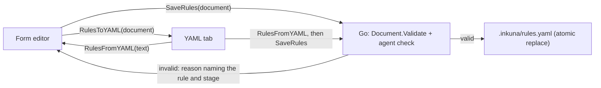
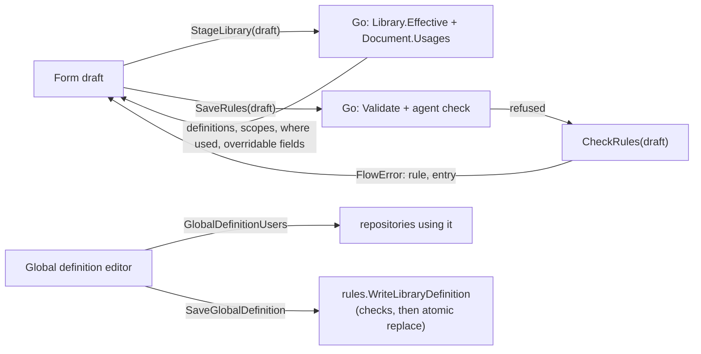
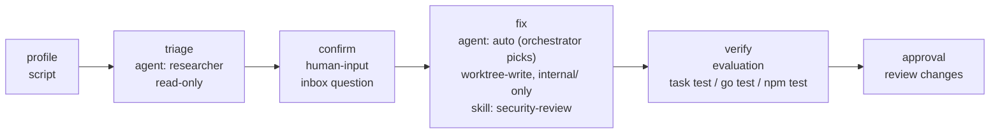

# Rules engine

Rules decide the flow a task goes through. They are declarative YAML in `.inkuna/rules.yaml` at the root of a repository. Rules never run code: they produce the workflow DAG, which the orchestrator staffs and the user approves.

## Document structure

```yaml
version: 1
rules:
  - name: security-hotfix
    description: Security bugs get a human check before the fix lands.
    when:
      kind: [bugfix]
      labels: [security, cve]
    then:
      stages:
        - id: profile
          kind: script
        - id: triage
          kind: agent
          agent: researcher
          permission: read-only
          dependsOn: [profile]
        - id: confirm
          kind: human-input
          prompt: "Confirm the proposed remediation before code changes."
          dependsOn: [triage]
        - id: fix
          kind: agent
          agent: auto
          permission: worktree-write
          allowedPaths: [internal/]
          skills: [security-review]
          dependsOn: [confirm]
        - id: verify
          kind: evaluation
          dependsOn: [fix]
        - id: approval
          kind: approval
          dependsOn: [verify]
default:
  stages:
    - id: profile
      kind: script
    - id: worker
      kind: agent
      agent: auto
      dependsOn: [profile]
    - id: verify
      kind: evaluation
      dependsOn: [worker]
    - id: approval
      kind: approval
      dependsOn: [verify]
```

Unknown keys are rejected. `version` is `1`, or `2` for a file with shared stages and groups ([Shared stages and groups](#shared-stages-and-groups)). `default` is optional in the file; when omitted the built-in default flow is used. `rules` is optional too: a file with only `default` sends every task through that flow.

## Matching

Rules are evaluated in order and the **first** rule whose `when` block fully matches wins. If none matches, `default` applies. Within a condition, every listed field must hold; within a list, any entry matching is enough. Labels, sources, keywords, and repository names compare without case; `kind` is written in lower case, as the table lists it.

Two things take precedence over condition matching:

1. **The user's choice.** The composer's **Workflow** picker, and the same picker on the workflow screen, name a rule (or `default`) outright; the plan is built from that rule's stages and notes that the user chose it and which rule would have matched. Re-planning from the workflow screen sends the same request under the new rule.
2. **A label naming a rule.** A task label equal to a rule's name (ignoring case) selects that rule, so a request or imported issue labelled `bugfix` goes through the built-in bugfix flow even though its kind is `implementation`. Rules are checked in document order, so a task carrying two rule names gets the earlier one; the label `default` selects the fallback flow. The plan notes that a label selected the rule. A label that names no rule only takes part in `labels` conditions.



| Field | Matches when |
| --- | --- |
| `kind` | The task kind is in the list (`research`, `bugfix`, `implementation`, `review`, `documentation`, `skill-authoring`). |
| `labels` | Any task label (from the request or the imported issue) is in the list. |
| `source` | The task source kind (`request`, `github`, `linear`) is in the list. |
| `keywords` | The objective or an acceptance criterion contains any keyword. |
| `repositories` | The repository path or its base name is in the list. |
| `complexity` | `{min, max}` within 1 to 10; compared against the task's deterministic initial score (task kind plus scope signals), since rules match before the orchestrator scores each stage for its own work. |
| `minPriority` | Task priority is at least this value. |

Validate a file with:

```sh
go run ./cmd/inkunactl rules validate .inkuna/rules.yaml
go run ./cmd/inkunactl rules show /path/to/repository
go run ./cmd/inkunactl rules show --expanded /path/to/repository
```

`--expanded` prints every flow as planning sees it, with its shared stages and groups resolved into plain stages.

## Stages

Each stage becomes one workflow step.

| Field | Meaning |
| --- | --- |
| `id` | Unique within the flow. |
| `title` | Optional; a default title is derived from the kind. |
| `kind` | `script`, `agent`, `evaluation`, `human-input`, or `approval`. |
| `dependsOn` | Stage ids declared **earlier** in the list. |
| `optional` | Recorded in step metadata for the UI. |
| `continueOnFailure` | `evaluation` stages only: run the remaining commands after one fails. The stage still fails, once every command has run. Without it the stage stops at the first failure and lists the rest as skipped. |
| `review` | `approval` stages only: `true` makes the stage a review gate, which pauses the run for a person to approve or request changes. |
| `onFailure` | `evaluation` stages only: `fail`, the default, or `feedback`, which sends the failed commands back to the feedback target as a new round instead of failing the run. |
| `feedback.target` | `approval` stages, and `evaluation` stages with `onFailure: feedback`: the agent stage feedback goes to. It must be upstream of the stage and writable. When left out, it is the nearest writable agent stage upstream: the one with the fewest dependency steps between them, the earliest in the flow when several are as near. |
| `feedback.maxRounds` | `evaluation` stages with `onFailure: feedback`: how many automatic rounds the stage's failures may start since a person last sent the run back, from 1 to 5; 2 when left out. |
| `feedback.systemExitCodes` | `evaluation` stages with `onFailure: feedback`: exit codes with which the stage's checks say their environment broke, not the code, such as `[3]`, each from 1 to 255. On a stage that lists any, a check that exits with one, could not start, or was stopped by a signal pauses the run for you instead of starting a round. Left out, every failure goes back as before. |

How they run ([feedback-loop.md](feedback-loop.md)):

- **A review gate** pauses the run once the work it depends on is done, for the person to approve it or send it back from the run detail or Messages.
- **A check loop.** When a stage with `onFailure: feedback` fails, each of its failed commands goes back to `feedback.target` as a feedback item from `check`: the command, how it ended (its exit code, or why it could not run), and the last 4 KiB of its log, from a line start and without colours. The full log stays the check's. The target and everything after it run again in the next round, while the run keeps running. The step's timeline says which round the failure started and how many of the stage's automatic rounds that makes.
- **The cap.** A failure that would start more than `feedback.maxRounds` automatic rounds for its stage, counted since a person last sent the run back, fails the run, with an error naming the stage and its cap. Rounds a person starts never count. When several opt-in stages fail together, their failures go back in one round, which counts once for each of them, and any one over its cap fails the run.
- **A failure only a person can fix.** On a stage with `feedback.systemExitCodes`, a check that exits with a listed code, could not start, or was stopped by a signal is a system failure: a database that is down, a missing tool, an expired sign-in. A round with one pauses the run in Messages instead of starting a round, showing each such check's command, how it ended, and the end of its log; the stage's other failed checks wait with it, since the broken environment may have caused them too. **Re-run checks** runs the failed stages' commands again against the worktree as it is, so a script fixed on the branch takes effect, in a round that sends nothing back; **Send to the writer** sends every failure back as a code failure; **Fail the run** fails it. A pause and a re-run are never automatic rounds and never count toward `feedback.maxRounds`.
- **A failure in a stage that did not opt in** fails the run as before, even beside one that did.

```yaml
- id: verify
  kind: evaluation
  dependsOn: [implement]
  onFailure: feedback
  feedback:
    target: implement
    maxRounds: 2
    # Checks exit 3 when the environment broke, not the code.
    systemExitCodes: [3]
- id: approval
  kind: approval
  dependsOn: [verify]
  review: true
```

Stage kinds:

- `script`: profiles the repository (root, branch, HEAD, languages, manifests). Its `commands` pass validation and the form edits them, but they are not run.
- `agent`: runs an agent. `agent` is a definition name or `auto` (orchestrator chooses). `permission` is `read-only` or `worktree-write`; when blank, research and review tasks are read-only and everything else is `worktree-write`. `allowedPaths` (default `.`) is advisory: it is passed to the worker as guidance and checked at approval, but the CLI sandbox covers the whole worktree, so it is not an enforced write boundary. `skills` names Inkuna skills the step must receive. `mcp` names MCP servers `inkuna.yaml` declares ([configuration.md](configuration.md#mcp-servers)) that the step is given besides its agent's; a name the machine does not declare is a planning error, as is naming servers on a stage a remote advisor or an argument-template runtime serves ([architecture.md](architecture.md#mcp-servers-a-step-is-granted)). `tracker` lists the kinds of tracker change (`status`, `comment`, `edit`, `create`) the step may ask for in its handoff besides its agent's; the step gets those the repository's `.inkuna/tracker.yaml` allows, as this machine's `inkuna.yaml` narrows it, and a step that gets any needs a review gate after it, directly or through other stages, where its changes are shown before they are made, or the task does not plan ([mcp-and-trackers.md](mcp-and-trackers.md#the-grant-and-gos-checks)). `runtime` pins a runtime. `prompt` (the rules editor's "Extra instructions") says what this stage does: the worker gets it, under the stage's `title`, right after the task's objective, as instructions from the repository's rules that narrow the objective to this step ([agents.md](agents.md#what-a-worker-receives)), so two stages with the same agent can do different work. A remote advisor gets it as the question to answer (see below). `commands` lists the exact command lines the worker may run without asking (for example `[go, test, ./...]`); anything else it is refused becomes a permission request in the inbox, approved for that run only ([architecture.md](architecture.md#trust-boundaries)).
- `evaluation`: runs deterministic verification. `commands` overrides the auto-detected commands (Taskfile, `go test`, `npm test`). Each command runs with what a worker is started with, not Inkuna's whole environment: the non-secret baseline (path, home, locale, temp directories, TLS and proxy settings) and the secrets declared in `inkuna.yaml`, plus `INKUNA_HUMAN_INPUTS`, the path of a JSON file holding the answers to the `human-input` stages the evaluation depends on, directly or through other stages, in this run, ordered by when each was answered, oldest first, and `[]` when none is upstream. For example: `[{"stageId": "approver", "prompt": "Who approves this docs change?", "answer": "Ada Lovelace", "answeredAt": "2026-10-17T21:48:13.635949Z"}]`. Inkuna writes the file from its own record of the inbox, read-only, in the run's data directory (`<dataDir>/runs/<run>/human-inputs/`, an absolute path), outside every worktree. It writes the file again before each command, so one command cannot change what the next one reads. A check can therefore compare a change against what the user approved rather than against what an agent wrote about it. For example, a docs check can require each changed doc's `author` to be the name the user gave when asked who approves the change. A failed check's log goes back to the writer, so a variable in your shell, such as an API key, never reaches a check unless `inkuna.yaml` declares it; a check that needs another variable, such as a database URL, gets it declared as a secret. The log hides the declared secrets' values, and those of the variables in Inkuna's environment whose names look like credentials (with `KEY`, `TOKEN`, `SECRET`, `PASSWORD`, or `AUTH`, for example), in case a check reads one from elsewhere.

  Each command is also a **check**, shown in the run's Changes tab under Checks. When the stage starts, every command is recorded as queued; each then runs, passes, fails (with its exit code, or why it could not start), or is cancelled with the run, and a command the stage never reached is skipped. The command also gets `FORCE_COLOR=1` and `CLICOLOR_FORCE=1`, so tools that switch colours off without a terminal keep them for the log. Its stdout and stderr together are kept as a `check` artifact. They are redacted first: the value of every declared secret wherever it falls, even across lines or across the cut of a very long line, and, line by line, the value after any credential-like key (the runtime's redaction). Nothing is left out until the log is over `checks.logBytes` (1 MB by default, [configuration.md](configuration.md)); then it keeps the first quarter and the last three quarters, since a failure's summary comes last, with a marker saying how much was left out between them, and a single line longer than the first quarter still keeps its beginning. While a command runs, its log so far can be read and grows in the view. A failed check's error event and the step's error carry the last 1 KB of its log; the whole kept log is the check's. A run's header and its card in the task list count the checks of each evaluation step's latest attempt, as "k of N checks passed".
- `human-input`: pauses until the user answers `prompt` in the inbox. The answer is delivered to dependent agent steps as a decision, and to `evaluation` stages downstream of it in the `INKUNA_HUMAN_INPUTS` file.
- `approval`: the end of the flow. Without `review` it records the approval the plan already had ("Approval recorded"); with `review: true` it is a review gate that pauses the run for a person (see `review` above).

Constraints enforced on load:

- every rule has a unique name, its `kind` values are known task kinds, and its `complexity` range sits inside 1 to 10;
- at least one stage, and the **last** stage must be `approval`;
- `agent` stages need an agent name or `auto`;
- `human-input` stages need a prompt;
- dependencies must point at earlier stages;
- permission and runtime values must be valid;
- `review` only on approval stages, `onFailure` only on evaluation stages, and `feedback` only on approval stages and on evaluation stages with `onFailure: feedback`;
- `mcp` and `tracker` only on agent stages, every `mcp` name a well-formed server name, and `tracker` lists only `status`, `comment`, `edit`, and `create`;
- `continueOnFailure` and `feedback.maxRounds` only on evaluation stages, and `feedback` on an evaluation stage only with `onFailure: feedback`;
- a named `feedback.target` exists, is upstream of the stage, is an agent stage, and is not `read-only`; `feedback.maxRounds` is from 1 to 5; `feedback.systemExitCodes` lists codes from 1 to 255, none twice, and only on evaluation stages;
- every command is an argv array that runs without a shell (`agentruntime.CheckCommand`): it names a program, its program is not a whole command line in one argument (`["go test ./..."]`), it does not run a shell (`sh`, `bash`, `zsh`, `cmd`, `pwsh`, and the like, as the program or handed a command line after a wrapper such as `env` or `timeout`; run a script as `./script.sh` instead), and no argument is one of the flags that turn a CLI's permission checks off, the same list runtime declarations are held to ([configuration.md](configuration.md#declaring-runtimes)). An agent stage's commands also need every argument to be one plain word (`agentruntime.CheckAllowedCommand`), since the worker is allowed each as one exact command line: no spaces, quotes, or shell characters such as `* | ; & $`.

A stage that leaves `permission` blank is read-only for research and review tasks, so whether a feedback target can write is settled when a task is planned (`Flow.Workflow`), which also names the default target. A named target that the task makes read-only is a planning error. With no target named and no writable agent stage upstream, a review gate still pauses but can only be approved, and the plan says so in a note; a check loop with nowhere to send its failures is a planning error. A rule that uses none of these fields plans exactly as before.

A stage can name a remote advisor connected in the Agents view, as long as the stage is `read-only`; on a `worktree-write` stage it is a planning error, and the rules editor refuses the save. The stage's `prompt` is sent to the advisor as the question to answer; its `skills` and `runtime` are not used. Naming a remote agent is the only way one is used unless it is marked for automatic staffing.

A stage may narrow an agent's permission (a `worktree-write` agent on a `read-only` stage) but never widen it: naming a read-only agent on a `worktree-write` stage is a planning error, and the rules editor refuses to save a stage that says `worktree-write` and names one.

## Shared stages and groups

Version 2 of the file adds two sections, so a stage, or a run of stages wired among themselves, is written once and used from any flow in the file:

```yaml
version: 2
stages:
  verify:
    kind: evaluation
    commands:
      - [task, deps]
      - [task, ci]
  review:
    title: Review the change
    kind: agent
    agent: reviewer
    permission: read-only
    skills: [conventions]
groups:
  check:
    stages:
      - use: verify
      - use: review
        dependsOn: [verify]
      - id: approval
        kind: approval
        dependsOn: [review]
rules:
  - name: docs
    when:
      kind: [documentation]
    then:
      stages:
        - id: write
          kind: agent
          agent: documenter
        - use: verify
          dependsOn: [write]
          commands:
            - [go, test, ./internal/docs/...]
        - id: approval
          kind: approval
          dependsOn: [verify]
default:
  stages:
    - id: profile
      kind: script
    - id: implement
      kind: agent
      agent: auto
      dependsOn: [profile]
    - use: check
      dependsOn: [implement]
```

- **`stages`** maps a name to a stage, written as an inline stage is but without `id`, since its name is its id, or `dependsOn`, since each use wires it in. A shared stage is a complete stage on its own: it passes the same checks as an inline stage, whether or not a flow uses it yet.
- **`groups`** maps a name to `stages`, a list of entries written as a flow's are: inline stages, uses of shared stages, and uses of other groups. Their `dependsOn` name only entries of the group, which need not end with an approval; the flow it is used in must.
- **A use** is a flow or group entry written `use: <name>` instead of as a stage:
  - `id` is the stage id it gives, the name when left out, so two uses of one stage in a flow need an `id` on at least one;
  - `dependsOn` wires it into the flow it is in;
  - on a use of a shared stage, a stage field overrides the definition for that use only. The override replaces the field whole, so a list is not merged, and one written as `false` or `[]` still overrides. `kind` is always the definition's. A use of a group takes only `id` and `dependsOn`.

| Override | Applies to |
| --- | --- |
| `title`, `optional` | every kind |
| `agent`, `prompt` | `agent` and `human-input` stages |
| `runtime`, `permission`, `skills`, `allowedPaths`, `mcp`, `tracker` | `agent` stages |
| `commands` | `agent` and `evaluation` stages |
| `continueOnFailure`, `onFailure` | `evaluation` stages |
| `review` | `approval` stages |
| `feedback` | `approval` and `evaluation` stages |

### Where definitions come from

A use's name is looked up in three scopes, and the highest that defines it wins: **builtin < global < repository**, by name, the same precedence agents use. A stage and a group share one namespace, so a group named `verify` replaces a stage named `verify` from a lower scope.

- **Built-in** (`rules.Builtin()`): the stages `profile` (a `script` stage), `verify` (an `evaluation` stage), and `approval` (an `approval` stage), and the group `verify-and-approve`, which is `use: verify` followed by `use: approval` that depends on it. The built-in rules use them (see [Built-in default rules](#built-in-default-rules)).
- **Global**: library files in the directories `stages.directories` in `inkuna.yaml` declares, `<data dir>/stages` by default ([configuration.md](configuration.md#inkunayaml-reference)). They are shared by every registered repository. Each `*.yaml` file directly in a directory is one library file, read as strictly as a rules file, with `version: 2`, `stages:`, and `groups:`, and nothing else:

  ```yaml
  version: 2
  stages:
    verify:
      kind: evaluation
      commands:
        - [task, ci]
  groups:
    review-gate:
      stages:
        - use: verify
        - id: approval
          kind: approval
          review: true
          dependsOn: [verify]
  ```

- **Repository**: the `stages:` and `groups:` of the repository's own rules file, which override a global or built-in definition for that repository's flows only.

Names resolve late, from wherever they are used. A repository that defines `verify` gets its own `verify` inside the built-in `verify-and-approve` group, too, and another repository keeps the global or built-in one. A group can therefore not use the definition it overrides: a repository group `verify-and-approve` that uses `verify-and-approve` uses itself.



Two global files that define one name are a configuration problem, and since which one was meant is unknown, a use of the name resolves to neither, even when a built-in definition has it; a repository's own definition still settles it. The global library is read again for every plan, approval, and rules edit, so an edit to a file applies without a restart. A library file that does not parse adds nothing, and the files beside it still load. Its mistakes, a definition that fails the checks a rules file's own would, and a duplicate name are each reported with the file, in Settings under **Stage library** and by `inkunactl stages list`, and never block saving the configuration. A group that uses a name the library does not resolve is reported too, but stays usable, since a repository may define that name for its own flows: a repository whose rules define it plans with the group, and a plan in one that does not is refused. A plan that uses a broken definition is refused, naming the rule, the reference, and the library file.

Rules, shared stages, and groups can also come from the catalog. `inkunactl catalog add NAME [REPOSITORY]` adds a rule first in the repository's rules file, or a shared stage or group under its `stages:` or `groups:`, with the agents and definitions it needs that the repository lacks. With `--global` it writes a shared stage or group as a library file of its own in the first stage directory. A rule added to a repository without a rules file is written with the built-in rules, so the repository keeps the flows it had, and nothing already there is overwritten ([inkuna-directory.md](inkuna-directory.md#the-catalog)).

`inkunactl stages list [REPOSITORY]` prints every definition with its `scope` and `file`, marks each one a higher scope replaces as `overridden` and each name two global files define as `ambiguous`, and lists the library's problems. With a repository it includes that repository's own definitions; when that repository's rules do not load, often because they use a broken or ambiguous library name, the reason is one more problem, naming the rules file, and the library is still listed.

### Changes between planning and approval

A plan records a digest of every shared stage and group its rule used, through its groups, in whichever scope each resolved (`stageDigests`). The digest covers what the definition says, not where it is written, so moving it to another file keeps it. Approval reads the definitions again and refuses the plan when one has changed: edited, removed, or now resolving to another definition because a higher scope defines the name since. The refusal names it, "shared stage "verify" in /Users/me/stages/checks.yaml changed after the plan was made, so the plan no longer shows what it would run; plan the task again", as approval refuses a plan whose MCP servers or routing policy changed (`StartWorkflow`, [architecture.md](architecture.md#trust-boundaries)). A rerun is not held to them: it starts from a plan that was already approved, and that plan keeps the expansion it was approved with.

### Expansion

Go expands uses as rules load: `Document.Match` and `Document.Named` hand the planner flows of plain stages (`Document.ExpandFlow`), so planning, the orchestrator, and the engine never see a use. Every expanded stage then passes exactly the checks an inline stage does (`Flow.Validate`). A use can express nothing an inline stage cannot: expansion adds no permission, command, or agent that the definition or the use does not state.

A used group's stages take the use's place in the flow:

- the use's `dependsOn` goes on the group's entry stages, the ones that depend on nothing in the group;
- a later `dependsOn` on the use's id waits for the group's exit stages, the ones nothing else in the group depends on. A later stage may also name one of the group's stages by its id;
- a stage keeps its own id unless the id is not unique in the flow, because another entry gives it, another group brings it, or it is a use's id. It then takes its use's id as a prefix: `<use id>.<stage id>`. Used twice, with `id: api` and `id: ui`, the `check` group above gives `api.verify`, `api.review`, and `api.approval`, then `ui.verify`, `ui.review`, and `ui.approval`;
- a `feedback.target` naming a stage of the group follows that stage when it is prefixed. One naming no stage of the group names a stage of the flow.

Groups nest. A group's use of another group expands the same way inside it, and its stages are prefixed again only where the outer flow needs it. The default flow above plans as:



`implement` is the use's `dependsOn`, so it goes on `verify`, the only stage of `check` that depends on nothing in it. A stage after the use with `dependsOn: [check]` would wait for `approval`, the only stage nothing in the group depends on.

Each expanded stage records where it came from, as `from` in `rules show --expanded`: the shared stage it used, the groups it came through, outermost first, the `scope` the definition lives in (`builtin`, `global`, or `repository`: this file), the library `file` of a global one, and the fields the use overrode. Planning carries it onto each step of the plan (`WorkflowStep.From`), with the rules file as the `file` of the repository's own, and the plan keeps it, so the approval screen and the run show where every step came from as it was planned, whatever the library says since ([architecture.md](architecture.md#trust-boundaries)). The plan's notes say when one of the repository's own definitions replaces a global or built-in one: "Shared stage "verify" is this repository's own, which replaces the global one in /Users/me/stages/checks.yaml."

The approval screen and a run's steps show the same origin as a badge, `shared: <outermost group or stage> (<scope>)` (`originLabel` in `frontend/src/views/origin.ts`). It opens on the definitions the step came through, the file each lives in, and the fields its use overrode (`StepOrigin.tsx`).

### Reference errors

A file Go refuses for a reference says which rule, entry, and reference:

- a use of a name no shared stage or group has: `rule "docs": entry 2 (use "verfy"): no shared stage or group is named "verfy"`. Inside a global group, the group and its file are named: `rule "docs": group "review-gate" in /Users/me/stages/gates.yaml: entry 1 (use "lint"): no shared stage or group is named "lint"`;
- a use of a name two global library files define: `entry 1 (use "verify"): "verify" is defined in more than one global stage library file (/a/stages/a.yaml, /b/stages/b.yaml); remove all but one`;
- a group that uses itself, directly or through other groups: `group "a" uses itself: a → b → a`;
- two entries that give one id: `rule "docs": entry 2 (use "verify") and entry 3 (use "verify") both give the id "verify"; set id on one of them`;
- an override the stage's kind does not have, such as `entry 2 (use "verify"): overrides agent, which an evaluation stage does not have`; also a `kind` on a use, and any stage field on a use of a group;
- a `dependsOn` that names nothing earlier. In a group: `group "check": entry 2 (use "review") depends on "nothing", which is not an earlier entry of the group`. In a flow: `rule "docs": stage "verify" (from shared stage "verify") depends on "nothing" which must be declared earlier`;
- an expanded stage that fails a stage check, named with the use it came from, and the file of a global one: `stage "review" (from shared stage "review") has invalid permission "admin"`, `stage "lint" (from shared stage "lint" in group "gate", /Users/me/stages/gates.yaml): …`;
- shared stages, groups, or uses in a `version: 1` file, a name used for both a shared stage and a group, and a shared stage that sets `id`, `dependsOn`, or `use`.

### Versions and saving

A file with shared stages, groups, or uses says `version: 2`. One without them can stay `version: 1`, and a save keeps the version a file has unless what it now uses needs 2, so a file that does not need version 2 stays readable by builds that know only version 1. The built-in rules are version 2, since they use the built-in library, so the rules the Rules view saves from them are too. A file that leaves out its default flow takes the built-in one already expanded, as plain stages, so it needs no newer version than it declares and is saved with plain stages as before; its plans still record the definitions that flow used. A build refuses a file newer than it reads by its version, "rules version 3 is newer than this build of Inkuna reads (up to 2); update Inkuna to use this file", rather than by the first key it does not know.

`rules.Marshal` and `rules.Write` write uses back as they were written, never expanded: `use`, `id`, `dependsOn`, then each field the use overrides, including one written as `false` or empty. Shared stages and groups are written in name order. As with any save, comments are not kept.

## Changing a step's access at approval

The most common reason a run fails is a step that was not allowed to do its job: a command its worker was refused, or a step that needed to write and was read-only. The approval screen fixes that for one run, without editing the rule and planning again. On an agent step it can change the `permission`, the `commands` the worker may run without asking, and, on a writable step, the `allowedPaths`; on an evaluation step it can change the `commands`. The edit belongs to the run's plan, not to the rule: the next plan from the same rule starts from the rule again, so a change wanted every time still goes in `.inkuna/rules.yaml`. The same edits fix a run that stopped: rerunning it opens the approval screen on the plan it ran under, with the fixes Go suggests from what its steps were refused made once the person ticks them, and Go holds the edits to the checks below ([feedback-loop.md](feedback-loop.md#rerunning-with-an-updated-plan-68)).

Go holds each edit to what it would hold the rule to (`planner.Restaff` with an `Access`, and `planner.EditCommands`):

- a read-only agent cannot be on a `worktree-write` step, and a remote advisor stays `read-only`; a runtime that declares no write arguments cannot run one (`planner.CheckRuntimes`);
- commands pass the checks above, an agent step's as allowed command lines and an evaluation step's as commands run directly;
- allowed paths stay inside the repository (`domain.CheckAllowedPath`), are trimmed, and default to `.` on a writable step given none, as a stage's do; a step made `read-only` keeps none;
- a step that feedback goes to stays `worktree-write`;
- in a plan where no step writes, a step can be made writable only when worktrees are off: such a plan names no branch for the run, so choose a rule with a writable stage instead.

Each change is kept on the step as `accessEdits`: the field, a note of what the plan had ("Permission set to worktree-write at approval; the plan said read-only."), and whether it widens the step. Making a step writable, adding a command, and adding a path outside every path the plan had all widen it; the approval screen marks those as giving the step more than its rule did. Removing or reordering commands and keeping paths inside the plan's are notes only. A rerun's edits are made against the plan the run was approved with, not the rule, so commands or allowed paths an earlier approval widened stay marked as widening when a rerun reorders or narrows them. The approved plan keeps them, so the run's record shows where it left its rule. See [architecture.md](architecture.md#trust-boundaries) for how `StartWorkflow` holds the approval to them.

### Saving a rerun's changes to the rule

A run's edits are its own. When the same change belongs on every run, **Save these changes to the rule…** on the rerun screen ([feedback-loop.md](feedback-loop.md#rerunning-with-an-updated-plan-68)) opens the Rules editor on the run's rule with them made, unsaved (`RerunRuleEdits`). Planning keeps on each agent and evaluation step what its stage gave it (`ruleAccess`: its permission, commands, and allowed paths), which an approval cannot change. Go rebuilds the rerun's plan from the person's edits as the rerun would run it, and makes each field of a step's access that differs from its `ruleAccess`, whether changed on the rerun screen or when the run was approved, on the stage with the step's id: its permission (a stage made read-only drops its paths), its commands, and its allowed paths (paths of `.`, the whole repository, leave the stage naming none). Only access is carried; a change of agent, runtime, or score stays the run's.

A step planned from a use of a shared stage takes its change on the use, as an override in that rule only, so the shared stage and the other flows using it keep theirs, and the change says so. A step a group brings is left out, naming the group, since a use of a group takes no overrides; change the group under **Shared stages and groups** instead.

A change is left out, with the reason, when the rule no longer has that stage, or the stage gives that field something other than it did when the run was planned: an edit made to the rule since is never undone. Making a stage read-only is left out, too, when the rule has changed the stage's allowed paths since, since a read-only stage keeps none. Go says which rule it found by its place in the document, so the editor opens that one, even a rule named `default`, which planning takes before the fallback flow. A run whose rule is gone opens nothing. A run planned before steps kept their `ruleAccess` carries only the fields its approval did not change. The editor lists what it made and what it left out above the rule, which it opens. Nothing is written until the person saves, through the same checks as any save, so a stage made writable whose named agent is read-only is refused with the reason; **Discard** drops the changes.

## Editing rules in the app

The **Rules** view edits the same file. Each rule shows as a readable card (its `when` predicates and its stage chain); **Edit** opens the form for that rule, and rules can be added, duplicated, deleted, and reordered, which matters because the first match wins. The fallback flow has the same stage editor. The **YAML** tab shows the document as Inkuna will write it and accepts hand edits.



Go is the only validator. Switching tabs, and saving, run `Document.Validate` and `Flow.Validate` (approval-terminated flows, `dependsOn` only on earlier stages, known kinds, runtimes, and permissions) and additionally reject a stage staffed with an agent the project cannot resolve, or one that says `worktree-write` and names a read-only agent. A rejected save leaves the file untouched and the edits on screen. Saving writes to the `repositories[].rules` override when `inkuna.yaml` declares one, otherwise to `.inkuna/rules.yaml`, and the next plan for the project uses it. The saved file sits uncommitted in the project checkout; that does not stop the Branches view from updating the base, which also shares the edit to origin as a pull request or a push ([branching.md](branching.md#sharing-settings-edits)). The view asks before unsaved edits are discarded by switching project or leaving the view. Approval stages have a **Pause for review** box and a **Send feedback to** list; evaluation stages choose **When a command fails**, and with **Send the failures back as feedback** a target, **Automatic rounds before the run fails**, and **Exit codes that pause the run for you**, typed as a list (`3, 75`), with a line under it saying what they do ("exit 3 pauses for you, as does a check that could not start or was stopped"). The target lists offer the earlier agent stages and the nearest writable one upstream as the default; Go decides whether the one chosen can receive feedback. Renaming a stage keeps feedback pointing at it, and removing it puts feedback back on the default target. The approval screen shows each planned gate and loop, with the target Go resolved: "pauses for review → implement", "pauses for review · approve only", or "failures → implement, up to 2 rounds", followed by "; exit 3 pauses for you" when the stage names system exit codes. Agent, script, and evaluation commands are entered one per line and stored as argv arrays; there is no shell. An agent stage's are the command lines its worker may run without asking, plain words only. An argument that is empty or contains whitespace, a double quote, or a backslash is written in double quotes with `\"` and `\\` escaped (`""` is an empty argument), so every argv value round-trips through the form.

### Shared stages and groups in the editor

The form edits uses and definitions without the YAML tab, and the YAML tab still round-trips them: switching tabs sends uses back to Go as they came, and Go writes them as they were written.

- **Shared stages and groups** lists every definition the rules can use, from `StageLibrary`: the built-in ones, the global library's, and the repository's own as they are being edited, each with its scope, its file, whether a higher scope overrides it, and the flows that use it, directly or through a group. Go works out all of it from the draft, so the list follows edits before they are saved.
  - The repository's own can be created, edited, and deleted; they are part of the rules and saved with them. A group's stages are edited with the same stage editor as a flow's.
  - A global one is edited in place and saved to its library file on its own (`SaveGlobalDefinition`, `rules.WriteLibraryDefinition`), not with the rules. The editor first lists the registered repositories whose saved rules use it, and the flows (`GlobalDefinitionUsers`), and a repository whose rules do not load, which may. Go checks the new definition as the library checks one, and refuses it when it would break another global definition, naming that one; the file's other definitions and its comments are kept. Plans made before the edit are refused at approval ([Changes between planning and approval](#changes-between-planning-and-approval)).
  - A built-in one is read-only: the editor shows it with Go's reason, and **Copy to repository** adds it to the repository's rules, where it overrides the built-in one for this repository. Go refuses an edit sent for one.
- **In a flow**, the list beside **+ Add stage** inserts a use of any definition in effect before the closing approval, with an id of its own when its name is taken. A use of a shared stage shows each field Go lets it override, from `rules.Overridable()`, with the definition's value marked *inherited* until the use sets it, which marks it *overridden*; **Reset to inherited** drops the override. A use of a group shows the group's stages and takes only an id and `dependsOn`. **Extract to shared stage** turns an inline stage into a repository shared stage, under a name no definition has, and puts a use with the same id and `dependsOn` in its place, so the flow plans as before. **Preview as planned** shows the flow as Go expands it (`ExpandRules`), each stage with where it came from.
- **Add from catalog…** beside **New shared stage** lists the catalog's shared stages and groups, and adds one to the repository's rules or, as a library file of its own, globally, as **Add rule from catalog…** does for a rule ([Adding from the catalog](#adding-from-the-catalog)).
- **A refused save** points at the entry. Go's checks record which flow and entry, as written, a mistake is in (`rules.FlowError`), or which of the repository's own definitions (`rules.DefinitionError`), and `CheckRules` returns it after a save or a switch to YAML is refused. The editor opens that flow and marks the entry with Go's reason; a mistake in an expanded stage points at the use it came from.



### Adding from the catalog

**Add rule from catalog…**, under the rules, lists the catalog's rules with their description, the task kinds their condition names, and the agents and shared stages they use (`CatalogItems`). A rule the repository's rules already have says so, naming the file, rather than offering to add it again. **Add to repository** first asks Go what the add would do, without writing anything (`PreviewCatalogItem`, `catalog.Preview`): the agents, shared stages, and groups that come with the rule because the repository lacks them, each with the file it goes to, and Go's notes, such as that a repository without a rules file gets the built-in rules written with the rule, so it keeps the flows it had, or that the rule goes first. Adding runs every check again (`AddCatalogItem`), and a refusal, such as a name already taken or rules that do not load, is shown with Go's reason. The view keeps no copy of these checks.

An add writes the rules file, so the editor refuses one to the repository while it has unsaved edits, which a later save would write over it; save or discard them first. After an add the editor reads the rules and agents again. A rule is added only to a repository, never globally; shared stages and groups can be either.

## Built-in default rules

When a repository has no `.inkuna/rules.yaml`, Inkuna uses `rules.Default()`, checked against the library like any rules file. Its `profile`, `verify`, and `approval` stages are uses of the built-in library ([Where definitions come from](#where-definitions-come-from)), so a global library that defines `verify` gives every repository without its own rules those commands:

| Rule | When | Stages |
| --- | --- | --- |
| `bugfix` | kind `bugfix` | `use: profile`, reproduce (`researcher`, read-only), fix (`auto`, worktree-write), `use: verify-and-approve` |
| `feature` | kind `implementation`, complexity 7 to 10 | `use: profile`, plan (`planner`, read-only), confirm-plan (`human-input`), implement (`auto`, worktree-write, after plan and confirm-plan), `use: verify`, review (`reviewer`, read-only, after implement and verify), `use: approval` with `review: true` and `feedback.target: implement` |
| `documentation` | kind `documentation` | `use: profile`, write (`documenter`, worktree-write), `use: verify-and-approve` |
| `read-only` | kind `research` or `review` | `use: profile`, worker (`auto`, read-only), `use: approval` |
| default | anything else, including smaller implementation tasks and skill authoring | `use: profile`, worker (`auto`), `use: verify-and-approve` |

The `feature` rule is for larger work. It matches on the deterministic initial score, and every implementation task starts at 6, so 7 takes only a task with four or more acceptance criteria or three or more constraints. A smaller task keeps the default flow unless the Workflow picker or a `feature` label chooses `feature`. Its run stops for the person twice:

- **At the plan.** `planner` returns the plan as its document. `confirm-plan` asks the person to read it, linked under **Read before answering**, and say what should change before it is implemented. Their answer reaches `implement` as a decision. This is a `human-input` stage rather than a review gate because a gate's feedback needs a writable target, and `plan` is read-only. `implement` depends on `plan` as well as `confirm-plan` because a step reads only the handoffs of the stages it depends on.
- **At review.** `reviewer` reads the change after `verify` passes, and the review gate pauses for the person to approve it or send it back to `implement`, which starts a round of `implement`, `verify`, and `review` ([feedback-loop.md](feedback-loop.md)). It is the only built-in flow with a review gate.

Fallback staffing, used when the orchestrator is unavailable, gives `implement` and every other writable `auto` stage to `implementer` ([agents.md](agents.md#built-in-agents)). `internal/planner/builtin_rules_test.go` plans every built-in rule for each kind that reaches it, with and without an orchestrator, and fails the build if one would not plan or if fallback staffing would give a writable `auto` stage to another agent. A repository with its own `rules.yaml` gets none of these rules: its file replaces them.

With the built-in library alone, the `bugfix`, `read-only`, and default flows plan exactly as they did when every stage was written inline: profile, then the agent stages, then verify and approval, with the same ids and dependencies.

## Worked example

With the `security-hotfix` rule above, a Linear issue labelled `security` of kind `bugfix` produces this DAG:



At plan time the orchestrator staffs `fix` (for example with `implementer`, complexity 7) and scores every agent stage for its own work, `triage` with `researcher` as the rule names (for example 4: it reads and traces one path), routing assigns each a model from the policy band inside the project runtime, and the approval screen shows the rule name `security-hotfix`, whether staffing was orchestrated or fell back, and the assignment rationale per step. Before approving, the user may give any agent step another agent, runtime, or score; Go rebuilds the step for that edit (see [architecture.md](architecture.md#trust-boundaries)), so choosing `documenter` for `fix` swaps in that agent's skills and pinned model while the stage's own skills and its `worktree-write` permission stay exactly as the rule wrote them. The step's permission, commands, and allowed paths change only when the user changes them too ([Changing a step's access at approval](#changing-a-steps-access-at-approval)). At run time the `confirm` stage raises an inbox item attributed to `rule:security-hotfix`; the worker in `fix` sees `Human input (Confirm the proposed remediation before code changes.): <answer>` among its decisions.
